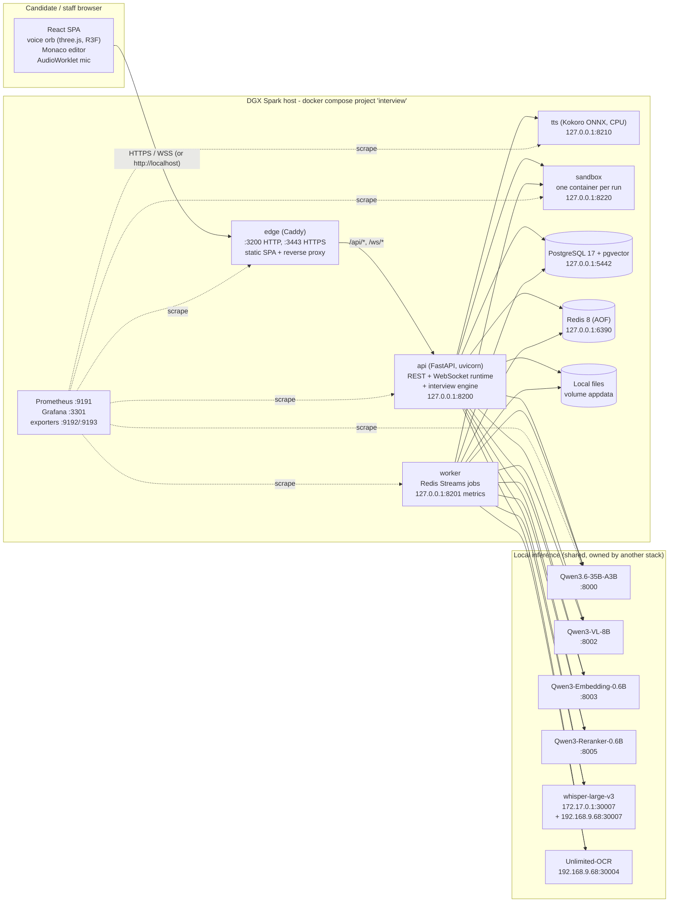
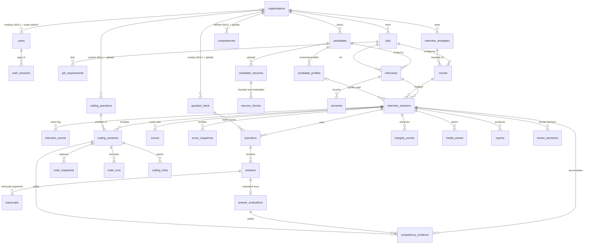
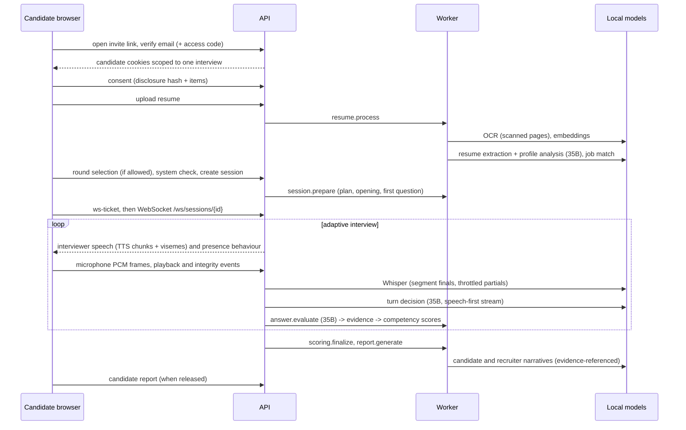
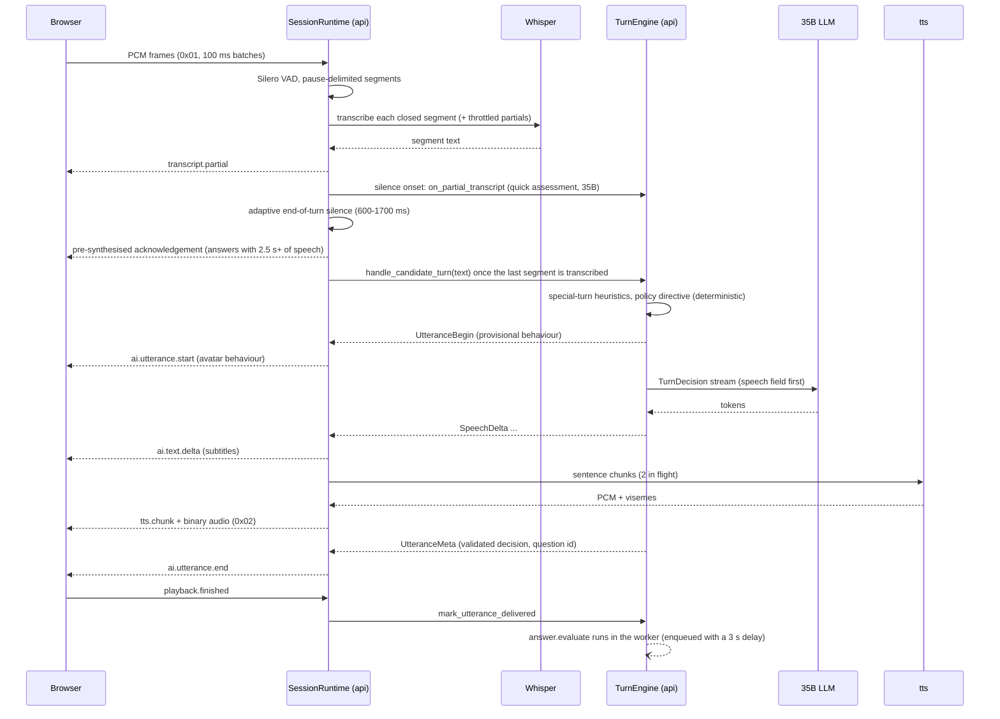

# Architecture

Written for: engineers who build, operate or extend the AI Interview Platform.

The platform runs an adaptive, voice-first interview with an animated interviewer presence rendered in the candidate's
browser. All AI runs on local inference endpoints shared with another production stack on the same host. The
design-time contracts are in [`docs/design/`](docs/README.md) (start with
[`CONTRACTS.md`](docs/design/CONTRACTS.md)); this document describes what is deployed.

## System context



## Services

| Compose service | Image | Responsibility | Network, port |
|---|---|---|---|
| `edge` | `interview-edge:local` (Caddy 2.11.7, SPA baked in) | serves the built SPA, terminates HTTP/HTTPS, proxies `/api/*` and `/ws/*`, sets CSP and other security headers, body limits, access log with token redaction | host; `:3200` and `:3443` on all interfaces |
| `api` | `interview-api:local` | REST API, auth and RBAC, candidate portal, WebSocket interview runtime (audio, VAD, STT scheduling, TTS streaming, barge-in), interview engine turn path, SSE live monitor, signed media | host; `127.0.0.1:8200` |
| `worker` | `interview-api:local` (`python -m app.worker`) | background jobs: resume processing, profiles, embeddings, session preparation, answer and coding evaluation, frame analysis, scoring, reports, interview recordings (ffmpeg remux), retention sweep | host; `127.0.0.1:8201` (`/metrics`, `/healthz`) |
| `migrate` | `interview-api:local` | one-shot `alembic upgrade head` before `api` and `worker` start | host |
| `tts` | `interview-tts:local` | Kokoro-82M text-to-speech on CPU with per-phoneme viseme timings | bridge `interview-backend`; `127.0.0.1:8210` |
| `sandbox` | `interview-sandbox:local` | runs candidate code in throwaway, network-less, resource-limited containers (`interview-sandbox-<lang>:local`) through the Docker socket | bridge; `127.0.0.1:8220` |
| `postgres` | `pgvector/pgvector:0.8.7-pg17-trixie` | system of record, vector search (HNSW) | bridge; `127.0.0.1:5442` |
| `redis` | `redis:8.8.3` | hot interview state, locks, outbox, pub/sub, job streams, rate limits, caches (AOF `everysec`, `noeviction`) | bridge; `127.0.0.1:6390` |
| `prometheus`, `grafana` | `prom/prometheus:v3.2.1`, `grafana/grafana:11.5.1` | metrics, alert rules, dashboards | host; `127.0.0.1:9191`, `127.0.0.1:3301` |
| `postgres-exporter`, `redis-exporter` | pinned community images | database and Redis metrics (incl. `jobs:*` stream lengths) | bridge; `127.0.0.1:9192`, `127.0.0.1:9193` |
| `clamav` (profile `security`) | `clamav/clamav:stable-debian13-slim` | optional malware scan of uploads (`MALWARE_SCAN_MODE`) | bridge; `127.0.0.1:3310` |
| `runtime-*` (profile `runtimes`) | `interview-sandbox-{python,node,java,go,cpp}:local` | build-only targets for the code runner images | none |

## Networking model

* **Host networking for `api`, `worker`, `migrate`, `edge`, `prometheus` and `grafana`.** The model servers of the
  other stack are bound to the host loopback (`localhost:8000`, ...) or reachable through the Docker bridge
  gateway (`172.17.0.1:30007`). With host networking the endpoint URLs in `.env` are identical inside and outside
  containers, and the API can be run on the host (`make api-dev`) without changing configuration.
* **Bridge network `interview-backend`** for stateful services and the two helper services (`postgres`, `redis`,
  `tts`, `sandbox`, exporters, `clamav`); each publishes on `127.0.0.1` only, so host-networked processes reach
  them at `127.0.0.1:<port>`.
* **Only the edge listens on non-loopback interfaces.** Browsers reach the API exclusively through the edge,
  which also blocks `/metrics`, `/api/v1/test/*` and `/__edge/metrics` for non-loopback clients.
* **One origin.** The SPA, REST API (`/api/v1`), WebSocket (`/ws/sessions/{id}`) and SSE stream
  (`/api/v1/sessions/{id}/live`) share the edge's origin, so cookies are first-party and the CSP is `'self'`.
* Everything is configured by environment variables (`apps/api/app/core/config.py`), so a Kubernetes deployment
  changes addresses, not code ([DEPLOYMENT.md](DEPLOYMENT.md#8-scaling-out)).

## Inside the API and the worker

| Process | Main components |
|---|---|
| `api` | FastAPI app with auto-discovered routers under `/api/v1` (test hooks only when `ENABLE_TEST_HOOKS=true` and not production), `/healthz`, `/readyz`, `/metrics`; the realtime router at `/ws/sessions/{session_id}`; one `SessionRuntime` per live session (audio ingest, VAD, segmentation, STT scheduling, end-of-turn, TTS streaming, outbox, bridges) driving the interview engine (`app/services/interview`) in-process |
| `worker` | queue consumer per job stream (`jobs:<type>`, consumer group, retries, dead letters, reclaim of stuck messages, recovery of `background_jobs` rows on start), a periodic scheduler (`retention.sweep` hourly, embedding backfill), metrics/health server, heartbeat key read by `/api/v1/system/health` |

Background jobs (all idempotent; the `background_jobs` row is the source of truth, Redis Streams dispatch):

| Job | Triggered by | Main model work |
|---|---|---|
| `resume.process` | resume upload (staff or candidate) | text extraction, OCR for scanned pages, chunking, embeddings |
| `profile.generate` | end of `resume.process` | resume extraction + profile analysis (35B), job match (embeddings + reranker + 35B) |
| `question_bank.embed`, `catalog.backfill_embeddings` | seed, catalog edits, worker start + hourly | embeddings |
| `session.prepare` | candidate creates the session | interview plan, opening and first question (35B), bank retrieval |
| `answer.evaluate` | each substantive answer (delayed 3 s so it does not compete with the live turn) | deep evaluation (35B) -> evidence, claims, contradictions, scores |
| `memory.summarize` | sessions with more than 12 answers | rolling summary of older turns (8B) |
| `coding.evaluate` | coding submission or time limit | coding evaluation (35B) on top of sandbox ground truth |
| `integrity.analyze_frame` | camera/screen frame upload | frame analysis (8B VL) |
| `scoring.finalize`, `report.generate` | interview end | final scores; candidate and recruiter narratives (35B) |
| `retention.sweep` | hourly | deletes expired media |
| `recording.finalize` | the browser finished a recording part, `recording.sweep` (every 2 minutes: session ended, page reloaded), staff "Process now" | none: joins the part's MediaRecorder segments and remuxes them with ffmpeg (stream copy) into one seekable file |

Session-scoped results are announced on the Redis pub/sub channel `session:{id}:bus` (`evaluation.ready`,
`coding.evaluated`, `integrity.event`, `report.ready`, ...) so the live runtime and the staff live monitor update
without polling. Details: [INTERVIEW_ENGINE.md](INTERVIEW_ENGINE.md), [AI_PIPELINE.md](AI_PIPELINE.md).

## Data stores

| Store | Holds | Durability |
|---|---|---|
| PostgreSQL (`pgdata` volume) | everything durable: organisations, users, catalog, candidates, resumes and chunks (1024-d vectors), profiles, interviews, sessions, questions, answers, evaluations, evidence, scores, coding runs, integrity events, reports, reviews, audit log, model-call ledger, job rows | system of record; `make backup-db` |
| Redis (`redisdata` volume, AOF) | hot copies and coordination only (table below) | never the only copy of anything durable; not backed up |
| Local filesystem (`appdata` volume at `/srv/interview-data/storage`, or `data/storage` on the host) | resumes, answer audio, integrity frames kept as evidence, recordings (when the policy enables them), report HTML artifacts | `make backup-storage`; files are served only through API-signed URLs |
| `caddydata` volume | the edge's internal CA and certificates | losing it only means re-trusting a new root on test devices |

Redis keys in use:

| Key | Purpose |
|---|---|
| `session:{id}:state` | hot `InterviewState` JSON (version-guarded writes; Postgres snapshot in `interview_sessions.state`) |
| `session:{id}:lock` | runtime ownership of a live session (one API instance at a time) |
| `session:{id}:outbox`, `session:{id}:seq` | sequenced server messages for replay after a reconnect |
| `session:{id}:bus` | pub/sub channel for session events |
| `session:{id}:bank`, `session:{id}:prep`, `session:{id}:memory`, `session:{id}:evals` | engine caches: candidate bank questions, speculative preparation, conversation memory, evaluation results waiting for the next decision |
| `ws:ticket:{ticket}` | single-use WebSocket tickets |
| `auth:sid:{sid}` | 30 s cache of auth-session state |
| `rl:*` | sliding-window rate limits |
| `cache:emb:*` | embedding cache |
| `integrity:*` | integrity rule windows and per-session vision state |
| `jobs:{type}`, `jobs:delayed`, `jobs:dead` | job streams (consumer group `workers`), delayed retries (sorted set), dead letters |
| `worker:heartbeat:{instance}` | worker liveness for `/api/v1/system/health` |

File layout under `STORAGE_LOCAL_ROOT` (keys are relative POSIX paths; traversal is rejected; writes are atomic
with mode 0600; each file has a `media_assets` row with `retention_until`):

```
orgs/{org_id}/resumes/{candidate_id}/{resume_id}/{safe_filename}
orgs/{org_id}/sessions/{session_id}/audio/{answer_id}.wav
orgs/{org_id}/sessions/{session_id}/frames/{camera|screen}/{timestamp}-{uuid}.jpg
orgs/{org_id}/sessions/{session_id}/{video|screen}/{segment:05d}.{webm|mp4}
orgs/{org_id}/sessions/{session_id}/reports/{type}-v{n}.html
```

## Data model

37 tables (Alembic `0001_initial`, `0002_global_catalog_uniqueness`, `0003_candidate_archive_and_list_indexes`).
Catalog rows with `organization_id` NULL are global (seeded from `samples/`); organisation rows override them.



Tables without foreign keys: `audit_logs` (every state-changing staff action and sensitive read), `model_calls`
(ledger of every model call: task, endpoint, latency, tokens, status), `background_jobs` (job state),
`system_notes`.

## Candidate journey



## One candidate turn



## Realtime connection lifecycle

The browser opens `/ws/sessions/{id}` with a single-use ticket from `POST /api/v1/portal/sessions/{id}/ws-ticket`
(Redis key `ws:ticket:{ticket}`, 60 s TTL). The first frame must be `hello` with the last sequence number the client
saw; the server replays missed events from the per-session outbox and sends a state sync. Only one API instance
owns a live session: ownership is a Redis lock (`SESSION_LOCK_TTL_SECONDS`, default 30 s) that the owning runtime
refreshes every third of the TTL, including during the disconnect grace period. Before closing an accepted socket,
the server sends an `error` message with the same code string. The client (`apps/web/src/features/realtime/client.ts`) reacts as follows:

| Code | Meaning | Client behaviour |
|---|---|---|
| 1000 | session ended normally | final, no reconnect |
| 1001, 1011, 1012 (and network drop 1006) | server shutdown, internal error, instance restart | reconnect with exponential backoff and jitter, fresh ticket, `hello.last_seq` |
| 4001 | ticket missing, used or expired | fetch a new ticket and retry once; a second 4001 is final |
| 4003 | WebSocket origin not allowed | final |
| 4004 | session not found | final |
| 4008 | no client traffic for 3 heartbeat intervals | reconnect with backoff |
| 4009 | another instance still owns the session lock | retry every few seconds for about a minute (see below) |
| 4010 | a newer connection (for example a second tab) took over | final for this tab |
| 4011 | session completed, aborted, cancelled or invite expired | final |
| 4013 | integrity policy `max_reconnects` exceeded | final; recorded as an integrity event for the reviewer |
| 4029 | rate limited | retry after a longer backoff |
| 4400 | protocol violation (no `hello`, bad version or sample rate) | final |

**Multi-instance hand-over.** When a reconnect lands on a different instance while the old runtime is still alive
(for example in its disconnect grace period), the new instance asks the old one on the session bus to hand over; the
old one releases the lock at once if it has no live connection. If an API instance dies without releasing the lock,
nobody answers the hand-over request and the reconnect is refused with 4009 until the lock expires. A candidate can
therefore wait up to `SESSION_LOCK_TTL_SECONDS` (30 s by default) before the interview resumes. A clean shutdown
(SIGTERM, `stop_grace_period: 20s`) releases the lock and closes sockets with 1012, so rolling restarts hand over
immediately. Interview state is in PostgreSQL and the event outbox in Redis, so the conversation resumes where it
stopped; speech the candidate produced while disconnected is not captured.

**Audio path budget.** Microphone PCM16 mono 16 kHz is sent in 100 ms batches (type byte `0x01`, 3.2 KB per batch,
about 256 kbit/s). TTS audio comes back as PCM16 24 kHz chunks (type byte `0x02`) with viseme timings in the matching
`tts.chunk` JSON event. Capture requests the browser's echo cancellation, noise suppression and automatic gain control
(`apps/web/src/features/realtime/audioCapture.ts`). The design depends on echo cancellation: without it the interviewer's
own voice can reach the microphone and trigger a barge-in. The welcome page tells candidates that headphones help;
the system check does not verify that the browser actually applied echo cancellation.

## Key decisions

| Decision | Rationale |
|---|---|
| PostgreSQL + pgvector as the single system of record | Relational integrity for audit and reporting plus vector search (resume evidence, question retrieval, near-duplicate prevention) in one store; filtered vector searches enable `hnsw.iterative_scan` (without it a candidate-filtered search returned 0 of 3 rows) |
| Redis for hot state, locks, streams, rate limits | Sub-millisecond access for the live loop; Postgres snapshots plus scores recomputed from evidence make Redis loss survivable |
| Local filesystem storage behind a `StorageBackend` interface | Owner requirement (no S3/MinIO for now); files are only reachable through authorised, HMAC-signed, short-lived API URLs; another backend can be added behind the same interface |
| One WebSocket per session (not WebRTC/Pipecat) for v1 | Speech recognition is a batch HTTP Whisper endpoint, TTS is our own service and the interview logic is a custom engine. A single multiplexed WebSocket (binary PCM + JSON) is simpler to secure, proxy, resume, test and observe than ICE/TURN; browsers still provide echo cancellation, noise suppression and AGC through `getUserMedia`. Pipecat would not remove the custom engine, STT scheduling or barge-in work. The transport is isolated in `app/realtime/transport.py` |
| Speech-first structured turn decisions | Guided JSON decoding emits properties in schema order, so `speech` is the first property of `TurnDecision`: TTS can start after a few tokens instead of after a 1.3-2 s metadata header. Measured: first speech character ~0.38 s after the call, speech complete ~0.95 s, while the full object takes 5-9 s on this vLLM build (whitespace padding), so the remaining fields are bounded and recovered with `json_repair` |
| Turn-critical tasks on the 35B MoE model | The 35B-A3B (3B active parameters, NVFP4) has a time to first token of 0.1-0.5 s and 45-60 tokens/s; the dense 8B VL model needed 2.4-4.8 s for a 20-token JSON on this hardware. The 8B handles vision and background classification and is the degraded fallback for turn tasks when the main circuit is open |
| Required fields in guided-decoding schemas | Guided decoding skips optional properties (the model returned every resume role without dates); schemas sent to the model mark every field required (`TurnDecision` directly, resume and question generation through wire variants that convert back) |
| Segment-level Whisper finals | Whisper runs at a real-time factor of ~0.3-0.5 on the shared GPU and each replica serves one request at a time; transcribing pause-delimited segments while the candidate talks leaves only the last short segment for end-of-turn |
| Client-side animated presence (voice orb) instead of a human avatar | The owner rejected human-like avatars (uncanny); an abstract orb cannot look "odd", is cheap on the GPU and reacts to the real audio. No GPU spent on video; the server sends semantic behaviour and visemes, the browser animates deterministically; 2D and text fallbacks keep the interview running on weak devices; the realistic 3D avatar remains an option |
| Docker-per-execution sandbox behind an HMAC-authenticated service | Candidate code never reaches the host, the API or the Docker API; containers are network-less, read-only, resource-limited and single-use |
| Integrity signals are observations for humans | No automated cheating verdicts; vision outputs can never pause or terminate an interview; only disclosed signals are recorded |
| Assistive recommendations, separate human decision | Scores and recommendations never auto-reject; the human decision is its own record (`review_decisions`) and the candidate report release can require it |

## Measured numbers (DGX Spark, shared GPU, 2026-10-07)

| Path | Measurement |
|---|---|
| Main LLM | TTFT 0.1-0.5 s, 45-60 tokens/s (thinking off) |
| First `SpeechDelta` of a turn | 559-699 ms in-process; 718-730 ms through the realtime WebSocket (first-turn outlier 2.8 s under load) |
| Whisper | 1.8 s for a 5 s clip, 4.8 s for 17 s, 14.8 s for 33 s at RTF ~0.3; up to RTF 0.56 and outliers of 11 s under load |
| Kokoro TTS (container, cache miss) | p50 506 ms (6 words), 814 ms (15 words), 1.86 s (35 words); cache hit 2.4 ms |
| End of turn -> first interviewer audio | p50 2.1 s, p95 2.6 s through the live voice loop under shared load (before the Wave C STT scheduling work: p50 4.2 s, p95 10.5 s, dominated by Whisper queueing) |
| Speech understanding | turn word error rate 0.059 (was 0.211), technical terms 12/12 (was 6/12), hesitation clips cut off 0/13 (was 5/13) |
| Embeddings / semantic search | ~60 ms per embedding call; question-bank search 105-150 ms warm |
| Code execution (p50, tests mode) | Python 278 ms, JavaScript 294 ms, TypeScript 372 ms, Java 683 ms, Go 442 ms, C++ 696 ms, SQL 319 ms (about 200 ms is container lifecycle) |
| Vision frame analysis (8B VL) | ~10.4 s per frame; 3 parallel calls ~10.7 s (batched) |
| Resume | OCR ~16-19 s per page; `profile.generate` 33-46 s with three concurrent extraction calls (was 131-187 s), 75 s for a long dense resume |
| Reports | `report.generate` ~56 s (two narrative calls in parallel) |
| Edge overhead | ~0.4 ms per REST request, ~0.04 ms per WebSocket frame |

SLO-style alert thresholds: interviewer turn latency p95 > 3 s and time to first audio p95 > 2 s
(`infra/prometheus/rules/alerts.yml`).
