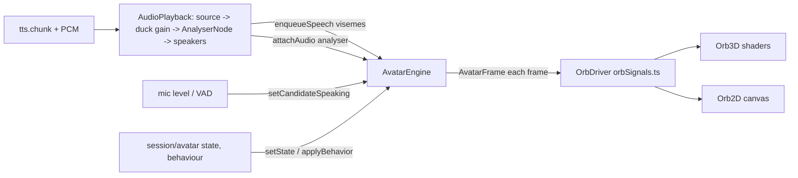

# Interviewer presence

The interviewer is shown as an animated, audio-reactive **presence orb** (default). A realistic 3D avatar
(`glb`/`vrm`) stays available as a secondary option. Everything lives in `apps/web/src/features/avatar/`
behind the unchanged `AvatarController` contract (`types.ts`, public API `index.ts`), so the interview
room, realtime runtime and E2E selectors (`data-testid="avatar-stage"`, `data-avatar-mode="3d|2d|none"`)
are the same for both.

## Selecting it

| Setting (`AvatarSettings`) | Result |
|---|---|
| `model_format="orb"`, `model_url="orb:aurora"` (default) | orb, palette aurora (teal, indigo, violet, a touch of pink) |
| `orb:sunrise` / `orb:ocean` | amber-coral-rose / cyan-blue-navy |
| unknown palette, unknown or retired format (`cartoon`) | orb aurora |
| `glb` / `vrm` with a same-origin path | optional realistic 3D avatar |
| `procedural` | built-in figure |

`resolveAvatarModel(format, url)` in `index.ts` does this mapping for the room (`useAvatarController`),
the system-check probe (`AvatarProbe`) and the admin preview. Admins choose under Settings → Interviewer
presence (three palette cards with a live preview and **Preview voice**, plus "3D avatar").

## Pipeline

## How speaking sync works

- Clock: visemes and loudness are read at the **audible time** (`lipsync/audioClock.ts`:
  `getOutputTimestamp`, else `outputLatency + baseLatency`), i.e. what the candidate hears now, not the
  scheduling clock.
- Loudness: `AmplitudeFollower` keeps a timestamped history of the analyser RMS (the analyser sits
  **after the duck gain**, so barge-in ducking shows). The orb reads the raw level at audible time +
  `LEVEL_LEAD` (30 ms: half the RMS window plus the orb's attack and one display frame).
- Articulation: target = `level × (0.72 + 0.5 × mouthOpen) − 0.4 × lipsPressed` (open vowels pulse
  bigger, p/b/m closures dip). Voice that never reaches the analyser (browser speech fallback) is driven
  by the visemes alone after 0.8 s.
- Envelope: attack 25 ms, release 140 ms inside speech, 65 ms once the audio has been quiet 50 ms.
- The voice drives scale (+7.5 %), surface wobble, inner luminance and heart, halo, flow speed; stressed
  syllables (fast rise over a slow average, ≥ 0.45 s apart) emit a faint ripple ring.

Measured on the real Kokoro fixtures (manual-clock strip, 40 ms simulated output latency): best lag
0 ms vs. heard loudness (correlation 0.82 intro / 0.68 question), pauses settle below 0.1 within 0–67 ms
of silence, no residual motion after the utterance.

## States

| State | Orb |
|---|---|
| IDLE | ±2 % breathing over ~4.2 s, slow colour drift |
| LISTENING | slightly smaller, cooler tint, gentle surface ripples from the candidate's mic level |
| ACKNOWLEDGING | warm brighten; `nod` = soft bounce |
| THINKING | faster flow twisted into a swirl, violet lean, shimmer |
| SPEAKING / QUESTIONING / ENCOURAGING | voice-driven (above), warmer; questions lift at the end |
| INTERRUPTED | fast dim and contract as the audio ducks |
| TRANSITION | colour sweep |
| CLOSING | warm glow, slow fade to rest |
| paused / offline (`dimmed`) | desaturated, slower breathing |

Expressions/gestures map to subtle variations only (warm/curious/serious tint and speed, emphasis =
bigger next ring, head tilt / question gesture = lift, goodbye = closing glow).

## Rendering and fallbacks

- `orb/Orb3D.tsx` (lazy chunk, R3F): displaced sphere (3D simplex noise, normals rebuilt), fragment
  shader with a soft-max of four noise fields over the palette, domain warp, two depth layers, fresnel
  rim, glint; premultiplied halo tinted by the palette with ripple rings. Transparent canvas over the
  stage backdrop, so light and dark stages both work.
- `orb/Orb2D.tsx`: Canvas2D twin (same `OrbDriver`, palette masses, rim, glint, rings), 30 fps; used
  without WebGL, for `renderMode: "2d"`, while the 3D chunk loads, and after a context loss.
- `orb/layout.ts`: shared framing (43 % of stage height; compact stages < 240 px use 56 % of the short
  side; `occludedCorner="bottom-right"` moves it clear of the camera tile in the coding corner).
- Reduced motion: no scale, lift, displacement or rings; brightness changes only.
- Hidden tab: rendering stops. Adaptive DPR capped at 1.75.
- The room's `PresenceLine` is now a static speaker divider; the orb is the only voice-reactive element.

Performance (GB10, headless Chromium, DPR 1.75, 1837×1032 canvas, speaking): steady 60 fps. Bundle:
`Orb3D` 16.1 kB (6.4 kB gzip), lazy, shares the existing `three` chunk; the orb needs no asset download.

## Optional realistic 3D avatar

`render/Avatar3D.tsx` + `public/avatars/interviewer.glb` (lip-sync, gestures, studio look) are unchanged
and selected with `model_format="glb"`. Dev playground: `/avatar-dev.html?model=aurora|sunrise|ocean|glb|2d|none`
(`&stage=light`, `&size=compact`, `&clock=manual&latency=0.04` for frame strips).
