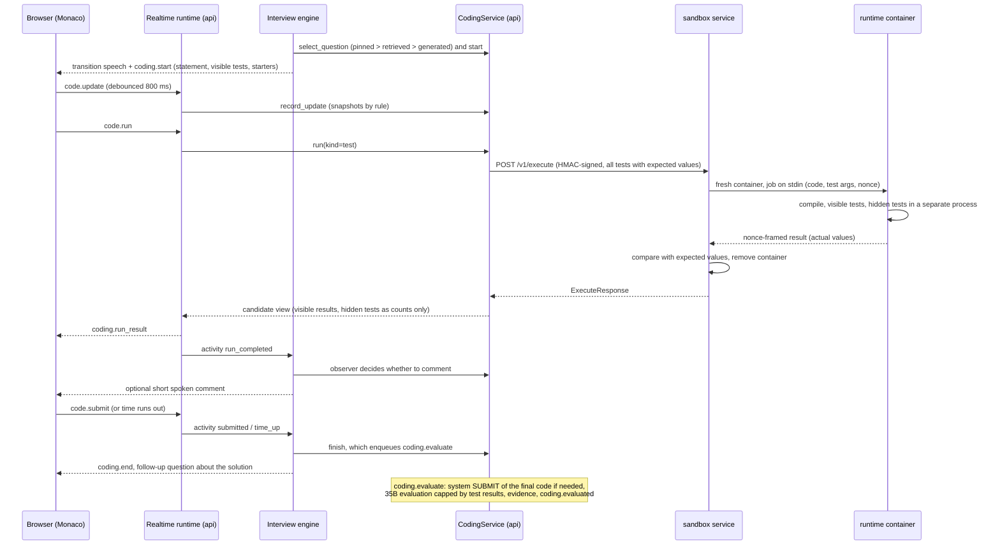

# Coding interview

Written for: engineers who add coding problems or languages, change the coding round, or review the sandbox's
isolation. Code: `apps/api/app/services/coding/` (`CodingServiceImpl`, `get_coding_service()`), the sandbox service
`services/sandbox/` (its [README](services/sandbox/README.md) has the full runner protocol), problems in
`samples/coding/`, the workspace UI in `apps/web/src/features/coding/`.

## Flow



## Languages and runtimes

| Language id | Runtime image (`interview-sandbox-<runtime>:local`) | Toolchain | Notes |
|---|---|---|---|
| `python` | python | Python 3.13 | `python3 -I -B -u` |
| `javascript` | node | Node.js 24 LTS | run with Node's `--permission` model (no child processes, no file writes) |
| `typescript` | node | Node.js 24 LTS | types stripped with `module.stripTypeScriptTypes`; **no type checking** (tsc would add ~1 s per run) |
| `java` | java | Temurin JDK 25 | javac with an AOT cache and precompiled harness (compile 0.8 s -> 0.33 s) |
| `go` | go | Go 1.27 | read-only pre-warmed build cache incl. the harness package (build 3.5 s -> 0.2 s) |
| `cpp` | cpp | GCC 14, `-std=c++17 -O2` | precompiled `<bits/stdc++.h>` + `using namespace std;` prelude and prebuilt harness object (~1.1 s -> 0.4 s) |
| `sql` | python | SQLite (stdlib) | one SELECT per submission; each test gets a fresh in-memory database |

Rounds offer the six function languages by default (`RoundConfig.coding.languages`); SQL problems are SQL-only.
Images are built with `make sandbox-images`; a runtime counts as available only when its image carries the label
`interview.sandbox.protocol="1"` (`GET /health` reports per-runtime availability).

## Problems and signatures

A problem (`samples/coding/<slug>.yaml`, or authored in the recruiter app) has a title, prompt, difficulty,
competencies, a language-neutral **signature**, tests, exactly three hints, starters and reference solutions.

* **Signature**: `{"function_name", "params": [{"name", "type"}], "return_type", "comparison", "tolerance"?}`.
  Types: `int long float bool string int[] long[] float[] string[] bool[] int[][] string[][]`. Names match
  `^[a-z][a-z0-9_]*$`, 1-6 parameters, and neither a name nor its lowerCamel form may be a reserved word in any
  supported language. `unordered` needs an array return, `float_tolerance` a float return (tolerance 0-1, default
  1e-6). Values: int is 32-bit, long within ±(2^53 - 1) (JavaScript numbers), floats finite.
* **Entry points**: Python uses `function_name` as written; every other language uses lowerCamel
  (`top_k_frequent` -> `topKFrequent`). Accepted forms: Python top-level function or `Solution` method; JavaScript
  and TypeScript top-level function (async allowed), `Solution` method or `module.exports`; Java public method of
  `class Solution` (fresh instance per test; arrays, boxed types and `List` accepted); Go top-level func (package
  rewritten to `main`, a candidate `main()` is ignored); C++ `Solution` method or free function (vectors may be taken
  by reference); SQL one `SELECT`.
* **Starters** are generated deterministically from the signature (`starters.py`) when a problem has none:

  | Signature | Python | JS / TS | Java | Go | C++ |
  |---|---|---|---|---|---|
  | `int` | `int` | `number` | `int` | `int` | `int` |
  | `long` | `int` | `number` | `long` | `int64` | `long long` |
  | `float` | `float` | `number` | `double` | `float64` | `double` |
  | `bool` | `bool` | `boolean` | `boolean` | `bool` | `bool` |
  | `string` | `str` | `string` | `String` | `string` | `string` |
  | `T[]`, `T[][]` | `list[T]`, `list[list[T]]` | `T[]`, `T[][]` | `T[]`, `T[][]` | `[]T`, `[][]T` | `vector<T>`, `vector<vector<T>>` |

* **Tests**: `{id, args, expected, hidden, description?}` (function problems) or `{id, setup_sql, expected_rows,
  ordered, hidden}` (SQL); `description` is staff-only and never sent to the sandbox. The catalog loader requires
  3-100 tests with at least 2 visible and 5 hidden, exactly 3 hints, starters for all six function languages and
  reference solutions (verified: every reference passes every test, in every language, also inside the sandbox).
  Problems created through the API need at least one visible test.
* **Comparison** happens in the sandbox service, never in the container (same semantics as `compare_results` in
  `apps/api/app/seed/loaders.py`): `exact` (deep equality; a bool never equals a number), `unordered` (multisets,
  inner arrays sorted at every nesting level), `float_tolerance` (`|a - e| <= tolerance x max(1, |e|)`); a `null`
  result for an array return counts as `[]`. SQL compares rows (not column names), numbers within 1e-6, booleans as
  1/0, in order only when `ordered` is true.
* **Statuses**, highest first: `compile_error` > `timeout` > `memory_exceeded` > `error` > `failed` > `passed`
  (plus `rejected` for well-formed requests that cannot run).

## Sandbox service

`services/sandbox` (compose service `sandbox`, `127.0.0.1:8220`) implements the contract in
`apps/api/app/services/coding/contracts.py`:

| Method and path | Auth | Purpose |
|---|---|---|
| `POST /v1/execute` | HMAC | `ExecuteRequest` -> `ExecuteResponse` |
| `GET /v1/runtimes` | HMAC (empty body) | languages, toolchains, entry conventions, limits |
| `GET /health` | none | Docker reachability and runtime image availability |
| `GET /metrics` | none | `interview_sandbox_*` metrics |

* Request: language, code (<= 200,000 characters), mode `tests` or `run`, stdin, up to 100 tests,
  `time_limit_ms` (default 5000, 500-20000, per execution), `compile_time_limit_ms` (15000), `memory_limit_mb` (256,
  64-1024). Response: status, stdout/stderr/compile output (64 KiB per stream, head and tail), per-test results
  (`actual` previewed above 8 KiB, `expected`, `error`, `runtime_ms`, `hidden`), passed/total and timing metadata.
* **Authentication**: `X-Sandbox-Timestamp` (unix seconds) and
  `X-Sandbox-Signature = hex(HMAC-SHA256(SANDBOX_SHARED_SECRET, f"{timestamp}.{raw_body}"))`; requests more than
  60 s off in either direction are rejected and each signature is accepted once (in-memory replay cache). Order of
  checks: body > 4 MiB -> 413; auth -> 401; schema -> 422; capacity -> 503 (`queue_full`, `queue_timeout`,
  `runtime_unavailable`, `docker_error`, with `Retry-After`).
* Concurrency: `SANDBOX_MAX_CONCURRENCY` executions (default 4), up to 64 queued for at most 15 s each.

## Isolation

Every execution gets one fresh container from the language's runtime image; candidate code never runs on the host,
in the API or in the sandbox service container.

| Control | Setting |
|---|---|
| Network | `network_mode=none`, network disabled (loopback only) |
| Filesystem | read-only root; `/tmp` tmpfs 64 MB `nosuid,nodev`; no volumes, binds or mounts; no `/dev/shm` (`ipc_mode=none`) |
| Identity | uid/gid 10001, `cap_drop=ALL`, `no-new-privileges`, no setuid binaries, no shells in the images |
| Syscalls | Docker's default seccomp profile; optional gVisor with `SANDBOX_CONTAINER_RUNTIME=runsc` |
| Resources | memory = memory+swap (no swap), 1 CPU, `cpu_shares` 512, 64 pids, ulimits `nofile=256 fsize=32MiB core=0`, `oom_score_adj=1000` |
| Memory | per-process limit = requested memory + a runtime allowance (Python/Go 32 MB, Node 64, JVM 96, C++ 16); compiled languages get a larger container for the compiler; a watchdog on the cgroup's anonymous memory (fork-safe) kills on breach -> `memory_exceeded` |
| Time | compile and each execution step have their own wall-clock limit plus an `RLIMIT_CPU` backstop; the service kills the container at a hard deadline (`compile + steps x limit + 10 s`) |
| Output | 64 KiB per stream returned; a process is killed past 4 MiB of output; the container past 64 MiB; no logging driver |
| Processes | tini as PID 1; every step runs in its own session; all candidate processes are SIGKILLed after each step and before the result is written |
| Result integrity | the job is read from stdin before any candidate process exists; the runner is non-dumpable; the result is framed with a per-run 128-bit nonce, so output written to `/proc/1/fd/1` cannot forge a result |
| Hidden tests | run in a separate process whose stdout/stderr are discarded; expected values never enter the container |
| Environment | only `HOME`, `TMPDIR`, `LANG`, `LC_ALL` (+ toolchain variables); no secrets |
| Lifecycle | container removed after every run; a janitor removes labelled leftovers (exited > 60 s, running > 300 s) |

The sandbox service itself mounts the Docker socket (root-equivalent on the host). It starts as root only to read
the socket's group id, then drops to uid 10002 with only that group, runs with a read-only filesystem, `cap_drop:
ALL` (+ SETUID/SETGID for the drop) and `no-new-privileges`, accepts only signed requests, and request fields never
influence the image, mounts or privileges. Hardening options for production: gVisor (`SANDBOX_CONTAINER_RUNTIME`),
rootless Docker or a socket proxy (`SANDBOX_DOCKER_URL`), and a dedicated node for code execution
([DEPLOYMENT.md](DEPLOYMENT.md#7-security-checklist-for-production)).

### Attack tests

`services/sandbox/tests/integration/test_security.py` runs against a live service (`uv run pytest -m integration
tests/integration` in `services/sandbox`) and asserts:

| Test | What it proves |
|---|---|
| `test_isolation_probe` | only `lo` exists; TCP to the internet, the host LLM (172.17.0.1:8000) and the host API (127.0.0.1:8200) and DNS all fail; writes outside `/tmp/work` fail (incl. `/etc/passwd`, `/dev/shm`, `/proc/sys`); uid 10001, no capabilities, `NoNewPrivs`, seccomp on; `setuid(0)`, user namespaces, `chroot`, raw sockets and `mount` fail; pids/memory/CPU/swap limits applied; the shared secret is in no environment or command line; no Docker socket; the runner's `/proc` entries are unreadable; no shell |
| `test_infinite_loop_times_out` (5 languages), `test_sleep_past_timeout`, `test_closed_stdio_does_not_escape_the_time_limit`, `test_timeout_in_tests_mode_marks_remaining_tests` | wall-clock limits hold; a 1 s loop returns `timeout` in ~1.3 s |
| `test_fork_bomb_is_contained` (Python, C++, Go raw clone) | `timeout`/`error` within the limit, a concurrent run still passes, `/health` stays up |
| `test_memory_bomb_is_contained` (5 languages), `test_memory_bomb_in_tests_mode` | `memory_exceeded` in ~0.5 s |
| `test_huge_output_is_truncated_and_stopped`, `test_flooding_container_stdout_directly_is_cut_off` | output floods (pipe or `/proc/1/fd/1`) end in `error` within ~0.3 s, nothing leaks into the response |
| `test_disk_quota` | a 40 MB file fails (`fsize`), filling `/tmp` fails (tmpfs size) |
| `test_forged_result_frame_is_ignored` | forged frames with guessed nonces and fake result records are ignored |
| `test_killing_the_runner_only_fails_the_run`, `test_node_permission_model`, `test_concurrent_requests_queue` | runner death is contained; Node child processes and file access are denied; queueing works |
| `test_auth_is_enforced` | unsigned, bad, stale (-120 s), replayed and tampered requests get 401; a 5 MiB body gets 413 |
| `test_no_sandbox_containers_left_behind` | cleanup |

`services/sandbox/tests/integration/test_languages.py` adds hidden-test output suppression, SQL write attempts ("not authorized"),
per-test segfault isolation and rejected signatures; `test_question_bank.py` runs every reference solution and
starter in `samples/coding` through the sandbox. Unit tests (no Docker) assert the container create parameters, the
nonce protocol, untrusted-record handling and HMAC checks.

## API-side sandbox client

`app/services/coding/sandbox_client.py`:

* Timeout per call `15 + compile_s + 2 x run_s + 10 s`, never below `SANDBOX_TIMEOUT_SECONDS` (45 s); connect 3 s.
* Retries (at most 3 attempts) only on connect/pool/write errors and on 503 with `Retry-After` <= 5 s. Read timeouts
  and dropped responses are **never** retried, because the code may have run. Every attempt is signed with a fresh
  timestamp and retries use `request_id` suffixes `.r2`/`.r3`, so a resend after an accepted signature is not
  rejected as a replay.
* Circuit breaker `sandbox` (5 failures, 30 s).
* Platform faults become a run with status `error`, `sandbox_meta.platform_fault`, and the candidate message "The
  code runner is busy, please try again"; fault runs never become the final run and are ignored by the observer and
  the evaluation. Metrics: `interview_coding_executions_total{language,status}` (`sandbox_error` for faults),
  `interview_coding_execution_seconds{language}`.

## Inside the interview

* The engine starts coding when the policy directive says so ([INTERVIEW_ENGINE.md](INTERVIEW_ENGINE.md#policy-directive)):
  coding enabled in the round, enough time left, and the plan's coding point reached or enough technical evidence
  collected. `force-coding` (test hook) makes it due immediately.
* **Selection** (`selection.py`): pinned problems in order (unused, not retired, owned by the organisation or global,
  supporting a requested language); otherwise retrieval over active problems (embeddings + reranker, plus overlap
  with the round's competencies, a bonus for the exact difficulty, the nearest difficulty otherwise); otherwise a
  generated problem only when `allow_generated` is set (off by default). Language preference comes from the resume
  skill with the most years.
* **Time limit** per problem: `max(300 s, coding duration / max_problems)` from the round (default 20 minutes).
* **End**: the exercise ends on submission (any submit result), when time runs out, or when the interview closes.
  If at least 120 s remain beyond the closing reserve, the interviewer asks a follow-up about complexity, a
  trade-off or an edge case without saying whether the solution was right.
* While coding, the candidate can still talk; repeat requests and hint requests are handled, other speech gets a
  short coding-aware reply.

## Hints and the assistance factor

* Three levels (`max_hints` in the round, `hints_enabled`): level 1 a nudge, level 2 names the technique, level 3
  describes the steps. A curated hint for the level is used when present; otherwise the 35B generates one
  (`hint_generation`, 12 s budget). Generated hints containing code (a fence or code-like syntax) are rejected unless
  `hint3_may_reveal_solution` is set and the level is 3; failures use a deterministic fallback hint.
* Each hint is stored once per level (`coding_hints`) and recorded as neutral evidence (`source=hint_usage`,
  dimension `assistance`, strength 0.07) on the problem's competencies, with text such as "Requested hint 2 of 3
  (generated) on 'Two Sum' after 4m10s of coding."
* **Assistance factor** = `1 - 0.07 x hints` in scoring, counting at most 3 hints (1.0, 0.93, 0.86, 0.79). Hints make
  the coding score lower, never failing: the hint evidence itself is neutral.
* The UI shows "Hints remaining: N" (`data-testid="coding-hints-remaining"`) and each issued hint in its own panel;
  the hint is also spoken briefly.

## The AI observer

The interviewer is quiet by default during coding. `observer.py` decides on each activity whether to comment, in
priority order:

| Trigger | Condition |
|---|---|
| `candidate_speech` | the candidate asked something: always answered, ignores rate limits |
| `time_warning` | fixed text, no model: half time (exercises with more than 60 s left), 5 minutes left (exercises over 7 minutes), 1 minute left |
| `repeated_compile_errors` | 2 or more compile errors in a row |
| `run_timeout` | the latest run timed out |
| `regression` | a failing run after an earlier pass (once) |
| `tests_passed` | the first fully passing run |
| `structural_change` | the approach changed (nested loops, hash map/set, recursion, sorting, heap, binary search, stack/queue; SQL joins, subqueries, grouping, window functions, CTEs), after 6 s without typing |
| `run_error` | runtime error or memory limit |
| `persistent_failures` | runs failing for 3 minutes without a comment |
| `long_idle` | no edits for 2 minutes with more than a minute left |

Rate limits: at least `min_seconds_between_comments` (round default 75 s) between comments, never while the
candidate typed in the last 6 s (unless a run just finished), at most 6 comments per problem; with
`proactive_comments` off only answers and time warnings remain. The model call (`code_observation`, temperature 0.4,
260 tokens, 12 s) asks for at most 35 words and one question, no praise and no solutions; code-like speech is
replaced by a template and speech is clipped to 45 words. Examples: "You've chosen a nested loop here. What is the
current time complexity?" Measured 2.2-7 s per observation (median ~4 s) on the shared 35B; guidance on how to fill
the nested behaviour object caused guided-JSON whitespace runaways, so that prompt stays minimal.

## Snapshots

The editor sends `code.update` (debounced 800 ms, versioned). A snapshot (`code_snapshots`, unified diff) is stored
on the first update, on >= 3 changed lines, >= 40 changed characters, any change 20 s after the last snapshot, a
language switch, and before each run, submit or hint when the code changed. Large inserts (>= 200 characters within
2 s) increment a paste counter (sizes only, never content). An identical run (same kind, language, code and stdin)
within 1 s, or a run while another is in progress, is rejected. Staff see snapshots, runs and hints in the session's
Coding tab (replay with diffs).

## Evaluation

`coding.evaluate` (`app/workers/coding.py`, enqueued by `finish`, 3 attempts):

1. The final run is the newest non-fault submission of the final code; otherwise the job runs a **system submit** of
   the final code against all tests (stored with `sandbox_meta.system`).
2. `tests_passed` / `tests_total` come from that run (ground truth).
3. The 35B evaluates correctness, complexity, code quality, edge cases and testing approach (`CodingEvaluation`,
   150 s); the score is **capped at `3 + 7 x passed / total`**.
4. On a non-retryable error or the last attempt: a deterministic fallback (`is_fallback`, `needs_human_review`).
5. The coding session's previous `coding` evidence is replaced by the model's items plus a `correctness` item from
   the pass ratio (positive at >= 0.8, negative below 0.5); the evaluation document stores the raw score, cap, hints,
   assistance factor and adjusted score; `coding.evaluated` is published on the session bus.

Measured 6-36 s per evaluation; the prompt must ask for 3-6 evidence items or the model returns none.

## Hidden-test redaction

* Candidates never see hidden tests: `public_question` carries title, prompt, difficulty, languages, starters,
  signature and visible tests only (no reference solutions, rubric, hints or hidden tests). `candidate_test_results`
  drops hidden results entirely (no id, arguments, expected, actual, error or timing); hidden tests only count toward
  passed/total, and the UI shows "Hidden tests: X of Y passed". Error excerpts use visible tests only.
* The WebSocket path applies the same view and `sanitize_run_result` reduces any hidden entry to
  `{id, passed, hidden}` as a second line of defence. Only already-issued hints are sent.
* The sandbox returns hidden `actual`/`error` to the API for staff views (`code_runs.test_results`); staff endpoints
  (`/coding-questions/{id}`, `/sessions/{id}/coding`) show them. Candidate reports include coding counts only.

## Authoring and validating problems

| Method and path | Permission | Notes |
|---|---|---|
| `GET /api/v1/coding-questions` | `jobs:read` | list omits reference solutions |
| `POST /api/v1/coding-questions` | `question_bank:write` | missing starters are generated |
| `GET /api/v1/coding-questions/{id}` | `jobs:read` | staff view incl. hidden tests and references |
| `PATCH /api/v1/coding-questions/{id}` | `question_bank:write` | global (seeded) problems are read-only (403 `global_read_only`); copy them first |
| `POST /api/v1/coding-questions/{id}/validate?include_starters=true` | `question_bank:write` | runs every reference solution as a submit (must pass every test) and every starter as a test run (must not fail to compile); 20 per minute per user; audited |
| `GET /api/v1/sessions/{id}/coding` | `sessions:read` | coding sessions, snapshots, runs, hints; audited |

Validation of 12 executions (6 references + 6 starters) takes 2.5-2.9 s. To add a problem to the seed catalog, add
`samples/coding/<slug>.yaml` (slug permanent, `^[a-z][a-z0-9_]*$`) and run `cd apps/api && uv run pytest
tests/unit/seed` (the harness runs every reference against every test locally) and the sandbox cross-check.

## Candidate workspace

Monaco (self-hosted, workers via Vite), one buffer per language seeded from the starter and kept in
`sessionStorage`; "Run tests" (visible + hidden counts), "Submit solution" (no confirmation step, test-id contract
`coding-submit`), "Request a hint"; paste and drop blocked when the integrity policy sets `block_paste_in_coding`
(only the size is reported); results panel with status, passed/total, runtime, compiler and error output, each
visible test's input, expected and actual values. Test ids: [`docs/design/UI_TEST_IDS.md`](docs/design/UI_TEST_IDS.md#candidate-journey).

## Measured latency

p50 of 5 warm runs, client round trip, `two_sum` with 4 tests (2 visible + 2 hidden) / run mode, shared DGX Spark
at load average 7-9 (`services/sandbox/scripts/bench.py`):

| | Python | JavaScript | TypeScript | Java | Go | C++ | SQL |
|---|---|---|---|---|---|---|---|
| tests | 278 ms | 294 ms | 372 ms | 683 ms | 442 ms | 696 ms | 319 ms |
| run | 280 ms | 253 ms | 354 ms | 605 ms | 429 ms | 506 ms | 276 ms |

About 200 ms of each run is container lifecycle (create ~55 ms, start ~100 ms). The coding service adds ~20-25 ms.

## Tests

```bash
cd apps/api && uv run pytest tests/unit/coding                       # unit (mock AI)
cd apps/api && uv run pytest -m integration tests/integration/coding # incl. real sandbox tests (marker sandbox)
cd services/sandbox && uv run pytest                                  # sandbox unit tests, no Docker
cd services/sandbox && uv run pytest -m integration tests/integration # languages, attacks, question-bank cross-check
```

After editing `services/sandbox/runtimes/runner.py`, run `python services/sandbox/scripts/sync_runner.py` and
rebuild the images; build flags in the drivers must match the runtime Dockerfiles (a unit test enforces it).

## Known gaps

* TypeScript types are not checked; JavaScript `long` values above 2^53 lose precision.
* Required test counts differ by path: the catalog loader requires >= 2 visible and >= 5 hidden; the API accepts
  one visible test; generated problems need >= 2 visible and >= 3 hidden.
* Any submit result ends the exercise, including a `rejected` or platform-fault run (only an exception or the 90 s
  realtime timeout keeps it open); the evaluation then re-runs the final code.
* The coding module's stored `adjusted_score` uses `1 - 0.07 x hints` without the 3-hint cap that scoring applies.
* The engine waits at most 8 s for the observer while one observer call may take up to 12 s x 2 attempts, so slow
  comments are dropped.
* Per-test timing is wall time under a shared 1-CPU quota.
