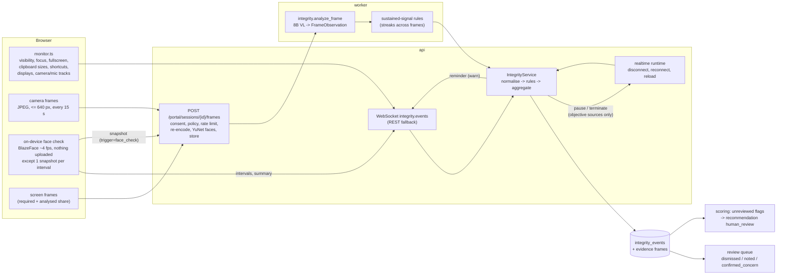

# Integrity monitoring

Written for: engineers and reviewers who change integrity signals, rules, consent text or retention, or who need to
explain to a customer what the platform does and does not detect. Code: `apps/api/app/services/integrity/`,
`apps/api/app/workers/integrity.py`, `apps/api/app/api/routers/integrity.py`, the browser monitor in
`apps/web/src/features/integrity/`, policies in `apps/api/app/schemas/policies.py`.

## Principles

1. **Observations, never verdicts.** Every signal is something the browser, camera or server noticed. Signals
   become events for a human reviewer; nothing in the platform concludes that a candidate cheated.
2. **Disclosed before recorded.** The candidate sees exactly what is monitored, recorded and retained, and must
   consent before anything is captured. What is not disclosed is not recorded.
3. **Vision never pauses or ends an interview.** Camera and screen observations come from a model that can be wrong
   (poor lighting looks like a covered camera); they can only be flagged for review.
4. **Proportionate actions.** Only objective, disclosed, configurable rules (for example stopping a required screen
   share) can pause or end an interview; everything else is logged, a gentle reminder, or a flag.
5. **Data minimisation.** No clipboard content, no keystrokes, no audio analysis for integrity; frames that do not
   become evidence are deleted right after analysis; retention is per policy.

## Two tiers

| | Tier 1: browser mode | Tier 2: Secure Interview Client |
|---|---|---|
| Status | implemented (this document) | design only ([below](#secure-interview-client-design)); no code exists |
| Runs in | any current Chrome, Edge, Firefox or Safari over HTTPS | a signed desktop application hosting the same interview room |
| Sees | page visibility, window focus, fullscreen state, in-page clipboard events (sizes), page shortcuts, extended displays (Chromium), camera/microphone track state, camera frames, optional screen share | additionally OS-level signals: foreground application category, remote-access and virtual-device software, display topology, kiosk lockdown state |
| Can enforce | nothing at OS level: fullscreen and focus are requested and observed, not enforced | optional lockdown (kiosk mode, shortcut suppression, clipboard isolation) |

## Signals (browser mode)

Sources: `browser`, `vision`, `screen`, `server` (`IntegritySource`). The server only accepts client-reportable
types from the browser; server-only and vision types are rejected if a browser sends them.

| Signal (`IntegrityEventType`) | Produced by |
|---|---|
| `tab_hidden`, `focus_lost`, `fullscreen_exited` (with the interval's `duration_ms`, reported when it closes), `fullscreen_declined` | browser monitor |
| `copy_event`, `paste_event` (sizes only: length, lines, context), `context_menu`, `prohibited_shortcut` (print, save, view source are blocked; PrintScreen and developer-tool shortcuts are observed, not prevented) | browser monitor |
| `large_paste_in_coding` (>= 200 characters or >= 8 lines in the editor) | coding workspace, also derived server-side from paste sizes |
| `multiple_displays_detected` (`screen.isExtended`, Chromium only) | browser monitor |
| `camera_disabled`, `microphone_disabled` (track ended or muted for 3 s), `camera_blocked` (luminance check) | browser monitor |
| `screen_share_started`, `screen_share_stopped`, `screen_share_not_full_screen` | screen-share manager |
| `rapid_focus_switching` (>= 5 focus/visibility signals in 60 s), `unusual_disconnect_pattern` (>= 3 disconnects in 10 minutes or more reconnects than allowed) | derived server-side |
| `disconnect`, `reconnect`, `page_reload` (a reconnect with no last sequence number after the interview started) | realtime runtime |
| `no_person_visible`, `person_left_frame`, `multiple_persons_visible`, `another_person_entered`, `possible_phone_visible`, `possible_photo_taking`, `looking_away_with_other_signals`, `camera_blocked` | vision analysis of camera frames |
| `screen_context_change` | vision analysis of screen frames |
| `face_not_visible`, `multiple_faces_visible` (intervals with `duration_ms`, start / 15 s updates / end), `static_face_ignored`, `face_check_summary` | on-device face check ([below](#on-device-face-check)); intervals double-checked by the server's face detector |
| `window_minimized` | rule exists, no client emits it today |

## Pipeline

## Rules and thresholds

Each event type has a built-in rule (`rules.py`). Resolution: defaults shaped by the policy's toggles -> the
recruiter's overrides (only the fields present) -> enforcement. A toggle that is off disables its rules and
overrides can never re-enable them. Organisation policy is merged with the job's (job fields win; job rules replace
organisation rules for the same event type) and frozen into each interview's policy snapshot.

| Event type | Severity | Action | Threshold | Escalation |
|---|---|---|---|---|
| `fullscreen_exited` | low | warn | – | flag after 3 |
| `fullscreen_declined` | low | warn | – | flag after 2 |
| `tab_hidden` | low | warn | >= 2 s | flag after 3 |
| `focus_lost` | low | warn | >= 3 s | flag after 4 |
| `window_minimized` | low | warn | >= 2 s | flag after 3 |
| `rapid_focus_switching` | medium | flag | 5 in 60 s | – |
| `multiple_displays_detected` | low | flag | – | – |
| `copy_event`, `paste_event`, `context_menu` | info | log | – | – |
| `large_paste_in_coding` | medium | flag | – | – |
| `prohibited_shortcut` | low | warn | – | flag after 3 |
| `camera_disabled`, `camera_blocked` | medium | flag if the camera is required, else log | blocked: confidence 0.6, 20 s | – |
| `microphone_disabled` | medium | warn | – | flag after 2 |
| `screen_share_stopped` | high if required, else info | **pause** if required (or **terminate** with `terminate_on_required_screen_share_stop`), else log | – | – |
| `screen_share_not_full_screen` | medium if required | warn if required, else log | – | flag after 2 |
| `page_reload` | low (medium if reloads are not allowed) | log (flag if not allowed) | – | flag after 3 |
| `disconnect`, `reconnect`, `screen_share_started` | info | log | – | – |
| `unusual_disconnect_pattern` | medium | flag | 3 in 10 minutes | – |
| `no_person_visible` / `person_left_frame` | medium | flag | confidence 0.6, 20 s / 30 s sustained | – |
| `multiple_persons_visible` | high | flag | confidence 0.75, 2 consecutive frames | – |
| `another_person_entered` | medium | flag | confidence 0.75, 2 consecutive frames | – |
| `possible_phone_visible` | medium | flag | confidence 0.6, 2 in 60 s | – |
| `possible_photo_taking` | high | flag | confidence 0.75 | – |
| `looking_away_with_other_signals` | low | flag | confidence 0.6, only with a recent strong signal | – |
| `screen_context_change` | medium | flag | confidence 0.7 | – |
| `face_not_visible` | low | warn | >= 5 s | flag at >= 30 s unless the server check contradicted it |
| `multiple_faces_visible` | medium | warn | >= 3 s | flag (severity high) once the server's face detector confirmed the snapshot, or at >= 15 s unless it contradicted it |
| `static_face_ignored`, `face_check_summary` | info | log | – | – |

Decision steps (`decide()`): disabled -> dropped; gaze without a recent strong signal -> dropped (gaze alone never
creates an event); below confidence or duration -> browser/server signals stored as `log_only`, vision signals not
stored; below the occurrence count -> stored as `log_only`; repeated warnings escalate to a flag (severity at least
medium); `warn_candidate=false` turns reminders into logs; finally enforcement by source. Browser signals without a
`duration_ms` never count as sustained. Repeats aggregate into one event per (type, source, action, streak) within
120 s (300 s for logs) under a per-session advisory lock; reviewed events are never aggregated into. Windows live in
Redis sorted sets (`integrity:*`, 1 h) and fail open. Limits: 120 signals per minute per session, late events
accepted for 10 minutes after the end, client clocks clamped to the last 15 minutes, one reminder per type per
60 s. Default reminder: "Please keep your attention on the interview window. Thank you."

Policy (`IntegrityPolicy`) defaults: monitoring on, fullscreen required, focus/clipboard/shortcut monitoring on,
paste in coding allowed, camera required with frame analysis every 15 s and evidence frames kept, screen share not
required and not analysed, candidate reminders on, page reload resume allowed, 10 reconnects.

## Vision analysis

* **Upload**: `POST /api/v1/portal/sessions/{id}/frames` (multipart `file`, `kind=camera|screen`, `captured_at`) ->
  202. Checks: consent present and not declined for that kind (403 `consent_required`), analysis enabled (403
  `frames_not_enabled`), JPEG/PNG/WebP by magic bytes (415), <= 2 MiB (413; the edge allows 4 MiB), 32-8192 px and
  <= 24 megapixels (422), session not ended (409), rate `ceil(60 / interval) x 2 + 2` per minute (camera 10, screen
  8 at the defaults; 429). Frames are re-encoded to JPEG q80 at <= 640 px, which strips EXIF.
* **Storage**: with `store_evidence_frames` the frame is stored under
  `orgs/{org}/sessions/{session}/frames/{kind}/...jpg`; otherwise it is held in Redis for 10 minutes. A stored frame
  that does not become evidence for an event is deleted right after analysis (`not_evidence`).
* **Analysis**: `integrity.analyze_frame` (concurrency `VISION_LLM_MAX_CONCURRENCY` = 4, 3 attempts); frames older
  than 180 s by server receive time are skipped and deleted. The 8B VL model (`frame_analysis`, temperature 0,
  320 tokens, 60 s) returns `FrameObservation`: person count, primary face visible, camera obstructed, image too dark,
  phone-like object (confidence, held toward the screen), additional person partially visible, primary person
  looking away (recorded, never acted on alone), short objective notes, confidence. Screen frames return
  `ScreenObservation` (active context, interview window visible, other applications, possible prohibited context
  such as an AI chat, messaging or Q&A site, a description of at most 25 words without names or content).
* **Prompt constraints** (`vision.py`), quoted: "Report only facts that are plainly visible in this single image";
  "A person in a photo, poster or on a screen is not a person"; "Never identify anyone and never describe
  appearance, clothing, age, gender, ethnicity, skin, hair, body, facial expression, emotion, attention, honesty or
  intent."; "Never speculate about cheating or behaviour. Describe the scene, not the person."; "When unsure, answer
  false and lower the confidence." `FAIRNESS_RULES` is appended.
* **Sustained signals** (`vision.py`): streaks across frames using server receive times. Absence becomes
  `no_person_visible` before a person was ever seen and `person_left_frame` afterwards; a blocked frame interrupts
  person streaks; low-confidence frames neither extend nor end a streak. At the 15 s interval, the 20 s rules need
  about 3 consecutive frames.
* Measured: ~10.4 s per frame on the shared 8B (99 output tokens at ~9.5 tokens/s); 3 concurrent calls batch in
  ~10.7 s, so one worker serves about 5 live sessions with camera analysis at the default interval. Synthetic live
  checks: empty room -> person count 0; two drawn figures -> person count 2.

## On-device face check

Code: `apps/web/src/features/integrity/face/` (browser), `apps/web/src/features/candidate/systemCheck/` (system
check), `apps/api/app/services/integrity/faces.py` (server detector and static-face tracker), fusion in `vision.py`,
intake and confirmation in `service.py`. Policy toggle `IntegrityPolicy.face_presence_check` (default on); it applies
while monitoring is on and the camera is used (`camera_required` or `camera_frame_analysis`), and needs the consent
item `face_check` (the API rejects face-check snapshots without it; the browser starts the check only with it).

* **Detector on the device.** MediaPipe Tasks Vision `FaceDetector` 0.10.17 with the BlazeFace short-range model
  (both Apache-2.0), self-hosted under `/mediapipe/` (`scripts/download_assets.sh face` pins every file's SHA-256;
  licences in `apps/web/public/mediapipe/LICENSES.md`). The library and the 9.3 MiB of WASM + model load lazily, only
  in the system check and the interview room. CPU delegate (XNNPACK), about 4 frames a second on a 320 px copy of the
  camera picture, paused while the tab is hidden or the camera track is muted/ended. The existing edge CSP
  (`script-src 'self' 'wasm-unsafe-eval'`) is enough; nothing is fetched from a CDN at runtime. Without WebAssembly
  SIMD (or on any loading error) the check reports "unsupported" and the interview continues without it.
* **What it derives per frame.** Face count, boxes, framing (centring, partly out, too close / too far), face-region
  brightness and sharpness. Head direction from keypoints is computed for context only and is never sent or used.
* **Liveness / static faces.** A face is "live" once it moves (a box move > 20% of the face width) or shows
  micro-motion inside its region (24x24 grey patch compared block by block with ~1 s earlier, above the patch's own
  noise floor, while the rest of the frame is calm; 2 hits within 3 s). A face present for 30 s without any sign of
  life is a picture (photo, poster, paused screen): it is not counted and reported once (`static_face_ignored`).
  Liveness decays after 30 s without life (no longer an extra person) but a once-live face is never set aside.
* **States (hysteresis).** `no_face`: no counted face for >= 5 s. `multiple_faces`: two or more live faces for
  >= 3 s (a face not yet seen moving never makes "more than one"). The reported duration counts from when the
  condition began; long intervals are re-reported every 15 s; an interval ends after 1.5 s without its condition. A
  detector dropout shorter than 0.75 s does not restart the clock. Framing and light tips (partly out, too close, too
  far, low light) have a 2 s / 1 s hysteresis and are candidate guidance only, never integrity events.
* **What leaves the device.** Only the aggregated observations above, through the existing integrity signal channel,
  plus a `face_check_summary` every minute and at the end (monitored time, time with one / no / several faces,
  pictures set aside). When an interval starts, one snapshot is captured immediately and uploaded through the frame
  endpoint with `trigger=face_check` and a `face_check` JSON hint (reason, interval id, duration, motionless boxes);
  at most one per reason per 10 s on the device and 6 per minute on the server. No other image leaves the device for
  this check. In the system check nothing is sent at all (`report: false`).
* **Server detector.** OpenCV YuNet (`face_detection_yunet_2023mar.onnx`, opencv_zoo, MIT; score >= 0.7, 2 threads,
  `opencv-python-headless`) runs on every received camera frame (periodic and face-check) in a worker thread and stores
  only face count, normalised boxes and scores with the frame (no landmarks, crops or embeddings). A per-session tracker
  sets aside faces whose box stays within max(2 px, 2% of the face) for 30 s over >= 3 frames; the device's motionless
  boxes are honoured only for faces the server never saw move.
* **Confirmation and fusion.** A face-check snapshot is checked right away: `confirmed` (YuNet agrees: no counted face,
  or >= 2), `not_confirmed`, or `unavailable`; the result is linked to the interval (`details.server_check`, plus
  the snapshot as evidence when confirmed). For periodic frames the vision state machine now requires: "more than one
  person" = YuNet >= 2 faces that moved, or the vision model >= 2 people (minus faces not seen moving) at confidence
  >= 0.9; "nobody visible" = YuNet 0 faces AND the vision model 0 people (without a vision observation: YuNet 0 faces
  on 2 consecutive frames; the worker's last attempt falls back to the face detection alone). Phones, screens, a
  covered camera and partial people remain vision-only.
* **Never a verdict.** Face-check types are in `NON_TERMINATING_TYPES`; at most a flag for human review. Reminders
  ("We can't see your face on camera. Please make sure you're in view and your face is lit.") follow
  `warn_candidate`. Snapshots that are not evidence are deleted right after the check; evidence follows frame
  retention.
* **System check.** A "Face visible" row (only under a consent that described the face check) and the live preview
  with the detected boxes (the candidate's face, other faces, "Picture · not counted") and one tip: "Move a little
  closer.", "Move back a little.", "Move into the middle of the picture.", "Add some light in front of you.", "Only you
  should be in view.", "We can't see your face. Sit facing the camera, not too far from it.". The row only passes or
  warns; it never blocks Continue.
* **Measured** (headless Chromium, `--use-angle=gl-egl --ignore-gpu-blocklist --enable-gpu`, DGX Spark, Vite dev
  build): 4.0 frames/s; detector p50 12.7 ms / p95 17.6 ms; whole analysis per frame p50 17.5 ms / p95 22.9 ms; about
  5% of one core added on the main thread; detector ready ~0.5-0.8 s after the camera starts. Payload: WASM 9.1 MiB
  (2.2 MiB zstd-19, 2.9 MiB gzip-9), loader 199 KiB, model 224 KiB. Server YuNet: median 13.5 ms per 640x480 frame
  (2 threads, including decode to BGR; up to ~36 ms on a busy host). Image size: `opencv-python-headless` adds about
  87 MiB installed (aarch64), the model 227 KiB.

## Never terminate from vision

`VISION` and `SCREEN` sources, and the face-check types (`NON_TERMINATING_TYPES` in `rules.py`), can never pause or
terminate. Enforced at five points:

| Where | How |
|---|---|
| Rule resolution (`rules.py` `enforce_rule`) and decision (`enforce_action`) | pause/terminate become flag, `downgraded_from` recorded |
| Policy snapshot (`app/services/jobs/policy.py` `enforce_integrity_guards`) | terminate on model-derived types rewritten to flag |
| Realtime runtime (`app/realtime/bridges.py` `objective_action_allowed`) | refuses non-objective actions (`realtime.integrity.action_refused`) |
| REST fallback (`portal.py`) | publishes `integrity.action` only for objective sources |
| Disclosure (`disclosure.py`) | lists consequences only for browser and server signals; tells the candidate camera observations never pause or end the interview |

Tests: `tests/unit/integrity/test_rules.py` (vision/screen x pause/terminate), `tests/unit/jobs/test_policy_and_rounds.py`,
`tests/integration/integrity/test_frames_pipeline.py`, `tests/integration/realtime/test_ws_protocol.py`,
`tests/unit/integrity/test_disclosure.py`; gaze-alone tests in the same files.

## Consent and disclosure

`GET /api/v1/portal/interviews/{id}/disclosure` returns the exact text the candidate sees, built from the interview's
frozen policy snapshot (`disclosure.py`), and a `policy_hash` (SHA-256 over the canonical JSON of the disclosure and
the snapshot). `POST .../consent {policy_hash, items}` stores a `consents` row (version, hash, item choices, IP,
user agent; audited `candidate.consent`); 409 `policy_changed` if the hash no longer matches, 422 `consent_required`
with the missing items.

| Item | Covers | Required |
|---|---|---|
| `microphone` | voice answers sent to speech recognition; typed-answer option | always |
| `camera` | camera use and preview, whether images are analysed or video recorded | when the camera is required (recording alone keeps it optional: without the camera only the sound is recorded) |
| `transcript` | everything said, typed answers and code, and how long it is kept | always |
| `integrity_monitoring` | which browser events are monitored, reminders, configured pause/end consequences, paste blocking, reconnect/reload rules | when anything is monitored |
| `camera_frames` | interval, objective facts only, evidence retention | when frame analysis is on |
| `face_check` | the camera picture is analysed on the candidate's device a few times a second to check that one face is visible (framing and light only; never identity, appearance, expression or emotion; gaze never a concern on its own); only short notes are sent, plus one snapshot when a note may need human review, double-checked by the platform's face detector; snapshot retention; motionless faces set aside; never pauses or ends | when the face check is on (`IntegrityPolicy.face_presence_check`, default on, applies while the camera is used) |
| `screen_share` | what is captured, retention, how to stop, the stop consequence, that screen observations never pause or end | when sharing is required or screen recording is on |
| `audio_recording` | answer audio and its retention | when answer audio is recorded |
| `video_recording` | the whole interview on video with the sound of both sides (the candidate's and the AI interviewer's voice; sound only without a camera), screen recording, who can watch it (interviewers, recruiters, admins), admin-only download, that viewing and downloads are logged, retention | when recording is on (`RecordingPolicy.record_video`, on by default) |
| `ai_assessment` | AI evaluates answers, the output is advisory, a person decides, no personal characteristics are assessed | always |
| `retention` | retention periods | shown, acknowledged |

Candidate-facing copy includes: "It never identifies you and never assesses your appearance, facial expressions,
emotions or any personal characteristic." / "Where you are looking is never treated as a concern on its own." /
"Observations from camera images never pause or end the interview; they are only shown to a human reviewer." /
"A person at {organization} makes every hiring decision. AI evaluations are advisory, and integrity observations are
signals for that person to review, never conclusions about you or proof of wrongdoing."

Enforcement: frames need consent for their kind (403); recording chunks need policy and consent
`video_recording` (403 `recording_not_enabled`); answer audio is stored only with `audio_recording` consent
(otherwise silently not recorded); resume upload, session creation and WebSocket tickets need a consent row (409).
Integrity data never appears in candidate reports or candidate API responses.

## Retention

`retention.sweep` runs hourly in the worker (batches of 200, at most 10,000 files per run): media whose
`retention_until` has passed is deleted from disk and marked deleted (the row stays for audit). Retention per kind
comes from the interview's policy (`RetentionPolicy` defaults: resume 365 days, answer audio 90, video 30, frames 30,
transcript 365, report 730; fallbacks in settings `FRAME_RETENTION_DAYS` 30, `AUDIO_RETENTION_DAYS` 90,
`VIDEO_RETENTION_DAYS` 30, `RETENTION_DAYS_DEFAULT` 180). Evidence frames linked to an event are kept for the frame
period; reviewers then see "The frame was deleted under the retention policy." Not implemented: deletion of
transcripts, integrity events and consents after their periods (see [SECURITY.md](SECURITY.md#data-protection)).

## Recordings

The whole interview is recorded by default (`RecordingPolicy.record_video = true`), only with the candidate's
`video_recording` consent (checked by the API on every upload; the disclosure says what is recorded, who can watch it
and for how long). Code: `apps/web/src/features/integrity/recorder.ts` (browser), `apps/api/app/services/recordings/`
(upload, parts, finalize, sweep, staff view), `app/workers/recordings.py`, `app/api/routers/recordings.py`.

* **What is recorded.** The camera picture plus one mono audio track that mixes the raw microphone with the AI
  interviewer's voice, tapped after the playback duck gain (`AudioPlayback.createRecordingMix`). The mix only feeds the
  MediaRecorder: it is never routed to the speakers, so it adds no echo and does not touch playback, the analyser or
  barge-in. Without a camera (none, declined when optional, unsupported, or lost mid-interview) the conversation is
  recorded as audio only; the interview never waits for or depends on recording. The shared screen is a separate
  recording when `record_screen` is on. The interviewer's voice is missing only when the candidate's browser used
  its own speech synthesis or text-only mode (that audio cannot be captured).
* **Parts and segments.** Every recorder start (page load, reload, camera lost, screen shared again) is a new part
  (`part_id`); MediaRecorder timeslices (10 s) are segments `0..n` uploaded to `POST /portal/sessions/{id}/recording`
  with the part id and timing (media time, interview clock, browser clock). Uploads are idempotent per part and index,
  order-independent, rate limited (120/min/session), 16 MiB each, and accepted for 10 minutes after the session ends
  (the last timeslice arrives as the interview closes). Failed uploads are retried with backoff; a segment that keeps
  failing becomes a gap (segment 0, which carries the container header, restarts the part instead).
* **Finalize.** `recording.finalize` joins a part's segments in order and remuxes them with ffmpeg (stream copy, no
  transcode) into one seekable `session_recording` file (WebM with cues and duration, or MP4 with `faststart`). It
  runs when the browser reports a part complete (`POST .../recording/complete`), from the two-minute
  `recording.sweep` (session ended, reload, abandoned parts) and on demand ("Process now", staff). Segments are kept
  until a finalized file covering them is committed and the part is closed (closing and uploads serialize on a per-part
  advisory lock, so no segment slips in afterwards: late ones get 409 `recording_part_closed`). Without ffmpeg the
  joined segments are stored as they are (playable, seeking limited) and remuxed once ffmpeg is available. Failures are
  counted on the part; the sweep stops after three until new segments arrive or staff retry.
* **Staff playback.** Session detail -> Recording tab (`sessions:read`: interviewers, recruiters, admins, super
  admins): parts list, playback speed, the transcript in sync (click a line to jump there, the line being heard is
  highlighted; part anchors map media time to the interview clock, which pauses during disconnects), neutral markers
  for integrity observations ("Observations, not determinations."), the shared screen as a second stream kept in step
  on wall time, and download for ADMIN / SUPER_ADMIN only. Playback URLs are signed, short-lived (15 minutes, re-signed
  by the player without losing its place) and every issue is audited as a sensitive read (`recording.view`);
  downloads are audited as `recording.download`. The media endpoint answers HTTP Range requests with 206, including
  through the Caddy edge, so seeking works.
* **Retention and erasure.** Segments and finalized files are ordinary media rows: the hourly `retention.sweep`
  deletes them at `retention.video_days` (a finalized file inherits the earliest deadline of its segments), and
  candidate erasure deletes all of them.

## Honest limitations

Stated to candidates and reviewers, and true of the implementation:

* "A web browser cannot lock your computer; fullscreen and focus are monitored, not enforced."
* OS-level shortcuts (Alt+Tab, Cmd+Tab, the Windows key) are invisible to a web page; keyboard switching between
  applications, other devices in the room, a second person out of camera view, or someone reading answers aloud may
  go unnoticed.
* "Automated observations can be wrong, for example poor lighting can look like a covered camera, which is why a
  person reviews them."
* A second monitor is detected only where the browser exposes `screen.isExtended` (Chromium); screen sharing of a
  window instead of the whole screen is reported, not blocked.
* PrintScreen and developer-tool shortcuts can be observed but not prevented.
* The on-device face detector (BlazeFace short-range) is made for faces within about 2 m: in the test renders a face
  5% of the picture wide was not found (it reads as no face; the tip asks the candidate to sit closer). It found a face on
  a rendered back of a head at score 0.63 (threshold 0.6); the server's YuNet did not. A face that was once seen
  moving is never set aside, so a very still candidate is never turned into "no face". The other side of that rule: a
  picture that takes over the place of someone who walked past it inherits their "moving" status, so a "more than one
  face" interval can run up to 30 s too long; after that the picture only counts as "someone is there".
* Rule windows fail open when Redis is unavailable (no repeat counting).
* Nothing here is proof on its own; the reviewer decides in context.

## Reviewer workflow

| Endpoint | Permission | Purpose |
|---|---|---|
| `GET /api/v1/integrity/events` | `integrity:review` | queue with filters `status`, `type`, `severity`, `source`, `action`, `actionable` (warn/flag/pause/terminate), `session_id`, `candidate_id`, `since`, `until` |
| `GET /api/v1/integrity/events/{id}` | `integrity:review` | detail with a 5-minute signed evidence-frame URL (audited `media.view`) |
| `PATCH /api/v1/integrity/events/{id}` | `integrity:review` | `{review_status, review_note}`; audited `integrity.review` |
| `POST /api/v1/integrity/events/review` | `integrity:review` | bulk review of up to 200 events |
| `GET /api/v1/sessions/{id}/integrity` | `sessions:read` | per-session timeline, counts, unreviewed flags, frozen policy; audited `session.integrity.view` |

* Review statuses: `unreviewed`, `dismissed` ("Reviewed in context; no concern."), `noted` ("Keep for context; no
  action needed now."), `confirmed_concern` ("Worth a conversation with the candidate before any decision.").
* RECRUITER, ADMIN and SUPER_ADMIN can review; INTERVIEWER can view session integrity.
* Effect on scoring: while any flag/pause/terminate event is unreviewed, the session's recommendation is
  `human_review` with the note "{n} integrity signal(s) are awaiting human review (observations only, not
  determinations)." Any review status clears that effect after the next recompute (`POST
  /api/v1/sessions/{id}/recompute-scores` or report generation); `confirmed_concern` does not change scores.
* Staff UI: the Integrity queue (Needs review / All / Reviewed) and the session's Integrity tab. Fixed copy:
  "Signals are observations, not determinations." and "Each signal is something the browser, camera or server
  noticed. Many have innocent explanations (a notification, a second monitor, a family member walking by). Review
  it in context before drawing any conclusion, and never treat it as proof on its own."
* Face check: the session's Integrity tab shows a "Face check" card (share of monitored time with exactly one face
  visible, intervals with no face / more than one face with how many snapshots the server confirmed, motionless
  pictures set aside; "Stepping out of view or looking away briefly is normal. Review each interval in context.").
  `face_check_summary` rows feed the card, not the list. The recruiter report's integrity summary carries the same
  numbers (`face_presence`).
* Metrics: `interview_integrity_events_total{type,source}`; the Overview dashboard shows integrity events per minute
  by source. There are no integrity alerts.

## Known gaps

* `screen_share_not_full_screen` is classified as a screen source by the realtime bridge but as a browser source by
  the rule engine, so a recruiter pause/terminate override on it is disclosed but refused at runtime.
* The interview room creates its screen-share manager without forwarding events, so the initial
  `screen_share_started` / `screen_share_not_full_screen` events are not sent.
* `window_minimized` has a rule but no producer; a browser `camera_blocked` carries no duration and is always
  logged only.
* Gating mismatches: the browser gates `contextmenu` on clipboard monitoring while the server gates it on shortcut
  monitoring; `visibilitychange` is always captured even when focus monitoring is off (the server drops it).
* The web default camera interval (10 s) differs from the backend default (15 s); the web uploads screen frames only
  when sharing is required, the server accepts them with analysis alone.
* `record_screen` is disclosed and accepted by the API, but the browser records only the camera (with microphone
  audio, while the disclosure says "Your camera video is recorded").
* No endpoint withdraws consent (`consents.withdrawn_at` is never set).

## Secure Interview Client design

Status: **design proposal, not implemented**. It describes how a second, higher-assurance tier would fit the
existing architecture without weakening the principles above.

**Goal.** For interviews where an organisation needs more assurance than a browser can give, offer a desktop client
that (a) adds OS-level observations and (b) optionally prevents the most common shortcuts, while keeping every
signal an observation for human review.

**Shape.**

* A signed and notarised desktop application (Windows and macOS first) that hosts the same interview room. A
  Chromium-based shell is the pragmatic choice because the room relies on AudioWorklet, WebGL and screen capture
  behaving exactly as in Chrome; the web origin is pinned to `PUBLIC_BASE_URL`.
* No background service: the client runs only for the interview, needs no administrator rights for observation
  mode, and leaves nothing running afterwards.
* Launch: the portal issues a short-lived, single-use launch token (like the WebSocket ticket) bound to the interview
  and candidate; the client exchanges it and sends its version, build hash and platform with `hello.client`. The
  server records the client tier on the session and refuses outdated versions.

**Additional signals** (computed on the device; only categories leave it):

| Proposed event type | Observation | Default action |
|---|---|---|
| `app_switch` | the interview window lost the foreground to another application (category: browser, messaging, AI assistant, editor, other; never window titles or content) | warn, flag after repeats |
| `remote_access_tool_detected` | remote-desktop or screen-sharing software running | flag |
| `virtual_device_detected` | virtual camera or virtual audio device in use | flag |
| `display_topology_changed` | a display was added or mirrored | flag |
| `virtual_machine_suspected` | VM indicators | log (high false-positive risk) |
| `lockdown_exited` | the candidate left kiosk mode (lockdown mode only) | pause, configurable |

**Lockdown mode** (opt-in per job, disclosed): kiosk window, suppression of application-switching shortcuts,
clipboard isolation (clipboard cleared at start; paste from outside the client blocked), OS content protection so
the interview window cannot be captured by other applications.

**Server changes required.** A new `IntegritySource` value for the client and the event types above in
`app/domain/enums.py`; rules with the same resolution and enforcement path (model-free OS signals may warn or flag;
only `lockdown_exited` may pause, and only when configured); policy fields such as `client_tier: browser |
secure_client` and `require_secure_client` in `IntegrityPolicy`; new disclosure items describing exactly what the
client observes; review UI labels; WebSocket `hello.client` fields for tier, version and attestation.

**Privacy and fairness.** No process lists, keystrokes, file access, browsing history or window titles are
uploaded; matching against deny-lists happens on the device. Assistive technology (screen readers, magnifiers,
dictation, accessibility switches) is allow-listed and never flagged, and an accommodation path lets candidates use
browser mode instead. Vision rules stay unchanged: camera and screen observations never pause or end an interview.

**Limits to state openly.** Attestation on a candidate-controlled machine is not tamper-proof; a second device or
person off camera remains undetectable; hardware and VM evasion is possible. The client raises the cost of common
shortcuts; it does not make cheating impossible, and its signals are reviewed like any other observation.
