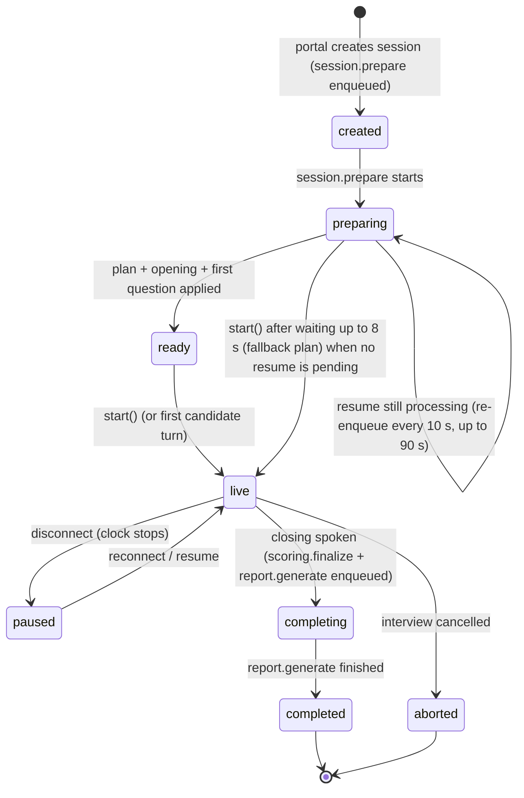

# Interview engine

Written for: engineers who change interview behaviour, scoring, reports or the review flow. The design intent is in
[`docs/design/ENGINE_DESIGN.md`](docs/design/ENGINE_DESIGN.md); this document describes the implementation and
lists where it deliberately differs. Constants are quoted from the code as of 2026-10-08; the prompt and policy
modules are actively tuned, so re-check `apps/api/app/services/interview/config.py` and `policy.py` before relying
on an exact number.

Principles carried into the code:

1. **Adaptive, not scripted.** Every move is chosen from the resume, job, round, accumulated evidence, the answer
   just given, time and unverified claims.
2. **Deterministic guardrails, generative phrasing.** A pure policy function computes what is allowed and
   recommended; the 35B model chooses within it and phrases it. Every model output is schema-validated and
   post-checked; deviations are corrected or logged.
3. **Evidence is atomic and attributable.** Scores are computed from evidence rows that point at answers,
   transcript spans and coding sessions.
4. **One streaming model call on the turn path.** Deep evaluation runs in the background and feeds the next turn.
5. **Human oversight.** Recommendations are assistive; the hiring decision is a separate human record.

## Components

| Module (`apps/api/app/services/interview/`) | Responsibility |
|---|---|
| `engine.py` | `InterviewEngine` (`get_engine()`): implements the `TurnEngine` seam used by the realtime runtime; per-session lock; start, turn, timer, coding, pause/resume, closing flows; `session.prepare` |
| `sessions.py` | `SessionService` (`get_session_service()`): `create_or_resume`, candidate view, completion |
| `state.py`, `state_store.py`, `transitions.py` | `InterviewState` model; Redis hot copy (`session:{id}:state`, version-guarded) + Postgres snapshot (`interview_sessions.state`, flushed every 15 s and at each committed turn); pure state transitions |
| `policy.py` | `PolicyDirective` computation and the post-check of model decisions |
| `difficulty.py` | starting difficulty and adaptation |
| `special.py` | regex heuristics for non-answers (repeat, clarification, "let me think", "I don't know", backchannel, hint, candidate question) and for hedged answers (`hedge_kind`: someone else handled it, not directly involved, did not dig in, not sure, no experience) |
| `turns.py`, `context.py`, `prompts.py` | prompt assembly (compact, byte-stable system prompt), speech-first streaming through the speech filters, decision recovery, fallback utterances |
| `speculative.py` | quick assessment while the candidate's end-of-turn silence accumulates |
| `selection.py` | round- and role-aware bank question retrieval (inspiration for the model, never read out verbatim) and near-duplicate detection |
| `evaluation.py` | `answer.evaluate`: deep evaluation -> evidence, claims, contradictions, follow-ups, score recompute |
| `grounding.py` | grounding of attributions ("you mentioned X") and of model-written inconsistency records in the candidate's own words (resume only when framed as the resume) |
| `attribution.py` | streaming guard: holds a sentence that opens with an attribution, drops / regenerates it when unsupported, turns a repeated "You mentioned X." preamble into a short acknowledgement |
| `memory.py` | conversation window and rolling summary (`memory.summarize`) |
| `planner.py`, `opening.py`, `closing.py` | interview plan, introduction and closing texts (model with template fallbacks) |
| `coding_bridge.py` | starting coding, observer comments, hint speech, finishing |
| `behavior.py` | avatar behaviour per action ([AVATAR_SYSTEM.md](AVATAR_SYSTEM.md)) |
| `app/services/scoring/` | pure scoring maths and persistence of scores and snapshots |
| `app/services/reports/` | report assembly, narratives, HTML artifacts, release, reviews, analytics |
| `app/services/intake/` (live part) | intake mode for `round_type: intake` ([below](#intake-mode-round_type-intake)): stage machine, conductor, activities, capture persistence, final transcript |

Jobs: `session.prepare`, `answer.evaluate`, `memory.summarize` (`app/workers/interview.py`), `scoring.finalize`
and `report.generate` (`app/workers/reports.py`), `coding.evaluate` (`app/workers/coding.py`),
`intake.activity_transcribe` (`app/workers/intake_capture.py`, intake rounds only). All are retried up
to 3 attempts with exponential backoff unless a handler says otherwise.

## Session lifecycle



* **Prepare** (`session.prepare`, `engine.py`): if the candidate's latest resume is still being processed, the job
  re-enqueues itself every 10 s for up to 90 s (`profile_wait_budget_s`; a full model profile takes ~15-20 s).
  When the budget runs out the latest usable profile or, failing that, the candidate's quick profile (deterministic
  read of the resume, `profile_status = "quick"`, `resume.service.quick_profile_fallback`) is attached; with neither
  the status is `timeout`. Then, concurrently: the interview plan
  (35B, 20 s budget; deterministic plan from the `RoundConfig` on failure or when the profile wait timed out), the
  introduction (15 s) and a pre-generated first question (structured `TurnDecision`, 20 s; discarded unless it is
  a real question). Afterwards a `max_tokens=1` call with the session's system prompt warms vLLM's prefix cache,
  and initial bank candidates are fetched for the top 3 target competencies. Status becomes `ready` and
  `session.ready` is published.
* **Start** (`start()`): waits up to 8 s for preparation. If a resume is still processing it yields
  `StateChanged("preparing")` and does not go live (the runtime starts again on `session.ready`). Otherwise it
  uses the prepared plan and texts or falls back to the deterministic plan and a template introduction, sends the
  introduction (2-3 sentences, no monitoring script) and then the first question as a separate utterance.
* **Pause and resume**: a disconnect pauses the session and its clock; the last undelivered utterance is marked
  interrupted and re-spoken. On reconnect the engine says nothing if the candidate was mid-answer, otherwise
  "Sorry, we got disconnected for a moment. As I was asking: ..." (coding: "Welcome back. Your code is right where
  you left it..."). Answers that arrive while paused are persisted and evaluated; the reply comes on resume.
* **Closing**: active coding is finished first; the closing text comes from a short structured call (6 s, accepted
  only if it passes `acceptable_closing`) for sufficient-evidence, time-limit and stopping-condition endings, and
  from templates otherwise. One transaction writes the transcript, sets the interview status and enqueues
  `scoring.finalize` and `report.generate` (not for aborted sessions). `completed` is set by the report worker
  once reports exist. The `failed` status exists in the enum but nothing sets it today.

## Interview state

`InterviewState` (`state.py`) is one JSON document per session, hot in Redis and snapshotted to Postgres:

* identity, status, turn and avatar state; candidate name, compact profile, job summary, frozen `RoundConfig`,
  plan, interviewer name (organisation avatar setting, default "Maya"; `INTERVIEWER_NAME` is only the fallback);
* time: start, pauses, elapsed (pauses excluded), `time_limit_s` / `max_time_s` (round duration and maximum);
* flow: current segment, topic, competency and difficulty, difficulty counts, turn index, current question,
  whether an answer is awaited, follow-up and simplify counters;
* records: questions, answers (with quality and its source), the last 40 conversation exchanges, the last 16
  utterances, the memory summary;
* per competency (`CompetencyState`): score estimate, confidence, evidence counts, dimensions covered, unanswered
  topics, sufficiency, score history (all derived from evidence and replaced by each evaluation), plus flow fields
  (difficulty seen, questions asked, follow-ups on the current topic, weak answers at the current level);
* claims to verify (up to 15 from the profile, by priority), contradictions (severity low/medium/high, status
  open/verifying/resolved/confirmed, at most 20), pending follow-ups (at most 12);
* coding state (active problem, language, time limit, hints, runs, observer state);
* preparation, time-warning, recording/monitoring flags and deviation/fallback counters.

## One candidate turn

`handle_candidate_turn` (`engine.py`) under the per-session lock (20 s; on timeout it logs and proceeds):

1. **Sync**: apply evaluation results waiting in `session:{id}:evals`, memory summaries and coding evaluations.
   A replayed turn (same start, end and text) is ignored.
2. **Special-turn classification** (`special.py`, ~0 ms). A repeat request is answered without a model call; while
   coding, turns go to the coding flow.
3. **Speculative preparation**: if the runtime reported a silence onset with at least 6 words (and 3 new words), a
   quick assessment (`answer_assessment`, 35B, 4 s, temperature 0) already ran; it is used when the final text
   equals or extends the prepared text by at most 3 words.
4. **Answer**: recorded in memory; queued for evaluation when there is a current question and the turn is a real
   answer or "I don't know".
5. **Policy directive** (deterministic, see below). `must_close` -> closing flow; `start_coding` -> coding flow.
6. **Bank candidates** from the cache only (`session:{id}:bank`, filled by preparation, speculation and
   post-decision prefetch); the Answer row is persisted concurrently with the model stream. Bank questions are
   inspiration: the model writes its own question from the candidate's resume and answers. Retrieval
   (`selection.bank_candidates`) keeps active rows of the organisation or global, for the target competency at the
   target or an adjacent difficulty, **written for the session's round type** (`round_types` contains it or is
   empty; `combined`/`custom` rounds also accept `technical_screening`, `deep_technical`, `behavioral` and
   `problem_solving` items). With fewer than 6 such rows the filter is relaxed: up to 20 rows of other round types
   join, ranked after every on-round row and with score - 0.2. Rows whose `role_tags` match the job's role get
   + 0.08 (`job_role_tags`: keyword map from the job title and department to the `catalog/roles.yaml` keys, e.g.
   "Senior DevOps / SRE Engineer" -> devops, sre; no match -> no boost). Order: on-round, exact difficulty, score.
   pgvector search runs with the filters (iterative scan); rows without an embedding are embedded in memory.
7. **`UtteranceBegin`** with a provisional avatar behaviour is yielded before the model call.
8. **TurnDecision stream** (35B, thinking off, temperature 0.5, max 900 tokens, 35 s total, 8 s to first speech):
   `StreamingJsonFieldExtractor("speech")` yields `SpeechDelta`s while the `speech` field streams. The speech passes
   three streaming filters (`turns.SpeechFilters`): `OpenerFilter` drops an evaluative first sentence,
   `AttributionGuard` (`attribution.py`) holds a sentence that opens with an attribution ("You mentioned ...",
   "Earlier you said ...", "As you described, ...") until it ends or the question starts inside it, and
   `QuestionLimiter` ends the utterance at its first question. An unsupported attribution is dropped when it is a
   statement before the question; when the question depends on it (an attribution inside the question, or an
   inconsistency probe) the stream is restarted once with a correction (`correction_messages`; words already spoken
   are kept and continued). A supported "You mentioned X." preamble whose frame was used in one of the last three
   questions becomes "Right, X." (or is dropped). Holding costs only the streaming time of that one sentence
   (~0.2-0.3 s) on turns that open with an attribution. After the speech field closes, the rest of the object is
   awaited for at most `2.5 s + 0.3 s x words`; whatever arrived is recovered with `json_repair` field by field and
   missing fields are synthesised.
9. **Failures**: an error before any speech retries once with a trimmed prompt (not for coding turns); after that a
   **fallback utterance** is emitted as one delta: a short acknowledgement plus the top cached bank question
   ("Let's shift gears. ..."), else a claim template ("Your resume mentions that ..."), else a competency template.
   The interview never stalls.
10. **Post-checks**: `check_decision` against the directive and the grounding check (below).
11. **Commit** (one transaction): Question row unless the action is `clarify_question`, `acknowledge_and_wait`,
    `answer_candidate_question` or `redirect`; interviewer transcript; state transition; `turn.decision` event;
    durable save. Then `UtteranceMeta` (final behaviour, question id, decision with deviations). In the background:
    question embedding with a near-duplicate log at cosine >= 0.88, bank prefetch for the next targets, and
    `memory.summarize` when due.
12. **Delivery**: the engine starts waiting for an answer (and the silence timer starts) only after the runtime
    reports the utterance as delivered (`mark_utterance_delivered`, on `playback.finished` or the estimated end
    of playback + 1.5 s).
13. **`answer.evaluate`** is enqueued in the answer's transaction with a 3 s delay (so it does not compete with the
    turn's stream), deduplicated per answer.

Barge-in closes the engine stream (`aclose`, which cancels the LLM HTTP stream); the spoken part is committed with
the deviation `interrupted_before_complete` and the realtime runtime decides whether the candidate's speech was a
backchannel (resume the interviewer) or a new turn.

### Special turns

| Kind | Heuristic (examples) | Handling |
|---|---|---|
| empty | no alphanumerics | treated as no answer: simplify once, then move on |
| backchannel | up to 3 words ("mm hmm", "yeah", "okay", "got it") | ask the candidate to elaborate; not evaluated |
| wants_time | fillers ("hmm", "um") or "let me think", "give me a second", "that's a tough question" | `acknowledge_and_wait` (required) |
| repeat | "could you repeat", "say that again", "didn't catch that", "you cut out" | repeat the current question without a model call |
| clarification | "what do you mean", "are you asking", short questions about the question | `clarify_question` (required, same question id) |
| dont_know | "I don't know", "never used", "pass", "skip this" without an attempt | simplify once, then `change_topic` with reassurance; evaluated |
| wants_hint | "can I get a hint" | outside coding: politely decline; in coding: the hint flow |
| candidate_question | "what's the next step", "how big is the team", "is this role remote" | `answer_candidate_question` from job facts only, then return to the question |

Silence: after an utterance is delivered, the silence timer speaks a gentle prompt up to 2 times, then treats the
turn as "I don't know" and moves on. There is no prompt-injection classifier; candidate text is fenced in prompts
(see [Prompts](#prompts)).

## Policy directive

`compute_directive` (`policy.py`) is a pure function of the state, the round configuration, the quick assessment
and the special classification. It is sent to the model and used to validate its answer.

| Field | Rule |
|---|---|
| `must_close` | closing already started; elapsed >= maximum duration; remaining <= closing reserve (`CLOSING_RESERVE_SECONDS`, 75 s); or questions asked >= `stopping.max_questions` |
| `should_wrap_up` | (every required competency sufficient and elapsed >= `min_duration_minutes` and asked >= `min_questions` and no coding outstanding, when `stop_on_sufficient_evidence`) or remaining <= reserve + 150 s; never on the first question. Invites candidate questions once if allowed and more than reserve + 45 s remain; after the invite, any turn that is not a candidate question or clarification closes |
| `coding_due` | coding enabled, not done or unavailable, remaining >= coding duration + reserve, and one of: forced (test hook), last window (remaining - reserve - duration < 120 s), the plan's coding segment reached, or required technical competencies have >= 60 % of their minimum evidence in aggregate; not before `start_after_minutes`. Combined rounds (`coding_start_window`): never before 20 % of the time limit (or `start_after_minutes`), and `round_point` at 40 % starts it at the next turn boundary without waiting for a follow-up; `plan_segments` rescales the segments before coding so the plan's coding segment starts inside that window. The transition utterance announces that the editor is opening |
| `start_coding` | due, not closing, not the first question; postponed one turn after a vague or partial answer without a follow-up |
| `open_contradiction` | first open contradiction with severity >= medium that the candidate has not already explained (skipped when every referenced answer is a "not involved" hedge such as "the 120 nodes were managed by a separate platform team"; the record stays for the reviewer) -> `verify_contradiction` (respectful phrasing) |
| `claim_to_verify` | resume validation enabled and fewer than `max_claims` probed: unverified claims with priority >= `min_priority` not yet attempted, inside the resume-validation segment window (else only claims on the target competency) |
| `targets` | competencies ranked by `weight x (required ? 1 : 0.5) x (1 - confidence) x (sufficient ? 0.15 : 1)`, then x `(0.6 + 0.1 x plan priority)`, x 1.6 in the current plan segment, x 0.25 for coding competencies while coding is pending; each with target difficulty and up to 4 uncovered topics |
| `blocked_competencies` | sufficient competencies (avoid redundant questions) |
| `max_followups_reached` | follow-ups on the current topic >= `max_followup_depth` (4) while the competency is uncertain, else >= 2; at most 2 in short rounds (`duration_minutes` <= 15) and while recent answers show limited experience (two of the last three: "I don't know", incorrect or hedged); after a **hedged answer** on the topic ("someone else handled that", "I wasn't directly involved", "I didn't dig into the details", "I'm not sure") at most one more, gentle follow-up about the part the candidate did themselves, then a different area (`hedge_cap`); removes follow-up, specificity and harder-question actions |
| `candidate_bank_questions` | up to 3 cached bank questions for the target competency |
| time | elapsed, remaining, segment budget, overrun (segment elapsed > 1.15 x budget), warnings at 5 minutes (rounds over 10 minutes) and 1 minute |

Recommended action ladder (first match wins): must close -> `close_interview`; invite -> `invite_candidate_questions`;
start coding -> `start_coding`; first question -> `verify_claim` or `ask_question`; clarification ->
`clarify_question`; wants time -> `acknowledge_and_wait`; hint request outside coding -> decline politely;
candidate question -> `answer_candidate_question`; open contradiction -> `verify_contradiction`; otherwise by answer
quality (from the special classifier, else the quick assessment when its confidence >= 0.6, else the model's own
judgement against stated rules):

| Answer quality | Move |
|---|---|
| vague | `request_specificity` (name what is missing: baseline, time range, scope, technique, measurement); `change_topic` once the follow-up limit is reached |
| partial | `ask_followup` on the same topic; `change_topic` at the limit |
| adequate | `ask_followup` while the competency is not sufficient, else `change_topic` |
| strong | `increase_difficulty` while not at hard and adaptive difficulty is on; `change_topic` when sufficient or at the limit |
| incorrect | `simplify` up to 2 times, then `change_topic` |
| no_answer | `simplify` once, then `change_topic` with encouragement |
| off_topic | `redirect` |

`change_topic` or `ask_question` becomes `verify_claim` when a claim is due; a segment overrun turns a same-topic
follow-up into `change_topic`.

### Post-checks

* `check_decision` logs `required_action_ignored` / `action_not_allowed` but keeps the model's action, except
  impossible ones (start coding, introduce, give hint, coding comment, close without `must_close`), which are
  replaced. Unknown competencies fall back to the target, difficulty is clamped to one level from the target,
  unknown claim or bank ids are removed. Speech issues are logged: no question, multiple questions, more than 60
  words, evaluative phrases ("great answer", ...), markdown. These cannot be retracted after streaming; they feed
  the deviation counters and the next directive.
* **Grounding** (`grounding.py`): the content of an attribution ("you mentioned / said / noted / told me X",
  "earlier you ...", "as you described ...", "your answer about ...", "the X you mentioned") must be supported by
  ONE of the candidate's own turns: at least 50 % of its content words inside two consecutive sentences, with the
  same polarity (negation scope runs forward inside a clause: "I wasn't involved in the cost-reduction work" does
  not support "you noted Karpenter configuration for cost reduction"), tolerant of recognition spellings
  ("Carpenter"). The interviewer's own questions, the job text and the conversation summary never count; a
  reference framed as the resume ("your resume says ...") must be supported by the resume (>= 40 %). Sentences
  that open with an attribution are checked while streaming (see step 8); the post-check covers the rest and
  logs `ungrounded_reference`, and the next directive tells the model not to repeat it. Deviations from the
  stream: `speech:ungrounded_attribution_dropped`, `speech:attribution_regenerated`,
  `speech:attribution_frame_rewritten`. Measured over 157 attributions in 32 saved harness runs: 6 flagged, all
  real misattributions (mostly resume content credited to the candidate), ~1 ms per turn.
* **Inconsistency records** written by a model (`possible_contradiction` of the turn decision; the evaluator's
  contradictions) are kept only when each side is grounded: a side citing the resume (or a claim id) in the
  resume, every other side in the candidate's own words; a record with no side in the candidate's words is
  dropped. Dropped records are deviations (`ungrounded_contradiction` on the decision; `state.deviations` and the
  event `evaluation.contradiction_dropped` for evaluator records).

## Difficulty

* Target distribution per round (default 30 % easy / 40 % medium / 30 % hard).
* A new competency starts at the plan's level, nudged one step toward the level with the largest deficit against
  the distribution, limited by the running average (average < 5: easy or medium; >= 7: medium or hard) and never
  more than one level from the plan.
* Step up one level after a strong answer; step down after the second weak answer (incorrect, no answer, vague,
  off-topic) at a level; adequate and partial hold; never jump two levels. `simplify` lowers the target difficulty
  immediately.
* Each question's difficulty is stored on the Question row and in the state counters.

## Memory

The prompt carries the last 8 candidate turns verbatim (plus the interviewer turn before them). Once a session has
more than 12 answers, `memory.summarize` (8B model on the vision endpoint, 60 s) summarises the older turns into
`session:{id}:memory` (48 h TTL); the engine applies it at its next operation.

## Deep evaluation (`answer.evaluate`)

* Inputs: the question (text, competency, difficulty, expected evidence plus the bank question's expected concepts
  and rubric), the answer, claims touched, the last 3 earlier answers and the last 6 evidence rows on the
  competency, the 12 transcript rows before the answer, and the round's competencies.
* Model: `answer_evaluation` on the 35B (temperature 0.1, 2200 tokens, 90 s, 2 attempts) -> `AnswerEvaluation`.
* Cleaning: evidence keys mapped into the round; a quote is kept only if it is a substring of the answer or a fuzzy
  match >= 85; unknown claim ids dropped; contradictions not grounded in the candidate's words (or, for the resume
  side, in the resume) are removed before anything is stored (`ground_contradictions`, logged as
  `evaluation.contradiction_dropped`). If the model returned no evidence, one overall item is synthesised from
  the answer quality.
* Writes: `answer_evaluations` (unique per answer), `competency_evidence` rows (signal, strength, confidence,
  dimension, difficulty, transcript reference with quote, embedding), answer status `evaluated` (or
  `needs_review`), then a non-final score recompute and snapshots.
* Delivery to the live interview: the result payload (claim status updates, contradictions with severity,
  up to 3 suggested follow-ups, competency states) is stored in `session:{id}:evals` and announced as
  `evaluation.ready` on the session bus; the engine applies it before its next decision. For ended sessions the
  job applies it to the stored state directly.
* Idempotent per answer. **Fallback**: invalid output, or an error on the last job attempt, produces a neutral
  evaluation (`is_fallback=True`, confidence 0.2, "flagged for human review") without evidence rows.

## Evidence, sufficiency and scoring

Pure functions in `apps/api/app/services/scoring/compute.py` (`get_scoring()`); persistence in `persistence.py`.
The same maths runs for the live interview (in memory, after each evaluation) and for persisted scores.

**Observation** per evaluated answer and competency (no observation for clarification requests, candidate
questions, "let me think" and hint requests):

* raw = weighted mean of the scored primary dimensions: correctness 0.25, depth 0.20, practical experience 0.15,
  specificity 0.15, reasoning 0.15, completeness 0.10. If none applies, the plain mean of relevance, architecture
  awareness, trade-off understanding, consistency and communication clarity; if none applies at all, the answer
  quality value x 10 (strong 0.9, adequate 0.7, partial 0.5, vague 0.35, off-topic 0.2, incorrect 0.15, no answer 0).
* score = min(raw, cap): easy 8.0, medium 9.3, hard 10.0, so top scores need hard evidence.
* weight r = evaluation confidence x (easy 0.85, medium 1.0, hard 1.2).
* Coding: the coding evaluation's `score_estimate` (already capped at `3 + 7 x tests passed / total` from sandbox
  ground truth) capped by difficulty, times the **assistance factor** `1 - 0.07 x min(hints, 3)` (1.0, 0.93, 0.86,
  0.79; never 0). Hint usage is also recorded as neutral evidence (dimension `assistance`) for transparency; hints
  never fail a candidate.

**Competency score**, over "scoring evidence" (non-neutral and not hint usage):

```
bayes   = (5.0 x 1.0 + sum(r_i x s_i)) / (1.0 + sum(r_i))          # prior 5.0 with weight 1
balance = 0.8 x (P - N) / (P + N + 1)                               # P, N = sum(strength x confidence) of positive / negative evidence
score   = clamp(bayes + balance, 0, 10)                             # 5.0 when nothing is known
```

**Confidence**:

```
R = sum(r_i) + min(1.5, 0.3 x strong_items)                         # strong: strength >= 0.7 and confidence >= 0.5
c = (1 - exp(-R / 2.2)) x (1 - min(0.35, 1.2 x std / 10))           # std: population std of observation scores
c = c + 0.05 if R > 0 and at least 2 difficulty levels were seen;  clamp to [0, 0.98]
```

* `evidence_count` = number of scoring evidence items.
* **Sufficient evidence** = count >= minimum evidence (per competency, default 3) AND confidence >= the round's
  **confidence target** (the `confidence_threshold`, default 0.7, scaled to the round scope below) AND (stable OR
  count >= minimum + extra), where stable means at least 3 history points and the last two score changes below
  0.8, and extra is 2 (1 in rounds that give each competency fewer than 3 expected answers, where a 3-point stable
  history cannot exist).
* Score history is replayed from the evidence in time order, one step per answer, coding session or evidence item
  (last 50 points), so a recompute is idempotent.
* **Unanswered topics** = expected-evidence topics of asked questions that no positive evidence covers, plus focus
  areas no scoring evidence touched. Topic matching is fuzzy (content tokens with light stemming, token subsets,
  rapidfuzz ratio >= 88).
* Evidence about a competency the round does not list is reported but never required.

**Round scope (short-round calibration)** — `round_scope(round_config)` in `compute.py`. The configured targets
assume a full-length round; a 10-minute screening with 3 required competencies cannot collect the 3+ consistent
answers per competency they need, so strong candidates ended as `borderline_evidence` (harness: overall 67-74,
confidence about 0.6, one required competency just under 0.65). The targets now scale with the round's evidence
budget, computed from the planned duration and the competencies the round must cover:

```
conversation = duration_minutes - coding minutes (duration x problems) - 2 (intro, candidate questions, close), >= 1
answers      = min(0.8 x conversation, stopping.max_questions) + coding problems     # scored answers the round can hold
load         = required competencies + 0.5 x optional ones   (all count fully when none is required)
per_comp     = answers / load                               # scored answers each competency can expect
scope        = clamp(per_comp / 4, 0, 1)                    # 1 = full-length round: configured targets apply
relief       = 0.25 x (1 - scope)
confidence target (sufficiency) = max(min(confidence_threshold, 0.5), confidence_threshold x (1 - relief))
overall target (recommendation) = min(max(min(min_confidence, 0.45), min_confidence x (1 - relief)),
                                      floor3(confidence target x required weight share - 0.001))
```

* The required weight share is the effective-weight share (optional competencies weigh half) of the competencies
  required coverage counts. Overall confidence is the effective-weight mean over all round competencies (untouched
  ones count 0), so this cap guarantees that sufficient evidence on every required competency (the engine's own
  stop condition) always meets the overall target; without it a session could stop on "sufficient evidence" and
  be reported as "insufficient evidence". The 0.001 margin covers the 3-decimal rounding of stored confidences.
* Scores and confidence values never change; only the targets they are compared with do. The live engine uses the
  same targets (competencies count as covered earlier in short rounds, so the policy moves on and may wrap up on
  `stop_on_sufficient_evidence`), score rows store `details.confidence_target` / `details.extra_evidence`, the
  overall row stores `details.round_scope`, and the recommendation `factors` add `round_scope`,
  `expected_answers_per_competency`, `competency_confidence_target`, `min_confidence_target` and
  `required_weight_share` next to the configured values. When the targets differ from the configured ones the
  rationale says so ("Round-scope calibration: a 10-minute round with 3 required and 2 optional competencies allows
  about 1.6 scored answers per competency, so the evidence targets are 55% confidence per competency (configured
  65%) and 48% overall (configured 60%; ...)").
* Examples: the quality-harness round (10 min, max 8 questions, 3 required + 2 optional, threshold 0.65): 6.4
  answers / load 4 = 1.6 per competency, scope 0.4, targets 0.5525 and 0.482, extra 1. The seeded Combined AI round
  (30 min, 10-min coding, 7 required + 4 optional, max 14 questions): 15 / 9 = 1.7, targets 0.555 and 0.482. A
  30-minute round with 2 required competencies (or any round with at least 4 expected answers per competency) keeps
  0.7 / 0.6 exactly.
* Calibration (2026-10-08): replaying the 29 evaluated persona runs of the Wave C harness, strong reaches `proceed`
  in 4 of 6 runs (was 1; the other two have a required competency never asked or at confidence 0.47), mid moves from
  `insufficient_evidence` to `borderline_evidence` where its three competencies have evidence, and no vague or weak
  run reaches `borderline_evidence` or better through the change (their time-limit "partial coverage" rule is
  unchanged). Synthetic score vectors (400 interviews per persona, engine-like question allocation) in the 10-minute
  round: strong `proceed` 71% -> 88%, mid `borderline_evidence` 22% -> 63%, vague and weak never `proceed`; a
  30-minute variant is unchanged. Recommendation score thresholds (80 / 65 / 50) separate the personas well (strong
  67-74, mid 50-63 with one run at 49.7, vague 28-47, weak 24-37) and were left as configured.

**Session level**:

* Rubric category (0-100) = weighted mean of its competencies' scores x 10 (competency weights) and its listed
  dimension averages x 10 (weight 1 each, only dimensions actually scored); a category with nothing to measure
  scores a neutral 50 with confidence 0.
* Overall score = sum of category weight % x category score (the round's rubric weights must total 100); without a
  rubric, the weight-averaged competency score x 10.
* Overall confidence = mean confidence of the *assessed* competencies, weighted by `weight x (required ? 1 : 0.5)`,
  times evidence coverage (the same effective-weight share of competencies that were touched).
* Required coverage = share of required competencies with sufficient evidence.

**Recommendation** (assistive; thresholds from the round's `passing_guidance`), first match wins:

| Condition | Recommendation |
|---|---|
| confidence < the overall target (`min_confidence`, default 0.6, scaled to the round scope) or required coverage < `min_required_coverage` (0.75) | `borderline_evidence` if the interview ended on the time limit with partial coverage, else `insufficient_evidence` (lists the competencies still lacking evidence) |
| any unreviewed integrity flag, or an open high-severity contradiction | `human_review` |
| overall >= 80 | `strong_proceed` |
| overall >= 65 | `proceed` |
| overall >= 50 | `borderline_evidence` |
| below | `human_review` ("The platform never rejects automatically; a reviewer should look at the evidence.") |

Every recommendation carries a rationale, notes about integrity signals awaiting review ("observations only, not
determinations") and open high-severity inconsistencies, and the fixed note: **"This recommendation is assistive.
A human reviewer owns the hiring decision."** There is no reject recommendation.

**Persistence** (`recompute_session_scores(db, session_id, final=..., trigger=...)`): runs inside the caller's
transaction under a per-session advisory lock; all rows of one run share `created_at` (readers take the newest
set). A final run replaces every score; a non-final run replaces non-final scores only. Non-final runs append a
`score_snapshots` row per competency whose score, confidence or evidence count changed; the final run adds one
`final` snapshot per competency and backfills competencies that never got a live snapshot.

| Caller | Mode |
|---|---|
| `answer.evaluate` | non-final, trigger `answer_evaluated`, then `evaluation.ready` |
| `coding.evaluate` | publishes `coding.evaluated`; the live engine recomputes in memory, persisted scores pick it up at the next evaluation or at finalize |
| `scoring.finalize` | final, then `scores.finalized` |
| `report.generate` | final (trigger `report`) before assembling reports |
| `POST /api/v1/sessions/{id}/recompute-scores` | manual (`?final=`; default final for ended sessions) |

**Timeline**: `GET /api/v1/sessions/{id}/timeline?window_minutes=10` buckets snapshots (or a replay from evidence)
into windows and keeps the last value per competency ("Minute 0-10: AWS 7.2, Kubernetes 6.5").

## Reports

`scoring.finalize` and `report.generate` (`app/workers/reports.py`) are enqueued at closing. Both defer themselves
(up to 12 times, 10 s apart) while `answer.evaluate` or `coding.evaluate` jobs of the session are still queued or
running, so reports include every evaluation.

`generate_reports` (`app/services/reports/service.py`):

1. Final score recompute; reserve `reports` rows (status `generating`, version = previous + 1, tagged with the job
   id so a retry reuses them). Regeneration always creates a new version; earlier versions stay readable.
2. **Deterministic assembly** (`assembly.py`): session, candidate, job and round; scores, rubric, competencies with
   their calculation; recommendation with passing guidance; evidence; questions with answers, evaluations,
   follow-up chains and interviewer reasons; transcript excerpts; coding sessions with runs, hints, final code and
   evaluation; claims and their verification status; contradictions; integrity summary and events; timeline.
3. **Two narrative calls in parallel** on the 35B (`report_generation`, temperature 0.2, 150 s, 2 attempts):
   `CandidateReportNarrative` and `RecruiterReportNarrative`, through guided schemas that require at least one
   evidence-backed strength, improvement area and finding (the model sometimes returned empty arrays). Evidence and
   questions are shown as aliases (`E1`, `Q1`) and mapped back; ids that are not this session's are dropped;
   aliases left in prose are removed; points without citations are linked to matching evidence by fuzzy match or
   dropped (a strength nobody can point at is not reported). Candidate text is scrubbed of sentences that mention
   integrity monitoring, recommendations or hiring outcomes. Empty sections are filled deterministically; on the
   last attempt a fully deterministic narrative is used, so a report is always produced. **Neutral wording**
   (`reports/wording.py`, both audiences): judgemental verbs ("failed to", "failing to", "fails to", "failure to",
   "was unable to", "refused/neglected to", "struggled", "ignored/ignores", "admitted", "dodged the question",
   "deflected", "evasive") become evidence-based wording ("did not", "not explaining", "a gap in addressing", "did not
   address ... at all", "said", "did not directly answer"). Technical statements ("the code ignores the input", "the
   webhook admits pods"), passives and quoted words stay as they are. The rules apply to the narratives and to
   model-written text read from stored records (evidence, contradiction descriptions and findings, claim notes,
   evaluator notes, interviewer reasons, coding reviews) when the report document is assembled and again when HTML
   is rendered; candidate-facing evaluator text is also put in the second person. Stored records and earlier report
   versions are never modified, so legacy text reads neutrally in any regenerated report.
4. **Store**: `reports` rows (candidate and recruiter content), HTML artifacts rendered with Jinja2 (autoescape,
   strict undefined, a restrictive CSP meta tag, A4 print CSS) at
   `orgs/{org}/sessions/{session}/reports/{type}-v{n}.html` (`media_assets` kind `report_artifact`, retention
   default 730 days). In `immediate` mode the candidate report is released automatically. `report.ready` is
   published; the report worker then marks the session `completed`.

**Candidate content** is a whitelist projection (`candidate_view`): overall score and confidence, rubric scores,
competency scores with unanswered topics, per-question feedback (quality, summary, missing details, measurable
outcomes, technical evidence), coding summary (tests passed, complexity, strengths, weaknesses), the cited evidence
and the narrative. It never contains the recommendation, integrity data, claims or their verification,
contradictions, interviewer reasons, transcripts, timeline, paste counts, final code, hidden-test data or recruiter
notes; the portal strips those keys again before serving a released report.

**Release policy** (`candidate_report_mode`, resolved interview snapshot -> job -> organisation, default
`never` since 2026-10-09): `immediate` (released at generation), `after_review` (needs at least one human review; otherwise
409 `review_required`), `never` (needs `acknowledge_policy_override: true`; otherwise 409
`policy_override_required`). `POST /api/v1/sessions/{id}/reports/candidate/release` needs `reports:release`; it is
idempotent and audited (`report.release`). `GET /api/v1/portal/sessions/{id}/report` serves only ready, released
candidate reports. `GET /api/v1/portal/sessions/{id}` returns the resolved `candidate_report_mode`; with `never`
the candidate portal shows no feedback card, link or promise (the report route shows a neutral "the hiring team
will contact you" page). A demo report can be rebuilt from the latest completed session with
`uv run python -m app.services.reports.demo --latest [--no-llm] [--persist] [--out PATH] [--html-dir DIR]`.

## Human review

* `review_decisions` keeps a history per session: reviewer, decision (`advance`, `hold`, `reject`,
  `needs_more_information`), notes, the AI recommendation at review time and whether the decision overrides it.
* `GET|POST /api/v1/sessions/{id}/reviews` (`reviews:write` to post; the session must have ended, else 409
  `session_not_finished`). `release_candidate_report: true` releases the candidate report in the same request when
  the policy allows. Reviews never change scores; overrides are counted in analytics (`ai_override_rate`).
* The review queue is `GET /api/v1/sessions?needs_review=true` (completed sessions without a human decision yet).
* Unreviewed integrity flags keep the recommendation at `human_review`; reviewing them (see
  [INTEGRITY_MONITORING.md](INTEGRITY_MONITORING.md#reviewer-workflow)) and recomputing scores updates it.
* Staff screens show every AI recommendation together with the human-decision note; integrity screens carry
  "Signals are observations, not determinations."
* Audited reads and actions: `report.view`, `report.regenerate`, `report.release`, `review.create`,
  `transcript.view`, `session.live.view`, `session.coding.view`, `scores.recompute`.

Staff live monitor: `GET /api/v1/sessions/{id}/live` is a server-sent event stream (`state` digests every few
seconds, every session bus event by name, `end`), shown as the Live tab of the session page.

## Documented deviations from the design

Where the implementation differs from [`ENGINE_DESIGN.md`](docs/design/ENGINE_DESIGN.md) on purpose:

| Design | Implementation | Why |
|---|---|---|
| §7 evidence balance `0.8 x mean(signal x strength x confidence)` | `0.8 x (P - N) / (P + N + 1)` | monotone: adding a weak positive item can never lower the score |
| §7 overall confidence = weighted competency confidence x coverage | mean over *assessed* competencies only, optional competencies weigh half in both factors | the literal formula let untouched optional competencies force `insufficient_evidence` |
| §7 hint evidence as scoring evidence | hint usage is neutral; assistance is priced only by the factor (at most 3 hints count, floor 0.79) | hints must never fail a candidate |
| §7 sufficiency against the round threshold, recommendation against `min_confidence` | both targets scaled to the round's evidence budget (planned duration, coding time, question cap, required/optional competencies; at most 25% lower, floors 0.5 / 0.45); the overall target is capped so that sufficient evidence on every required competency meets it | short or crowded rounds cannot collect the evidence the configured targets assume; scores and confidence values are unchanged |
| §7 coding score = estimate x factor | also capped by difficulty and by `3 + 7 x pass ratio` (in `coding.evaluate`) | test results are ground truth |
| §7 one snapshot per competency per evaluation | snapshots only when score, confidence or evidence count changed; final snapshots and backfill at the end | keeps the timeline readable; recompute is idempotent |
| §7 exact-string topic coverage | fuzzy token matching | model-written dimensions rarely repeat topic strings exactly |
| §3 `start()` falls back after ~8 s | while a resume is still processing (up to 90 s, then the quick profile), `start()` reports `preparing` and the engine starts on `session.ready` | interviews are better with the parsed profile |
| §3 `failed` on preparation errors | `failed` is never set; deterministic plan instead | the interview never stalls |
| §4 fallback question as `UtteranceBegin(text=...)` | text-less `UtteranceBegin` followed by one `SpeechDelta`; cache-only bank question or template | keeps one code path for subtitles and TTS |
| §4 metadata awaited in full | tail bounded at `2.5 s + 0.3 s/word`, partial object recovered with `json_repair` | this vLLM build pads JSON whitespace (full object 5-9 s) |
| §5 incorrect -> clarify/simplify, max 2 per level | `simplify` up to 2 times per question chain; `adequate` and `wants_hint` handled explicitly | simpler, measurable rule |
| §5 follow-up depth 4 | 4 only while the competency is uncertain, otherwise 2 | avoids redundant probing |
| §5 target ranking | extra multipliers for plan priority, current segment (x1.6) and pending coding (x0.25) | follows the plan's time budget |
| §5 wrap-up | adds a near-end window (reserve + 150 s) and closes after the invite on any non-question reply | no dead air at the end |
| §6 step changes per answer | `simplify` lowers the target immediately; otherwise the model's level (clamped to one step) wins when a question is asked | the model sees the directive's target |
| §8 last 6 exchanges and retrieved prior evidence | 12 transcript rows and the last 6 evidence rows of the competency; claim/contradiction updates travel to the live state, not as rows | bounded prompt, no retrieval latency |
| §8 fallback evaluation writes neutral evidence | fallback writes no evidence and is flagged for review | avoids inventing evidence |
| §9 retrieved evidence in the prompt | not filled; post-check word cap is 60 (prompt target 45) | latency |
| §10 transition speech generated | two-sentence template; the engine adds its own 5- and 1-minute warnings | determinism |
| §11 narratives cite evidence ids | aliases (`E1`, `Q1`), uncited points linked or dropped, candidate scrub, deterministic fallback, minimum-item schemas | the model invented or omitted ids; candidate text must never mention integrity or outcomes |

## Coding inside the interview

* **Start**: when the directive says `start_coding`, `CodingService.select_question` picks a problem (pinned >
  retrieved > generated, the last only when the round allows generated problems; language preference from the
  resume skill with the most years), the Question row is
  written, `CodingService.start` opens the coding session, and a two-sentence template introduces the problem
  (the statement is on screen). Events: `UtteranceBegin(kind="transition")`, `UtteranceMeta`, `CodingStarted`.
* **During coding** the interviewer is silent by default. Editor activity, runs, idle ticks and time warnings go
  to the coding observer, which applies deterministic triggers and rate limits before asking the 35B for a short
  comment ([CODING_INTERVIEW.md](CODING_INTERVIEW.md#the-ai-observer)); a comment containing a question creates a
  `coding_comment` Question row. The engine adds its own "about N minutes left" warnings when the observer is
  silent.
* **Hints** (button or voice): `CodingService.request_hint` -> `CodingHintIssued` + a short spoken hint.
* **Finish**: submission, the coding time limit or the interview closing calls `CodingService.finish` (which
  enqueues `coding.evaluate`) and yields `CodingEnded`. If at least 120 s remain beyond the closing reserve, the next
  question is a follow-up about complexity, a trade-off or an edge case, never revealing whether the solution was
  right.

## Intake mode (`round_type: intake`)

Contract: [`docs/design/INTAKE_INTERVIEW.md`](docs/design/INTAKE_INTERVIEW.md) sections 6-7 (deviations in its
section 18). An intake session is an ordinary session driven by the same `InterviewEngine`; `InterviewState.intake`
(`app/services/intake/state.py`) switches the hook points below to `IntakeConductor`
(`app/services/intake/conductor.py`, `engine.intake`). Every hook is `if state.intake is not None`, so other round
types never reach intake code.

| Module (`app/services/intake/`) | Responsibility |
|---|---|
| `stages.py` | pure machine: item catalogue (`ItemSpec`; T template, M model-phrased, A activity, X form-only MQ1), `build_stages`, `stage_budgets` (kit midpoints x `(time_limit - 60) / 2520`), compression (`available < 1.15 x required`), soft cap (1.25 x budget), `next_move()`, `apply_*` helpers, answer-text parsers |
| `selection.py` | level estimate, Drill A/B passages (B never equals A), topic card, language question + fallback, résumé claims (effective profile), scenarios; ties by `sha256(session_id + drill)` |
| `conductor.py` | moves -> utterances, live `IntakeTurn` calls, activities, persistence, resume, time-up, closing |
| `prompts.py` | every fixed text (opening, transitions, MQ templates, clarifications, activity prompts, closings), the live turn and verification-grade prompts, post-checks (`intake_speech_issues`) |
| `turn_schema.py` | `IntakeTurn` (speech first, every field required, `SPEECH_FIRST_TURN`), `VerificationGrade` |
| `activities.py` | phase plans (reading 180 s; relay read 30 s + relay 150 s; card prepare 60 s + speak 120 s), material content, descriptors |
| `session_init.py` | initial `IntakeState` at session creation (intake row, frozen settings, onboarding digest, org approved info) |
| `capture_store.py` | `intake_stage_results` upserts, `intake_activity_results` writes; conditional final-transcript updates |
| `transcribe.py` | windowed final pass (windows <= 25 s cut at VAD pauses >= 300 ms) |

Hook points in `engine.py`: `prepare_session` (intake branch replaces plan, opening, first question, prefix
warm-up and bank retrieval: claims, ladder items, stage rows, opening template, a plan mirroring the 7 stages,
`plan_source = "intake"`), `_start_events` (opening + `greeting.intro`), `_handle_candidate_turn` (paused turns
and live turns go to the conductor before the coding branch), `_accept_answer` (`evaluate = False`),
`_commit_decision` (no `memory.summarize`), `_speculate` (off), `_timer` (silence prompts suppressed while an
activity is armed/running; `time_up` -> compressed close, deferred until a running activity ends), `_silence_events`
(after the two prompts the item closes as unanswered and the plan moves on), `pause` (reveal / remaining-time
accounting of a running non-capture phase), `_resume_events` and `_backchannel_resume` (activity-aware re-ask and
re-arm), `_closing_text` (intake templates), `_closing_events` (ends an active activity, final stage statuses,
enqueues `intake.evaluate` `{session_id, reason: "session_completed"}` with dedupe `intake.evaluate:{sid}:initial`
and `INTAKE_EVAL_START_DELAY_SECONDS` instead of `scoring.finalize` + `report.generate`), new
`handle_activity_event`. `sessions._initial_state` builds the intake state (409 `intake_disabled` when
`INTAKE_ENABLED=false`) and sets `time_limit_s` / `max_time_s` from the invitation's intake settings (+5 min).
`turns.stream_speech_object` applies the speech filters to any schema with `SPEECH_FIRST_TURN`.

Turn flow: the answer is persisted (`answers` + candidate transcript, audio when consented, never
`answer.evaluate`), `stages.next_move()` decides deterministically, then a template utterance (committed first), a
streamed `IntakeTurn` (UtteranceBegin first, the stage bridge as the first delta when known, model speech, commit
after the stream) or an activity (instruction utterance + `ActivityStarted`). Follow-ups are offered only inside the
budgets of `IntakeFollowupLimits`; when the next item is model-phrased the model chooses `follow_up` or `ask_item`
in the same call, otherwise `followup_warranted()` (short or hedged answer) decides before the call. Each committed
utterance writes a `questions` row (`segment = "intake:<stage>"`, `decision.intake` = `IntakeQuestionMeta`), the
interviewer transcript, the touched `intake_stage_results` rows and the durable state in one transaction. Model
post-checks (generic speech issues, grounding, intake decision words / material restatement / unapproved facts in
stage 7) are logged as deviations; an intake issue makes the next model utterance use its template.

Activities: the runtime owns phase deadlines and capture (see
[REALTIME_DESIGN.md section 10](docs/design/REALTIME_DESIGN.md#10-intake-activities-round_type-intake)); the
conductor arms an activity (row `armed`, instruction question), records phase starts (`phases`, read_relay
`reveal`, a new capture attempt resets the transcript columns), asks for the next phase's prompt after a
non-capture phase ends, and commits a capture (`capture`, `answer_id`, `transcript_live`, audio) as `completed`.
A capture that ended by disconnect is only an `attempts_log` entry; the resume restarts the phase as a new
attempt (at most 2 restarts, then `interrupted`), re-shows a read_relay passage only for the time left (straight to
the relay below 3 s) and a topic card for the prepare time left. A normal turn that arrives while the conductor
still has a phase running means the runtime lost that phase (a failed job; the runtime released the floor): the
conductor closes it (at its deadline at the latest) and re-arms with "Sure — let me explain again." on the next
capture phase, or on the same capture phase as a new attempt; a Drill B passage is never re-shown by a recovery.

Measured with mock AI on the shared dev Postgres (2026-10-09): `next_move` ~0.24 ms; first event of a turn with a
model item ~16 ms after the turn arrives (answer persisted first), template items ~70 ms (committed before they
are spoken); `session.prepare` ~70 ms. No live model run was made (shared GPU busy).

Intake test hooks (`app/api/routers/test_hooks_intake.py`, same gating as the hooks below):
`POST /api/v1/test/intake/sessions/{id}/jump {stage}`, `POST .../capture {activity_id, phase, text, segments?,
pauses?, end_reason?, typed?}` (an injected spoken capture has no audio and settles `live_only`), and
`POST .../activity-deadline {activity_id}`. With a live runtime in the process they act through it.

Tests: `uv run pytest tests/unit/intake tests/unit/realtime/test_activity_capture.py tests/integration/intake -m "not live"`.

## Prompts

* Order is static -> dynamic, and the system prompt is byte-stable per session, for vLLM prefix caching. Note:
  the shared main-model server currently runs with `enable_prefix_caching=False` (`vllm:cache_config_info`), so
  every turn prefills the whole prompt and time to first token grows with its size (measured 2026-10-08:
  ~80 ms + 0.1 ms per prompt token, plus ~0.2-0.3 s from the first token to the first speech character). The turn
  prompt is therefore kept compact: the system prompt holds the persona, speech rules with the move rules (once;
  they used to be repeated in every directive), `FAIRNESS_RULES`, a short field guide instead of the full schema
  dump (guided decoding enforces types and enums), job facts, round, a brief profile (achievements already listed
  as claims, derived "strengths" and "recommended topics" left out), the claims the round may verify, and the
  plan's opening focus, extra focus areas and risks. The user prompt holds compact competency rows (no score
  estimate), claims status, memory, asked questions, recent conversation (without the spoken introduction and
  without repeating the current question; interviewer turns clipped harder than candidate turns), the last answer
  and the directive with at most two bank questions. Same reconstructed states, old vs new prompt: 5,586 -> 3,918
  prompt tokens, paired median first token / first speech -164 ms.
* Speech rules: 1-3 short sentences, usually under 45 words; exactly one question; no praise words ("Great
  answer!"); never reveal or hint at scores or whether an answer was right; no hints outside coding; no markdown,
  lists or emojis; natural transitions; first name occasionally; reference only what was actually said;
  contradictions checked respectfully; vague answers get a request that names what is missing; role questions
  answered from job facts only.
* `FAIRNESS_RULES` (`apps/api/app/ai/prompts/__init__.py`) is included in the turn, plan, closing, quick-assessment,
  evaluation and memory prompts (and in resume, coding and report prompts). It forbids inferring or using emotion,
  demeanour, personality, honesty, intelligence, any protected or sensitive trait and proxies for them (name,
  photo, voice, school prestige, address, graduation year, employment gaps); forbids penalising speaking style
  unless communication is the assessed competency; treats resume statements as claims and contradictions as
  questions for a human, never as proof of dishonesty; and states that a human makes every hiring decision.
* Candidate-controlled text (resume profile, answers, conversation summary, earlier answers, code) is wrapped by
  the `untrusted` Jinja filter in labelled tags with nested tags removed, and the rules tell the model never to
  follow instructions inside them. Known gap: some derived strings (claim texts, contradiction descriptions, the
  plan, evaluation follow-up texts) are rendered outside these tags (see [SECURITY.md](SECURITY.md#prompt-injection)).
* Prompt versions are content hashes (`turn@<sha256[:10]>`) recorded with every model call in `model_calls`.

## Configuration

Engine constants (`EngineConfig`, `config.py`): plan wait at start 8 s; first speech 8 s and turn total 35 s;
metadata tail 2.5 s + 0.3 s/word; plan/opening/first-question budgets 20/15/20 s; profile wait 90 s polled every
10 s (then the quick profile); evaluation 90 s with a 3 s delay; quick assessment 4 s; speculation after 6 words (3 new); 3 bank candidates;
near-duplicate threshold 0.88; memory window 8, summarise after 12 answers; lock 20 s; Postgres flush every 15 s;
2 silence prompts before moving on; post-coding follow-up needs 120 s.

Per round (`RoundConfig`, `apps/api/app/schemas/rounds.py`, edited in the recruiter app):

| Group | Fields and defaults |
|---|---|
| Duration | `duration_minutes` 30, `max_duration_minutes` 40, `expected_difficulty` medium, difficulty distribution 0.3/0.4/0.3 |
| Competencies | weights, required flags, per-competency minimum evidence (default `min_evidence_per_competency` 3), `confidence_threshold` 0.7 |
| Question strategy | `max_followup_depth` 4, `adaptive_difficulty` true, `allow_candidate_questions_at_end` true, `prefer_curated_ratio` 0.4 and `allow_generated_questions` true (not read by the live engine today) |
| Stopping | `stop_on_sufficient_evidence` true, `min_duration_minutes` 8, `min_questions` 4, `max_questions` none |
| Coding | `enabled` false, `duration_minutes` 20, `difficulty` medium, `max_problems` 1, `hints_enabled` true, `max_hints` 3, `proactive_comments` true, `min_seconds_between_comments` 75, `start_after_minutes` none, pinned problem |
| Resume validation | `enabled` true, `max_claims` 4, `min_priority` 2 |
| Passing guidance | strong proceed 80, proceed 65, borderline 50, `min_confidence` 0.6, `min_required_coverage` 0.75 |

The candidate report release mode is part of the organisation/job policy (`candidate_report_mode`, default
`never`), not of the round.

## Test hooks

With `ENABLE_TEST_HOOKS=true` (refused when `APP_ENV=production`; routers not mounted in production):
`POST /api/v1/test/sessions/{id}/advance-clock {"seconds": 1..86400}` adds elapsed time, and
`POST /api/v1/test/sessions/{id}/force-coding` makes coding due on the next turn. The end-to-end test uses both.
Every call must send `X-Test-Hooks-Token` equal to `TEST_HOOKS_TOKEN` (403 `test_hooks_forbidden` otherwise; only
`APP_ENV=test` runs without a token), and the edge only serves them to loopback clients. Never enable them on a
shared or staging environment.

## Tests

```bash
cd apps/api
uv run pytest tests/unit/interview tests/unit/scoring tests/unit/reports          # unit, mock AI
uv run pytest -m integration tests/integration/interview tests/integration/scoring tests/integration/reports
uv run pytest -m live tests/integration/interview/test_live_interview.py -s       # real models, small
```

## Known limitations

* The 35B model sometimes narrates intent or uses mild praise despite the rules; post-checks log it but cannot
  retract streamed speech (only evaluative first sentences and sentences opening with an attribution are held
  back while streaming).
* An attribution in the middle of a sentence ("How did the setup you mentioned ...") cannot be held back; it is
  only post-checked. References framed as the resume are not held (the claim text is in the directive) and are
  only post-checked.
* Prefix caching is disabled on the shared vLLM server, so the byte-stable system prompt does not save prefill
  today; enabling it (with the Mamba/hybrid cache mode this model needs) would cut time to first token further.
* Jobs have no role field: the role used to boost bank `role_tags` is inferred from the job title and department
  with a keyword map (`selection.job_role_tags`); titles like "Software Engineer" get no role boost.
* `SessionStatus.FAILED` is never set; a session whose preparation keeps failing falls back to the deterministic
  plan instead.
* The speculative-turn path (`CandidateTurn.speculative`, `SPECULATIVE_TURN_START`) exists in the engine but the
  realtime runtime does not use it; only the quick assessment at silence onset is live.
* If the per-session lock cannot be taken within 20 s the turn proceeds without it (logged).
