<p align="center">
  
</p>

<h1 align="center">AI Interview Studio</h1>

<p align="center">
  Self-hosted, voice-first AI interviews with evidence-based reports and a human decision at the end.<br>
  Built by TechSara Solutions. Every model runs on local inference endpoints.
</p>

AI Interview Studio runs adaptive job interviews by voice. An AI interviewer, shown to the candidate as an animated
voice orb, asks one question at a time, listens, follows up on the candidate's résumé and answers, and can open a
coding exercise. Recruiters get a transcript, a recording, evidence-referenced competency scores, integrity
observations and a printable report, and a person on the hiring team makes every decision. A separate intake
module screens candidates for a training program with a fixed seven-part interview and reading and speaking
exercises. Everything runs on the organisation's own hardware: no cloud models, and files stay on the local
filesystem (no S3 or MinIO).

<p align="center">
  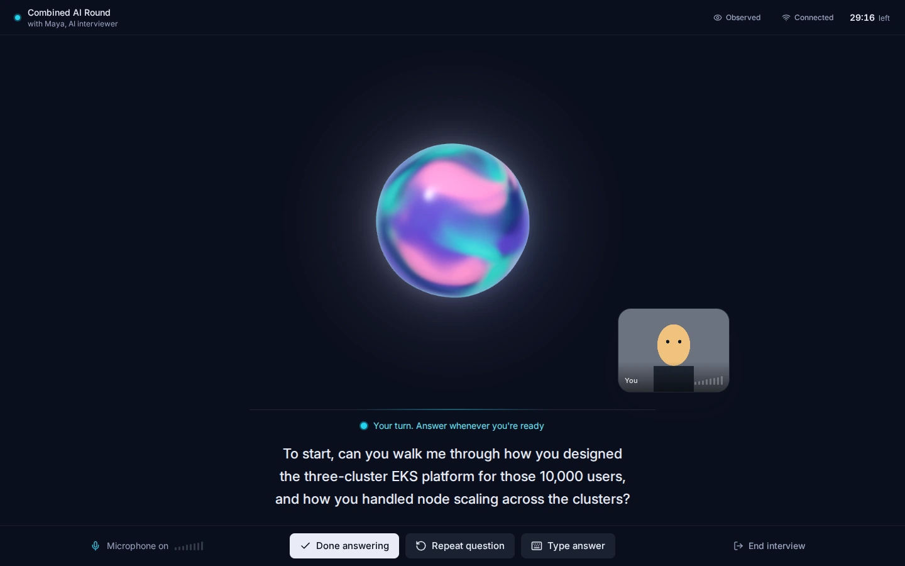
</p>

Written for: the TechSara team, engineers joining the project and anyone opening the repository.

## Contents

- [Features](#features)
- [Screenshots](#screenshots)
- [Architecture](#architecture)
- [System flows](#system-flows)
- [Measured performance](#measured-performance)
- [Quick start](#quick-start)
- [URLs and ports](#urls-and-ports)
- [Development credentials](#development-credentials)
- [Project layout](#project-layout)
- [Running tests](#running-tests)
- [Documentation](#documentation)
- [Privacy, fairness and human oversight](#privacy-fairness-and-human-oversight)
- [Limitations](#limitations)
- [License](#license)

## Features

### Candidate experience

- **Two ways in.** A personal invite link (`/i/<token>`, email plus an optional access code) or a shareable open
  link for many candidates (`/j/<token>`, registration form). Open-link candidates also get a personal "continue
  later" link (`/r/<token>`).
- **Guided journey.** Welcome, instructions, consent to a policy-specific disclosure, résumé upload, round choice
  (when the invite allows it), system check, interview, completion page.
- **Résumé upload.** PDF, DOCX, TXT, PNG/JPEG and scanned PDFs (OCR). A quick profile is on screen about 0.8 s
  after upload; the full AI profile follows in about 15-29 s on the shared GPU.
- **System check.** Browser, camera, microphone, speakers, connection, interviewer view and the on-device face
  check, with plain-language tips.
- **Interview room.** The interviewer is a frameless, audio-reactive voice orb (three palettes; idle, listening,
  thinking and speaking states that follow the audio the candidate actually hears). Live captions, "Done
  answering", "Repeat question" and "Type answer" controls, reconnect and resume after a dropped connection, 2D and
  text fallbacks for weak devices. A realistic 3D avatar (CC0 MPFB model with viseme lip-sync) stays selectable.
- **No scores for candidates by default.** Candidates see a thank-you page; a candidate report is shown only when
  the organisation turns it on.

### AI interviewer

- **Deterministic guardrails, generative phrasing.** A pure policy function decides what is allowed on each turn
  (time, coverage, difficulty, résumé claims to verify, contradictions, coding); the 35B model chooses within that
  and phrases one question. Every model output is schema-validated and post-checked.
- **Speech-first streaming.** The structured turn decision streams its `speech` field first, so text-to-speech
  starts after a few tokens: first interviewer words 0.56-0.73 s after the call.
- **Turn understanding.** "Can you hear me?", "Should I start?", "Let me think" and half-finished fragments get a
  short reply and never consume the pending question.
- **Grounded and fair.** The interviewer never claims the candidate said something they did not, asks one gentle
  follow-up after a hedged answer, verifies résumé claims respectfully and phrases contradictions as questions.
- **Own questions.** Questions are written from the candidate's résumé and answers; the question bank (round- and
  role-aware retrieval) is inspiration, not a script.
- **Voice loop.** Browser AudioWorklet (16 kHz PCM) over one WebSocket, Silero VAD, pause-delimited Whisper
  segments on two replicas, adaptive end of turn (600-1700 ms of silence), glossary correction of technical terms,
  Kokoro TTS with viseme timings, barge-in, reconnect and resume.

### Intake interview module

Training-program screening (`round_type: intake`). Staff create single or batch invitations (up to 200 rows; links
are shown once). The candidate fills in a details form and checks what was read from the résumé, then takes a
35-50 minute voice interview (45 by default) in seven fixed parts with server-enforced timers:

| Part | What happens |
|---|---|
| 1 Introduction | self-introduction and the project they are proudest of |
| 2 Your experience | two or three résumé claims, from "what did you personally do" to "what would break" |
| 3 Standard questions | confirms the details form (target role, best language, self-rating, commitment) |
| 4 Reading exercise | Drill A: read a passage aloud (up to 3 min). Drill B: read another passage silently for 30 s, the server hides it, then explain it and answer three follow-ups |
| 5 Speaking exercise | topic card with four points: 60 s to prepare, up to 2 minutes to speak |
| 6 Learning and growth | how they would learn in three weeks of intensive training |
| 7 Your questions | answered only from the approved program information |

The worker then proposes seven weighted competency scores (1-5 or "insufficient evidence"), each quoting the
answers it rests on, a weighted total, an advisory band (strong accept ≥ 4.20, accept with notes 3.30-4.19,
borderline 2.50-3.29, reject < 2.50) and a training plan. A reviewer records one of five decisions (accept, accept
with notes, second interview, reject, request evidence) with a rationale. Work-authorisation answers never reach a
model, score, report or export. Details: [intake guide](docs/INTAKE_INTERVIEW_GUIDE.md).

### Coding round

- Monaco editor; Python, JavaScript, TypeScript, Java, Go, C++ and SQL.
- Every run executes in a fresh, network-less, read-only, resource-limited container behind an HMAC-authenticated
  sandbox service (p50 278-696 ms per run, about 200 ms of it container lifecycle).
- Exactly three graduated hints, priced into the score; a quiet AI observer that comments only on triggers;
  evaluation combines the sandbox's test results with a 35B code review.
- The interviewer announces the exercise and the editor opens on its own when the policy starts the coding segment.

### Integrity monitoring and face check

- Disclosed browser signals (focus, tab visibility, fullscreen, clipboard sizes, reloads, disconnects) and periodic
  camera or screen frames analysed by the 8B vision model.
- On-device face check (MediaPipe BlazeFace: one face visible, more than one face, framing and light tips),
  confirmed on the server by a deterministic face detector (OpenCV YuNet).
- A rule engine with warn, pause and terminate actions for objective, disclosed rules only. Vision and face signals
  can never pause or end an interview, and gaze alone never counts.
- A human review queue: "Signals are observations, not determinations."

### Recordings

With consent, the whole interview is recorded (camera video plus both voices, interviewer and candidate) and
remuxed with ffmpeg into one seekable file. Staff watch it on the session's Recording tab with transcript sync and
integrity markers. Downloads are admin-only and audited; recordings are deleted after 30 days by default.

### Scoring, reports and the human decision

Atomic evidence per competency → scores with confidence → rubric categories → an assistive recommendation (never
an automatic reject) → recruiter and candidate narratives that cite evidence (`E1`, `Q1` aliases mapped back to
records, neutral wording) → a separate human review decision. Short rounds are scored against round-scoped targets;
a competency without evidence has no score (NULL), not a low one. Candidate reports are off by default
(`candidate_report_mode: never`).

### Open interview links

One shareable link per job and round(s) for campus drives and job posts: a configurable registration form with a
fairness guard (protected-trait fields are blocked), one attempt per person (same email or phone blocked; same
device, résumé or network flagged for review), multi-round progression (immediately or after recruiter review), a
registrations table with advance, retake and CSV export, and a QR code.

### Recruiter app

Dashboard, jobs and rounds editor, invitations, interview links, candidates with parsed profile and job match,
intake interviews (list, create, batch, review, analytics, settings), question bank (semantic search, generation),
coding question editor with sandbox validation, templates, organisation settings, users, sessions, session detail
(transcript, recording, questions and evidence, competencies, timeline, coding replay, integrity, plan and claims,
review), live monitor (server-sent events), printable report and analytics.

### Content library

Validated catalog in `samples/`, checked by `uv run python -m app.seed.validate` (in `apps/api`):

| Content | Count |
|---|---|
| Curated interview questions | 9,780 (at least 1,000 for each of the ten spoken round types; easy 29 %, medium 47 %, hard 24 %) |
| Coding problems | 1,039: 932 function problems with Python and JavaScript reference solutions, 107 SQL |
| Competencies (with rubrics) | 68 |
| Roles | 25 |
| Round templates | 13 (one per round type, including intake) |
| Demo jobs (`make demo`) | 5, including "AI/ML Training Program — Intake" |

### Theme and layouts

Light, dark and system theme (applied before first paint, CSP-safe) and phone-friendly layouts for both the
candidate and the staff app. The TechSara brand mark appears on the sign-in page, the staff app and candidate
pages.

### Operations

Docker Compose project `interview`, Caddy edge with LAN HTTPS, Prometheus with 32 alert rules, three Grafana
dashboards, database and file backups (`make backup-db`, `make backup-storage`), smoke test (`make smoke`).

## Screenshots

All screenshots use demo or fictional data; camera tiles show a synthetic test image, never a real person.

| | |
|---|---|
| 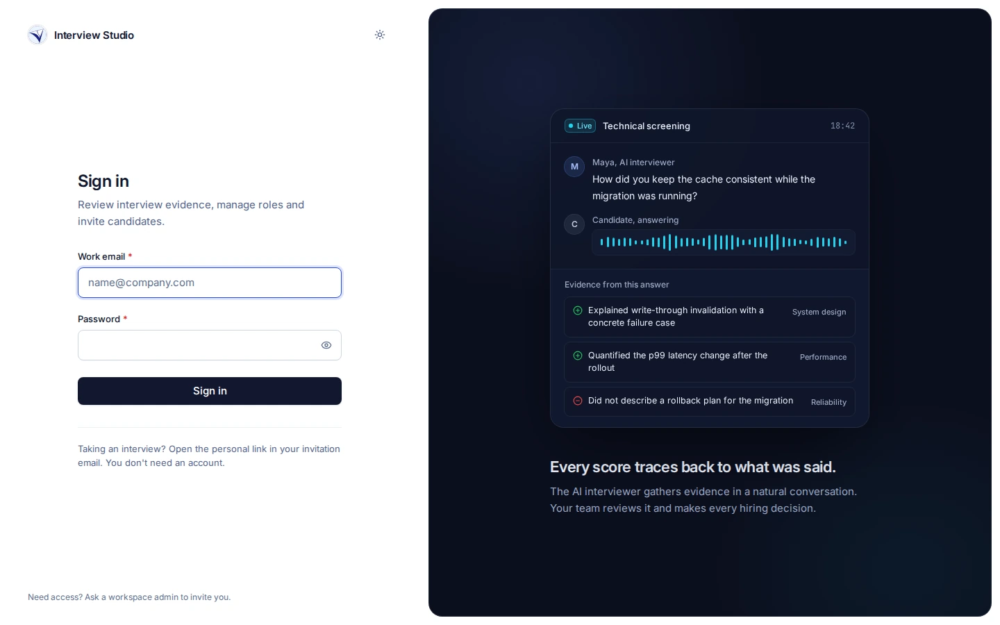<br>Staff sign-in | 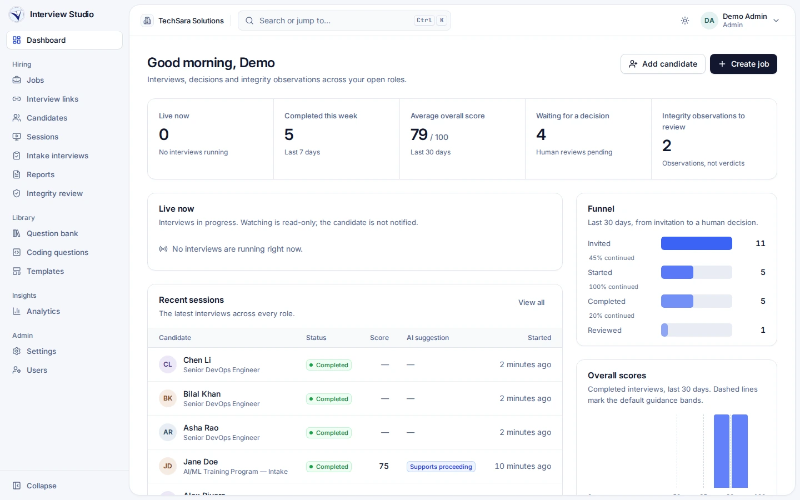<br>Staff dashboard |
| 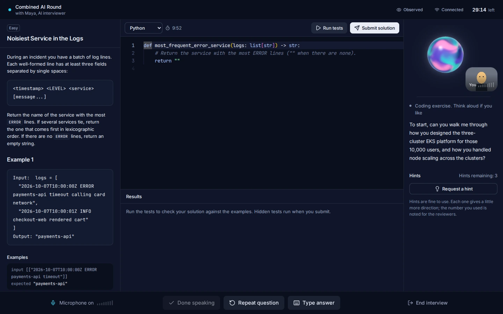<br>Coding round inside the interview | 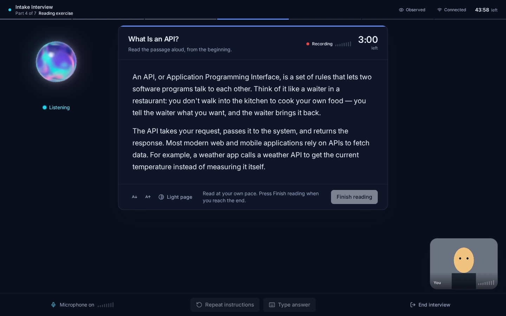<br>Intake reading exercise (Drill A) |
| 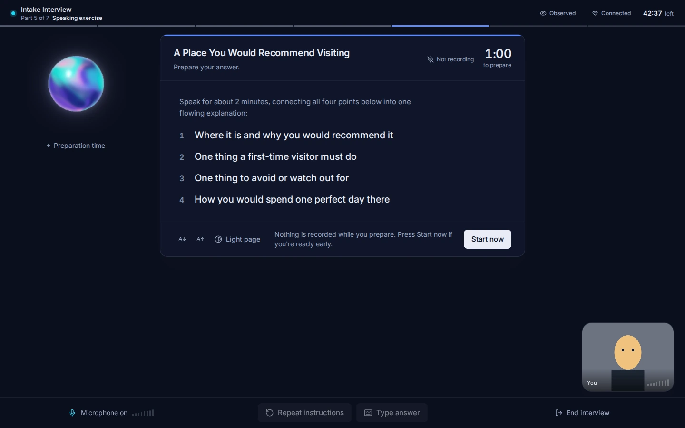<br>Intake speaking exercise (topic card) | 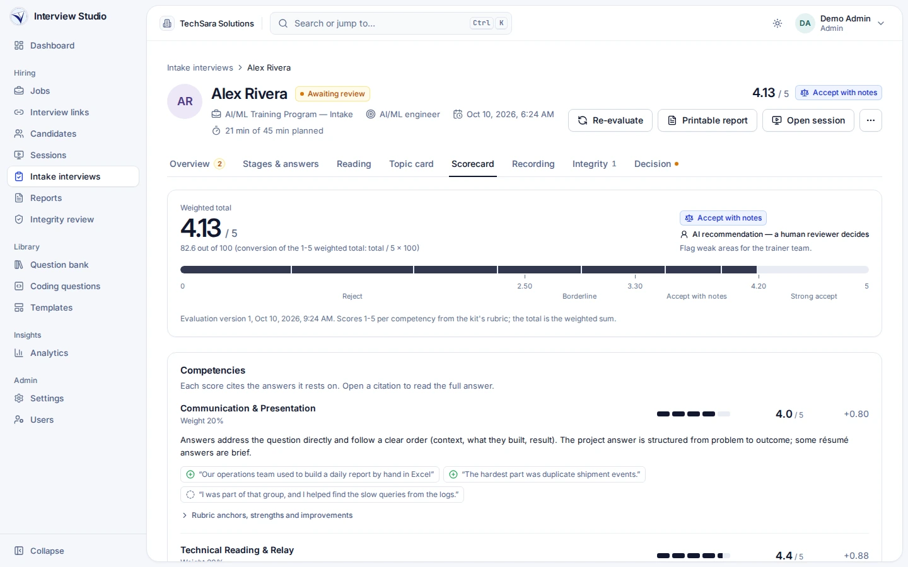<br>Intake scorecard: weighted total, bands, quoted evidence |
| 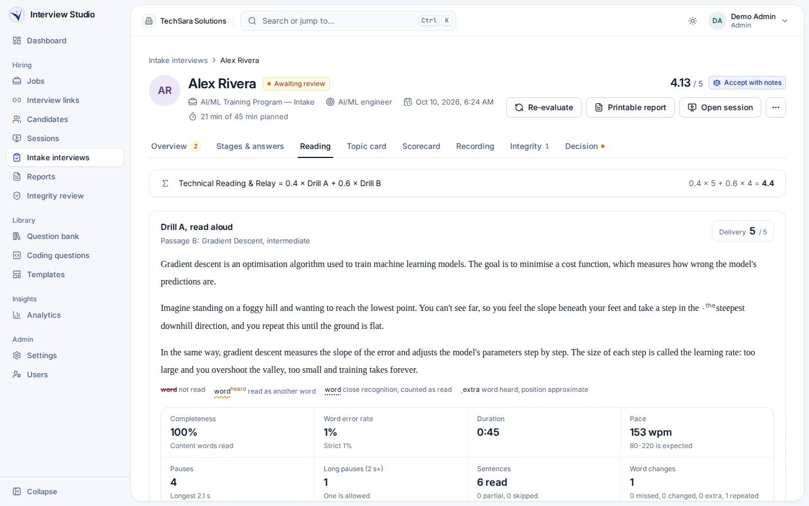<br>Reading review: alignment marks, error rate, pace | 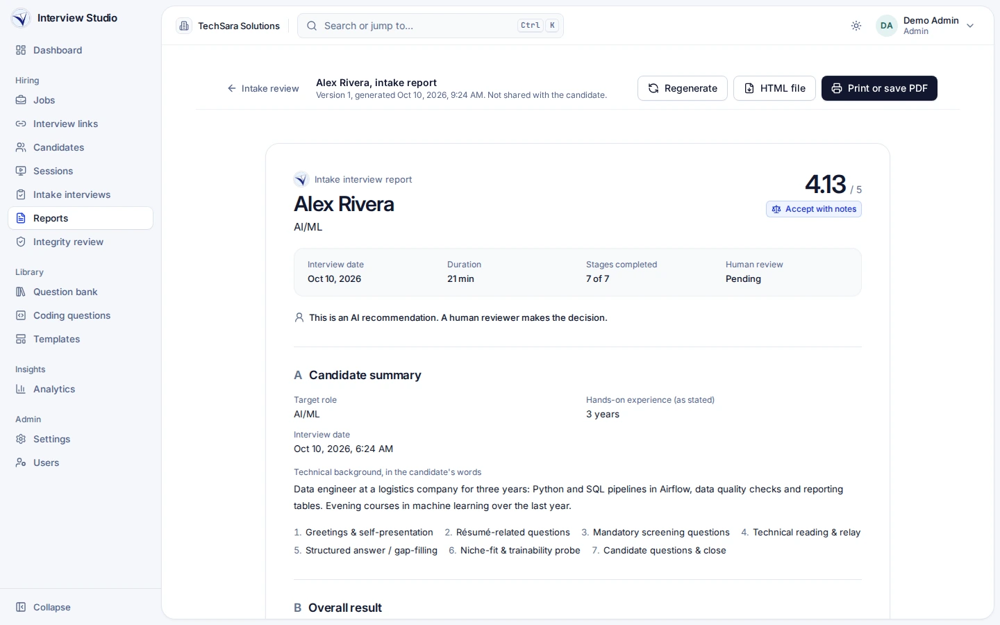<br>Printable intake report |
| 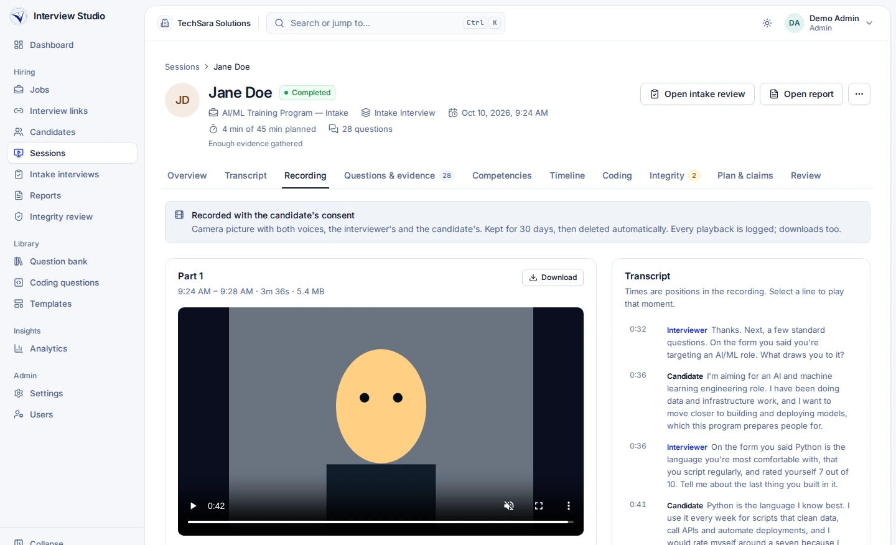<br>Recording with transcript sync | 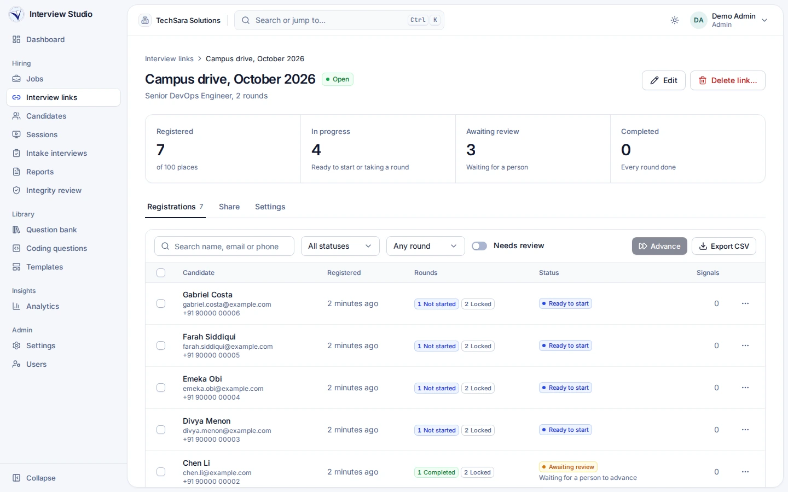<br>Open interview link and registrations |
| 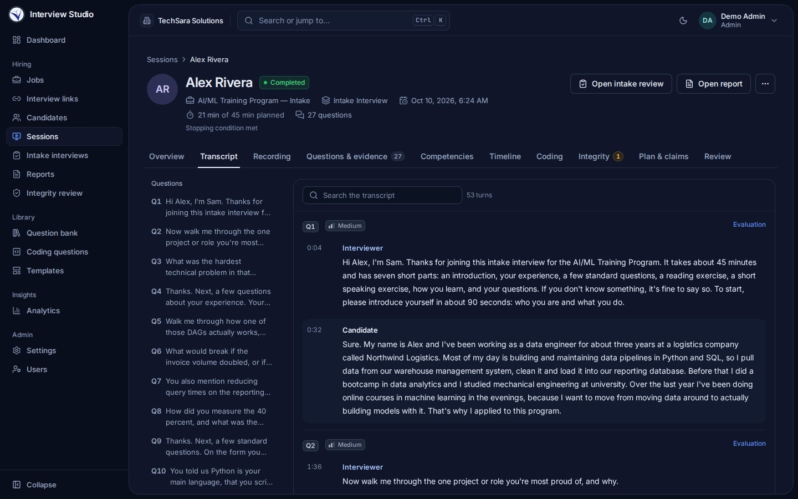<br>Session transcript (dark theme) | 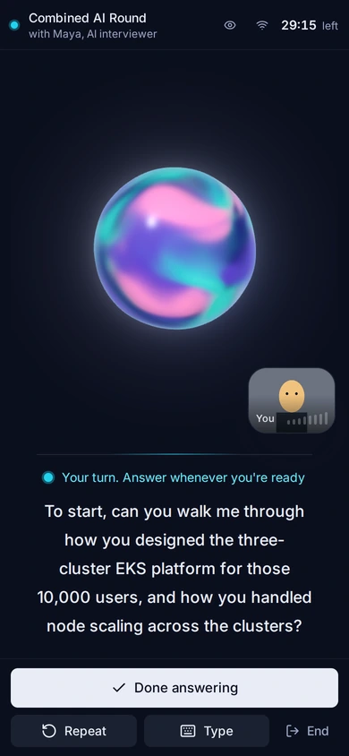 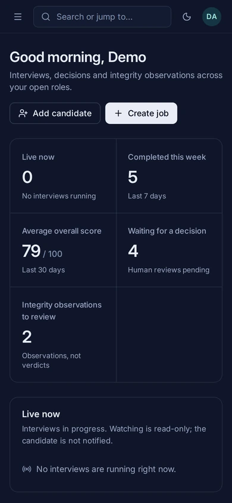<br>Phone layouts (390 px) |

## Architecture

A single host runs the Compose project; the model servers belong to another stack on the same host and its second
node, and their GPU is shared with production work.

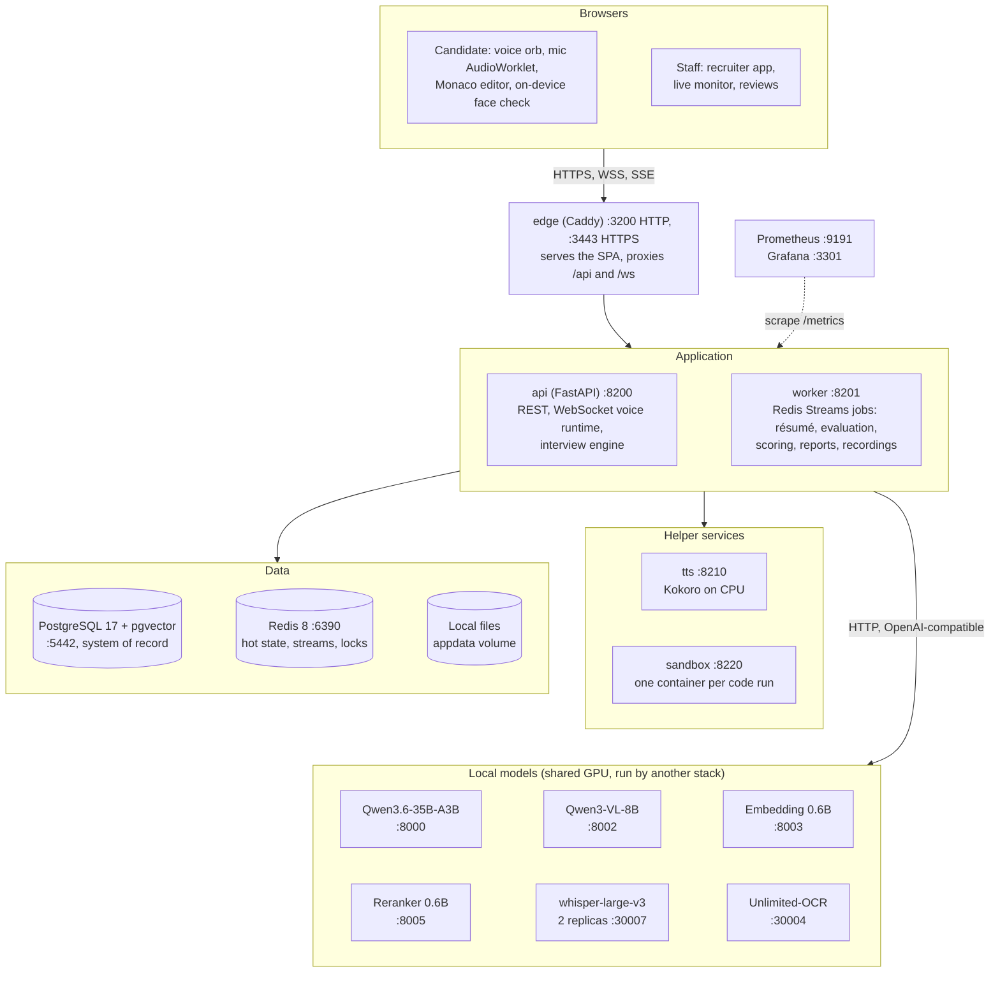

| Model | Role |
|---|---|
| `Qwen/Qwen3.6-35B-A3B-NVFP4` (:8000) | turn decisions, answer and coding evaluation, résumé profile, reports, intake evaluators |
| `Qwen/Qwen3-VL-8B-Instruct-FP8` (:8002) | camera and screen frames, memory summaries, fallback for turn tasks when the main model is unavailable |
| `Qwen/Qwen3-Embedding-0.6B` (:8003), `Qwen/Qwen3-Reranker-0.6B` (:8005) | résumé evidence, question retrieval, job match, near-duplicate checks |
| `openai/whisper-large-v3` (two replicas, :30007) | speech recognition; each replica serves one request at a time |
| `baidu/Unlimited-OCR` (:30004) | scanned résumé pages |
| Kokoro-82M (own `tts` service, CPU) | interviewer voice with per-phoneme viseme timings |
| MediaPipe BlazeFace (browser), OpenCV YuNet (server) | face check |

### Deployment topology

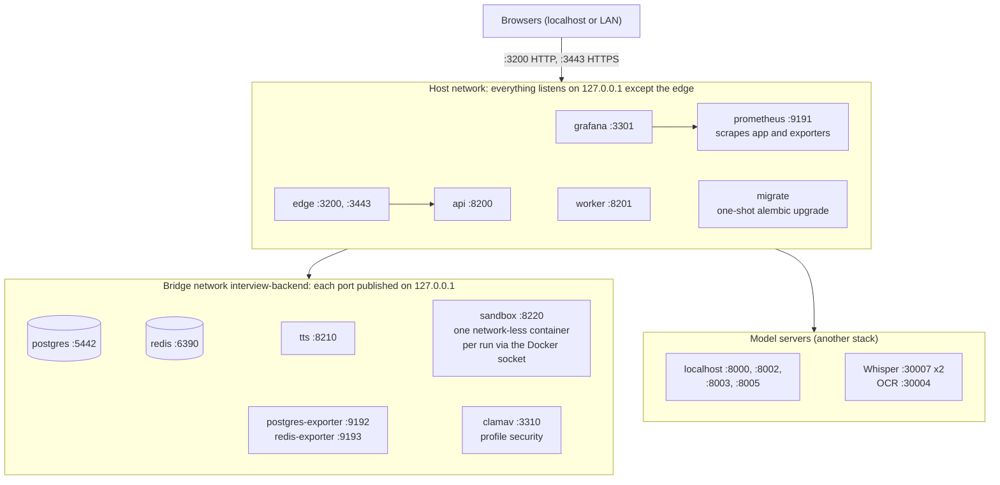

- `api`, `worker`, `migrate`, `edge`, `prometheus` and `grafana` use host networking so the model endpoint URLs in
  `.env` (`http://localhost:8000/v1`, ...) are identical inside and outside containers.
- Only the edge listens on non-loopback interfaces. It blocks `/metrics`, `/api/v1/test/*` and `/__edge/metrics`
  for non-loopback clients. The SPA, REST API (`/api/v1`), WebSocket (`/ws/sessions/{id}`) and SSE stream share one
  origin, so cookies are first-party and the CSP is `'self'`.
- Redis holds hot copies and coordination only; PostgreSQL is the system of record; files are served only through
  short-lived, HMAC-signed API URLs.

### Tech stack

| Layer | Technology |
|---|---|
| Web (`apps/web`) | React 19, React Router 7, Vite 7, TypeScript 5.9, Tailwind CSS 4, TanStack Query 5, three.js + React Three Fiber (voice orb), Monaco editor, MediaPipe Tasks Vision, AudioWorklet |
| API and worker (`apps/api`) | Python 3.12, FastAPI, Pydantic, SQLAlchemy 2 (async), Alembic (migrations `0001`-`0006`), Redis Streams job queue |
| Voice | Silero VAD (ONNX), Whisper large-v3, Kokoro-82M ONNX on CPU (`services/tts`) |
| Data | PostgreSQL 17 with pgvector 0.8 (HNSW), Redis 8 (AOF), local filesystem storage |
| Code execution (`services/sandbox`) | one Docker container per run; runtime images for Python, Node.js, Java, Go and C++ |
| Edge and operations (`infra/`) | Caddy 2.11, Prometheus 3.2, Grafana 11.5, PostgreSQL and Redis exporters, optional ClamAV upload scanning |

Details: [ARCHITECTURE.md](ARCHITECTURE.md) (services, Redis keys, data model, key decisions) and
[DEPLOYMENT.md](DEPLOYMENT.md).

## System flows

### Candidate journey

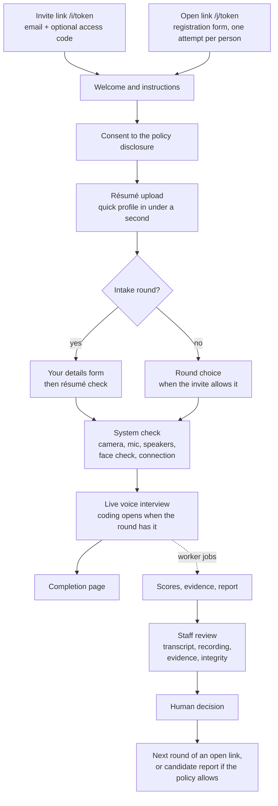

### One voice turn

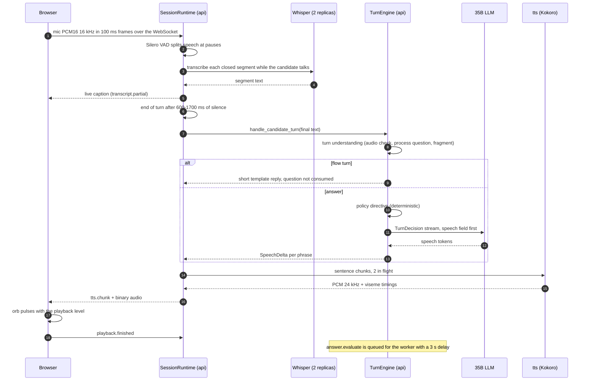

A pre-synthesised acknowledgement ("Got it.") plays at the end of a spoken answer of 2.5 s or more while
recognition and the model run. End of turn to first interviewer audio: p50 2.1 s, p95 2.6 s on the shared GPU.

### Intake interview stages

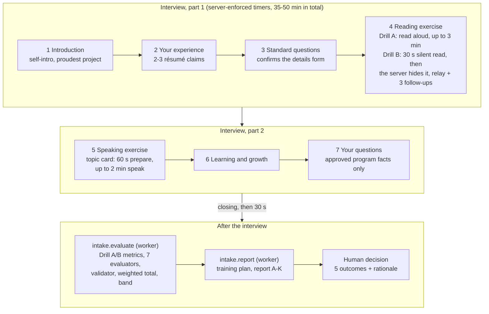

The stage machine is deterministic (`apps/api/app/services/intake/stages.py`); the model phrases résumé questions and
follow-ups inside limits the system sets. Drill B's passage is never on screen for more than 30 seconds in total.

### Evaluation and report pipeline

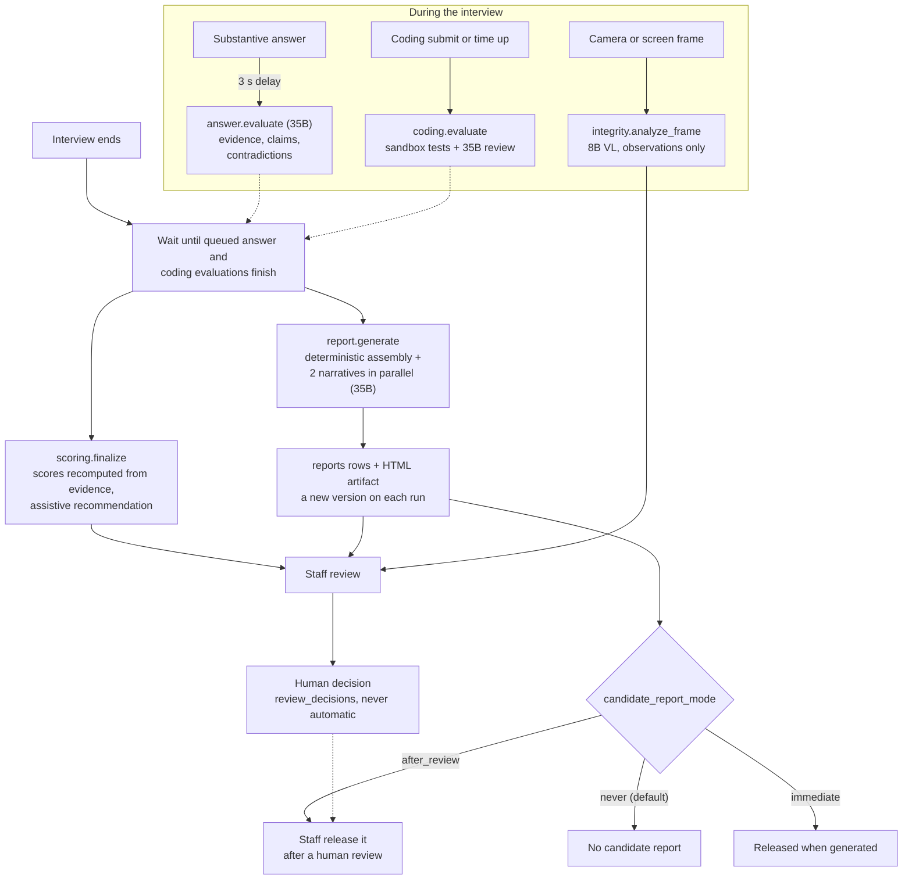

Every job is idempotent: the `background_jobs` row is the source of truth and Redis Streams dispatch it, with
retries, dead letters and recovery on worker start. Intake sessions skip `report.generate`; `intake.evaluate` and
`intake.report` replace it (diagram above). Session events (`evaluation.ready`, `report.ready`, ...) are published
on `session:{id}:bus`, so the live room and the staff live monitor update without polling.

## Measured performance

Measured on the DGX Spark host with the GPU shared with another production stack (2026-10-07 and 2026-10-08).
Source and method: [AI_PIPELINE.md](AI_PIPELINE.md#measured-latencies-summary),
[ARCHITECTURE.md](ARCHITECTURE.md#measured-numbers-dgx-spark-shared-gpu-2026-10-07).

| Step | Measurement |
|---|---|
| Main LLM time to first token | 0.1-0.5 s, 45-60 tokens/s |
| First spoken text of a turn | 559-699 ms in-process, 718-730 ms through the WebSocket |
| End of turn to first interviewer audio | p50 2.1 s, p95 2.6 s |
| Speech understanding | turn word error rate 0.059 (was 0.211), technical terms 12/12 |
| Kokoro TTS first chunk | about 0.38 s uncached, 5-15 ms cached |
| Code execution (p50, tests mode) | Python 278 ms, JavaScript 294 ms, TypeScript 372 ms, Go 442 ms, Java 683 ms, C++ 696 ms, SQL 319 ms |
| Résumé | quick profile visible in about 0.8 s; full profile 15-29 s; scanned résumés 31-38 s |
| Report generation | about 56 s (two narrative calls in parallel) |
| Vision frame analysis (8B VL) | about 10.4 s per frame |

Alert thresholds: interviewer turn latency p95 > 3 s, time to first audio p95 > 2 s
(`infra/prometheus/rules/alerts.yml`).

## Quick start

Prerequisites: Docker Engine with Compose v2.17+, GNU make, bash, curl, python3, [uv](https://docs.astral.sh/uv/),
Node.js 20.19+ or 22.12+, about 4 GB of disk, and network access to the local model endpoints (see
[LOCAL_SETUP.md](LOCAL_SETUP.md#prerequisites)).

```bash
make setup            # .env with fresh secrets, model/avatar assets (sha256-checked), uv + npm dependencies
make doctor           # preflight: tooling, .env, the configured AI endpoints, assets, runtime images
make sandbox-images   # per-language code runner images (python, node, java, go, cpp)
make up               # docker compose up -d, then wait until every service is healthy
make seed             # organisation, one account per staff role, global catalog; prints the logins
make demo             # optional: the same plus 5 demo jobs, 2 demo candidates and their invite links
make smoke            # health, edge headers, Prometheus targets
```

`make seed` and `make demo` run on the host (`uv run python -m app.seed ...` in `apps/api`), so run `make setup`
(which installs the uv environment) first. `make demo` creates two demo candidates with 14-day invitations and
prints their interview links: Jane Doe (Senior DevOps Engineer, combined AI round) and Marcus Okafor (Backend
Engineer (Python), candidate picks the round). Running it again rotates the links. Other candidates and interviews
are created in the recruiter app (Jobs > job > Invite candidate, Interview links, or Intake interviews > Create).

For hot-reload development (API, worker and Vite on the host) see
[LOCAL_SETUP.md](LOCAL_SETUP.md#development-mode-hot-reload).

## URLs and ports

| What | URL |
|---|---|
| Web app (staff sign-in at `/login`, staff app under `/app`) | http://localhost:3200 |
| Same app over HTTPS for other devices on the LAN | `https://<host-ip>:3443` ([LAN HTTPS](LOCAL_SETUP.md#testing-from-other-devices-on-the-lan-https)) |
| Candidate invite links | `<PUBLIC_BASE_URL>/i/<token>` (shown once when the invite is created) |
| Open interview links | `<PUBLIC_BASE_URL>/j/<token>` (shown on the link's Share tab) |
| API docs (when `ENABLE_API_DOCS=true`; open directly, not through the edge) | http://127.0.0.1:8200/api/docs |
| Grafana (user `admin`, password `GRAFANA_ADMIN_PASSWORD` in `.env`) | http://127.0.0.1:3301 |
| Prometheus | http://127.0.0.1:9191 |
| Design-system and interviewer-presence playgrounds (development aids; Vite dev server via `make web-dev`, or builds made with `VITE_ENABLE_DEV_ROUTES=true`) | http://localhost:5173/dev/ui, http://localhost:5173/dev/avatar |

| Service | Port | Network |
|---|---|---|
| edge (Caddy, SPA) | 3200 HTTP, 3443 HTTPS | host, all interfaces |
| api | 8200 | host, 127.0.0.1 |
| worker (metrics, health) | 8201 | host, 127.0.0.1 |
| tts | 8210 | bridge, published on 127.0.0.1 |
| sandbox | 8220 | bridge, published on 127.0.0.1 |
| postgres / redis | 5442 / 6390 | bridge, published on 127.0.0.1 |
| prometheus / grafana | 9191 / 3301 | host, 127.0.0.1 |
| postgres-exporter / redis-exporter | 9192 / 9193 | bridge, published on 127.0.0.1 |
| clamav (profile `security`) | 3310 | bridge, published on 127.0.0.1 |

Full port map: [LOCAL_SETUP.md](LOCAL_SETUP.md#ports).

## Development credentials

`make seed` creates four staff accounts in the organisation "TechSara Solutions":

| Role | Email (overridable with `SEED_*_EMAIL` in `.env`) |
|---|---|
| SUPER_ADMIN | `superadmin@demo.local` |
| ADMIN | `admin@demo.local` |
| RECRUITER | `recruiter@demo.local` |
| INTERVIEWER | `interviewer@demo.local` |

All four share the password `SEED_PASSWORD` from `.env` (generated by `make setup`, printed by `make seed`).
`uv run python -m app.seed --reset-passwords` (in `apps/api`) resets them to that value and clears lockouts. The
seed is the only way to create the first SUPER_ADMIN. Never reuse these accounts or the generated `.env` outside
development, and never commit `.env`.

## Project layout

```
apps/api/            FastAPI app (package `app`): REST API, WebSocket interview runtime, worker, Alembic
  app/ai/            model clients (LLM, embeddings, reranker, Whisper, OCR, TTS), routing, structured outputs
  app/realtime/      voice runtime: VAD, segmentation, STT scheduling, end-of-turn, TTS streaming, barge-in
  app/services/      interview engine, intake, scoring, reports, coding, integrity, resume, jobs, open links, storage
  app/api/routers/   one module per REST resource
  app/workers/       background job handlers (Redis Streams)
  app/seed/          seed CLI, catalog loaders and the content validator
apps/web/            Vite + React 19 SPA (candidate app, staff app, interviewer presence), served by the edge
services/tts/        Kokoro TTS microservice (CPU) with viseme timings
services/sandbox/    code execution service + per-language runtime images
infra/               Caddy edge, Prometheus rules and tests, Grafana dashboards, Postgres init
samples/             validated catalog: competencies, roles, round templates, question bank, coding problems,
                     intake kit, demo jobs, sample résumés
scripts/             setup, asset download, backups and restores, smoke test, edge CA export
tests/e2e/           Playwright end-to-end tests (full voice interview; intake interview on a mock-AI stack)
docs/                documentation index, intake guide, design-time contracts, README images
```

## Running tests

| Suite | Command | Needs |
|---|---|---|
| API unit tests (mock AI) | `make test-api` (`uv run pytest -m "not live and not integration"` in `apps/api`) | nothing running |
| Web unit tests | `make test-web` (`npm test` in `apps/web`); also `npm run typecheck`, `npm run build` | nothing running |
| API integration tests | `make test-integration` (`-m integration`) | postgres + redis (`make infra-up`); each pytest process creates and drops its own `interview_test_*` database |
| Live model tests | `make test-live` (`-m live`) | the local model endpoints; they are shared with production, keep runs small |
| Coding sandbox tests | `cd services/sandbox && uv run pytest` (unit); `uv run pytest -m integration tests/integration` | integration: running sandbox + runtime images |
| TTS service tests | `cd services/tts && uv run pytest`; `uv run pytest -m live` | live: running tts service |
| Content validator | `uv run python -m app.seed.validate` (in `apps/api`; `--stats` for coverage) | nothing running |
| End-to-end | `make test-e2e` (Playwright in `tests/e2e`, base URL `E2E_BASE_URL`, default `http://localhost:3200`) | full stack, `ENABLE_TEST_HOOKS=true`, `make demo`, live models; `full-interview.spec.ts` (30-minute timeout) drives a voice interview through a fake microphone fed with recorded WAV clips (`intake.spec.ts` is skipped there unless `E2E_INTAKE_LIVE=1`, see the next row); credentials from `E2E_RECRUITER_EMAIL` / `E2E_PASSWORD` or `SEED_PASSWORD` in `.env`, test-hook token from `E2E_TEST_HOOKS_TOKEN` or `TEST_HOOKS_TOKEN` in `.env` |
| Intake end-to-end (mock AI) | `cd apps/api && uv run python ../../tests/e2e/mock-stack/stack.py --run specs/intake.spec.ts` | postgres + redis (`make infra-up`), `npm ci` in `apps/web` and `tests/e2e`; the script builds and removes its own throwaway stack (`interview_test_*` database seeded with `--demo`, leased Redis DB, API on :8480 with test hooks, worker, Vite on :5280, mock AI registry: no model calls); staff create -> candidate journey -> seven stages and the three exercises -> evaluation, report, decision in about 4 minutes; details in the [intake guide](docs/INTAKE_INTERVIEW_GUIDE.md#end-to-end-test-mock-ai) |
| Infrastructure | `make test-infra` | Docker (Caddy validate, promtool, compose invariants, dashboards, shellcheck, edge behaviour tests) |

Pytest markers (`apps/api/pyproject.toml`): `integration`, `live`, `sandbox`; `live` tests are excluded unless
selected with `-m live`. Other quality targets: `make lint`, `make typecheck`.

## Documentation

| Document | Contents |
|---|---|
| [ARCHITECTURE.md](ARCHITECTURE.md) | services, networking, data stores, data model, key decisions with measured numbers |
| [LOCAL_SETUP.md](LOCAL_SETUP.md) | prerequisites, step-by-step setup, development mode, ports, LAN HTTPS, troubleshooting |
| [DEPLOYMENT.md](DEPLOYMENT.md) | production configuration, TLS, observability and alerts, backups, scaling, security checklist |
| [AI_PIPELINE.md](AI_PIPELINE.md) | every model's role, routing, structured outputs, streaming, STT/TTS, measured latencies, fallbacks |
| [INTERVIEW_ENGINE.md](INTERVIEW_ENGINE.md) | interview state, policy directive, turn understanding, difficulty, scoring formulas as implemented, reports, human review, intake mode |
| [AVATAR_SYSTEM.md](AVATAR_SYSTEM.md) | interviewer presence: voice orb states, speaking sync, fallbacks, the optional 3D avatar |
| [CODING_INTERVIEW.md](CODING_INTERVIEW.md) | languages, signatures, sandbox isolation and attack tests, hints, observer, evaluation |
| [INTEGRITY_MONITORING.md](INTEGRITY_MONITORING.md) | signals, rules, vision constraints, face check, consent, retention, recordings, limitations, reviewer workflow |
| [SECURITY.md](SECURITY.md) | threat model, controls, data protection, responsible-AI constraints, known gaps |
| [docs/INTAKE_INTERVIEW_GUIDE.md](docs/INTAKE_INTERVIEW_GUIDE.md) | intake interviews: running them (recruiters, admins) and the module (engineers) |
| [samples/README.md](samples/README.md) | catalog layout and the content validator |
| [docs/README.md](docs/README.md) | documentation index, design-time contracts and the implementation report |

## Privacy, fairness and human oversight

- **A person decides.** Scores and recommendations are assistive and never reject anyone automatically. The human
  decision is its own record (`review_decisions`; intake decisions with a required rationale), overrides of the AI
  recommendation are counted in analytics, never blocked, and staff screens show every AI recommendation next to
  the note that a person makes the decision.
- **Integrity signals are observations.** Nothing in the platform concludes that a candidate cheated. Camera,
  screen and face-check observations can never pause or end an interview, gaze alone never counts, and a reviewer
  sees every flag in context.
- **Disclosed before recorded.** The candidate consents to a disclosure generated from the actual policy before
  anything is captured; what is not disclosed is not recorded. No clipboard content, no keystrokes and no audio
  analysis for integrity.
- **No protected traits.** Every evaluative prompt carries the fairness rules (judge job-relevant content only;
  never infer or use emotion, personality, race, ethnicity, national origin, religion, disability, health, age,
  gender, sexual orientation, family status, appearance or accent, or proxies such as name, photo, voice, school
  prestige or employment gaps). The content validator lints questions and rubrics for protected topics; the
  open-link form builder blocks protected-trait fields; education dates are dropped from résumé extraction;
  intake work-authorisation answers never reach a model, score, report, export or analytics, and candidate names
  are replaced by `[name]` before any intake evaluator sees an answer.
- **Speech is judged on content.** Filler words, pauses, non-native phrasing, pronunciation and accent are not
  evidence.
- **Candidate reports are off by default.** `candidate_report_mode` defaults to `never`; `after_review` needs a
  human review first. Candidate reports never contain the recommendation, integrity data or claim verification.
- **Local and minimal.** No cloud models; files on the local filesystem behind signed, short-lived URLs; default
  retention: recordings and frames 30 days, answer audio 90 days, résumés and transcripts 365 days, reports 730
  days; recording downloads admin-only and audited; per-candidate archive and erasure.

Details: [SECURITY.md](SECURITY.md#responsible-ai-and-fairness), [INTEGRITY_MONITORING.md](INTEGRITY_MONITORING.md#principles).

## Limitations

- **Shared GPU.** The models are shared with another production stack; latency rises under load (Whisper outliers
  of about 11 s have been measured). Keep load tests and live-model test runs small.
- **Browser integrity has limits.** A web page cannot lock the computer, see OS-level app switching, other devices
  or a second person out of camera view; the Secure Interview Client in
  [INTEGRITY_MONITORING.md](INTEGRITY_MONITORING.md#secure-interview-client-design) is a design only.
- **The model is not perfect.** The 35B model sometimes narrates intent or uses mild praise despite the rules;
  post-checks log it but cannot retract speech already streamed.
- **Echo cancellation is assumed.** Without the browser's echo cancellation the interviewer's voice can trigger a
  barge-in; headphones help, and the system check does not verify that echo cancellation was applied.
- **Intake.** The AI never interrupts a long answer, pronunciation is not assessed, there is no outbound email
  (staff copy links), a candidate could photograph the Drill B passage during its 30 seconds, evaluation takes
  minutes on the shared GPU, and real-model latency of live intake turns has not been measured yet.
- **Before any internet-facing deployment** close the top items of the hardening backlog in
  [SECURITY.md](SECURITY.md#known-gaps-and-hardening-backlog), first of all the Docker socket in the sandbox service
  (use gVisor, rootless Docker or a socket proxy).
- **Data lifecycle.** There is no consent withdrawal flow, and transcripts, integrity events and the model-call
  ledger are not deleted automatically after their retention periods (erasure is manual, per candidate).

## License

The repository contains no license file: the code is proprietary to TechSara Solutions; ask the owner before
reusing or redistributing it. Third-party assets keep their own licenses: Kokoro-82M weights (Apache-2.0) and
kokoro-onnx (MIT) in `services/tts`, the MPFB avatar (CC0 1.0, `apps/web/public/avatars/LICENSES.md`) and MediaPipe
Tasks Vision with the BlazeFace model (Apache-2.0, `apps/web/public/mediapipe/LICENSES.md`).
