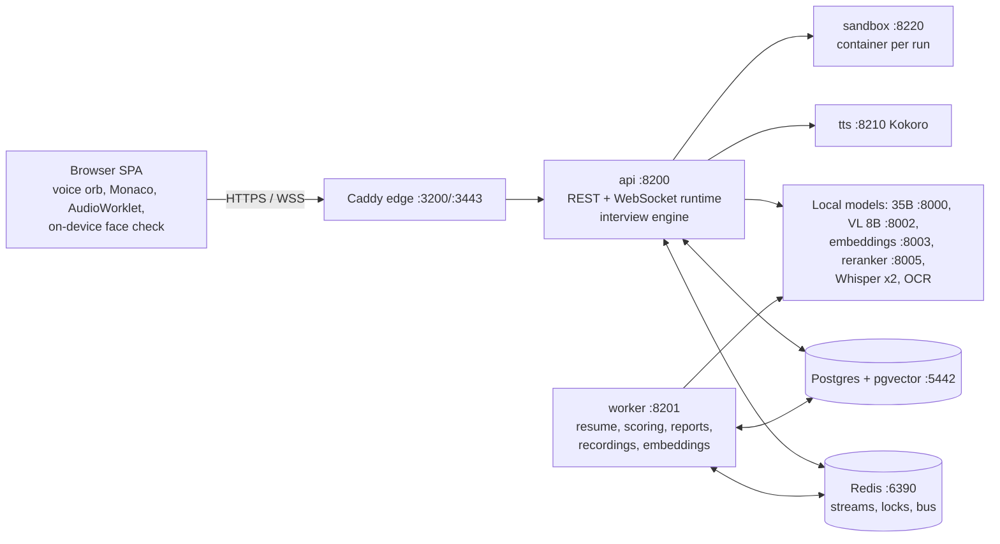

# Implementation report

Written for: the product owner and the engineers who take over Swayam.
State as of 2026-10-08 (deployed on the DGX Spark, compose project `interview`, Alembic head `0004`).

## 1. What was found

An empty directory. The platform was built from scratch: backend, realtime voice runtime, web app, AI pipelines,
sandbox, TTS service, infrastructure, tests, sample content and documentation. Only the owner's local model endpoints
were reused. No cloud LLMs, no S3/MinIO (local filesystem storage only, per the owner).

## 2. Architecture (summary)



Details: [ARCHITECTURE.md](../ARCHITECTURE.md). Other docs: README, LOCAL_SETUP, AI_PIPELINE, INTERVIEW_ENGINE,
AVATAR_SYSTEM (interviewer presence), CODING_INTERVIEW, INTEGRITY_MONITORING, SECURITY, DEPLOYMENT,
docs/design/OPEN_LINKS.md.

## 3. Services, ports, models

| Service | Port | Notes |
|---|---|---|
| edge (Caddy, SPA) | 3200 HTTP, 3443 HTTPS (LAN) | CSP self + `wasm-unsafe-eval`, loopback-only metrics/test hooks/API docs |
| api | 127.0.0.1:8200 | FastAPI, WebSocket interview runtime, engine |
| worker | 127.0.0.1:8201 (metrics) | Redis Streams jobs |
| tts | 127.0.0.1:8210 | Kokoro ONNX on CPU, viseme timings |
| sandbox | 127.0.0.1:8220 | one locked-down container per code run, 7 languages |
| postgres / redis | 127.0.0.1:5442 / 6390 | pgvector HNSW, AOF |
| prometheus / grafana | 127.0.0.1:9191 / 3301 | alerts, dashboards, exporters :9192/:9193 |

Models (all local): main `Qwen/Qwen3.6-35B-A3B-NVFP4` (turn-critical, evaluation, reports, resume), router/vision
`Qwen/Qwen3-VL-8B-Instruct-FP8` (camera/screen frames), `Qwen/Qwen3-Embedding-0.6B`, `Qwen/Qwen3-Reranker-0.6B`,
`openai/whisper-large-v3` (two replicas), `baidu/Unlimited-OCR`. Client side: MediaPipe BlazeFace (face check);
server side: OpenCV YuNet.

## 4. Feature status

| Area | Status |
|---|---|
| Candidate journey | invite or open link -> identity -> consent -> resume -> round -> system check -> interview -> report |
| Resume analysis | quick profile on screen in ~0.8 s, full AI profile ~15-20 s (was 62-96 s); scans 31-38 s (was 68-74 s); identical re-upload ~1 s |
| AI interviewer | speech-first streaming, deterministic policy + model-written questions from the candidate's resume and answers; grounding (never claims the candidate said something they did not), one gentle follow-up after hedges, varied wording, round/role-aware bank inspiration, quick-profile fallback after 90 s |
| Interviewer presence | animated voice orb (owner rejected realistic and cartoon avatars), pulses with the audio the candidate hears; 2D fallback; realistic avatar still selectable |
| Speech understanding | WER 0.059 (was 0.211), technical terms 12/12, no cut-offs on hesitation clips, glossary correction (Whisper server ignores prompts) |
| Coding round | Monaco, 7 languages, sandbox per run, exactly 3 hints priced into the score, quiet observer, evaluation |
| Integrity | disclosed browser signals, camera/screen frames, on-device face check + server YuNet confirmation; observations for human review only — never verdicts, never automatic rejection; gaze alone never counts |
| Recordings | consented video with both voices, ffmpeg finalize, Recording tab with transcript sync, admin-only audited download, 30-day retention |
| Scoring and reports | evidence-based competency scores with confidence, short-round calibration, assistive recommendation, neutral candidate/recruiter narratives; a human reviewer decides |
| Open interview links | one link for many candidates, form builder with fairness guard, one attempt per person, personal continue link, multi-round progression (immediate or after review), registrations table, CSV, QR |
| Content | 9,780 questions (>=1,000 per round type, 25 roles, 63 competencies), 1,039 coding problems (107 SQL), validator `uv run python -m app.seed.validate` |
| Recruiter app | jobs/rounds, invites, links, candidates + profiles, question bank, coding editor, templates, settings, users, sessions, live monitor, recordings, report, analytics |
| UI | light/dark/system theme, phone-friendly layouts, TechSara logo |

## 5. Migrations

`0001_initial`, `0002_global_catalog_uniqueness` (NULLS NOT DISTINCT), `0003_candidate_archive_and_list_indexes`,
`0004_open_interview_links` (interview_links, link_registrations, link_registration_rounds).

## 6. Tests (2026-10-08, after the final deploy)

| Suite | Result |
|---|---|
| API unit (`uv run pytest -m "not live and not integration"`) | 3,214 passed, 6 skipped (Java/Go not installed on the host; verified in the sandbox images) |
| API integration (per area, run by the feature owners) | interview 494, resume 199, recordings + related 409, integrity 290, open links 171 (+526 shared areas), coding + catalog 1,143, sandbox real 137, scoring/reports 242 — all passing |
| Web (`npm run typecheck`, `npx vitest run`) | typecheck clean, 823 / 823 passed; production build passes |
| Content validator | 0 errors, 0 warnings over 1,440 files |
| Smoke (`make smoke`) | 29 / 29 |
| Live open-links smoke | create link 201, landing open, register 201 + personal link, duplicate 409, registrations listed |
| Live voice E2E (`tests/e2e/specs/full-interview.spec.ts`) | passed in 5.4 min on the deployed stack with live models (voice, Whisper, engine, coding + hint, reports); test hooks then disabled (`ENABLE_TEST_HOOKS=false`) |

## 7. Performance (shared GPU; the owner's GPU was ~95% busy during round 2)

End of answer -> first interviewer audio p50 2.1 s / p95 2.6 s (measured when the GPU was quieter); first spoken text
~0.8 s p50, up to 1.6-1.7 s p95 under heavy load. Resume profile 15-20 s. Coding problem selection 25 ms pool load,
0.74 s live rerank. Face check: 4 fps on device, ~5% of one core; YuNet ~14 ms per frame. Orb 60 fps.

## 8. Known limitations and next steps

- Live persona-quality and latency re-checks of the final engine are pending until the GPU is free
  (`apps/api/tests/quality`, chain script in the scratchpad notes).
- vLLM prefix caching is off on the shared server; enabling `--enable-prefix-caching` would cut time to first token.
- Some generated question-bank entries have templated "common errors"/rubric lines; a polish pass would improve them.
- The interviewer's voice cannot be recorded when the browser falls back to its own speech synthesis.
- A candidate sitting far from the camera reads as "no face" on the device (tip asks them to sit closer).
- ffmpeg adds ~411 MB to the api/worker image (a static build would shrink it).
- Session timeline orders some events by creation time, not answer time.
- No email sending: invite and personal links are shown in the UI; add SMTP for email delivery.
- The TechSara logo source is ~164 px; provide an SVG for crisp large use.
- Consent withdrawal after the interview is handled by staff (candidate erasure); no self-service endpoint.

## 9. Commands

```bash
make up            # build + start, wait for health
make seed          # org, staff accounts, catalog (prints logins)
make demo          # + demo jobs, Jane Doe and Marcus Okafor invites (rotates links)
make smoke         # health checks
make test          # API unit + web tests
cd apps/api && uv run python -m app.seed.validate --stats   # content library check
cd tests/e2e && npx playwright test specs/full-interview.spec.ts   # live voice E2E (needs ENABLE_TEST_HOOKS=true)
```

URLs: web http://localhost:3200 (staff `/login`, staff app `/app`, interview links `/app/links`), LAN
`https://<host-ip>:3443`, Grafana http://127.0.0.1:3301. Dev staff accounts: `superadmin|admin|recruiter|interviewer@demo.local`,
password `SEED_PASSWORD` in `.env` (generated locally; never reuse outside development).

## 10. Scaling recommendations

Run several api instances behind the edge (session locks + hand-over already support it), scale workers per queue,
add a second vision model replica for camera-heavy policies, move media to dedicated disks with backups, enable vLLM
prefix caching, and consider a dedicated GPU slice for the interview models so other workloads cannot slow interviews.
