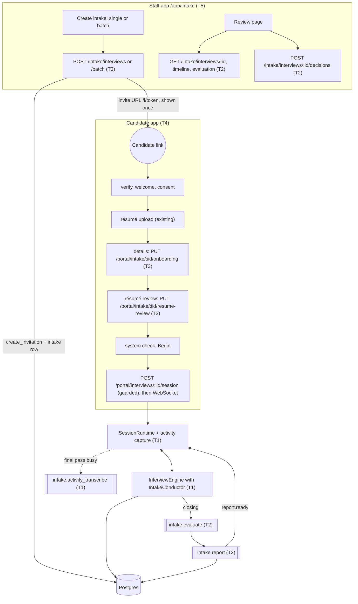
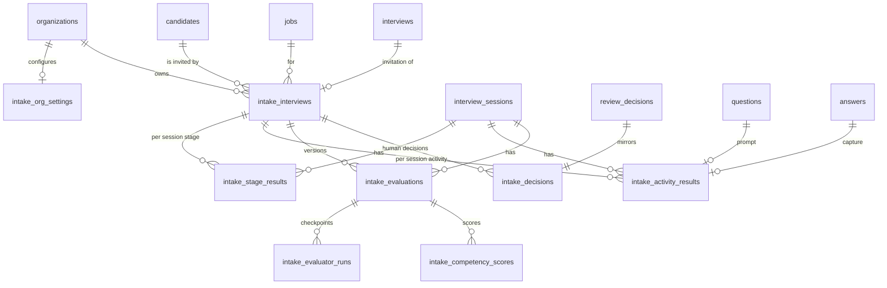
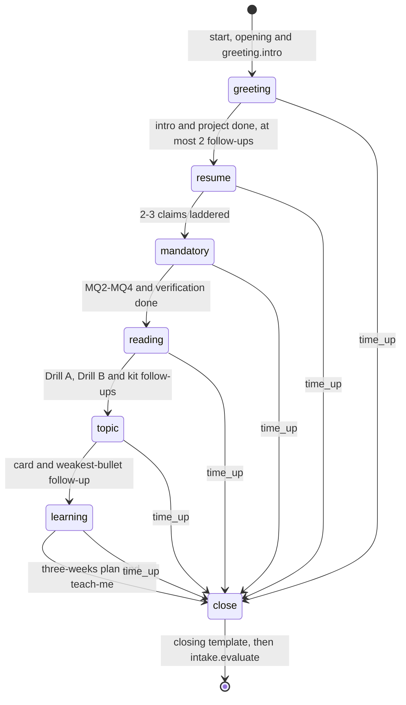
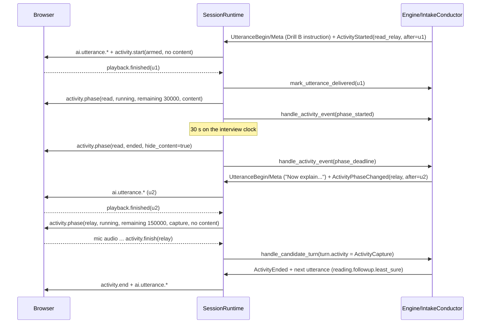

# Intake Interview (`round_type: intake`) — design contract

Written for: the five parallel implementation tracks (T1-T5) and the coordinator. This document is the
authoritative contract for the Intake Interview module once it exists (see
`docs/design/briefs/intake-common.md`). Where it is silent, follow `docs/design/CONTRACTS.md` and the code
conventions of the module you extend. Where it disagrees with the owner's master prompt, the coordinator's
non-negotiable decisions (intake-common.md) win, then this document.

Sources read for this design (2026-10-09): `intake-common.md`; the owner's master prompt (phases 0-16, saved at
`<scratchpad>/intake/master_prompt.md`); the full kit extraction (`<scratchpad>/intake/kit.txt`); README,
ARCHITECTURE, AI_PIPELINE, INTERVIEW_ENGINE, INTEGRITY_MONITORING, CODING_INTERVIEW, SECURITY, CONTRACTS, OPEN_LINKS;
and the code paths named in each section (every "verified" fact below was checked in the code, not assumed).

Contents

1. Decisions
2. Architecture and end-to-end flow
3. Data model and migration `0005`
4. Round type `intake`, round config, template, competencies, demo job
5. The kit (foundation F0: `kit.py`, `scoring.py`, `reading.py`, YAML)
6. Stage state machine and engine integration
7. Realtime activity protocol and runtime capture mode
8. Evaluation pipeline
9. Intake report and generic report integration
10. REST APIs, RBAC, errors, rate limits
11. Web: staff module and candidate experience
12. Security, privacy, fairness, feature flag
13. Test plan
14. File ownership (T1-T5, F0) and shared files
15. Cross-track JSON shapes (consolidated)
16. Delivery order and integration checklist
17. Known limitations of v1
18. Implementation notes and deviations (per track)

---

## 1. Decisions

Each line is binding for every track.

1. **One first-class round type** `RoundType.INTAKE = "intake"` (UI label "Intake interview"). `rounds.round_type` /
   `interview_templates.round_type` are `String(32)` columns (verified: `alembic/versions/0001_initial.py`), so no
   `ALTER TYPE` is needed. The seed validator requires a default template for every `RoundType`
   (`app/seed/loaders.py` "no default template for ..."), so the intake template ships with the enum.
2. **Reuse, don't fork.** An intake interview is an ordinary `interviews` row (invite token `/i/{token}`, frozen
   `policy_snapshot`, consent, résumé, system check) and an ordinary `interview_sessions` row driven by the existing
   `InterviewEngine` and realtime `SessionRuntime`. Intake-specific data lives in eight new `intake_*` tables (one
   additive migration `0005`). Questions, answers, transcripts, media, recordings, integrity events, `reports`,
   `scores` and `review_decisions` are reused.
3. **Candidate route** stays `/i/{token}` (the master prompt's `/interview/intake/{token}` is adapted to the
   existing route structure). Two intake-only journey steps are added: `details` (onboarding form) and
   `resume-review` (confirm/correct the extracted résumé). Order: welcome → instructions → consent → résumé →
   details → résumé review → system check → interview.
4. **Engine integration = an intake mode inside `InterviewEngine`**, not a second engine: `InterviewState.intake`
   (new optional field) switches the engine's hook points to `IntakeConductor` (`app/services/intake/conductor.py`),
   exactly like `state.coding.active` switches to the coding flow today. Every hook is `if state.intake is not None`;
   other round types never reach intake code.
5. **Deterministic stage machine, LLM for phrasing only.** Stage order, mandatory items, follow-up budgets, time
   budget, activity selection, timers, transitions, MQ wording and the closing are deterministic. The live model
   only phrases model-phrased items (stage 1 follow-ups, stage 2 ladder questions, the stage 5 weakest-bullet
   follow-up, stage 6 personalisation and follow-ups, stage 7 answers from approved information) and reports
   whether a follow-up is warranted inside a budget the machine already granted.
6. **MQ1 (work authorisation) is collected only in the onboarding form** when the policy enables it (structured
   yes/no answers, stored in `intake_interviews.eligibility`). It is never asked or discussed live, so it never
   reaches any model — not even speech recognition — and never feeds a score. The live stage 3 covers MQ2-MQ4 and
   the language verification question.
7. **Onboarding answers are confirmed, not re-asked**: stage 3 uses deterministic templates that insert the
   candidate's own form values ("On the form you said ..."). The language verification question is always asked
   live. Onboarding values that reach prompts are fenced as untrusted (MQ1 never).
8. **Three realtime activities over the existing WebSocket**: `reading_aloud` (Drill A), `read_relay` (Drill B),
   `topic_card` (stage 5). New server messages `activity.start` / `activity.phase` / `activity.end` and client
   message `activity.finish`; all three server messages are **non-replayable** (outbox), content is only sent in the
   message that starts the phase in which it may be shown, and `session.state.intake.activity` carries a content-free
   snapshot. No new transport, no new endpoint for activities.
9. **Server-authoritative timers**: the runtime owns phase deadlines on the interview clock (pauses excluded) and
   enforces them (hide, next phase, end capture); the engine owns the activity state (resume). The Drill B passage is
   hidden at exactly 30 s by a server message; the client also hides it at its own countdown zero and on any
   disconnect.
10. **Activity capture mode** in the runtime: one `TurnCapture` spans the whole capture phase; normal end-of-turn
    endpointing, acknowledgements, "didn't catch that" prompts and the commit wait are bypassed; the phase ends on
    the finish button, a per-kind silence rule, the deadline (with a ≤ 3 s grace for an unfinished sentence) or a
    disconnect. Segments, VAD pauses and timings are captured for Drill A metrics.
11. **Final transcript for activities** = a windowed whole-audio pass (windows ≤ 25 s cut at VAD pauses) on a spare
    Whisper replica after the capture; if that cannot run within 60 s, the worker job `intake.activity_transcribe`
    redoes it from the stored answer audio; otherwise the live segment transcript is used and labelled. Evaluation
    waits for every activity's `transcript_status` to settle (bounded).
12. **No generic per-answer evaluation for intake**: intake answers are not sent to `answer.evaluate`, memory
    summarisation is off, and closing enqueues `intake.evaluate` instead of `scoring.finalize` + `report.generate`.
    The shared GPU sees zero evaluation load during the live interview.
13. **Evaluation** = deterministic reading metrics (F0 `align_reading` → Drill A `delivery_score`) + a deterministic
    Drill B score from concept coverage + seven schema-validated evaluator calls + a deterministic validator +
    F0 scoring (`summarize_scores`). Each competency carries evidence references (stage, question, answer,
    timestamps, verbatim quote) or is `insufficient`. Checkpointed per evaluator; idempotent; retried.
14. **Recommendations only.** The band is advisory. Kit red flags become review items with evidence. Human decisions
    `accept | accept_with_notes | second_interview | reject | request_evidence` are stored in `intake_decisions`
    with rationale + reviewer + timestamp, audited, and **mirrored** into a generic `review_decisions` row
    (`advance | advance | hold | reject | needs_more_information`) so the review queue (`needs_review`), sessions
    list and analytics keep working. `ReviewDecisionValue` is not changed.
15. **One intake report per evaluation**, stored as a `reports` row of type `recruiter` with
    `content.kind = "intake"` (sections A-K), plus a self-contained HTML artifact and the existing printable page.
    No candidate report is ever generated for intake (`candidate_report_mode: never`).
16. **Generic integration rows**: the intake pipeline writes `scores` rows (competency 0-10 = intake score × 2;
    overall 0-100 = total / 5 × 100, only when a band exists) and the `reports.recommendation` mapping
    `strong_accept→strong_proceed, accept_with_notes→proceed, borderline→borderline_evidence, reject→human_review,
    insufficient_evidence→insufficient_evidence`, so the existing sessions list and analytics show intake sessions.
    Generic regenerate/recompute endpoints and the generic report worker are guarded for intake sessions.
17. **Organisation intake settings** (MQ1 default policy, approved program information, defaults) live in their own
    table `intake_org_settings`, not in `OrganizationSettings`: `PUT /settings` replaces the whole settings document
    (verified: `save_organization_settings`), which would silently wipe an intake section saved elsewhere.
18. **No email delivery exists** in the platform (verified). "Send invitation" = copy link, copy invitation text,
    `mailto:` link; notification settings are stored (assigned reviewer, notify flag) and drive in-app views only.
19. **"Permitted retries"** maps to the invitation's frozen `policy_snapshot.integrity.max_reconnects` (existing
    enforcement in `SessionRuntime.attach`); activity restarts after a disconnect follow section 7.8.
20. **Feature flag** `INTAKE_ENABLED` (default `true`): when false, intake routers answer 404 `intake_disabled`,
    intake sessions cannot be created (409 `intake_disabled`), the staff page shows a disabled state; sessions
    already created finish normally.
21. **No new `ModelTask` values** (no router/enum change): live intake turns use `TURN_DECISION`, the stage 3
    verification quick grade `ANSWER_ASSESSMENT`, evaluators `ANSWER_EVALUATION`, the training plan
    `REPORT_GENERATION`; `CallContext.prompt_version` distinguishes them (`intake-turn@…`, `intake-quick@…`,
    `intake-eval-<key>@…`, `intake-training@…`).
22. **No AI interruption of the candidate in v1.** Long answers (self-introduction, project, teach-me, 3-week plan)
    use a "long answer" endpointing profile so pauses do not cut them; time-boxing is done by stage budgets and
    follow-up limits. Durations are recorded as evidence.
23. **Scenario questions** (kit Part 4.2) are optional planned items: up to two per interview (stage 5 group B or A,
    stage 6 group C), dropped first under time pressure.
24. **Résumé required** for intake by default (`settings.resume_required`, staff toggle); the résumé review may be
    skipped by the candidate only after 3 minutes of waiting for processing (recorded).
25. **Single writer per table** (section 3): T1 writes stage/activity rows and the session's questions/answers/
    transcripts, T2 writes evaluation/score/decision/report rows, T3 writes intake/org-settings rows.

---

## 2. Architecture and end-to-end flow



Live interview, one candidate answer (normal item): runtime endpointing → `CandidateTurn` →
`engine.handle_candidate_turn` → (intake) `IntakeConductor.candidate_turn` → persist answer → deterministic
`next_move()` → template utterance or a speech-first `IntakeTurn` model stream → `UtteranceBegin/SpeechDelta/
UtteranceMeta` → runtime TTS. Activity: the conductor yields the instruction utterance + `ActivityStarted`; the
runtime starts the phase when that utterance is delivered (section 7).

Component map (new modules; ownership in section 14):

| Layer | Module | Purpose |
|---|---|---|
| Foundation (F0, done) | `app/services/intake/kit.py`, `scoring.py`, `reading.py`, `samples/intake/intake_kit_v1.yaml` | Kit content + validation, weights/bands, Drill A alignment + delivery score, relay cue coverage |
| Contracts (T3, day 0) | `app/schemas/intake.py`, `app/db/models/intake.py`, `alembic/versions/0005_intake_interviews.py` | Cross-track pydantic models, ORM models, migration |
| Admin/onboarding (T3) | `app/services/intake/{invitations,listing,org_settings,onboarding,resume_review,access}.py`, routers `intake.py`, `portal_intake.py` | Create/batch/drafts/list/stats, org settings, candidate onboarding + résumé review + start guard |
| Live (T1) | `app/services/intake/{state,stages,selection,conductor,prompts,turn_schema,activities,session_init,capture_store,transcribe}.py`, `app/workers/intake_capture.py` | Stage machine, conductor, activity lifecycle, runtime capture persistence, final transcript |
| Evaluation (T2) | `app/services/intake/{evidence,evaluators,eval_prompts,eval_schemas,relay,validator,review_items,pipeline,training,report,report_html,decisions,analytics,review_views,demo}.py`, router `intake_review.py`, `app/workers/intake.py` | Evaluators, validator, scoring, report, decisions, analytics, review payloads |
| Web candidate (T4) | `apps/web/src/features/intake/candidate/**` + additive edits in `features/{candidate,interview,realtime}` | Journey steps, room stage indicator, activity panels |
| Web staff (T5) | `apps/web/src/features/intake/staff/**` + additive edits (nav, router, round editor, sessions filter, report page) | List, create, review, analytics, settings |

---

## 3. Data model and migration `0005`

### 3.1 Reuse map

| Concept (master prompt) | Stored in |
|---|---|
| IntakeInterviewTemplate | `interview_templates` (round_type `intake`) + `rounds.config.intake` |
| IntakeInvitation | `interviews` (token, expiry, policy snapshot) + `intake_interviews` (intake settings, drafts, batch) |
| IntakeCandidateProfile | `candidates` + `candidate_profiles` (unchanged) + `intake_interviews.onboarding / eligibility / resume_review` |
| IntakeSession | `interview_sessions` (+ `state.intake` hot state) |
| IntakeStageResult | `intake_stage_results` |
| IntakeQuestionResponse | `questions` (`segment = "intake:<stage>"`, `decision.intake` meta) + `answers` + `transcripts` |
| IntakeReadingAssessment / IntakeTopicAssessment | `intake_activity_results` (capture) + `intake_evaluator_runs` / `intake_competency_scores` (judgement) |
| IntakeCompetencyScore / IntakeEvaluation | `intake_competency_scores`, `intake_evaluations`, `intake_evaluator_runs` |
| IntakeHumanReview | `intake_decisions` (+ mirrored `review_decisions`) |
| IntakeAuditEvent | `audit_logs` (existing `audit()`), `interview_events` (existing `log_event`) |
| Org intake policy | `intake_org_settings` |

### 3.2 Entity relationships



### 3.3 Tables

Conventions: `id UUID PK server_default gen_random_uuid()`; `created_at`/`updated_at timestamptz NOT NULL
server_default now()`; constraint names follow `app/db/base.py` NAMING_CONVENTION (`fk_<table>_<col>_<ref>`,
`ix_...`, `uq_...`); no CHECK constraints (the codebase uses none; enums are validated in pydantic). Every table
carries `organization_id` (FK `organizations.id` ON DELETE CASCADE) for org scoping. All JSONB columns are
`NOT NULL server_default '{}'`/`'[]'` unless marked nullable. Writer = the only track that inserts/updates rows.

**`intake_interviews`** — one per intake invitation (also drafts). Writer: T3 (T1 reads; T2 reads).

| column | type | null | default | notes |
|---|---|---|---|---|
| organization_id | UUID FK organizations CASCADE | no | | |
| candidate_id | UUID FK candidates CASCADE | no | | candidate erasure cascades |
| job_id | UUID FK jobs CASCADE | no | | job with an active intake round |
| round_id | UUID FK rounds SET NULL | yes | | the intake round |
| interview_id | UUID FK interviews CASCADE | yes | | NULL while `status = draft`; unique when set |
| batch_id | UUID | yes | | rows created by one batch request |
| status | String(16) | no | `'draft'` | `draft` \| `active` \| `cancelled` (staff lifecycle only; everything else is derived, 10.3) |
| title | String(200) | no | `'Intake Interview'` | |
| target_role | String(40) | yes | | staff preset (`TargetRole`); NULL = candidate chooses |
| settings | JSONB | no | `'{}'` | `IntakeInviteSettings` (15.2), frozen when sent |
| onboarding | JSONB | yes | | `IntakeOnboarding` (15.3) |
| onboarding_submitted_at | timestamptz | yes | | |
| eligibility | JSONB | yes | | `IntakeEligibility` (MQ1; never to models, never in reports) |
| resume_review | JSONB | yes | | `ResumeReviewRecord` (15.4) |
| resume_confirmed_at | timestamptz | yes | | also set on an allowed skip |
| assigned_reviewer_id | UUID FK users SET NULL | yes | | |
| created_by_id | UUID FK users SET NULL | yes | | |
| sent_at | timestamptz | yes | | when the `interviews` row was created |
| cancelled_at | timestamptz | yes | | |
| notes | Text | yes | | staff only |

Indexes: `ix_intake_interviews_org_created (organization_id, created_at)`, `ix_intake_interviews_org_status
(organization_id, status)`, `ix_intake_interviews_candidate (candidate_id)`, `uq_intake_interviews_interview
UNIQUE (interview_id) WHERE interview_id IS NOT NULL`, `ix_intake_interviews_batch (batch_id) WHERE batch_id IS NOT
NULL`, `ix_intake_interviews_reviewer (assigned_reviewer_id) WHERE assigned_reviewer_id IS NOT NULL`.

**`intake_org_settings`** — one per organisation (PK = `organization_id`, no `id`). Writer: T3.

| column | type | default | notes |
|---|---|---|---|
| organization_id | UUID PK FK organizations CASCADE | | |
| program_name | String(200) | `'AI/ML Training Program'` | spoken in the opening/closing |
| work_authorization | JSONB | `'{"enabled": false, "country": null, "ask_sponsorship": true, "variant": "default"}'` | `WorkAuthorizationPolicy` org default |
| approved_info | JSONB | `'[]'` | `ApprovedInfoItem[]` (≤ 30) — the only facts stage 7 may state |
| defaults | JSONB | `'{}'` | `{duration_minutes, max_reconnects, expires_in_hours, presence, resume_required}` |
| updated_by_id | UUID FK users SET NULL | | |
| created_at, updated_at | timestamptz | now() | |

**`intake_stage_results`** — one per (session, stage). Writer: T1 (upsert at stage start/end and on checkpoint).

| column | type | null | notes |
|---|---|---|---|
| organization_id | UUID FK organizations CASCADE | no | |
| intake_id | UUID FK intake_interviews CASCADE | no | |
| session_id | UUID FK interview_sessions CASCADE | no | |
| stage_key | String(16) | no | kit `STAGE_KEYS` |
| stage_number | SmallInteger | no | 1-7 |
| status | String(16) | no, `'pending'` | `pending` \| `in_progress` \| `completed` \| `incomplete` |
| started_elapsed_s / ended_elapsed_s | Float | yes | interview clock (pauses excluded) |
| budget_s | Float | yes | planned budget (6.3) |
| items | JSONB | no, `'[]'` | `StageItemResult[]` (15.5) |
| extra | JSONB | no, `'{}'` | stage specifics: `claims` (stage 2), `language`, `level` (stage 3), `passages` (4), `card` (5), `scenarios` |

Unique `uq_intake_stage_results_session_stage (session_id, stage_key)`; index `ix_intake_stage_results_intake (intake_id)`.

**`intake_activity_results`** — one per (session, kind). `id` is the protocol `activity_id`. Writer: T1 (live) and
T1's `intake.activity_transcribe` job.

| column | type | null | notes |
|---|---|---|---|
| organization_id, intake_id, session_id | as above | no | |
| kind | String(16) | no | `reading_aloud` \| `read_relay` \| `topic_card` |
| stage_key | String(16) | no | `reading` \| `topic` |
| status | String(16) | no, `'pending'` | `pending` \| `armed` \| `running` \| `completed` \| `interrupted` \| `skipped` \| `failed` |
| attempt | SmallInteger | no, 1 | restarts after a disconnect (7.8) |
| material_key | String(8) | no | passage `A`-`F` or card `1`-`8` |
| kit_version | String(32) | no | |
| question_id | UUID FK questions SET NULL | yes | the activity prompt question |
| answer_id | UUID FK answers SET NULL | yes | the committed capture (reading / relay / speech) |
| phases | JSONB | no, `'[]'` | `[{phase, status, planned_ms, started_elapsed_s, ended_elapsed_s, end_reason}]` |
| reveal | JSONB | no, `'{}'` | `read_relay` only: `{shown_ms, windows: [{from_elapsed_s, to_elapsed_s}], interrupted: bool}` |
| capture | JSONB | no, `'{}'` | `ActivityCaptureRecord` (15.6) of the scored attempt |
| attempts_log | JSONB | no, `'[]'` | earlier interrupted attempts: `{attempt, end_reason, capture summary, transcript_live}` |
| transcript_live | Text | yes | joined live segment finals (glossary applied) |
| transcript_final | Text | yes | windowed final pass (glossary applied) |
| transcript_status | String(16) | no, `'pending'` | `pending` \| `final` \| `pending_worker` \| `live_only` \| `unavailable` |
| transcript_source | String(24) | yes | `final_pass_live` \| `final_pass_worker` \| `live_segments` \| `typed` |
| audio_media_id | UUID FK media_assets SET NULL | yes | stored WAV when audio recording is consented |
| ended_reason | String(24) | yes | `finish_button` \| `deadline` \| `silence` \| `disconnect` \| `max_audio` \| `session_end` \| `skipped` |

Unique `uq_intake_activity_results_session_kind (session_id, kind)`; index `ix_intake_activity_results_intake (intake_id)`.

**`intake_evaluations`** — one per evaluation run (versioned). Writer: T2.

| column | type | null | notes |
|---|---|---|---|
| organization_id, intake_id | | no | |
| session_id | UUID FK interview_sessions CASCADE | no | |
| version | Integer | no | 1, 2, ... per session |
| status | String(16) | no, `'pending'` | `pending` \| `running` \| `ready` \| `failed` |
| reason | String(32) | no | `session_completed` \| `reevaluate` |
| requested_by_id | UUID FK users SET NULL | yes | re-evaluation requester |
| job_id | String(64) | yes | reserving queue job (retries reuse the row) |
| input_digest | String(64) | yes | sha256 of the ordered evaluator inputs |
| kit_version / scoring_version | String(32) | no | `scoring_version = "intake-scoring-1"` |
| weighted_total | Numeric(7,4) | yes | exact; NULL when evidence is insufficient |
| partial_total | Numeric(7,4) | yes | only when insufficient (labelled partial) |
| normalized_100 | Numeric(7,3) | yes | display conversion |
| band | String(24) | yes | `DecisionBand` value |
| evidence_sufficiency | String(16) | yes | `sufficient` \| `partial` \| `insufficient` |
| summary | JSONB | no, `'{}'` | `{strengths[], improvements[], drill_a, drill_b, claims[], verification, bullets[]}` (8.6) |
| validator | JSONB | no, `'{}'` | `{issues: [ValidatorIssue]}` |
| review_items | JSONB | no, `'[]'` | `ReviewItem[]` (15.8) |
| training_plan | JSONB | yes | `TrainingPlan` (15.10) |
| model_call_ids | JSONB | no, `'[]'` | |
| error | Text | yes | |
| started_at / finished_at | timestamptz | yes | |

Unique `uq_intake_evaluations_session_version (session_id, version)`; indexes `ix_intake_evaluations_intake
(intake_id, version)`, `ix_intake_evaluations_org_created (organization_id, created_at)`.

**`intake_evaluator_runs`** — checkpoint per evaluator per evaluation. Writer: T2.

| column | type | notes |
|---|---|---|
| evaluation_id | UUID FK intake_evaluations CASCADE | |
| organization_id, session_id | UUID (session_id indexed) | |
| evaluator | String(32) | `reading_metrics` \| `communication` \| `resume_evidence` \| `technical` \| `relay` \| `structured` \| `trainability` \| `composure` \| `training_plan` |
| status | String(16) | `pending` \| `running` \| `succeeded` \| `fallback` \| `failed` |
| attempts | SmallInteger, 0 | |
| input_digest | String(64) | |
| output | JSONB, nullable | validated evaluator output (or `ReadingMetrics` / `RelayCoverage` dumps) |
| model_call_id | UUID, nullable | |
| latency_ms | Float, nullable | |
| error | Text, nullable | |

Unique `uq_intake_evaluator_runs_evaluation_evaluator (evaluation_id, evaluator)`.

**`intake_competency_scores`** — seven rows per ready evaluation. Writer: T2.

| column | type | notes |
|---|---|---|
| evaluation_id | UUID FK intake_evaluations CASCADE | |
| organization_id, session_id | UUID (indexed) | |
| competency_key | String(32) | `INTAKE_COMPETENCY_KEYS` |
| status | String(16) | `scored` \| `insufficient` |
| score | Numeric(3,1), nullable | 1.0-5.0; NULL when insufficient |
| weight | Numeric(3,2) | from `INTAKE_WEIGHTS` |
| weighted | Numeric(6,4), nullable | score × weight |
| evaluator | String(32) | producing evaluator (`technical_reading` = `relay` + `reading_metrics`) |
| reasoning | Text | neutral wording |
| evidence | JSONB `'[]'` | `EvidenceRef[]` (15.7) |
| missing_evidence | JSONB `'[]'` | strings |
| strengths / improvements | JSONB `'[]'` | strings |
| sub_scores | JSONB `'{}'` | `technical_reading`: `{drill_a: {score, basis[]}, drill_b: {score, basis[]}, formula: "0.4 × Drill A + 0.6 × Drill B"}` |

Unique `uq_intake_competency_scores_evaluation_key (evaluation_id, competency_key)`; index
`ix_intake_competency_scores_org_key (organization_id, competency_key)`.

**`intake_decisions`** — human decisions (append-only). Writer: T2.

| column | type | notes |
|---|---|---|
| organization_id, intake_id | | |
| session_id | UUID FK interview_sessions CASCADE | |
| evaluation_id | UUID FK intake_evaluations SET NULL, nullable | evaluation shown when deciding |
| review_decision_id | UUID FK review_decisions CASCADE, UNIQUE | the generic mirror row |
| reviewer_id | UUID FK users RESTRICT | |
| outcome | String(24) | `accept` \| `accept_with_notes` \| `second_interview` \| `reject` \| `request_evidence` |
| rationale | Text NOT NULL | 10-5000 chars |
| ai_band_at_decision | String(24), nullable | |
| ai_total_at_decision | Numeric(7,4), nullable | |
| overrides_ai | Boolean, false | rule 8.9 |
| review_items_resolution | JSONB `'[]'` | `[{item_id, resolution: confirmed\|dismissed\|follow_up, note}]` |
| competency_notes | JSONB `'{}'` | reviewer notes per competency key (never changes AI scores) |
| requested_evidence | JSONB `'[]'` | strings, for `request_evidence` |

Indexes `ix_intake_decisions_intake_created (intake_id, created_at)`, `ix_intake_decisions_org_outcome (organization_id, outcome)`.

### 3.4 Migration

`apps/api/alembic/versions/0005_intake_interviews.py` (revision `"0005"`, `down_revision = "0004"`), owned by T3,
purely additive (no change to existing tables), written in the style of `0004_open_interview_links.py` (`_id()`,
`_timestamps()` helpers, explicit FK names, explicit index drops in `downgrade()` in reverse order). ORM models in
`apps/api/app/db/models/intake.py` (`IntakeInterview`, `IntakeOrgSettings`, `IntakeStageResult`,
`IntakeActivityResult`, `IntakeEvaluation`, `IntakeEvaluatorRun`, `IntakeCompetencyScore`, `IntakeDecision`),
exported from `app/db/models/__init__.py`. `uv run alembic check` must be clean after the migration. Update
`tests/integration/platform/test_seed_migrations.py` only if it pins the head (verified 2026-10-09: no test pins
`0004`).

---

## 4. Round type `intake`, round config, template, competencies, demo job

### 4.1 Enum and round configuration (T3)

* `app/domain/enums.py`: `RoundType.INTAKE = "intake"` (append after `COMBINED`).
* `app/schemas/intake.py` defines `IntakeRoundConfig` (below); `app/schemas/rounds.py` gains one optional field
  `intake: IntakeRoundConfig | None = None` on `RoundConfig` and one `model_validator(mode="after")` branch that runs
  only when `round_type is RoundType.INTAKE`:
  * `intake` defaults to `IntakeRoundConfig()` when missing;
  * `35 <= duration_minutes <= 50` else `ValueError("Intake rounds last 35-50 minutes")`;
    `max_duration_minutes = min(max(max_duration_minutes, duration_minutes), duration_minutes + 5)`;
  * `coding.enabled` must be false; `candidate_selectable` must be false;
  * `resume_validation.enabled = True` (the profile's claims feed stage 2).
  Other round types are untouched (the field is `None` and ignored).

```python
class WorkAuthorizationPolicy(_Model):           # app/schemas/intake.py
    enabled: bool = False
    country: str | None = Field(None, max_length=80)   # spoken/printed as written, e.g. "the United States"
    ask_sponsorship: bool = True
    variant: Literal["default"] = "default"            # reviewed variants are out of scope in v1
    # validator: enabled -> country required (422 "work_authorization_country_required")

class IntakeFollowupLimits(_Model):
    greeting: int = Field(2, ge=0, le=3)               # follow-ups on the proud project
    resume_clarify_per_rung: int = Field(1, ge=0, le=2)
    mandatory: int = Field(1, ge=0, le=2)               # optional MQ follow-ups beyond the fixed items
    topic: int = Field(1, ge=0, le=2)                   # beyond the mandatory weakest-bullet follow-up
    learning: int = Field(2, ge=0, le=3)

class IntakeClaimLimits(_Model):
    min_claims: int = Field(2, ge=1, le=3)
    max_claims: int = Field(3, ge=1, le=3)

class IntakeRoundConfig(_Model):
    kit_version: str = "v1"
    followup_limits: IntakeFollowupLimits = Field(default_factory=IntakeFollowupLimits)
    claims: IntakeClaimLimits = Field(default_factory=IntakeClaimLimits)
    scenarios: int = Field(2, ge=0, le=3)
    passage_drill_a: Literal["auto", "A", "B", "D", "E", "F"] = "auto"
    passage_drill_b: Literal["auto", "A", "B", "C", "E", "F"] = "auto"
    topic_card: Literal["auto", "1", "2", "3", "4", "5", "6", "7", "8"] = "auto"
    work_authorization: WorkAuthorizationPolicy | None = None    # None = organisation default
    closing_questions_max: int = Field(3, ge=0, le=5)
```

Timers are not configurable: they come from the kit (`timers`: self-intro 90 s, Drill A ≤ 180 s, Drill B read
30 s, prepare 60 s, speak 120 s) plus one platform constant, relay capture ≤ 150 s (`stages.RELAY_MAX_SECONDS`).

Effective work-authorisation policy at send time (T3, `org_settings.effective_work_authorization`): round config
value if set, else `intake_org_settings.work_authorization`; frozen into `intake_interviews.settings.work_authorization`.

### 4.2 Competencies (T3, `samples/catalog/competencies.yaml`)

`communication` and `adaptability` exist. Append five global competencies so rounds can reference all seven intake
keys (round/template validation rejects unknown keys): `technical_reading` (category `communication`),
`structured_answer` (`communication`), `technical` (`technical`), `trainability` (`behavioral`), `composure`
(`behavioral`). Their catalog rubric anchors copy the kit YAML's sanitised anchors (levels 1/3/5) and must pass the
catalog fairness lint (`app/seed/fairness.py`, evaluation rules: no "confident", "calm", "energy"; the kit anchors
already comply). The intake pipeline never reads catalog anchors — the kit YAML is the scoring source.

### 4.3 Default template (T3, `samples/catalog/round_templates.yaml`)

```yaml
  - round_type: intake
    name: Intake Interview
    description: Seven-stage intake screening before the training program (35-50 minutes, target 45), from the Intake Interview Kit.
    config:
      duration_minutes: 45
      max_duration_minutes: 50
      expected_difficulty: medium
      competencies:            # weights mirror the kit (0.20 ... 0.05) on the RoundCompetency 0-10 scale
        - {key: communication, weight: 2.0}
        - {key: technical_reading, weight: 2.0}
        - {key: structured_answer, weight: 1.5}
        - {key: technical, weight: 1.5}
        - {key: trainability, weight: 1.5}
        - {key: composure, weight: 1.0}
        - {key: adaptability, weight: 0.5}
      rubric:                  # one category per competency; sums to 100
        - {key: communication, label: Communication & Presentation, weight: 20, competency_keys: [communication]}
        - {key: technical_reading, label: Technical Reading & Relay, weight: 20, competency_keys: [technical_reading]}
        - {key: structured_answer, label: Structured Answer / Gap-Filling, weight: 15, competency_keys: [structured_answer]}
        - {key: technical, label: Actual Technical Ability, weight: 15, competency_keys: [technical]}
        - {key: trainability, label: Trainability & Learning Attitude, weight: 15, competency_keys: [trainability]}
        - {key: composure, label: Confidence & Composure, weight: 10, competency_keys: [composure]}
        - {key: adaptability, label: Niche-Fit & Adaptability, weight: 5, competency_keys: [adaptability]}
      question_strategy: {style: [experience_deep_dive, resume_claim_verification], max_followup_depth: 2, prefer_curated_ratio: 0, allow_generated_questions: true, adaptive_difficulty: false, allow_candidate_questions_at_end: true}
      stopping: {stop_on_sufficient_evidence: false, min_duration_minutes: 30, min_questions: 10}
      coding: {enabled: false}
      resume_validation: {enabled: true, max_claims: 6, min_priority: 1}
      instructions: >-
        This intake interview has seven short parts: an introduction, your experience, a few standard questions, a
        reading exercise, a short speaking exercise, how you learn, and your questions. It takes about 45 minutes.
        Answer in your own words; it's fine to say when you don't know something.
      interviewer_notes: Intake mode is driven by the deterministic stage machine; these notes are not used.
      intake: {}               # IntakeRoundConfig defaults
```

The generic `rubric`/`competencies` exist so `RoundConfig` stays valid everywhere and the round editor can show the
weights; intake scoring uses `app.services.intake.scoring` only (the loader `kit.py` rejects a kit whose weights
disagree with it).

### 4.4 Demo job (T3, `samples/jobs/ai_ml_training_intake.yaml`)

`key: ai_ml_training_intake`, `title: "AI/ML Training Program — Intake"`, `department: Training`, `employment_type:
training_program`, `seniority: entry`, `status: open`, `candidate_report_mode: never`,
`allow_candidate_round_selection: false`, description (≥ 80 chars: what the program is, that a human reviewer decides,
that the interview takes about 45 minutes), `interview_instructions` (intake-specific: quiet room, microphone
required, a reading exercise and a timed speaking exercise), `requirements` (≥ 1: e.g. `required_skill` "Programming
fundamentals" → `technical`; `preferred_skill` "Clear technical communication" → `communication`;
`responsibility` "Commit to an intensive, time-boxed training program" → `trainability`),
`integrity_settings` = platform defaults (camera on, fullscreen, focus/clipboard monitoring, `max_reconnects: 10`,
`allow_page_reload_resume: true`, no screen share), `recording_settings` (`record_answer_audio: true`,
`record_video: true`, `record_screen: false`, `show_live_subtitles: true`, `allow_typed_answers: true`),
`rounds: [{template: intake, name: "Intake Interview"}]`. Validate with `uv run python -m app.seed.validate
samples/jobs/ai_ml_training_intake.yaml`.

### 4.5 Where the type appears ("everywhere types are selected, created, monitored, filtered, reported")

| Place | Change | Owner |
|---|---|---|
| `GET /round-types` (round editor "Add round", templates page) | automatic from the new template | T3 (content) |
| Job round create/update APIs | accept `intake`; validator 4.1 | T3 |
| Interview invite (generic job page) | `create_invitation` hook creates the `intake_interviews` row (10.1, "Invitation hook") | T3 |
| Open links | rounds of type intake work as any round (hook above); registration form unchanged | T3 |
| Sessions list `GET /sessions` | new `round_type` query filter (repeatable) | T2 |
| Session detail / report pages | `round.round_type == "intake"` → link to the intake review page; report page renders `content.kind == "intake"` | T5 |
| Web `RoundType` mirror + `ROUND_TYPE_LABELS` | `INTAKE: "intake"` / `intake: "Intake interview"` | T5 |
| Round editor (`features/recruiter/admin/rounds`) | intake panel (duration 35-50, follow-up limits, MQ1 policy, passage/card overrides), hide coding/difficulty-mix tabs, preserve `intake` in `toRoundConfig()` | T5 |
| Sessions list filter UI | "Round type" select | T5 |
| Analytics (generic) | unchanged (round filter exists); intake has its own analytics page | — |
| Candidate journey | `rounds_offered[].round_type == "intake"` and `PortalInterview.intake` switch the journey | T4 |

---

## 5. The kit (foundation F0 — delivered)

The foundation agent (F0) wrote `samples/intake/intake_kit_v1.yaml` (1245 lines) and its loader
`apps/api/app/services/intake/kit.py`, plus `scoring.py` and `reading.py`. Their APIs are fixed points of this
design; no track edits them until F0 hands over. After the hand-over: `kit.py` + YAML → T3, `scoring.py` +
`reading.py` → T2. Changes after handover need the coordinator's approval (they are contracts).

### 5.1 Schema (as implemented by `kit.py`; `extra="forbid"`, frozen models, tuples)

| Top-level key | Model | Content |
|---|---|---|
| `schema_version` | `Literal[1]` | |
| `source` | `KitSource{file, sha256, version, title, subtitle}` | `version = "v1"`, sha256 of the DOCX |
| `overview` | `Overview{purpose, kit_original?}` | |
| `duration` | `Duration{min_minutes 35, max_minutes 50, target_minutes 45, kit_note}` | |
| `timers` | `Timers{self_intro_seconds 90, drill_a_max_seconds 180, drill_b_read_seconds 30, topic_card_prepare_seconds 60, topic_card_speak_seconds 120}` | |
| `conduct` | `tuple[str]` | interviewer conduct rules (no coaching, neutral) → live prompts |
| `stages` | 7 × `Stage{key, number, title, kit_title, minutes{min,max}, measures, say[], do[], follow_ups[FollowUp], watch_for[], activities[Activity], mandatory_questions[], scores_into[ScoreLink], kit_scores_into, kit_original?}` | keys in order: `greeting, resume, mandatory, reading, topic, learning, close` |
| `mandatory_questions` | 4 × `MandatoryQuestion{key mq1..mq4, code, title, kit_title, ask[], placeholders[], purpose, follow_ups[], record, flag, policy_configured, send_to_model, used_in_scoring, informs[], review_flags[], kit_original?}` | `mq1.send_to_model = false`, `used_in_scoring = false`, placeholder `{country}`; MQ4 is the reframed wording; the kit's "interview-support model" follow-up is dropped (kept only under `kit_original`) |
| `language_verification` | `{instruction, expected_from_rating 6, languages: [LanguageCheck{key, label, aliases[], questions: (LanguageQuestion{text, key_points[]}, LanguageQuestion)}]}` | python, java, javascript (node/ts aliases), csharp, sql |
| `resume_framework` | `{instruction, depth_ladder: (ownership, mechanics, stress), claim_probes[{key, claim, questions[]}], honesty_signals_title, honesty_signals_note, honesty_signals[]}` | claim probe keys: `tool_or_framework, metric_improvement, project_or_product, leadership, thin_or_vague` |
| `probe_bank` | `{instruction, categories[{key, label, probes[]}]}` | kit 4.1 |
| `scenario_bank` | `{instruction, use_in_stages, per_interview{min 2, max 3}, signals_note, groups[A-D]{key, title, kit_competencies, competencies[], scenarios[{key, prompt, tests, strong, weak}]}}` | kit 4.2 |
| `rubric` | `{instruction, scale{1,5}, competencies[7]{key, label, kit_label, weight, kit_weight, description, anchors{1,3,5}, excluded_signals[], components[], kit_original?}}` | equals `scoring.INTAKE_COMPETENCIES`; `technical_reading.components = drill_a 0.4, drill_b 0.6` |
| `decision_guide` | `{note, bands[4]{key, label, min_inclusive, max_exclusive, kit_range, kit_decision, guidance}, insufficient_evidence, normalized_100_note, human_decisions[5], human_decision_rule}` | equals `scoring.BAND_THRESHOLDS` |
| `review_flags` | `{note, kit_original, flags[{key, label, description, trigger, evidence[], sources[], kit_text, automatic_rejection: false, note?}]}` | keys: `claims_not_supported, reading_not_completed, work_authorization_review, mandatory_mismatch, communication_unclear` |
| `passages` | 6 × `Passage{key A-F, header, title, index_topic, level easy\|intermediate\|advanced, level_label, suggested_use, drills[read_aloud\|relay], platform_note?, paragraphs[] (exact kit text), terms[], relay_concepts[5-8]{key, text, cues[]}}` | drills: A, B, E, F both; C relay only; D read-aloud only |
| `topic_cards` | 8 × `TopicCard{number, header, title, index_topic, type, type_label, suggested_use, instruction, bullets (exactly 4)}` | types `compare_decide, explain_example, personal_reasoning, argue_position, personal_narrative` |
| `selection_index` | `{instruction, rows[], notes[], kit_original?}` | must agree with passages/cards |

Rules enforced by the loader (do not duplicate): 7 stages in order, MQ1-MQ4 each in exactly one stage (all in
`mandatory`), rubric keys/labels/weights equal to `scoring.py`, contiguous half-open bands, passages A-F and cards
1-8 complete, unique language aliases, known review-flag references. `kit_original` blocks are source metadata:
never shown, asked, sent to a model or scored (tracks must never read `kit_original`).

### 5.2 Consumers

| Consumer | Uses |
|---|---|
| T1 `stages.py` / `conductor.py` / `prompts.py` | `stages[*]` (follow-ups, say, scores_into), `mandatory_questions` (`render_ask`, follow-ups), `language_verification`, `resume_framework`, `scenario_bank`, `probe_bank`, `conduct`, `timers`, `passages_for()`, `topic_card()`, passage `terms` (Whisper glossary) |
| T2 evaluators / validator / report | `rubric` (labels, anchors, descriptions, excluded signals), `decision_guide` (labels, guidance), `review_flags`, passage `relay_concepts`, language `key_points`, `honesty_signals` (as neutral hints only) |
| T3 config/settings APIs | `source`, `duration`, `stages` (titles/minutes), passages/cards index (titles, levels, types) |
| T5 / T4 | only through APIs (never import the YAML in the web) |

### 5.3 Reading and scoring foundations used by T2

* `reading.align_reading(reference: Passage | str, hypothesis: str | None, *, segments=None, pauses=None,
  duration_seconds=None, terms=None) -> ReadingMetrics` — fields: `method, reference_words, reference_tokens,
  content_tokens, hypothesis_words, hypothesis_tokens, matched, asr_variants, substitutions, omissions, insertions,
  repetitions, reordered, fillers, wer, strict_wer, completeness, token_coverage, sentences[SentenceCoverage],
  sentences_read/partial/skipped, duration_seconds, words_per_minute, correct_words_per_minute, pause_source,
  pause_count, long_pause_count, longest_pause_seconds, total_pause_seconds, delivery_score (1-5), delivery_basis[],
  pronunciation = "not_assessed", review_flags (`reading_not_completed`), events[ReadingEvent]`. Segment mappings
  use `start_ms`/`end_ms`/`text`; pause mappings `start_ms`/`end_ms`/`duration_ms` — exactly the T1 capture format
  (15.6).
* `reading.relay_coverage(passage, transcript) -> RelayCoverage{passage, concepts[{key, text, covered,
  matched_cue}], covered, total, coverage, verbatim_ratio, relay_words}`.
* `scoring.summarize_scores(scores: Mapping[str, Decimal|int|None]) -> IntakeScoreSummary{band, band_label, total,
  normalized_100, partial_total, partial_label, scored, missing, scored_weight, contributions}`;
  `technical_reading_score(drill_a, drill_b)` (`None` if either is missing); `decision_band`, `weighted_total`,
  `partial_weighted_total`, `normalized_100`, `DecisionBand`, `BAND_LABELS`, `INTAKE_COMPETENCIES`.

---

## 6. Stage state machine and engine integration (T1)

### 6.1 Shape



Pure logic lives in `app/services/intake/stages.py` (`STAGE_PLAN`, `stage_budgets()`, `next_move()`), selections in
`selection.py`; `conductor.py` turns a `Move` into events and persistence. `next_move(state, last: AnswerSignal |
None, now_s) -> Move` is deterministic and unit-tested without I/O.

### 6.2 Items per stage

Item keys are stable identifiers (stored in `questions.decision.intake.item_key` and stage results). "T" = fixed
template text (no model), "M" = model-phrased inside the item (template fallback when the model fails), "A" =
activity. Mandatory items without `c` are never dropped by compression; items marked `c` are compressible: under
compression they are skipped (`skip_reason: time_budget`), optional items before mandatory `c` items.

| Stage (kit minutes) | Item key | Kind | Mandatory | Text source / rule | Answer mode |
|---|---|---|---|---|---|
| 1 greeting (5) | `greeting.intro` | T | yes | "To start, please introduce yourself in about 90 seconds: who you are and what you do." (kit `say`, online wording) | long, soft limit 90 s |
| | `greeting.project` | T | yes | "Now walk me through the one project or role you're most proud of, and why." | long |
| | `greeting.followup` | M | no (budget 2) | kit `stages.greeting.follow_ups` as inspiration | standard |
| 2 resume (8-10) | `resume.C{n}.ownership` | M | yes (C1, C2) | ladder `ownership` + claim-type probes, grounded in the claim | long |
| | `resume.C{n}.mechanics` | M | yes (C1, C2) | ladder `mechanics` | long |
| | `resume.C{n}.stress` | M | yes C1, `c` C2 | ladder `stress`; skipped (`not_hands_on`) after a hedge on ownership | standard |
| | `resume.C3.*` | M | no | only when ≥ 180 s of stage budget remain and not compressed | |
| | `resume.C{n}.{rung}.clarify` | M | no (1 per rung) | probe bank (depth/ownership/honesty) | standard |
| 3 mandatory (3-5) | `mandatory.mq1` | — | policy | never asked live: `prefilled` from the form or `not_applicable` | — |
| | `mandatory.mq2` | T | yes | confirm form values, else kit `mq2.ask`; adds "what draws you to it?" | standard |
| | `mandatory.mq2.pm` | T | if target is PM | kit MQ2 follow-up "In your own words, what's the difference between a technical PM and a growth PM?" | standard |
| | `mandatory.mq3` | T | yes | confirm language / scripting / self-rating, else kit `mq3.ask` | standard |
| | `mandatory.mq3.verification` | T | yes | `language_check(language).questions[0].text` (6.5.4) | standard |
| | `mandatory.mq3.verification_retry` | T | no (mandatory budget) | `questions[1].text`, only after a don't-know / brief / < 6-word answer | standard |
| | `mandatory.mq3.rating_probe` | T | yes, `c` | "You said {X}/10 — what would someone at {X+2}/10 know or do that you don't yet?" (X ≥ 9: "what would you still like to get better at?") | standard |
| | `mandatory.mq4` | T | yes | kit `mq4.ask` (reframed); prefixed with the stated experience when known ("You mentioned about {years} years of hands-on experience.") | standard |
| | `mandatory.mq4.followup` | T | conditional | years unknown → kit "How many years of hands-on experience…" (mandatory); else commitment ≠ full → "…can you commit the hours?"; else `c` "Where's the gap…" | standard |
| 4 reading (7-8) | `reading.drill_a` | A | yes | `reading_aloud`, passage by 6.5.2 | capture |
| | `reading.drill_b` | A | yes | `read_relay`, a different passage | capture (relay) |
| | `reading.followup.least_sure` | T | yes | kit "What part were you least sure about?" | standard |
| | `reading.followup.non_technical` | T | yes | kit "Now explain the same idea to a non-technical person in two sentences." | standard |
| | `reading.followup.interviewer_question` | T | yes, `c` | kit "What might an interviewer ask about this, and how would you answer?" | standard |
| 5 topic (7-8) | `topic.card` | A | yes | `topic_card`, card by 6.5.3 | capture (speak) |
| | `topic.weakest` | M | yes | ask about the least-developed bullet (`target_bullet`); fallback kit "Which of the four points were you least confident on?" | standard |
| | `topic.followup` | M | no (budget 1) | kit follow-ups 2-3 | standard |
| | `topic.scenario` | T | no, `c` | scenario group B (level ≥ intermediate) else A, kit prompt verbatim | long |
| 6 learning (5) | `learning.three_weeks` | M | yes | kit `say[0]` personalised with their field (headline / latest role); fallback without the field | long |
| | `learning.teach` | T | yes | kit `say[1]` "Teach me something technical you learned recently — anything — in two minutes." | long |
| | `learning.followup` | M | no (budget 2) | kit follow-ups; one slot may be scenario group C (`learning.scenario`, T) | standard |
| 7 close (3-5) | `close.questions` | T | yes | kit `say[0]` | standard |
| | `close.answer` | M | no (≤ `closing_questions_max`) | answer from `approved_info` only; unknown → "That's a good question for the hiring team; they'll follow up with you on it." | — |
| | `close.anything_else` | T | no, `c` | kit `say[1]` | standard |
| | `close.closing` | T | yes | "Thank you, {first_name}. That's everything from my side. The hiring team will review the interview and contact you about next steps." (passes `closing.acceptable_closing(report_allowed=False)`) | — |

The opening (said before `greeting.intro`, template, prepared in `session.prepare`): "Hi {first_name}, I'm
{interviewer}. Thanks for joining this intake interview for the {program_name}. It takes about {minutes} minutes and
has seven short parts: an introduction, your experience, a few standard questions, a reading exercise, a short
speaking exercise, how you learn, and your questions. If you don't know something, it's fine to say so." Stage
transitions prepend one bridging sentence to the next stage's first item (`prompts.TRANSITIONS[stage]`, e.g. "Thanks.
Next, a few standard questions.").

### 6.3 Time budget and compression

* `time_limit_s = settings.duration_minutes × 60` (default 45 min; 35-50), `max_time_s = time_limit_s + 300`,
  closing reserve 60 s.
* Stage budget: kit midpoints m = greeting 5, resume 9, mandatory 4, reading 7.5, topic 7.5, learning 5, close 4
  (Σ 42 min); `k = (time_limit_s − 60) / 2520`; `budget_s(stage) = round(m × 60 × k)` (45 min → k = 1.048:
  314, 566, 251, 471, 471, 314, 251 s). Stored in `intake_stage_results.budget_s`.
* Stage soft cap = `1.25 × budget_s`: past it, no optional items or follow-ups in that stage; when its mandatory items
  are done the stage ends at the next boundary.
* Global compression flag, recomputed before every move: `available = time_limit_s − elapsed − 60`;
  `required = Σ estimate(remaining mandatory, non-compressible items)` with estimates (s): intro 100, project 90,
  ladder rung 60, MQ item 45, verification 45, Drill A 150, Drill B 160, reading follow-up 40, topic card 200,
  weakest 50, three-weeks 90, teach 120, close.questions 60, closing 15. Compression when `available < 1.15 ×
  required`: optional items, scenarios, C3 and compressible items are skipped (`skip_reason: time_budget`).
* Activity timers are never shortened.
* `time_up` (runtime timer at `time_limit_s`): if the current stage is before `close`, the machine marks remaining
  items `not_reached`, stages `incomplete`, and moves to a compressed close ("We're about at time. Before we finish,
  is there one quick question I can answer for you?" → at most one answer → `close.closing`). `max_time` keeps the
  existing hard close (`_closing_events(generated=False)`) with the intake closing text.

### 6.4 Follow-up, clarification and skip rules

Applied by `next_move()` on the classified last answer (`app.services.interview.special.classify`, reused):

| Last answer | Rule |
|---|---|
| `REPEAT` | existing `_repeat_events` (re-ask the current question core); not counted |
| `CLARIFICATION`, `BRIEF`, `GARBLED`, `BACKCHANNEL` | one clarification per item (T items: `prompts.CLARIFY[item_key]`, M items: model `clarify`); a second unclear answer → item `answered` with signal `unclear`, move on |
| `WANTS_TIME` | "Of course, take your time." — no new question, still awaiting the answer |
| `DONT_KNOW` | recorded (never penalised more than a wrong answer); ladder rung → one "How would you find out, or what would you try first?" (counts as the rung's clarification); verification → `verification_retry`; else next item |
| `CANDIDATE_QUESTION` before stage 7 | short answer from approved info (M, `answer_question`) or "Let's make sure we get to that at the end", then re-ask the current item; not counted |
| `INSTRUCTION` (prompt injection) | template redirect "Let's stay with the interview." + current question core; never followed |
| `NO_QUESTIONS` in stage 7 | `close.closing` |
| hedge on a stage 2 ownership rung (`special.hedge_kind` or model `claim_signal = team_level`) | mechanics rung asks what they observed/learned; stress rung skipped (`not_hands_on`) |
| candidate asks to skip a mandatory item | encourage once ("Even a short answer helps"), then `declined` and move on |
| model-phrased item, last answer vague (`answer_quality ∈ {vague, partial}`) and budget left | the model may choose `follow_up` (budget charged) |

Follow-up budgets: `IntakeFollowupLimits` (4.1). The conductor offers `follow_up`/`clarify` to the model only while
the budget allows; a move the model was not offered is recorded with deviation `move_not_offered` and still charged.

### 6.5 Deterministic selections (`selection.py`)

**6.5.1 Level estimate** (computed at the end of stage 3, stored in `stage_results[mandatory].extra.level`):
`advanced` when self-rating ≥ 7, verification answer quality ∈ {strong, adequate} and (résumé lists AI/ML skills or
≥ 4 years experience); `easy` when verification quality ∈ {incorrect, no_answer, vague}, self-rating ≤ 4 or a thin
résumé; otherwise `intermediate`. Stage 3 is template-only, so the verification answer is graded by a background
quick assessment (`ModelTask.ANSWER_ASSESSMENT`, small schema `{quality, matched_key_points[]}` against the kit
`key_points`, ≤ 4 s, started when the answer is accepted and awaited at the stage 4 boundary, never on the turn
path); without a result the level uses self-rating and résumé only. The quick grade only selects passages; it is
never a score.

**6.5.2 Passages**: Drill A from `kit.passages_for("read_aloud")` (A, B, D, E, F): easy → A; intermediate → B or F;
advanced → D or E. Drill B from `kit.passages_for("relay")` (A, B, C, E, F) minus Drill A's passage: easy → A or F;
intermediate → C, else B; advanced → E, else C. Ties broken by `int(sha256(session_id + drill), 16) % len(pool)`.
Round-config overrides (`passage_drill_a/b`) win; Drill B never equals Drill A (fallback: next in pool).

**6.5.3 Topic card**: easy → {2, 5, 6, 7}; intermediate → {1, 2, 3, 5, 6}; advanced → {1, 3, 4, 8}; pick by the same
hash; `topic_card` override wins.

**6.5.4 Language question**: `kit.language_check(onboarding.primary_language or primary_language_other)`; none
found → deterministic clarifier "Of Python, Java, JavaScript, C# or SQL, which do you know best?" (T) then
`language_check(answer)`; still none → SQL if the résumé mentions SQL, else Python, recorded as
`language_fallback`. Question 1 first; question 2 only as `verification_retry`.

**6.5.5 Claims (stage 2)**, from the *effective profile* = latest usable profile (`ready|partial`, else the quick
profile) with the candidate's résumé-review corrections applied (`resume_review.effective_profile`, T3):
1. `claims_to_verify` sorted by priority desc whose source item was not removed by the candidate; category →
   claim probe: `technical → tool_or_framework`, `impact|scale → metric_improvement`, `ownership|tenure|other →
   project_or_product`, `leadership → leadership` (at most one leadership claim).
2. Prefer diversity: first claim a `tool_or_framework` or `project_or_product`, second a different probe type.
3. Fewer than `min_claims`: derive from the corrected document — newest role with technologies → `tool_or_framework`
   ("You listed {tech} at {company}"), project with outcomes → `project_or_product`; candidate-added items
   (`source: candidate_correction`) rank after résumé items.
4. Nothing usable → one `thin_or_vague` claim (kit probe "Tell me about the most technical thing you've ever done…").
Stored in `stage_results[resume].extra.claims = [{ref: "C1", text, probe, source: resume|candidate_correction|
thin_resume, source_quote, profile_claim_id}]` at prepare time.

**6.5.6 Scenarios**: at most `IntakeRoundConfig.scenarios` (default 2): `topic.scenario` (group B or A) and
`learning.scenario` (group C), first scenario of the group not yet used, by hash.

### 6.6 What the model decides vs what is deterministic

| Deterministic (code) | Model (live `IntakeTurn`) |
|---|---|
| stage order, items, mandatory set, transitions, budgets, compression, time_up handling | wording of M items, grounded in the résumé / earlier answers (fenced) |
| follow-up / clarification budgets and which moves are offered | choosing `follow_up` vs `ask_item` inside the offer; `answer_quality`, `claim_signal`, `target_bullet` metadata |
| claims, passages, card, language question, scenarios | answering candidate questions strictly from approved info |
| MQ wording, activity instructions, reading follow-ups, closing (all T) | nothing about scores, weights, stage rules, permissions, MQ1 |
| timers and activity phases | — |

Live model call: `stream_speech_object(ai, messages, schema=IntakeTurn, json_schema=INTAKE_TURN_SCHEMA, …)` (reused
from `app/services/interview/turns.py`); `IntakeTurn` (`app/services/intake/turn_schema.py`, every field required —
the required-field wire-schema rule):

```python
class IntakeTurn(AIModel):           # speech FIRST (TTS starts after ~5 tokens)
    speech: str = Field(..., min_length=1, max_length=600)   # 1-2 short sentences, exactly one question
    move: Literal["ask_item", "follow_up", "clarify", "answer_question", "redirect"]
    item_key: str = Field(..., max_length=60)                 # must equal the offered item
    answer_quality: AnswerQuality | None                      # of the candidate's last answer
    claim_signal: Literal["hands_on", "team_level", "conceptual", "unsupported", "uncertain"] | None
    target_bullet: int | None = Field(..., ge=1, le=4)        # topic.weakest only
    missing_specifics: list[str] = Field(..., max_length=4)
    reason: str = Field(..., max_length=300)
    SPEECH_FIRST_TURN: ClassVar[bool] = True                  # turns.py applies OpenerFilter/QuestionLimiter
```

Prompt (`app/services/intake/prompts.py`, versioned with `prompt_version("intake-turn", …)`): system = interviewer
persona + kit `conduct` rules ("Do not coach…", "Stay neutral…") + `FAIRNESS_RULES` + "never mention scores,
evaluation, pass/fail or decisions" + "never restate passage or topic-card content"; user = stage title, item key +
intent + kit wording, offered moves, budgets, the claim (stage 2), fenced résumé excerpt (`untrusted`, label
`resume`), fenced onboarding digest (`onboarding_digest()`, no MQ1, label `candidate_form`), the last ≤ 6 exchanges
(fenced), and the approved info list (stage 7 only). Post-checks after the stream: existing `speech_issues()` (≤ 60
words, one question), grounding post-check, plus `prompts.intake_speech_issues()` (no score/decision words such as
"score", "pass", "fail", "you did well"; in stages 4-5 no ≥ 3 cue terms of the current passage/card bullets; stage 7
no numbers, currency, dates or guarantees absent from approved info) → on failure the item's template fallback is
used for the next utterance and the deviation logged.

### 6.7 `IntakeState` (`app/services/intake/state.py`, persisted inside `InterviewState.intake`)

```python
class IntakeItemState(_State):        # mirrors StageItemResult (15.5) while live
    item_key: str; mandatory: bool; status: str = "pending"; followups_used: int = 0
    clarifications: int = 0; question_ids: list[str] = []; answer_ids: list[str] = []; skip_reason: str | None = None

class IntakeStageState(_State):
    key: str; number: int; status: str = "pending"; budget_s: float
    started_s: float | None = None; ended_s: float | None = None; items: list[IntakeItemState] = []

class IntakeActivityState(_State):
    activity_id: str; kind: str; phase: str; status: str          # armed | running | ended
    material_key: str; attempt: int = 1
    phase_started_s: float | None = None; phase_duration_s: float | None = None
    reveal_shown_s: float = 0.0                                    # read_relay cumulative reveal
    start_after_utterance_id: str | None = None

class IntakeState(_State):
    intake_id: str; kit_version: str; kit_sha256: str
    stage_index: int = 0; stages: list[IntakeStageState]
    current_item: str | None = None; compression: bool = False
    claims: list[dict] = []; level: str | None = None; language: str | None = None
    passages: dict[str, str] = {}; card: str | None = None; scenarios_used: list[str] = []
    onboarding_digest: dict = {}                                   # prompt-safe subset, no MQ1
    work_authorization_enabled: bool = False                       # never the answers
    program_name: str; approved_info: list[dict] = []; presence: str = "orb"
    activity: IntakeActivityState | None = None
    closing_answers: int = 0; answer_mode: str = "standard"; soft_limit_s: int | None = None
```

`app/services/interview/state.py` gains `intake: IntakeState | None = None` (import from `app.services.intake.state`,
which imports only pydantic and `app.domain.enums`).

### 6.8 Engine hook points (all `if state.intake is not None`, T1)

| `InterviewEngine` method | Intake behaviour |
|---|---|
| `prepare_session` | after the existing profile gate: `IntakeConductor.prepare(state, profile_doc)` replaces plan/opening/first-question/prefix-warm/bank steps: claims (6.5.5), budgets, `intake_stage_results` rows (pending), opening text; `plan_source = "intake"` (an `InterviewPlan` whose segments mirror the 7 stages, for the session detail page) |
| `_start_events` | opening utterance + `greeting.intro` (T); stage 1 → `in_progress` |
| `_handle_candidate_turn` | session PAUSED (the turn finished transcribing after a disconnect): `conductor.paused_turn(state, turn)` persists the answer and, for `turn.activity`, the interrupted attempt (`attempts_log`), no reply; otherwise, after the duplicate-turn check and before the coding branch: `conductor.candidate_turn(state, turn, text, replay)`; activity captures arrive as `turn.activity` (7.5) |
| `_accept_answer` | `evaluate=False` for intake (no `answer.evaluate`) |
| `_timer` | `silence_timeout` suppressed while an activity is armed/running; `tick` has no intake behaviour (the runtime owns activity deadlines, 7.3); `time_up` → 6.3; `max_time` unchanged |
| `_resume_events` / `_backchannel_resume` (regenerate branch) | `conductor.resume_events` / `conductor.regenerate_events` (activity-aware, 7.8) |
| `_closing_text` | intake closing template |
| `_closing_events` | first end an active activity (`ActivityEnded(reason="session_ended")`, row `interrupted` unless its capture was committed), like the coding branch ends coding; enqueue `intake.evaluate` `{session_id}` (dedupe `intake.evaluate:{sid}:initial`, `delay_seconds = INTAKE_EVAL_START_DELAY_SECONDS`) instead of `scoring.finalize` + `report.generate`; mark the current stage `completed`/`incomplete` and later stages `incomplete` |
| `_commit_decision` | no `memory.summarize` for intake (conductor commits through its own helper anyway) |
| new `handle_activity_event(session_id, event: ActivityEvent) -> EventStream` | phase started / phase deadline / finish requested for non-capture phases (7.3) |
| `mark_utterance_delivered` | unchanged (the runtime arms the activity phase on delivery) |

`app/services/interview/sessions.py`: `_initial_state` calls `session_init.build_initial_intake_state(db, interview,
round_config, profile)` for intake rounds (409 `intake_disabled` when the flag is off; uses T3's
`ensure_intake_for_interview` when the row is missing) and sets `time_limit_s`/`max_time_s` from the intake
settings. `turns.py`: `speech_turn = schema is TurnDecision or getattr(schema, "SPEECH_FIRST_TURN", False)`.

### 6.9 Persistence and checkpoints

* Every committed move: `questions` row (`segment = "intake:<stage>"`, `kind` per item, `decision.intake` meta 15.9)
  + interviewer `transcripts` row + durable state save in one transaction (existing pattern of `_commit_decision`).
* Candidate answers: `answers` + candidate `transcripts` rows (existing `add_answer`/`add_transcript`); answer audio
  when consented (`store_answer_audio`).
* Stage start/end: upsert `intake_stage_results` (status, timestamps, items, extra) in the same transaction as the
  transition utterance. Stage results are the checkpoint the evaluation pipeline and the review page read.
* Resume (reconnect, process restart, runtime handover): state from Redis/Postgres; completed stages stay
  completed; a pending item is re-asked ("Sorry, we got disconnected for a moment. As I was asking: …"); an
  unanswered candidate turn is answered; activities follow 7.8. Nothing mandatory is skipped silently: an item that
  could not run is `not_reached`/`interrupted` with a reason.

---

## 7. Realtime activity protocol and runtime capture mode (T1 server, T4 client)

### 7.1 Messages (additive to `app/schemas/realtime.py`; mirrored in `apps/web/src/lib/realtime/protocol.ts`)

```python
ActivityKind = Literal["reading_aloud", "read_relay", "topic_card"]
ActivityPhase = Literal["read", "relay", "prepare", "speak"]

class ActivityContentMsg(_Msg):
    title: str
    paragraphs: list[str] | None = None     # passage text (exact kit paragraphs)
    bullets: list[str] | None = None        # topic card: exactly 4
    instruction: str | None = None          # card line "Speak for about 2 minutes, connecting all four points ..."

class ActivityPhasePlanMsg(_Msg):
    phase: ActivityPhase
    duration_ms: int
    capture: bool                           # microphone capture phase (reading / relay / speak)

class ActivityStartMsg(_ServerMsg):         # NON-REPLAYABLE
    type: Literal["activity.start"] = "activity.start"
    activity_id: str                        # = intake_activity_results.id
    kind: ActivityKind
    stage: Literal["reading", "topic"]
    title: str                              # passage / card title (no body text)
    phases: list[ActivityPhasePlanMsg]
    status: Literal["armed"] = "armed"      # waiting for the instruction utterance to finish
    attempt: int = 1
    resumed: bool = False

class ActivityPhaseMsg(_ServerMsg):         # NON-REPLAYABLE
    type: Literal["activity.phase"] = "activity.phase"
    activity_id: str
    kind: ActivityKind
    phase: ActivityPhase
    status: Literal["running", "ended"]
    duration_ms: int
    remaining_ms: int                       # authoritative remaining time when sent (pauses excluded)
    capture: bool
    can_finish: bool
    content: ActivityContentMsg | None = None   # only in phases where content may be visible (7.2)
    hide_content: bool = False                  # remove any shown content now (read_relay at 30 s)
    server_time_ms: float                       # epoch ms when sent (diagnostics only)

class ActivityEndMsg(_ServerMsg):           # NON-REPLAYABLE
    type: Literal["activity.end"] = "activity.end"
    activity_id: str
    kind: ActivityKind
    reason: Literal["completed", "finished_early", "deadline", "interrupted", "skipped", "session_ended"]

class IntakeStageMsg(_Msg):
    key: str; number: int; title: str                           # candidate-safe title (7.10)
    status: Literal["pending", "current", "done", "incomplete"]

class ActivitySnapshotMsg(_Msg):            # inside session.state: never any content
    activity_id: str; kind: ActivityKind; phase: ActivityPhase
    status: Literal["armed", "running", "ended"]; remaining_ms: int | None = None

class IntakeStateMsg(_Msg):
    stage: str; stage_number: int; stage_title: str
    stages: list[IntakeStageMsg]
    activity: ActivitySnapshotMsg | None = None
    answer_mode: Literal["standard", "long"] = "standard"
    soft_limit_s: int | None = None         # UI hint only (90 for the self-introduction)

# SessionStateMsg gains:  intake: IntakeStateMsg | None = None

class ActivityFinishMsg(_Msg):              # client -> server
    type: Literal["activity.finish"] = "activity.finish"
    activity_id: str
    phase: ActivityPhase
```

`ActivityFinishMsg` joins `ClientMessage`; the three server messages join `ServerMessage`;
`app/realtime/outbox.py` `NON_REPLAYABLE_TYPES` gains `"activity.start", "activity.phase", "activity.end"` (they
still get a `seq`; they are never stored in the in-memory or Redis outbox). `app/realtime/limits.py`: per-type limit
`activity.finish` 2/s. Web `parse.ts`: add the three types to `SERVER_TYPES`; `REQUIRED`: `activity.start →
[activity_id, kind, phases]`, `activity.phase → [activity_id, phase, status, remaining_ms]`, `activity.end →
[activity_id]`.

### 7.2 Phases per kind

| Kind | Phase | Duration | Capture | Content visible | `can_finish` | Ends on |
|---|---|---|---|---|---|---|
| `reading_aloud` | `read` | ≤ 180 s (`timers.drill_a_max_seconds`) | yes | passage | after 5 s ("Finish reading") | finish, silence rule, deadline, disconnect |
| `read_relay` | `read` | 30 s (`timers.drill_b_read_seconds`) | no | passage (`user-select: none`) | after 10 s ("I'm ready") | deadline (hide), finish |
| | `relay` | ≤ 150 s (`RELAY_MAX_SECONDS`) | yes | **never** (`hide_content: true` on entry) | yes ("I'm done") | finish, silence rule, deadline, disconnect |
| `topic_card` | `prepare` | 60 s (`timers.topic_card_prepare_seconds`) | no | card | yes ("Start now") | deadline, finish |
| | `speak` | ≤ 120 s (`timers.topic_card_speak_seconds`) | yes | card | yes ("I'm done") | finish, silence rule, deadline, disconnect |

Silence rules (runtime constants in `runtime.py`, `ACTIVITY_SILENCE`): `reading_aloud` ends after 4 s of silence
once the live transcript holds ≥ 70 % of the passage's word count, or after 8 s of silence once any speech was heard;
`relay` after 6 s once ≥ 15 words were heard; `speak` after 10 s once ≥ 30 words were heard. A phase never ends on
silence before the candidate has spoken (the deadline governs). Deadline grace: if the candidate is speaking at the
deadline, the runtime waits for a ≥ 300 ms pause, at most 3 s, then ends the capture. Non-capture phases
(`read_relay.read`, `topic_card.prepare`) ignore speech: no capture or turn is opened (thinking aloud while preparing
is not transcribed); the finish button is the way to end them early. While any activity is armed or running the
25 s silence prompt (`_tick`) and the engine's `silence_timeout` are suppressed.

### 7.3 Lifecycle (who does what)

1. **Engine** (conductor) commits the activity prompt question + `intake_activity_results` row (`status = armed`) and
   yields: `UtteranceBegin/UtteranceMeta` (instruction, template) then `ActivityStarted(descriptor,
   start_after_utterance_id=<that utterance>)`.
2. **Runtime** posts `activity.start` (armed, no content) and stores `RuntimeActivity`. When the instruction utterance
   is delivered (`_await_delivery` → after `engine.mark_utterance_delivered`), it starts phase 1: `deadline =
   clock.elapsed() + duration`, posts `activity.phase{running, content per 7.2}`, opens the capture if `capture`, and
   enqueues a control floor job `engine.handle_activity_event(ActivityEvent("phase_started", activity_id, phase,
   elapsed_s))` (engine records the phase start; yields nothing).
3. **Non-capture phase end** (deadline in `_tick`, or `activity.finish`): for `read_relay.read` the runtime posts
   `activity.phase{phase: read, status: ended, hide_content: true}` **immediately**, then enqueues
   `handle_activity_event("phase_deadline" | "finish_requested")`; the engine yields the next prompt utterance (T:
   "Now explain what you understood, in your own words." / "Time's up for preparation. Please go ahead whenever
   you're ready.") + `ActivityPhaseChanged(next phase, start_after_utterance_id=…)`; the runtime starts that phase on
   delivery exactly as in step 2.
4. **Capture phase end**: the runtime ends the capture (`end_turn(reason="activity_<finish|silence|deadline|disconnect>")`),
   runs the activity variant of `_run_turn` (7.4) and calls `engine.handle_candidate_turn(turn)` with
   `turn.activity = ActivityCapture(...)` (7.5). The conductor persists the answer + capture, sets the activity
   `completed` (or `interrupted`), yields `ActivityEnded` and the next move.
5. A candidate turn that arrives while an activity is `armed` (the instruction was interrupted or the candidate asked
   something): the conductor answers briefly (template "Sure — let me explain again.") and re-yields the instruction
   + `ActivityStarted(resumed=True)` with a new `start_after_utterance_id`.



### 7.4 Runtime capture mode (`app/realtime/runtime.py`)

While a capture phase runs:

* the capture is opened at phase start (`_open_capture(segmenter.now_ms, reason="activity")`, turn state
  `CANDIDATE_SPEAKING`, avatar `LISTENING`) and stays open across speech bursts — `SpeechStarted` does not open a new
  capture, `_check_endpoint` does not end it (the activity rules of 7.2 replace endpointing);
* no acknowledgement backchannel (`_ack_eligible` false), no `_await_commit`, no `_unclear` / `_ask_to_repeat`, no
  silence prompt timer, no barge-in (the interviewer is silent);
* VAD `SpeechEnded.t_ms` → `SpeechStarted.t_ms` gaps inside the capture are recorded as pauses (audio clock →
  session ms: `started_session_ms + (t_ms − capture.start_ms)`), pauses < 300 ms dropped;
* segments go to STT as usual (eager 200 ms split after 2.5 s, max 6 s); each final keeps `start_ms`, `end_ms`,
  `speech_ms`, `vad_prob`, `no_speech_prob`, `text`;
* `capture.audio` keeps the PCM (activity cap 300 s = existing `MAX_TURN_AUDIO_BYTES`);
* `control.end_turn` during a capture = `activity.finish`; `answer.text` during a capture: `reading_aloud` → error
  `typed_not_allowed_for_reading`; relay/speak → accepted only when typed answers are allowed and becomes the
  capture (`typed = true`, `transcript_source = typed`);
* the transcript shown to the candidate (`transcript.partial/final`) is the candidate's own speech only; the client
  hides the subtitle strip during activities.

The activity variant of `_run_turn`: wait for STT finals (`wait_finals`, 25 s), glossary correction (session glossary
includes the kit passage `terms`, added by `context.load_session_context` for intake sessions), build
`ActivityCapture`, schedule the windowed final pass (7.7), call the engine.

### 7.5 Engine seam additions (`app/services/interview/contracts.py`, additive)

```python
@dataclass(slots=True)
class ActivityCapture:
    activity_id: str
    kind: Literal["reading_aloud", "read_relay", "topic_card"]
    phase: Literal["read", "relay", "speak"]
    end_reason: Literal["finish_button", "deadline", "silence", "disconnect", "max_audio", "session_end"]
    started_ms: int; ended_ms: int                     # session clock
    voiced_ms: int
    segments: list[dict[str, Any]]                     # [{start_ms, end_ms, speech_ms, vad_prob, no_speech_prob, text}]
    pauses: list[dict[str, Any]]                       # [{start_ms, end_ms, duration_ms}]
    stt_confidence: float | None = None
    stt_degraded: bool = False                         # a segment failed / stt_degraded notice during the capture
    typed: bool = False

# CandidateTurn gains:  activity: ActivityCapture | None = None

@dataclass(slots=True)
class ActivityEvent:
    kind: Literal["phase_started", "phase_deadline", "finish_requested"]
    activity_id: str
    phase: str
    elapsed_s: float
    detail: dict[str, Any] = field(default_factory=dict)

@dataclass(slots=True)
class ActivityStarted:
    activity: dict[str, Any]          # {activity_id, kind, stage, title, phases[], attempt, resumed, content}
    start_after_utterance_id: str | None

@dataclass(slots=True)
class ActivityPhaseChanged:
    activity_id: str; kind: str; phase: str; duration_ms: int; capture: bool; can_finish: bool
    content: dict[str, Any] | None; hide_content: bool; start_after_utterance_id: str | None

@dataclass(slots=True)
class ActivityEnded:
    activity_id: str; kind: str; reason: str

# TurnEvent union gains ActivityStarted | ActivityPhaseChanged | ActivityEnded;
# TurnEngine gains: handle_activity_event(session_id, event) -> AsyncIterator[TurnEvent]
```

The descriptor `content` travels engine → runtime only (the runtime decides when to show it); for `read_relay` the
runtime keeps the paragraphs in memory for the read phase and drops them when the phase ends.

### 7.6 What is stored for Drill A metrics

`intake_activity_results.capture` (`ActivityCaptureRecord`, 15.6) for the scored attempt: session-clock
`started_ms/ended_ms`, `voiced_ms`, every segment with timing and text, VAD pauses, `end_reason`, STT confidence /
degraded flags, `typed`. Plus `transcript_live`, `transcript_final`, `transcript_status`, `transcript_source`, the
answer row (`answers.transcript_text` = final when available) and the answer WAV (`answers.audio_storage_key` +
`audio_media_id`) when audio recording is consented. T2 calls `align_reading(passage, transcript_final or
transcript_live, segments=capture.segments, pauses=capture.pauses, duration_seconds=…)`.

### 7.7 Final transcript (no race with evaluation)

* After a capture with ≥ 1 segment the runtime runs `intake.transcribe.windowed_final_pass(audio, segments)`:
  windows ≤ 25 s built by merging consecutive live segments and cutting only at VAD pauses ≥ 300 ms; each window is
  transcribed with `stt.transcribe(..., background=True)` (spare replica only, `PartialSkipped` → wait ≤ 60 s total,
  `INTAKE_ACTIVITY_FINAL_PASS_WAIT_SECONDS`); joined, glossary-corrected; stored via
  `capture_store.store_final_transcript(session_id, activity_id, text, windows, source="final_pass_live")`, a
  conditional update (`transcript_status IN ('pending','pending_worker')`). The answer row is revised through the
  existing conditional `revise_answer_transcript` (applied when the pass kept ≥ 80 % of the words).
* Could not run (busy/time out): status `pending_worker` and the runtime enqueues `intake.activity_transcribe`
  `{session_id, activity_id}` (delay 30 s, dedupe `intake.activity_transcribe:{activity_id}:{attempt}`); the worker
  repeats the windowed pass from the stored WAV (`final_pass_worker`). No stored WAV (audio not consented) or still
  failing after the job's last attempt → `live_only`. No segments at all → `unavailable`.
* `typed` captures → `final` immediately (`transcript_source = typed`).
* Column ownership inside T1: the conductor writes `capture`, `phases`, `reveal`, `attempts_log`, `answer_id`,
  `status`, `ended_reason`, `transcript_live` and resets `transcript_status = pending` when an attempt starts;
  `capture_store` alone writes `transcript_final` / `transcript_status` / `transcript_source` with conditional
  updates, so a final pass that finishes before the conductor commits the capture is never overwritten. The answer
  revision retries once after 1.5 s (as the existing `_full_pass` does); evaluators read the activity row's
  `transcript_final` (falling back to `transcript_live`), never the answer text, for activities.
* Evaluation (8.2) proceeds only when every activity row is `final`, `live_only` or `unavailable`, deferring up to
  12 × 10 s; after that it uses `transcript_live` and records `transcript_source: live_segments` in its own
  `reading_metrics` run output (T2 never writes activity rows).

### 7.8 Reconnect mid-activity

The interview clock pauses while disconnected, so remaining time is preserved. On detach during a capture the runtime
ends the capture with `end_reason = "disconnect"` (the turn still runs offline; the conductor records it as an
interrupted attempt in `attempts_log`). On re-attach the runtime posts `session.state` (content-free activity
snapshot) and, for an active activity, a fresh `activity.start{resumed: true}` + `activity.phase` with the remaining
time:

| Disconnected during | On resume |
|---|---|
| any phase before it started (armed) | instruction re-spoken (existing utterance re-speak), phase starts on delivery |
| `reading_aloud.read` | AI (T): "We got disconnected. Please start reading the passage again from the beginning." → new attempt, full 180 s (max 2 restarts; then the activity ends `interrupted`, review item `activity_interrupted`) |
| `read_relay.read` | passage re-shown only for `30 s − reveal_shown_s` (if < 3 s left: straight to relay, passage not re-shown); reveal windows recorded in `reveal` |
| `read_relay.relay` | passage never re-shown; AI (T): "Sorry, we got disconnected. Please explain the passage again in your own words." → new relay attempt, full 150 s |
| `topic_card.prepare` | card re-shown with the remaining prepare time |
| `topic_card.speak` | AI (T): "We got disconnected — please give your answer again from the start." → new attempt, full 120 s |

The client hides any read_relay content the moment the socket drops (store action `activity.hide_local`).

### 7.9 Drill B passage secrecy (all enforced and tested)

1. Content only in the `activity.phase{read, running}` message (and its re-send while time remains); never in
   `activity.start`, `session.state`, subtitles, interviewer utterances (activity prompts are templates), the outbox
   (non-replayable), Redis, `sessionStorage`/`localStorage`, or any portal REST response.
2. Server hide at 30 s of interview time; client hide at its local countdown zero, on disconnect, and on any
   `activity.phase` with `hide_content`.
3. During `relay` the passage is not reachable from the client (no API returns it to the candidate).
4. Staff see the passage in the review UI (kit text by `material_key`).

### 7.10 `session.state.intake`

Built by `runtime.build_state()` from `state_cache.intake`: current stage key/number, candidate-safe stage titles
(`stages.CANDIDATE_TITLES`: Introduction, Your experience, Standard questions, Reading exercise, Speaking exercise,
Learning and growth, Your questions), per-stage status, the activity snapshot (no content), `answer_mode` and
`soft_limit_s` of the current question. Pushed on every stage change (`StateChanged("intake_stage")`).

### 7.11 Long-answer endpointing

`UtteranceMeta.decision.intake.answer_mode = "long"` on long items (6.2). The runtime keeps the mode of the last
delivered question and uses `EndpointParams(base_ms=1500, short_ms=1100, long_ms=2600, think_max_ms=…,
max_utterance_ms=…)` for the next capture (back to settings values afterwards); `commit_required_ms` uses the same
params. Activities use capture mode instead.

---

## 8. Evaluation pipeline (T2; `intake.activity_transcribe` is T1)

### 8.1 Jobs

| Job | Payload | Enqueued by | Dedupe key | Concurrency / timeout | Module |
|---|---|---|---|---|---|
| `intake.activity_transcribe` | `{session_id, activity_id}` | runtime (7.7) | `intake.activity_transcribe:{activity_id}:{attempt}` | 1 / 600 s | `app/workers/intake_capture.py` (T1) |
| `intake.evaluate` | `{session_id, reason: session_completed\|reevaluate, requested_by?, deferrals?}` | engine closing (delay `INTAKE_EVAL_START_DELAY_SECONDS` = 30); staff re-evaluate | `intake.evaluate:{sid}:initial` / `intake.evaluate:{sid}:v{n}` / `…:defer:{k}` | 2 / 900 s | `app/workers/intake.py` (T2) |
| `intake.report` | `{session_id, evaluation_id, reason?}` | `intake.evaluate` on success; regenerate guard | `intake.report:{evaluation_id}` (`…:regenerate:{ts}` for staff) | 2 / 600 s | `app/workers/intake.py` (T2) |

All handlers are idempotent and use the queue's retries (max 3). Bus events on `session:{id}:bus`:
`{"type": "intake.evaluated", "evaluation_id", "band", "status"}` and the existing `report.ready`
(`candidate_report_available: false`) so the lingering runtime closes.

### 8.2 `intake.evaluate` steps

1. Load session + intake row; permanent error unless the session is ended (`completing|completed|aborted|failed`)
   and `round_config.round_type == "intake"`.
2. First run only: enqueue `open_link.round_finished` `{session_id}` (guarded, same as `finalize_scores` does for
   other rounds) so open-link progression works.
3. Transcript finality (7.7): if any `intake_activity_results.transcript_status` is `pending|pending_worker` and
   `deferrals < 12` → re-enqueue with `delay 10 s`, return `{deferred: true}`.
4. Reserve the evaluation row: the newest row with this `job_id` (retry) or a new `version = max + 1`, `status =
   running`, `input_digest` = sha256 of the canonical evaluator inputs (8.3). If a `ready` row with the same digest
   exists and `reason = session_completed` → no-op (duplicate delivery).
5. `reading_metrics` (deterministic, no model): Drill A `align_reading(...)` → stored as evaluator run output;
   Drill B `relay_coverage(passage, relay transcript)`.
6. Model evaluators (8.4) with bounded concurrency `INTAKE_EVAL_CONCURRENCY` (default 2): `communication`,
   `resume_evidence`, `relay`, `structured`, `trainability`, `composure` in parallel, then `technical` (needs
   `resume_evidence`). Each run: skip if its `intake_evaluator_runs` row already `succeeded|fallback` (checkpoint);
   else call `ai.llm.structured(<Output>, messages, context=CallContext(task=ANSWER_EVALUATION, session_id,
   organization_id, prompt_version="intake-eval-<key>@…"), temperature=0.1, max_tokens=1200, timeout=90,
   max_attempts=2)`; on the job's last attempt a still-failing evaluator becomes `fallback` (its competencies
   `insufficient`, review item `evaluator_fallback`).
7. Deterministic drill scores (8.5) and `technical_reading_score(drill_a, drill_b)`.
8. Validator (8.7) → adjusted judgements + issues.
9. `summarize_scores(scores)` (F0) → total / band / partial / normalized.
10. Review items (8.8).
11. One transaction: `intake_competency_scores` (7 rows), evaluation row `ready` with totals, summary, validator,
    review items; generic `scores` rows (8.10). Publish `intake.evaluated`; enqueue `intake.report`.

### 8.3 Evaluator inputs (`evidence.py`)

* Built from DB rows only (never from `InterviewState`): intake `questions` (ordered by `sequence`, with
  `decision.intake` meta) and their `answers` (final transcript text, `started_ms`, `ended_ms`, `duration_ms`,
  `typed`), activity rows, stage results, onboarding digest (no eligibility), effective-profile claims.
* Aliases: questions `Q1…Qn`, answers `A1…An` (the model never sees UUIDs); `alias_map` maps back to ids and
  timestamps. Each evaluator receives only its stages (table below); every candidate-provided string is wrapped with
  the `untrusted` filter; `FAIRNESS_RULES` and the competency's kit `description`, sanitised `anchors` and
  `excluded_signals` are in every prompt. `kit_original` text and eligibility answers are never included (asserted
  in the builder and unit-tested).

| Evaluator | Competencies | Inputs |
|---|---|---|
| `communication` | communication | answers of greeting, resume, topic (speech + follow-ups), learning; durations; kit anchors (clarity, structure, relevance; never accent/energy) |
| `resume_evidence` | — (claim verdicts) | stage 2 claims (text, probe, source quote) and their ladder Q&A; kit `honesty_signals` as neutral cues ("the explanation stayed general under follow-up"), never labels |
| `technical` | technical | `resume_evidence` verdicts; MQ3 confirm + verification Q&A with the kit `key_points` and the self-rating; stage 2 mechanics/stress answers; topic answer for factual accuracy only |
| `relay` | (Drill B) | the passage paragraphs + `relay_concepts`; relay transcript; the 3 reading follow-up Q&A; deterministic `RelayCoverage` hints |
| `structured` | structured_answer | card title, 4 bullets, speech transcript, `topic.weakest` + `topic.followup` Q&A |
| `trainability` | trainability, adaptability | learning Q&A (incl. scenario C), MQ2 Q&A (role, flexibility), MQ4 Q&A (commitment), candidate's closing questions (engagement; pay/timing questions never count against) |
| `composure` | composure | every answered item with context markers: follow-up, challenge (stress rung, reading follow-ups, "analogy breaks down"), don't-know moments, restarts; observable behaviour only |

### 8.4 Evaluator output schemas (`eval_schemas.py`; wire schemas with every field required)

```python
class EvidenceCite(AIModel):
    answer: str = Field(..., pattern=r"^A\d{1,3}$")
    quote: str = Field(..., min_length=3, max_length=300)     # verbatim from that answer
    supports: Literal["positive", "negative", "context"]

class ReviewItemDraft(AIModel):
    kind: Literal["claims_not_supported", "mandatory_mismatch", "communication_unclear", "evaluator_note"]
    note: str = Field(..., max_length=300)
    answers: list[str] = Field(..., max_length=4)              # aliases

class CompetencyJudgement(AIModel):
    competency: Literal["communication", "structured_answer", "technical", "trainability", "composure", "adaptability"]
    sufficient: bool
    score: int | None = Field(..., ge=1, le=5)                 # None exactly when not sufficient
    reasoning: str = Field(..., max_length=700)
    evidence: list[EvidenceCite] = Field(..., max_length=6)
    missing_evidence: list[str] = Field(..., max_length=4)
    strengths: list[str] = Field(..., max_length=3)
    improvements: list[str] = Field(..., max_length=3)

class CommunicationOutput(AIModel):
    judgement: CompetencyJudgement; review_items: list[ReviewItemDraft]
class ClaimVerdict(AIModel):
    claim: str                                                  # "C1".."C3"
    verdict: Literal["hands_on", "team_level", "conceptual", "unsupported", "uncertain", "inconsistent"]
    rung_answers: dict[Literal["ownership", "mechanics", "stress"], str | None]
    evidence: list[EvidenceCite]; note: str; unresolved: list[str]
class ResumeEvidenceOutput(AIModel):
    claims: list[ClaimVerdict]; review_items: list[ReviewItemDraft]
class VerificationResult(AIModel):
    answer: str | None; quality: Literal["correct", "partially_correct", "incorrect", "no_answer", "not_asked"]
    matched_key_points: list[int]; note: str
class TechnicalOutput(AIModel):
    judgement: CompetencyJudgement; verification: VerificationResult
    rating_supported: Literal["supported", "partially", "not_supported", "unknown"]; review_items: list[ReviewItemDraft]
class ConceptJudgement(AIModel):
    key: str; status: Literal["covered", "partial", "missing"]; answer: str | None; quote: str | None
class RelayOutput(AIModel):
    concepts: list[ConceptJudgement]; paraphrase: Literal["own_words", "mixed", "recited", "insufficient"]
    misstatements: list[EvidenceCite]                            # factual errors about the passage (<= 3)
    followups: list[RelayFollowup]                               # the 3 kit follow-ups
    notes: str
class RelayFollowup(AIModel):
    question: str; answer: str | None; note: str                 # aliases "Q21" / "A21"
class BulletJudgement(AIModel):
    index: int = Field(..., ge=1, le=4); status: Literal["covered", "partial", "missing"]; answer: str | None; quote: str | None
class StructuredOutput(AIModel):
    judgement: CompetencyJudgement; bullets: list[BulletJudgement]
    flow: Literal["natural", "mechanical", "disjointed"]; examples_used: bool
    gap_handling: Literal["honest", "bluffed", "not_needed"]; followup_analysis: str
class TrainabilityOutput(AIModel):
    trainability: CompetencyJudgement; adaptability: CompetencyJudgement
    learning_strategy: str; teach_back: str
    ai_ml_openness: Literal["eager", "open", "hesitant", "refuses", "unknown"]; review_items: list[ReviewItemDraft]
class ComposureObservation(AIModel):
    behaviour: Literal["kept_going_when_unsure", "handled_followup", "recovered_from_mistake", "stalled_when_unsure", "abandoned_answer"]
    answer: str; note: str
class ComposureOutput(AIModel):
    judgement: CompetencyJudgement; observations: list[ComposureObservation]
```

Prompt rules common to all evaluators: judge only the listed evidence against the anchors; honest "I don't know" is
never scored lower than a confident wrong answer; never reward bluffing; never infer emotion, energy, accent,
appearance, honesty or deception — describe what the answer did ("the explanation of the claim stayed general after
two follow-ups"), never label the person; mark `sufficient: false` instead of guessing.

### 8.5 Deterministic drill scores (`relay.py`, T2) and `technical_reading`

* **Drill A** = `ReadingMetrics.delivery_score` (F0 mapping: completeness/WER base, out-of-order cap 4, pace outside
  80-220 wpm −1, extra long pauses −1/−2, max −2, never < 1; pronunciation not assessed). `None` (insufficient) only
  when the reading could not be captured for technical reasons: no capture, `transcript_status = unavailable`, or
  only `disconnect`-ended attempts. A candidate who does not read gets 1 plus `reading_not_completed`.
* **Drill B** (`relay_score(concepts, coverage, relay)`): `covered = Σ` over the kit `relay_concepts` of 1
  (`covered` with a validated quote) or 0.5 (`partial` with a validated quote, or a model status without a valid
  quote that the cue coverage confirms); model unavailable → cue coverage only (basis `cue_only`).
  `r = covered / total`; base `r ≥ 0.80 → 5`, `≥ 0.60 → 4`, `≥ 0.40 → 3`, `≥ 0.20 → 2`, else 1; recited
  (`paraphrase = recited` or `verbatim_ratio ≥ 0.5`) caps at 4 (kit anchor 5 = "relays in own words"); −1 per
  validated misstatement (max −2), never < 1. Silence or "I can't remember" = 1 (kit anchor 1); `None` only when no
  relay could be captured for technical reasons. Returns `{score, basis[], coverage, concepts[]}`.
* **technical_reading** = `technical_reading_score(drill_a, drill_b)` = 0.4 × A + 0.6 × B (`None` if either is
  `None`). Both drills are stored and reported separately in `sub_scores`.

### 8.6 Evaluation `summary` JSON (stored on the evaluation row; feeds the report)

`{strengths[], improvements[] (from judgements, deduplicated, ≤ 5 each), drill_a: {passage, metrics (ReadingMetrics
dump without events), score, basis[]}, drill_b: {passage, coverage, concepts[], paraphrase, misstatements[],
followups[], score, basis[]}, claims: [ClaimVerdict + resolved refs], verification: {...}, rating_supported,
bullets: [...], flow, examples_used, gap_handling, learning_strategy, teach_back, ai_ml_openness,
composure_observations[]}` — every `answer` alias resolved to an `EvidenceRef`.

### 8.7 Validator (`validator.py`, deterministic)

| Rule | Check | Effect |
|---|---|---|
| V1 schema | evaluator output validates | invalid after retries → fallback (competencies insufficient) + `evaluator_fallback` |
| V2 evidence | alias belongs to the evaluator's stages; quote matches the answer (rapidfuzz `partial_ratio ≥ 85` after whitespace/case normalisation) | invalid refs dropped (issue `evidence_dropped`) |
| V3 support | a score needs ≥ 1 valid ref; ≥ 4 needs a positive ref; ≤ 2 needs a negative or context ref | else `insufficient` (issue `score_unsupported`) |
| V4 required evidence | per competency (table below) | else `insufficient` (issue `required_evidence_missing`) |
| V5 mandatory coverage | stage results: mandatory items not `answered`/`prefilled` | review item `mandatory_item_missing` per item; `stage_incomplete` per incomplete stage |
| V6 consistency | technical ≥ 4 with ≥ 2 claims `unsupported`/`inconsistent`; structured ≥ 4 with < 3 bullets covered/partial; structured = 5 with < 4 covered; \|communication − structured\| ≥ 3 | review item `evaluator_disagreement` (scores unchanged; structured 5 with < 4 covered is lowered to 4) |
| V7 arithmetic | recompute via `summarize_scores` from the stored rows | mismatch raises (bug; job retries) |
| V8 privacy | no eligibility text, no `kit_original` text in any prompt | assertion (raises) |

Required evidence (V4): communication ≥ 3 answers of ≥ 25 words across ≥ 2 of greeting/resume/topic/learning;
technical_reading both drills scored; structured_answer a speak capture of ≥ 30 words (or typed); technical ≥ 2
answered ladder rungs or an answered verification question; trainability both `learning.three_weeks` and
`learning.teach` answered; composure ≥ 4 answered items including ≥ 1 follow-up, clarification or challenge;
adaptability MQ2 or `learning.three_weeks` answered.

### 8.8 Review items (`review_items.py`)

Never automatic outcomes; each item carries evidence. Ids are deterministic (`ri_` + sha1(kind, competency, sorted
evidence ids)[:10]) so resolutions survive re-evaluation.

| kind | source | trigger | severity |
|---|---|---|---|
| `claims_not_supported` (kit) | rule + evaluator drafts | a claim verdict `unsupported`/`inconsistent` with evidence; or self-rating ≥ kit `expected_from_rating` (6) with verification `incorrect`/`no_answer` | important |
| `reading_not_completed` (kit) | `ReadingMetrics.review_flags` | nothing read or completeness < 0.50 | important |
| `work_authorization_review` (kit) | onboarding eligibility | MQ1 enabled for this interview; evidence = the onboarding record (`EvidenceRef.source = "onboarding"`); important when `authorized = false` or `needs_sponsorship = true`, else info | important / info |
| `mandatory_mismatch` (kit) | onboarding + evaluator drafts | `training_commitment = cannot`, `experience_level_comfort = no`, `open_to_ai_ml = no` with a non-AI/ML target, or an MQ2-MQ4 answer stating the mismatch (quoted) | important |
| `communication_unclear` (kit) | rule | communication = 1 with evidence from ≥ 2 stages | important |
| `stage_incomplete`, `mandatory_item_missing` | validator V5 | | attention |
| `activity_interrupted` | activity rows | an activity ended `interrupted` (restarts exhausted) | attention |
| `asr_quality_low` | capture | `stt_degraded` or `stt_confidence < 0.5` on an activity, or `transcript_source = live_segments` for Drill A | attention ("listen to the recording") |
| `integrity_observation` | integrity | unreviewed flagged integrity events for the session (count + link) | attention |
| `evaluator_fallback`, `evaluator_disagreement` | pipeline / V6 | | attention |

### 8.9 Human decisions (`decisions.py`)

`POST /intake/interviews/{id}/decisions` (10.2): requires the session ended (409 `session_not_finished`) and no
evaluation `running` (409 `evaluation_running`; a row `running` for more than 15 minutes is stale and does not block —
the same rule applies to re-evaluation); allowed when the evaluation failed (AI fields null). In one
transaction: `app.services.reports.reviews.create_review(db, principal, session, decision=<mapped>,
notes=rationale)` (mirror; mapping `accept→advance, accept_with_notes→advance, second_interview→hold,
reject→reject, request_evidence→needs_more_information`; it audits `review.create`) then the `intake_decisions` row,
then `audit(..., "intake.decision.create", details={outcome, band, overrides_ai, resolved_items, mirror_id})`.
`overrides_ai = outcome ∉ aligned(band)` with aligned sets: strong_accept/accept_with_notes → {accept,
accept_with_notes}; borderline → {second_interview, request_evidence, accept_with_notes}; reject → {reject};
insufficient_evidence → {request_evidence, second_interview}; no evaluation → false. Decisions are append-only; the
latest is current.

### 8.10 Generic integration rows

Written with the evaluation (one `created_at` per set, `is_final = true`, `details.source = "intake"`,
`details.evaluation_id`): per scored competency a `scores` row `category=competency, key, label (UI label), score =
intake score × 2 (0-10), weight, sufficient_evidence=true, details.intake_score`; when a band exists an `overall` row
`score = normalized_100`, `confidence = 1.0`, `details.recommendation = <mapped Recommendation>`,
`details.band`. Mapping: strong_accept→`strong_proceed`, accept_with_notes→`proceed`,
borderline→`borderline_evidence`, reject→`human_review`, insufficient_evidence→`insufficient_evidence` (no overall
row then). Guards (T2, additive):
`app/workers/reports.py::generate_report` and `finalize_scores` return `{skipped: "intake"}` for intake sessions
(`generate_report` enqueues `intake.report` for the latest ready evaluation instead);
`POST /sessions/{id}/reports/regenerate` enqueues `intake.report` for intake sessions;
`POST /sessions/{id}/recompute-scores` → 409 `intake_scores_managed` for intake sessions.

---

## 9. Intake report and generic report integration (T2)

### 9.1 Storage and rendering

* `intake.report` assembles `IntakeReport` (15.11) deterministically from the evaluation, its competency rows,
  activity rows, stage results, Q&A, onboarding (no eligibility), integrity summary
  (`app.services.integrity.integrity_summary` / counts) and the decisions at generation time; generates the training
  plan (9.2); stores a `reports` row: `type = "recruiter"`, next `version`, `status = ready`, `content` = the report,
  `recommendation` = mapped value (8.10), `overall_score = normalized_100` (float or NULL), `confidence =
  scored_weight` (0-1), `model_call_ids`, `generated_at`; reserved with the job id like `generate_reports` (retries
  reuse the row).
* HTML artifact: `report_html.render_intake_html(content, meta)` with its own Jinja environment
  (`app/services/intake/templates/intake_report.html.j2`, autoescape, inline CSS, the same CSP meta as
  `app/services/reports/rendering.py`, loader also sees `app/services/reports/templates` to extend `base.html.j2`);
  stored with `store_media(kind=report_artifact, key=orgs/{org}/sessions/{sid}/reports/recruiter-v{n}.html,
  retention = report_retention_days)`; `artifact_storage_key` set. Every model-written string goes through
  `app.services.reports.wording.neutral()` at assembly and render (stored evaluator outputs are never rewritten).
* PDF export follows the existing convention: the browser's "Save as PDF" from the printable page or the
  self-contained HTML artifact (no server-side PDF engine is added).
* Then `mark_session_completed(db, sid)` (COMPLETING → COMPLETED) and `report.ready` on the bus.
* Readers: the existing `GET /sessions/{sid}/reports/recruiter` (audited `report.view`) returns it; the existing
  printable page `/app/reports/:sessionId` renders `content.kind == "intake"` with `IntakeReportView` (T5); the
  intake review page links to it. The candidate never sees it: no candidate report row is created, `PortalSession`
  reports `candidate_report_mode = never`.

### 9.2 Training recommendation (`training.py`)

* Catalog in code (platform content, not kit text): `programming_fundamentals`, `python_fundamentals`,
  `sql_fundamentals`, `ai_ml_fundamentals`, `technical_reading_practice`, `technical_explanations`,
  `structured_speaking`, `communication_practice`, `interview_preparation`, `learning_habits` — each with a title,
  default objectives (2-3) and default week 1-3 milestones with a measure.
* Selection (deterministic): every competency scored ≤ 3 or insufficient maps to modules (communication →
  communication_practice; technical_reading → technical_reading_practice, + technical_explanations when Drill B ≤ 3;
  structured_answer → structured_speaking; technical → the verification language's fundamentals or
  programming_fundamentals; trainability → learning_habits; composure → interview_preparation; adaptability →
  ai_ml_fundamentals); `ai_ml_fundamentals` is always included; ≤ 5 modules ordered by `weight × (5 − score)`.
* Personalisation: one `REPORT_GENERATION` call (`prompt_version="intake-training@…"`) writes `why` (evidence-based,
  neutral), objectives and measurable milestones per selected module from the improvement notes (fenced); schema
  `TrainingPlan` (15.10); fallback = catalog defaults (`generated_by = "deterministic"`). Never mentions the band, a
  decision or eligibility.

---

## 10. REST APIs, RBAC, errors, rate limits

All under `/api/v1`. Lists use the `Page` envelope `{items, total, limit, offset}`. Errors use the platform
envelope (`app.core.errors`). Staff queries are scoped to `principal.organization_id` (SUPER_ADMIN may pass
`?organization_id=` through `resolve_org_id`); cross-org ids answer 404. Every state-changing staff call is audited.
When `INTAKE_ENABLED=false` every route below answers 404 `intake_disabled`. DTO field lists are in section 15.

### 10.1 Staff admin — T3, `app/api/routers/intake.py` (prefix `/intake`), DTOs `app/schemas/api/intake_admin.py`

| # | Method + path | Permission | Body → response | Notes / errors |
|---|---|---|---|---|
| 1 | `GET /intake/config` | `jobs:read` | → `IntakeConfigOut` | kit version/sha, stage titles + minutes, passage/card index (titles, levels, types — no passage text), defaults, jobs that have an active intake round |
| 2 | `GET /intake/settings` | `jobs:read` | → `IntakeOrgSettingsOut` | creates defaults lazily (not persisted until PUT) |
| 3 | `PUT /intake/settings` | `settings:manage` | `IntakeOrgSettingsIn` → `IntakeOrgSettingsOut` | audit `intake.settings.update`; 422 `work_authorization_country_required`; approved info ≤ 30 items, each run through `app.seed.fairness.fairness_hits` (422 `protected_topic`) |
| 4 | `POST /intake/interviews` | `interviews:invite` + `candidates:write` | `IntakeCreate` → 201 `IntakeCreateResponse` | creates or reuses the candidate (drafts too); `send=false` saves a draft (no interview); `send=true` calls `create_invitation(..., intake_managed=True)` (existing function, new keyword), patches the frozen `policy_snapshot.integrity.max_reconnects`, writes the intake row with frozen `settings`; returns the invite URL + access code **once**. 404 `job_not_found`, 409 `job_has_no_intake_round`, 409 `interview_exists` (existing code), 409 `candidate_archived`, 422 validation. Audit `intake.create` |
| 5 | `POST /intake/interviews/batch` | same | `IntakeBatchCreate` → 201 `IntakeBatchResponse` | ≤ `INTAKE_BATCH_MAX_ROWS` (200) rows; each row in a savepoint; per-row `created`/`failed{code}`; links returned once; rate `intake_batch_create` 10/min/user; audit `intake.batch_create {batch_id, created, failed}` |
| 6 | `GET /intake/interviews` | `sessions:read` | query → `Page[IntakeSummaryOut]` | filters `bucket`, `q` (name/email), `job_id`, `target_role`, `band`, `outcome`, `reviewer_id` (assigned or deciding reviewer), `batch_id`, `created_from`, `created_to`, `session_id` (exact lookup: the intake whose interview owns that session; added at integration, 18.3), `sort` (`-created_at` default, `created_at`, `-completed_at`, `-score`, `score`, `candidate`), `limit`/`offset` |
| 7 | `GET /intake/stats` | `sessions:read` | same filters minus bucket/sort/paging → `IntakeStatsOut` | bucket counts + totals (10.3) |
| 8 | `PATCH /intake/interviews/{intake_id}` | `interviews:invite` | `IntakeUpdate` → `IntakeSummaryOut` | drafts: every field; active: `assigned_reviewer_id`, `notes`, `notify_on_completion`, `target_role` (until onboarding). 409 `intake_not_draft` for draft-only fields. Audit `intake.update` |
| 9 | `POST /intake/interviews/{intake_id}/send` | `interviews:invite` | `{expires_in_hours?}` → `IntakeCreateResponse` | draft → active; 409 `intake_not_draft`. Audit `intake.send` |
| 10 | `POST /intake/interviews/{intake_id}/cancel` | `interviews:invite` | `{reason?}` → `IntakeSummaryOut` | draft → cancelled; active → existing `cancel_invitation` (ends a live session) + cancelled. Audit `intake.cancel` |
| 11 | `POST /intake/interviews/{intake_id}/regenerate-link` | `interviews:invite` | `{expires_in_hours?}` → `IntakeCreateResponse` | existing `regenerate_link`; link shown once. Audit `intake.regenerate_link` |

Invitation hook (shared edit, T3): `create_invitation(..., intake_managed: bool = False)` (new keyword; the default
keeps today's behaviour, like `skip_access_code`). At the end of the function, unless `intake_managed`, inside
`try/except` + savepoint (never breaks invitations): when the interview's round (or, with round selection, any
selectable round) is `intake` and no intake row exists, `ensure_intake_for_interview(db, interview)` creates one
(`status = active`, settings from org defaults). This covers generic job invites and open-link rounds; the intake
create/send/batch flows pass `intake_managed=True` and write their own row.

### 10.2 Staff review — T2, `app/api/routers/intake_review.py` (prefix `/intake`), DTOs `app/schemas/api/intake_review.py`

| # | Method + path | Permission | Body → response | Notes / errors |
|---|---|---|---|---|
| 12 | `GET /intake/interviews/{intake_id}` | `sessions:read` | → `IntakeDetailOut` | audit `intake.view` (details: `eligibility_included`) |
| 13 | `GET /intake/interviews/{intake_id}/timeline` | `sessions:read` + `transcripts:read` | → `IntakeTimelineOut` | stages → items → Q&A with timestamps and audio media ids |
| 14 | `GET /intake/interviews/{intake_id}/evaluation` | `sessions:read` + `reports:read` | `?version=` → `IntakeEvaluationOut` | newest ready by default; 404 `evaluation_not_ready` |
| 15 | `POST /intake/interviews/{intake_id}/evaluate` | `sessions:read` + `reviews:write` | → 202 `{evaluation_version, job_id}` | 409 `session_not_finished`, 409 `evaluation_running`. Audit `intake.evaluate` |
| 16 | `GET /intake/interviews/{intake_id}/decisions` | `sessions:read` | → `{items: IntakeDecisionOut[], total}` | newest first |
| 17 | `POST /intake/interviews/{intake_id}/decisions` | `sessions:read` + `reviews:write` | `IntakeDecisionIn` → 201 `IntakeDecisionOut` | 409 `session_not_finished`, 409 `evaluation_running`, 422 `rationale_required` (10-5000 chars), 422 `requested_evidence_required` (for `request_evidence`), 422 `unknown_review_item` |
| 18 | `GET /intake/analytics` | `analytics:read` | `?days=30 \| created_from&created_to, job_id, target_role, reviewer_id, bucket` → `IntakeAnalyticsOut` | |

Report reads/regeneration use the existing endpoints (`GET /sessions/{sid}/reports/recruiter`, `POST
/sessions/{sid}/reports/regenerate` — guarded to `intake.report`, 8.10). Sessions list gains `?round_type=` (T2,
`app/api/routers/sessions.py`, repeatable, validated against `RoundType`, join on `rounds.round_type`).

### 10.3 Buckets and stats (T3, `listing.py`)

One query over `intake_interviews i` LEFT JOIN `interviews iv`, LATERAL latest `interview_sessions s` (by
`created_at` for `iv.id`), LATERAL newest ready `intake_evaluations e` (by `version`), LATERAL newest
`intake_decisions d` (by `created_at`). `now = now()`.

| bucket | predicate |
|---|---|
| `drafts` | `i.status = 'draft'` |
| `active` | `i.status = 'active' AND iv.status = 'invited' AND iv.invite_expires_at > now AND (iv.scheduled_for IS NULL OR iv.scheduled_for <= now) AND (s IS NULL OR s.status IN ('created','preparing','ready'))` |
| `scheduled` | `i.status = 'active' AND iv.status = 'invited' AND iv.invite_expires_at > now AND iv.scheduled_for > now` |
| `in_progress` | `s.status IN ('live','paused')` |
| `completed` | `s.status IN ('completing','completed')` |
| `awaiting_review` | `s.status IN ('completing','completed') AND d IS NULL` |
| `accepted` | `d.outcome IN ('accept','accept_with_notes')` |
| `borderline` | `(d IS NULL AND e.band = 'borderline') OR d.outcome IN ('second_interview','request_evidence')` |
| `rejected` | `d.outcome = 'reject'` |
| `training` | `e.training_plan IS NOT NULL AND (d.outcome IN ('accept','accept_with_notes') OR (d IS NULL AND e.band IN ('strong_accept','accept_with_notes')))` |
| `expired` | `iv.status = 'expired' OR (iv.status = 'invited' AND iv.invite_expires_at <= now)` |
| `cancelled` | `i.status = 'cancelled' OR iv.status = 'cancelled'` |
| `all` | no predicate |

Buckets are views and may overlap (a completed, undecided borderline session is in `completed`, `awaiting_review`
and `borderline`). Each row's single badge `IntakeSummaryOut.bucket` uses the precedence cancelled > expired >
rejected > accepted > borderline (decided) > awaiting_review > in_progress > scheduled > active > draft.
`IntakeStatsOut.totals`: `invitations` (non-draft), `started` (`s.started_at` not null), `completed`, `incomplete`
(ended with an incomplete stage or end reason `candidate_ended|disconnect_timeout|technical_failure`),
`average_weighted_total` (ready evaluations with a band, Decimal as string), `average_duration_s` (completed
sessions' `elapsed_seconds`), `awaiting_review`, `decided`.

### 10.4 Candidate portal — T3, `app/api/routers/portal_intake.py` (prefix `/portal/intake`), DTOs in `intake_admin.py`

Candidate principal only, own interview only (same `_interview()` guard as `portal.py`: anything else 404
`interview_not_found`). 409 `intake_not_applicable` when the interview's round is not intake.

| # | Method + path | Body → response | Notes / errors |
|---|---|---|---|
| 19 | `GET /portal/intake/{interview_id}` | → `PortalIntakeOut` | creates the intake row lazily (`ensure_intake_for_interview`) |
| 20 | `PUT /portal/intake/{interview_id}/onboarding` | `IntakeOnboardingIn` → `PortalIntakeOut` | consent required (409 `consent_required`); 409 `onboarding_locked` once a session is live/ended; 422 field errors (`details.field`); eligibility required when MQ1 is enabled; rate `portal_intake_onboarding` 30/min/interview; audit `candidate.intake_onboarding` |
| 21 | `GET /portal/intake/{interview_id}/resume-review` | → `ResumeReviewOut` | candidate-safe document (no claims-to-verify, no priorities, no match data) |
| 22 | `PUT /portal/intake/{interview_id}/resume-review` | `ResumeReviewIn` → `ResumeReviewOut` | `action = confirm` needs a profile (quick or full; 409 `resume_not_ready`); `action = skip` allowed only after 180 s of processing (409 `skip_not_allowed`); 409 `onboarding_locked`; rate `portal_intake_resume_review` 30/min/interview; audit `candidate.intake_resume_review` |

Shared portal edits (T3, `app/api/routers/portal.py` + `app/schemas/api/portal.py`, additive):
* `portal_create_session`: `_intake_start_guard(db, interview)` before `create_or_resume` (pattern of
  `_open_link_resume_guard`): 409 `intake_disabled`, `intake_onboarding_required`, `intake_resume_required`
  (résumé required and none uploaded/usable), `intake_resume_review_required`.
* `_steps_completed`: add `details` (onboarding submitted) and `resume-review` (confirmed or skipped) for intake
  interviews; `CandidateStepKey` gains `"details"`, `"resume-review"`.
* `PortalInterview.intake: PortalIntakeBrief | None` (`{intake_id, title, estimated_minutes, presence}`);
  `InviteInfo.round_type: str | None` (candidate-access, so `/i/:token` can show intake copy before verification).

### 10.5 RBAC summary

| Action | SUPER_ADMIN | ADMIN | RECRUITER | INTERVIEWER | CANDIDATE |
|---|---|---|---|---|---|
| View intake list/stats/detail/timeline/evaluation/report | x | x | x | x | |
| Create / batch / send / cancel / regenerate / patch | x | x | x | | |
| Re-evaluate, record decisions | x | x | x | x | |
| Intake analytics | x | x | x | x | |
| Org intake settings (write) | x | x | | | |
| Own onboarding / résumé review / start | | | | | x (own interview) |

Eligibility (MQ1) answers are part of `IntakeDetailOut.eligibility` for staff with `sessions:read` (the reviewer
must see them); they are excluded from reports, exports, analytics and every model prompt.

### 10.6 Rate limits and audit actions (new)

Rate limits (`app/core/ratelimit.py` scopes): `intake_batch_create` 10/min/user; `portal_intake_onboarding`
30/min/interview; `portal_intake_resume_review` 30/min/interview; WS `activity.finish` 2/s/connection. Audit actions:
`intake.settings.update`, `intake.create`, `intake.batch_create`, `intake.update`, `intake.send`, `intake.cancel`,
`intake.regenerate_link`, `intake.view`, `intake.evaluate`, `intake.decision.create`, `candidate.intake_onboarding`,
`candidate.intake_resume_review` (plus the existing `review.create`, `report.view`, `recording.view`).

### 10.7 T3 implementation notes and deviations (2026-10-09)

Everything in 3, 4, 10.1, 10.3-10.6 and 15 is implemented as specified except the points below (additive or
clarifying; none changes another track's contract).

*Data model and catalog*
* Nullable JSONB documents (`onboarding`, `eligibility`, `resume_review`, `training_plan`, evaluator `output`) use
  `JSONB(none_as_null=True)`: assigning `None` stores SQL NULL (not JSON `null`), so `IS NULL` predicates hold for
  every writer. Two extra indexes back the "session_id indexed" notes: `ix_intake_evaluator_runs_session`,
  `ix_intake_competency_scores_session`; `intake_competency_scores.reasoning` is NOT NULL default `''`;
  `intake_evaluator_runs.input_digest` is nullable.
* `RoundConfig` intake validator: a missing `duration_minutes` defaults to 45 and a missing `max_duration_minutes` to
  duration + 5 (so `RoundConfig(round_type="intake", name=...)`, e.g. the built-in round-type default, is valid);
  given values follow 4.1. `coding.enabled` and `candidate_selectable` are rejected (ValueError), not coerced.
* Catalog fairness lint (evaluation rules) rejects "honestly": the catalog `structured_answer` description and level-5
  anchor say "openly ... without inventing facts" instead (4.2 assumed the kit anchors comply). The kit YAML, the
  scoring source, is unchanged. The demo job has a `qualification` requirement too (the catalog tests require
  required_skill + responsibility + qualification). `GET /round-types` label "Intake interview" comes from
  `ROUND_TYPE_INFO` (`app/services/jobs/catalog.py`).
* `INTAKE_CANDIDATE_STAGE_TITLES` (candidate-safe stage titles, 7.10) is a contract constant in
  `app/schemas/intake.py`; T1's `stages.CANDIDATE_TITLES` should import it rather than redefine it.
* Shared tests adjusted: `tests/unit/seed/test_catalog_content.py` (intake job in `test_demo_jobs_present`;
  bank-coverage check skips intake-only templates/jobs, which never draw from the bank),
  `tests/integration/jobs/test_jobs_api.py` (round types / templates counted as `len(RoundType)`),
  `tests/integration/seed/test_seed_catalog.py::test_seed_runner_steps` (5 demo jobs).

*Admin API*
* Settings precedence on create/send: a value the request gives > `intake_org_settings.defaults`; work
  authorisation: request > round config > organisation default. Rows created by the generic invitation hook take
  the duration from the intake round and the reconnect limit from the frozen policy. Drafts store their effective
  settings at save time; send re-freezes program name and kit version (a draft whose round was removed falls back to
  the job's first active intake round).
* Error codes added: 422 `invalid_reviewer` (assigned reviewer not an active staff user of the organisation),
  422 `batch_too_large` (`INTAKE_BATCH_MAX_ROWS`), batch row code `duplicate_row`, 409 `job_not_open` (also for
  drafts), 409 `intake_cancelled` (changes or link rotation on a cancelled intake; notes stay editable),
  409 `intake_not_sent` (link rotation on a draft), 409 `target_role_locked` (PATCH `target_role` after the
  onboarding form was submitted), 503 `intake_kit_unavailable`.
* Validation errors of all intake routes go through `IntakeRoute`: `details.field` (dotted path of the first error),
  `details.errors`, and an intake error type (`work_authorization_country_required`, `target_role_other_required`,
  `primary_language_other_required`, `candidate_or_candidate_id_required`, `document_required`, ...) as `error.code`.
* Audit details say `access_code_issued` (the audit sanitizer redacts every key ending in `access_code`, which is why
  the existing `requires_access_code` key always reads `[redacted]`). The batch rate limit is enforced inside the
  handler after authentication (key = user id).
* `IntakeStatsOut.totals.average_weighted_total` is quantized to 4 decimals (display); bands always use exact totals.

*Candidate portal*
* `PortalIntakeOut.target_role_preset` (additive): a staff preset target role is stored instead of the candidate's
  choice on submit (the form shows it read-only).
* `primary_language_other` is required when `primary_language = "other"` (422 `primary_language_other_required`),
  symmetric with `target_role_other`. MQ1 enabled without an `eligibility` object: 422 `eligibility_required`
  (`details.field = "eligibility"`); MQ1 disabled: any eligibility input is dropped, never stored;
  `needs_sponsorship` is stored as null when the policy does not ask it.
* Résumé review: `original` is the document of whichever profile of the current résumé (quick or full) is closest to
  the submitted document, so a full profile that arrived while the candidate edited never appears as corrections;
  `n*` refs are re-keyed on every confirmation; extracted refs the profile lacks answer 422 `unknown_ref`. A
  re-uploaded résumé needs a new review (the record is bound to `source.resume_id`). `ResumeReviewRecord.original`
  and `.document` are null only for a skip without any profile. A skip is accepted whenever 180 s passed since the
  upload (even if the profile became ready meanwhile, to avoid a race); `ResumeReviewOut.can_skip` is true only while
  waiting; a skip after a confirmation keeps the confirmation.
* `effective_profile(profile_doc, record)` returns a plain dict (CandidateProfile keys + `source` on roles, projects
  and claims + `intake_review {action, corrections, removed_claim_ids}`); claims mentioning a removed company,
  project, skill or technology that no longer appears anywhere in the corrected document are dropped; education has
  no dates. Do not validate the result with the strict `CandidateProfile` model.
* Start guard order follows the journey (résumé -> details -> résumé review) with `details.missing`; it is skipped
  while a session is open (reconnects and running sessions are never blocked, also when intake is disabled).
  `PortalInterview.requires_resume` is false for intake interviews whose settings do not require a résumé;
  `InviteInfo.duration_minutes` shows the frozen intake duration for intake invites.

*Helpers other tracks call* - T1: `invitations.ensure_intake_for_interview(db, interview)`,
`onboarding.onboarding_digest(onboarding)`, `onboarding.assert_no_eligibility(payload)`,
`resume_review.effective_profile(profile_doc, record)`, `org_settings.get_org_settings(db, org_id)` (program name,
approved info, defaults), `org_settings.effective_work_authorization(...)`, `access.parse_settings(intake)`,
`access.parse_review_record(intake)`. T2: `listing.get_summary(db, org_id, intake_id)` /
`listing.summaries_for(...)` (the `IntakeSummaryOut` part of `IntakeDetailOut`), `access.get_intake(...)`,
`onboarding.stored_onboarding(intake)`, `onboarding.stored_eligibility(intake)`.

### 10.8 T2 implementation notes and deviations (2026-10-09)

Sections 8, 9, 10.2, 12 (T2 parts) and 15.13 are implemented as specified except the points below (additive or
clarifying; none changes another track's contract).

*Modules and schemas*
* Extra module `app/services/intake/demo_content.py` (pure demo interview + canned evaluator outputs used by `demo.py`,
  the unit fixtures `tests/unit/intake/eval_fixtures.py` and `tests/integration/intake/eval_helpers.py`).
* `ClaimVerdict.rung_answers` is a fixed-property object `{ownership, mechanics, stress}` (same JSON as the
  contract's mapping): guided decoding of a `dict[Literal, …]` would need `propertyNames`. List items carry length
  bounds (200-300 characters).
* Output budgets per evaluator: 1200 tokens (communication), 1400 (technical, relay, structured, composure), 1800
  (resume_evidence, trainability: two-part outputs).
* `ReviewItemDraft.kind = "evaluator_note"` is not a `ReviewItemKind`: such drafts go to `summary.evaluator_notes`.

*Evaluation*
* The candidate's name (full name and capitalised parts, from the candidate row and the form) is replaced by `[name]`
  in every question and answer shown to an evaluator (a name is a proxy for protected traits; the opening/closing
  templates contain the first name). Report excerpts therefore show `[name]` too.
* V2: a quote must also not be longer than the answer (+12 characters); `partial_ratio` alone accepts a long invented
  quote that contains a short answer.
* V5: `close.closing` / `close.answer` with status `asked` count as covered (no answer expected); `not_applicable`
  items and skips with reason `not_hands_on`, `policy_disabled` or `prefilled` are not missing; `time_budget` skips of
  compressible mandatory items are reported (`mandatory_item_missing`, attention).
* V8: the eligibility-marker check skips the fenced candidate-provided blocks (`interview_answers`,
  `resume_claims`, `candidate_form`, `interview_notes`) — a candidate may mention their own situation unprompted and
  that must not block the evaluation; the digest is protected structurally (whitelist + `assert_onboarding_safe`);
  `kit_original` text is checked everywhere. A V8 failure is never sent: the evaluator falls back at once.
* Drill A is insufficient when nothing was captured (not run, skipped), only disconnect-ended attempts exist, or the
  transcript is unavailable although speech was detected (voiced >= 1.5 s) or recognition was degraded; a capture
  without speech scores 1 + `reading_not_completed`. Drill B concept credit counts quotes from the relay answer only
  (the three follow-ups are summarised separately); a model `missing` is never overridden by a cue match.
* An evaluator with no answers in scope is not called; a valid "insufficient" output is stored (run `succeeded`).
* The transcript wait counts only activities that captured something (capture `end_reason`, or status
  `completed`/`interrupted`) with `pending`/`pending_worker`; activities never reached are not waited for.
* `summary` adds `language`, `drill_a.events` (alignment events for the Reading tab; `drill_a.metrics` stays without
  events), `drill_a.status|reason|transcript_source`, `drill_b.cue_coverage|status|reason|shown_ms`,
  `evaluator_notes`. `evidence_sufficiency`: `sufficient` (7 scored), `partial` (some), `insufficient` (none).
* When the evaluation fails for good (exception on the last attempt) the worker still moves the session
  `COMPLETING -> COMPLETED`; decisions stay possible without AI fields.
* Generic `scores` rows: competency `weight` = intake weight × 10 (the template's competency weights), plus
  `details.intake_weight`; every evaluation replaces the session's whole score set (one set at a time).
* The training plan is generated by `intake.report` (checkpoint run `training_plan`) and written to
  `intake_evaluations.training_plan`; a competency without sufficient evidence counts as 3 for module priority.
* A late (redelivered) older evaluation never replaces the generic score set of a newer ready one, and an
  `intake.report` job for a superseded evaluation is skipped (`superseded: true`; the newer evaluation's own report
  job renders the current report).

*Report*
* Additive fields: `content.version`, `content.generation`, `D_resume_verification[].note`,
  `G_structured.bullets[].quote_verified`; `report.ready` of intake reports carries `kind: "intake"`.
* In reports the `work_authorization_review` item is reduced to a neutral note (severity `info`, no evidence) and
  decision resolution notes on it are dropped.

*APIs*
* Review routes resolve the organisation like T3's admin routes (`resolve_org_id`; SUPER_ADMIN `?organization_id=`).
* `IntakeDetailOut.evaluation` is the full newest ready `IntakeEvaluationOut`; the summary's evaluation reference
  stays available as `evaluation_ref` (additive). Documents written by other tracks (settings, onboarding,
  résumé review, stage items/extra, activity phases) are passed through as JSON objects (tolerant readers).
* `GET …/evaluation?version=n` returns that version in any status (404 `evaluation_not_found`); without `version` the
  newest ready one (404 `evaluation_not_ready`). `IntakeEvaluationOut.error` (additive).
* The timeline read is audited as `transcript.view` (`details.view = "intake_timeline"`).
* Decisions: rationale and requested evidence are validated by the service (codes `rationale_required`,
  `requested_evidence_required`); an unknown key in `competency_notes` answers 422 `validation_failed`
  (`details.field = "competency_notes"`).
* Analytics: population through T3's `listing.list_intakes` (same filters and bucket predicates); `target_role`
  filters and groups by the effective role (the candidate's form choice, else the staff preset);
  `by_target_role[].label` (additive).
* `POST /sessions/{id}/reports/regenerate` on an intake session without a ready evaluation answers 409
  `evaluation_not_ready`.

---

## 11. Web: staff module (T5) and candidate experience (T4)

Visual rules for both: existing design system (`src/components/ui/*`, tokens, dark/light), TechSara branding as
today, no nested cards, no decorative boxes or circles, no overlapping elements, one surface per panel, the voice orb
stays frameless; layouts work at 360 px and desktop without horizontal overflow (check element rects, not only
`documentElement.scrollWidth` — see the recordings memory note).

### 11.1 Staff module (T5, `apps/web/src/features/intake/staff/**`)

**Navigation and routes.** `staffNav.ts`, group `hiring`, after `sessions`: `{ key: "intake", label: "Intake
interviews", to: "/app/intake", icon: ClipboardCheck, permission: "sessions:read", keywords: "intake screening
training onboarding" }`. Router (staff children): `intake` (list), `intake/new` (behind `PermissionGate
permission="interviews:invite"`; `?mode=batch`, `?draft=<id>`), `intake/analytics`, `intake/settings` (behind
`settings:manage`), `intake/:intakeId` (review, `?tab=`). Lazy pages: `IntakeListPage`, `IntakeCreatePage`,
`IntakeReviewPage`, `IntakeAnalyticsPage`, `IntakeSettingsPage`. When `/intake/config` answers 404
`intake_disabled` the pages show one empty state ("Intake interviews are turned off for this workspace").

**List page.** Header (title, "Create intake interview", links to Analytics and Settings); a single stats row
(inline figures with dividers — invitations, started, completed, incomplete, awaiting review, average score /5,
average duration); bucket tabs with counts (All, Drafts, Active invitations, Scheduled, In progress, Completed,
Awaiting review, Accepted, Borderline, Rejected, Training recommendations); toolbar (search, job, target role, band,
reviewer, sort); table (candidate + email, target role, job, status badge, started/completed, weighted total "3.67
/ 5", band badge, decision, reviewer, open review items); server pagination; per-bucket empty states. URL holds
`bucket`, `q`, filters, `sort`, `page`. Drafts open the create page with `?draft=`.

**Create page.** Tabs Single / Batch.
* Single: Candidate (search existing via `GET /candidates?q=`, or name + email (+ phone)); Program (job select from
  `config.jobs`, target role select or "Let the candidate choose"); Résumé (optional; uploaded after create with the
  existing `POST /candidates/{id}/resumes`); Interview (duration slider 35-50, default 45; interviewer voice orb on/off;
  allowed reconnects 0-20, default 10; link expiry, default 7 days; optional schedule; access code toggle; résumé
  required toggle); Eligibility (inherit organisation default / ask with country / don't ask); Notifications
  (assigned reviewer, notify on completion — "in-app only"); Notes. Actions "Save as draft" / "Create invitation".
  Success panel: invite link (copy), access code if any, "Copy invitation message" (template with link, duration and
  what to expect), "Open email draft" (`mailto:`), "Open intake"; links are shown once (same close-confirmation
  pattern as the existing invite dialog).
* Batch: paste or CSV (`name,email[,target_role]`), client-side parse/validation (email format, duplicates, ≤ 200),
  preview table, shared settings, submit, results table (per-row status, link copy, failure reason), "Download links
  (CSV)" generated client-side, with the shown-once warning.

**Review page** (`IntakeReviewPage`, tabs; data from 10.2):
1. Overview — candidate summary (section A), résumé link, onboarding answers, eligibility block labelled "For human
   review only — never used by the AI interviewer or in any score", stage progress (7 stages, status, time vs
   budget), review items.
2. Stages & answers — stage accordion → items → Q&A with timestamps, answer audio (existing media URL flow), "Play in
   recording" (seek the recording at the answer start).
3. Reading — Drill A: passage with alignment highlights from `ReadingMetrics.events` (omitted struck through,
   substituted underlined with the heard word, insertions/repetitions marked), metrics grid (completeness, WER and
   strict WER, duration, words per minute, pauses and long pauses, sentences read/partial/skipped), delivery score +
   basis lines, "Pronunciation: not assessed", transcript with its source label. Drill B: passage title + text, time
   shown, relay transcript, concept table (concept, status, quote), paraphrase, misstatements, follow-up Q&A, score +
   basis. The formula line "Technical Reading & Relay = 0.4 × Drill A + 0.6 × Drill B".
4. Topic card — card, four bullets with coverage and quotes, flow, examples, gap handling, follow-up analysis.
5. Scorecard — seven rows (label, weight, score or "Insufficient evidence", weighted contribution, kit anchors 1/3/5,
   reasoning, evidence chips that jump to the Q&A/recording, missing evidence, strengths, improvements); weighted
   total, "Out of 100 (conversion)", band with "AI recommendation — a human reviewer decides"; partial total labelled
   when evidence is insufficient; validator issues collapsed.
6. Recording — the existing `RecordingTab`, embedded with `SessionDataProvider value={{...useSessionData(detail),
   nav}}` (`features/recruiter/review/session/context.tsx` already exports both).
7. Integrity — the existing `IntegrityTab` embedded the same way ("Signals are observations, not determinations.").
8. Decision — outcome radios (Accept, Accept with notes, Second interview, Reject, Request evidence), rationale
   (required), each review item with a resolution (confirmed / dismissed / needs follow-up) and note, optional notes
   per competency, requested evidence (for Request evidence), submit; history (reviewer, time, outcome, rationale,
   "differs from AI recommendation" badge). Copy: "The AI recommendation is advisory. Your decision is recorded with
   your name and rationale."
Header actions: Re-evaluate (409 handling), Printable report (`/app/reports/:sessionId`), Open session
(`/app/sessions/:sessionId`).

**Analytics page.** Filters (period, job, target role, reviewer); KPI row; charts with the existing chart wrappers
(`src/components/charts`): funnel, band distribution, decision distribution + override rate, stage completion,
competency averages, common technical weaknesses, training needs, by target role.

**Settings page.** Program name, MQ1 default (ask / country / sponsorship question), approved program information
(topic + answer rows, ≤ 30), defaults (duration, reconnects, expiry, presence, résumé required).

**Shared admin edits (T5, additive).** `src/lib/types.ts` `RoundType.INTAKE`; `src/lib/labels.ts`
`ROUND_TYPE_LABELS.intake = "Intake interview"`; `features/recruiter/admin/rounds/roundConfig.ts` (`withDefaults` /
`toRoundConfig` keep `intake` as an opaque object; intake rounds hide the coding tab and the difficulty mix);
`RoundConfigEditor.tsx` intake panel (duration 35-50, follow-up limits, MQ1 override, passage/card overrides);
`features/recruiter/review/sessions/*` "Round type" filter sending `round_type`; `RecruiterReportPage` /
`review/report` dispatch `content.kind === "intake"` → `IntakeReportView` (from `features/intake/staff/report`);
session detail header shows "Open intake review" for intake sessions.

### 11.2 Candidate experience (T4, `apps/web/src/features/intake/candidate/**` + additive edits)

* **Invite entry** `/i/:token`: `InviteInfo.round_type === "intake"` → "Intake interview · about {n} minutes".
* **Welcome (intake variant)**: branding (existing `BrandMark` + organisation name), "Intake interview for the
  {program}", "About 45 minutes (35-50)", the seven parts by candidate-safe title, what to prepare (quiet room,
  working microphone, camera when required), privacy and recording summary (what is recorded, who can watch, how long
  it is kept — from the disclosure), "A person at {organisation} makes every decision. You won't see scores or a
  report.", required permissions, Start.
* **Instructions (intake variant)**: the reading exercise (read a passage aloud; later read another one silently for
  30 seconds, then explain it), the speaking exercise (60 seconds to prepare, 2 minutes to speak), saying "I don't
  know" is fine, no feedback at the end.
* **Details** `/candidate/:interviewId/details`: the onboarding form (15.3) with help text; eligibility only when
  enabled (two yes/no questions with "I'd rather discuss this with the hiring team"; note "Used only by the hiring
  team — never by the AI interviewer or in any assessment"); accuracy confirmation; Save & continue. Client validation
  mirrors the server; server errors map to fields via `details.field`.
* **Résumé review** `/candidate/:interviewId/resume-review`: progressive like `ResumePage` (poll 0.6 s until the first
  read, then 1.5 s; "First read" / "Checked" badges); editable lists for roles, projects, skills, programming
  languages, tools, education, certifications (edit, add, remove); "Looks right — continue" (confirm); after 3 minutes
  of processing "Continue without reviewing" (skip). Copy: "We use these details to ask about your experience. Fix
  anything we read incorrectly."
* **Journey** (`features/candidate/journey.ts`): intake steps welcome → instructions → consent → resume → details →
  resume-review → system-check → interview (round step hidden); `CANDIDATE_STEPS` gains `{key: "details", label:
  "Your details"}` and `{key: "resume-review", label: "Check résumé"}` (filtered out for other rounds);
  `requiredRedirect` sends intake candidates to the missing step before system check / interview. The portal
  normaliser reads `PortalInterview.intake`.
* **Room** (`InterviewRoom.tsx`, additive): `intake-stage-indicator` in the top bar ("Part 4 of 7 · Reading
  exercise"); with an activity, the activity layout: centred `ActivityPanel` (max-w-3xl, 18-22 px type, line height
  ~1.7, A-/A+ size control), the orb compact and frameless via `PersistentSlot` (as in the coding layout), camera pip
  bottom-right, subtitles hidden. Panel header: title, phase label, countdown (mm:ss + thin progress bar; no rings),
  microphone level and a recording dot. Body per phase: armed → "Listen to the instructions"; read (Drill A) →
  passage + "Finish reading" (after 5 s); read (Drill B) → passage + "I'm ready" (after 10 s); relay → "The passage
  is hidden. Explain it in your own words." + "I'm done"; prepare → card (title, instruction, four bullets) + "Start
  now"; speak → same card + "I'm done". `activity.end` → brief "Done", panel closes.
* **Store/runtime** (`features/realtime/store.ts`, `features/interview/runtime.ts`): reducer cases for
  `activity.start|phase|end` and local actions `activity.hide_local` (dispatched when the connection status becomes
  `reconnecting|offline`), `activity.finish_requested`; `session.state.intake` → `store.intake`; the countdown is
  `remaining_ms − (performance.now() − syncedAt)`, hiding read_relay content at zero even if the server message is
  late; `runtime.activityFinish(activityId, phase)` sends `activity.finish`; the typed-answer panel is disabled during
  `reading_aloud`. The passage lives only in React/Zustand memory (never storage).
* **Accessibility**: text-size control, theme contrast tokens, `aria-live="polite"` announcements (phase change,
  "The passage is now hidden", "10 seconds left"), keyboard-reachable buttons with visible focus,
  `prefers-reduced-motion`, `lang="en"` on passages, accessible countdown label.

### 11.3 Test ids (add to `docs/design/UI_TEST_IDS.md`: T4 the candidate block, T5 the staff block)

Candidate (T4): `intake-overview`, `intake-details-page`, `intake-field-<name>` (`full_name, target_role,
target_role_other, open_to_ai_ml, technical_background, primary_language, primary_language_other, self_rating,
scripting, scripting_details, data_ml_libraries, years_hands_on, experience_level_comfort, training_commitment,
weekly_hours, availability, available_from, accuracy_confirmed, work_authorized, needs_sponsorship`),
`intake-field-error-<name>`, `intake-details-submit`, `intake-resume-review` (`data-stage`),
`resume-review-section-<section>` (roles, projects, skills, languages, tools, education, certifications),
`resume-review-item-<ref>`, `resume-review-edit-<ref>`, `resume-review-add-<section>`, `resume-review-remove-<ref>`,
`resume-review-confirm`, `resume-review-skip`,
`intake-stage-indicator` (`data-stage`, `data-stage-number`), `activity-panel` (`data-kind`, `data-phase`,
`data-status`), `activity-title`, `activity-passage`, `activity-card-bullets`, `activity-countdown`
(`data-remaining-s`), `activity-finish-button`, `activity-hidden-notice`, `activity-mic-status`,
`activity-font-larger`, `activity-font-smaller`.

Staff (T5): `intake-page`, `intake-create-button`, `intake-stats`, `intake-stat-<key>`, `intake-bucket-<key>`,
`intake-search`, `intake-filter-job`, `intake-filter-role`, `intake-filter-band`, `intake-filter-reviewer`,
`intake-sort`, `intake-row` (`data-intake-id`, `data-bucket`), `intake-create-page`, `intake-mode-single`,
`intake-mode-batch`, `intake-candidate-search`, `intake-candidate-name`, `intake-candidate-email`,
`intake-job-select`, `intake-target-role`, `intake-resume-upload`, `intake-duration`, `intake-presence-toggle`,
`intake-max-reconnects`, `intake-expiry`, `intake-schedule`, `intake-access-code-toggle`, `intake-resume-required`,
`intake-mq1-mode`, `intake-mq1-country`, `intake-reviewer-select`, `intake-save-draft`, `intake-send`,
`intake-invite-link`, `intake-copy-link`, `intake-copy-message`, `intake-batch-input`, `intake-batch-preview`,
`intake-batch-row` (`data-row`, `data-status`), `intake-batch-submit`, `intake-batch-download`,
`intake-review-page`, `intake-tab-<overview|stages|reading|topic|scorecard|recording|integrity|decision>`,
`intake-stage-row-<key>`, `intake-qa-item` (`data-question-id`), `intake-reading-drill-a`, `intake-reading-drill-b`,
`intake-alignment`, `intake-reading-metric-<name>`, `intake-topic-card`, `intake-bullet-coverage-<n>`,
`intake-scorecard`, `intake-competency-<key>` (`data-score`, `data-status`), `intake-evidence-ref`,
`intake-weighted-total`, `intake-band` (`data-band`), `intake-review-item` (`data-kind`), `intake-decision-form`,
`intake-decision-outcome-<outcome>`, `intake-decision-rationale`, `intake-review-item-resolution-<id>`,
`intake-decision-submit`, `intake-decision-history`, `intake-reevaluate`, `intake-report-link`,
`intake-analytics-page`, `intake-settings-page`, `intake-approved-info-row`, `intake-settings-save`.

---

## 12. Security, privacy, fairness, feature flag

| Concern | Control | Owner / test |
|---|---|---|
| Tenant isolation | every intake query filters `organization_id`; cross-org ids → 404; SUPER_ADMIN via `resolve_org_id` | T2/T3 integration tests per endpoint |
| Candidate isolation | portal intake routes reuse the `principal.interview_id` + `candidate_id` guard (404 otherwise) | T3 |
| Links | existing 32-byte invite tokens (hash only), expiry, optional access code, rotation; links returned once | existing + T3 |
| MQ1 (eligibility) | form-only; stored in `intake_interviews.eligibility`; never spoken, never in STT, prompts, evaluator inputs, reports, exports or analytics; prompt builders assert absence | T1/T2/T3 unit tests (`assert_no_eligibility`) |
| Drill B passage | 7.9 rules (non-replayable, content-free snapshots, server hide at 30 s, client hide on disconnect/zero, memory only) | T1 WS tests, T4 store tests |
| Prompt injection | `untrusted` fences for résumé, onboarding text, answers; `INSTRUCTION` special → redirect; schema-validated outputs; deterministic machine, scores, bands; model cannot change items, timers, weights, permissions | T1/T2 tests (injection persona text in answers and résumé) |
| Uploads | existing résumé pipeline (magic bytes, PDF/DOCX checks, ClamAV per `MALWARE_SCAN_MODE`, size limits, OCR, duplicate sha) | existing |
| Recording / audio access | existing signed URLs + `recording.view` audit; admin-only download | existing |
| Report access | `reports:read`; audited `report.view`; never released to candidates | existing + T2 |
| Audit | 10.6 actions | T2/T3 tests assert audit rows |
| Fairness | `FAIRNESS_RULES` in every evaluator; sanitised kit anchors; composure = observable behaviour; communication = clarity/structure/relevance; pronunciation not assessed; accent never penalised; honest "don't know" not penalised below wrong answers; no emotion/face/voice-affect analysis | T2 prompt tests + fairness lint on approved info |
| Human authority | band advisory; review items never decide; decisions require rationale; overrides counted, not blocked | T2 |
| Retention / erasure | intake rows cascade with the candidate (erasure) and organisation; audio/media rows keep their `retention_until`; reports keep `report_days` | T3 migration test checks cascades |
| Logging hygiene | never log onboarding values, eligibility, transcripts, passage text or résumé text at INFO; ids and counts only | all |
| Rate limits | 10.6 | T3 / T1 |

**Feature flag** (T3 adds to `app/core/config.py`, used by all): `intake_enabled: bool = True` (`INTAKE_ENABLED`).
Off → staff/portal intake routes 404 `intake_disabled`; `create_or_resume` for an intake round 409
`intake_disabled`; the generic invitation hook does nothing; live sessions continue.

**Other settings** (T3 adds, one block): `intake_eval_concurrency: int = 2`, `intake_eval_start_delay_seconds: int =
30`, `intake_activity_final_pass_wait_seconds: int = 60`, `intake_batch_max_rows: int = 200`.

**Metrics** (T3 adds to `app/core/metrics.py`, prefix `interview_`): `intake_invitations_total{mode}` (single, batch,
draft_sent), `intake_activities_total{kind,end_reason}`, `intake_stage_seconds{stage}` (histogram),
`intake_evaluations_total{status}`, `intake_evaluation_seconds` (histogram), `intake_decisions_total{outcome,
overrides_ai}`. T1 increments activities/stages, T2 evaluations/decisions, T3 invitations.

---

## 13. Test plan

Run from `apps/api` with `SAMPLES_DIR=<scratchpad samples snapshot>` when other agents edit `samples/` (see the
engine memory note). Mock AI (`MockAIServices`, outputs queued per task / resolver keyed by `prompt_version`), fake
clock (`advance-clock` test hook), throwaway DB per pytest process (existing fixtures). Live model tests are marked
`@pytest.mark.live` and run only when `nvidia-smi` shows < 80 % utilisation, one at a time.

**T1** — unit `tests/unit/intake/test_stages.py` (budgets for 35/45/50 min; `next_move` per stage; compression and
compressible items; `time_up`; follow-up/clarification budgets; special-turn rules; hedge → stress skipped; C3
gating), `test_selection.py` (level; passages per level, Drill B ≠ Drill A, overrides; cards; language fallback;
claims incl. candidate corrections and thin résumé), `test_conductor.py` (template texts, MQ confirmation with form
values, MQ1 never asked, closing passes `acceptable_closing(report_allowed=False)`, MQ4 never contains the kit's
"present your profile" wording), `test_turn_schema.py` (wire schema required fields; OpenerFilter/QuestionLimiter
applied), `test_transcribe.py` (windows ≤ 25 s cut at pauses; statuses); `tests/unit/realtime/test_activity_capture.py`
(capture spans bursts; endpointing/ack/unclear bypassed; silence rules; deadline grace; finish; pauses recorded in
session ms; activity messages non-replayable; `session.state` has no content; Drill B paragraphs dropped after the
read phase; typed rules); integration `tests/integration/intake/test_intake_session_flow.py` (engine + DB + Redis +
mock AI: all seven stages in order with typed answers and injected captures → stage/activity rows, question meta,
answers; `intake.evaluate` enqueued; no `answer.evaluate`/`scoring.finalize`/`report.generate`/`memory.summarize`),
`test_intake_realtime_ws.py` (WS sequence; 30 s hide with the fake clock; reconnect during read_relay read →
remaining time only, never after 30 s; relay restart; `activity.finish`), `test_intake_resume.py` (disconnect mid
item / mid activity; state reload). Test hooks `app/api/routers/test_hooks_intake.py`: `POST
/api/v1/test/intake/sessions/{id}/jump {stage}`, `POST .../capture {activity_id, phase, text, segments?, pauses?}`
(injects a capture as the runtime would), `POST .../activity-deadline {activity_id}`. Regression:
`uv run pytest tests/unit/interview tests/integration/interview tests/unit/realtime tests/integration/realtime -m "not live"`.

**T2** — unit `test_relay_score.py`, `test_validator.py` (V1-V8), `test_review_items.py` (each kit flag + platform
items; deterministic ids), `test_evidence_builder.py` (aliases; fences; eligibility/`kit_original` exclusion),
`test_eval_schemas.py`, `test_training.py`, `test_decisions.py` (mapping, overrides table, audit), `test_report_assembly.py`
(A-K present, no eligibility, decimals as strings, partial total labelled), `test_report_html.py` (CSP, autoescape,
no external URLs); integration `test_intake_pipeline.py` (evaluate → evaluation/competency/score/report rows,
session COMPLETED, `report.ready`; duplicate delivery no-op; retry reuses checkpoints; last-attempt fallback;
transcript-wait deferral), `test_intake_review_api.py` (RBAC per role, cross-org 404, detail/timeline/evaluation,
decision mirror + audit, 409s, analytics on fixtures), `test_intake_generic_guards.py` (regenerate → `intake.report`,
recompute 409, report worker skip, sessions `round_type` filter). F0 tests (`test_scoring.py`, `test_reading.py`)
stay green. `python -m app.services.intake.demo --org-slug demo` builds a completed intake fixture (no models,
deterministic evaluator outputs) for T5 and the E2E.

**T3** — unit `test_intake_schemas.py` (contracts, intake `RoundConfig` validator, work-authorisation country rule),
`test_onboarding.py` (validation, digest without MQ1), `test_resume_review.py` (document from profile, corrections
diff, effective profile); integration `test_intake_admin_api.py` (single/draft/send/cancel/regenerate, batch partial
failures, links once, RBAC, cross-org, rate limit), `test_intake_listing.py` (every bucket predicate and precedence,
stats), `test_intake_portal_api.py` (onboarding, résumé review confirm/skip timing, locks, start guard codes, step
keys, `PortalInterview.intake`), `test_invitation_hook.py` (generic invite and open-link round create the intake row;
hook failure never breaks invites), `test_intake_migration.py` (upgrade/downgrade `0005`, `alembic check`, cascades);
catalog: `uv run python -m app.seed.validate` and `uv run pytest tests/unit/seed -m "not slow"` (template for every
`RoundType`, competencies, demo job).

**T4** — vitest: journey (intake vs other rounds, redirects), details form (validation, eligibility visibility),
résumé review (progressive, edit/add/remove, confirm/skip timing), `parse.ts` (new types), store (activity lifecycle,
hide on disconnect, countdown, no content from snapshots), `ActivityPanel` (phases, button enablement, aria-live,
relay shows no passage), room activity layout (orb frameless, subtitles hidden), runtime sends `activity.finish`;
Playwright with mocked REST + `routeWebSocket` at 360 px and desktop, light and dark. Gates: `npm run typecheck`,
`npm run test`, `npm run build`.

**T5** — vitest: list (buckets/filters → query, pagination), create (single validation, batch parse/dedupe/limit,
success panel, shown-once warning), review (tabs from fixtures, alignment highlight builder, scorecard decimals and
insufficient labels, decision validation and submit), analytics transforms, round editor keeps `intake`, sessions
round-type filter, report dispatch; Playwright with mocked API at 360/1440 px, light and dark. Same gates.

**E2E** (coordinator, after merge): `tests/e2e/specs/intake.spec.ts` with mock AI + test hooks — admin creates an
intake → candidate opens the link → consent → résumé (`.txt`) → details → résumé review → begin → typed answers and
injected captures → closing → evaluation → report → decision.

---

## 14. File ownership

### 14.1 Tracks

| Track | Creates (exclusive) | Edits in shared files (additive, exact parts) |
|---|---|---|
| **F0** foundation (delivered 2026-10-09, 280 unit tests) | `samples/intake/intake_kit_v1.yaml`; `apps/api/app/services/intake/{__init__,kit,scoring,reading}.py`; `apps/api/tests/unit/intake/{__init__,docx_source,test_kit,test_scoring,test_reading}.py` | none. Hand-over: kit + YAML + `__init__` + `test_kit` → T3; `scoring`, `reading` + tests → T2 |
| **T1** engine + realtime | `apps/api/app/services/intake/{state,stages,selection,conductor,prompts,turn_schema,activities,session_init,capture_store,transcribe}.py`; `apps/api/app/workers/intake_capture.py`; `apps/api/app/api/routers/test_hooks_intake.py`; `apps/api/tests/unit/intake/{test_stages,test_selection,test_conductor,test_turn_schema,test_transcribe}.py`; `apps/api/tests/unit/realtime/test_activity_capture.py`; `apps/api/tests/integration/intake/{live_helpers,test_intake_session_flow,test_intake_realtime_ws,test_intake_resume}.py` | `app/services/interview/state.py` (`intake` field); `contracts.py` (7.5); `engine.py` (6.8 hooks only); `sessions.py` (`_initial_state` hook); `turns.py` (`speech_turn` condition); `app/schemas/realtime.py` (7.1); `app/realtime/runtime.py` (capture mode, activity timers, `build_state` intake, long-answer endpointing, typed rules); `app/realtime/outbox.py` (`NON_REPLAYABLE_TYPES`); `app/realtime/limits.py` (`activity.finish`); `app/realtime/context.py` (kit terms for intake sessions); docs `INTERVIEW_ENGINE.md`, `docs/design/REALTIME_DESIGN.md` (intake sections) |
| **T2** evaluation, scoring, report, decisions, analytics | `apps/api/app/services/intake/{evidence,evaluators,eval_prompts,eval_schemas,relay,validator,review_items,pipeline,training,report,report_html,decisions,analytics,review_views,demo}.py`; `apps/api/app/services/intake/templates/intake_report.html.j2`; `apps/api/app/workers/intake.py`; `apps/api/app/api/routers/intake_review.py`; `apps/api/app/schemas/api/intake_review.py`; `apps/api/tests/unit/intake/{test_relay_score,test_validator,test_review_items,test_evidence_builder,test_eval_schemas,test_training,test_decisions,test_report_assembly,test_report_html}.py`; `apps/api/tests/integration/intake/{eval_helpers,test_intake_pipeline,test_intake_review_api,test_intake_generic_guards}.py`; after hand-over `scoring.py`, `reading.py` | `app/workers/reports.py` (intake guard in `generate_report` + `finalize_scores`); `app/api/routers/reports.py` (regenerate guard); `app/api/routers/sessions.py` (`round_type` filter, recompute guard); docs `SECURITY.md` (intake section), `ARCHITECTURE.md` (job rows), `AI_PIPELINE.md` (evaluator calls) |
| **T3** admin, invitations, onboarding, résumé review, migration, templates | day 0: `apps/api/app/schemas/intake.py`, `apps/api/app/db/models/intake.py`, `apps/api/alembic/versions/0005_intake_interviews.py`; then `apps/api/app/services/intake/{invitations,listing,org_settings,onboarding,resume_review,access}.py`; `apps/api/app/api/routers/{intake,portal_intake}.py`; `apps/api/app/schemas/api/intake_admin.py`; `samples/jobs/ai_ml_training_intake.yaml`; `apps/api/tests/unit/intake/{test_intake_schemas,test_onboarding,test_resume_review}.py`; `apps/api/tests/integration/intake/{__init__,admin_helpers,test_intake_admin_api,test_intake_listing,test_intake_portal_api,test_invitation_hook,test_intake_migration}.py` (`__init__.py` on day 0; no shared `conftest.py` — each track imports its own helper module); after hand-over `kit.py`, YAML, `__init__.py` | `app/domain/enums.py` (`RoundType.INTAKE`); `app/schemas/rounds.py` (`intake` field + validator); `app/db/models/__init__.py`; `app/core/config.py` (every intake setting of section 12, one block); `app/core/metrics.py` (every intake metric of section 12, one block); `app/services/jobs/invitations.py` (`intake_managed` keyword + guarded hook at the end of `create_invitation`); `app/api/routers/portal.py` (start guard, `_steps_completed`, `PortalInterview.intake`); `app/schemas/api/portal.py` (`CandidateStepKey`, `PortalIntakeBrief`, `PortalInterview.intake`, `InviteInfo.round_type`); `app/api/routers/candidate_access.py` (fill `round_type`); `samples/catalog/round_templates.yaml` (intake template); `samples/catalog/competencies.yaml` (5 competencies); docs `docs/design/CONTRACTS.md` (intake section: endpoints, jobs, metrics, rate limits), `DEPLOYMENT.md` (migration 0005, `INTAKE_ENABLED`) |
| **T4** web candidate | `apps/web/src/features/intake/candidate/**` (`api.ts`, `types.ts`, `journey.ts`, `pages/IntakeDetailsPage.tsx`, `pages/IntakeResumeReviewPage.tsx`, `components/{IntakeOverview,OnboardingForm,ResumeReviewEditor}.tsx`, `room/{ActivityPanel,StageIndicator}.tsx`, `room/activityModel.ts`, `__tests__/**`) | `src/lib/realtime/protocol.ts`, `src/lib/realtime/parse.ts` (7.1 mirror); `src/features/realtime/store.ts` (activity + intake state); `src/features/interview/runtime.ts` (`activityFinish`, hide on disconnect, typed rule); `src/features/interview/InterviewRoom.tsx` + `components/RoomChrome.tsx` (stage indicator, activity layout); `src/features/candidate/journey.ts`, `api.ts`, `pages/{WelcomePage,InstructionsPage,InviteEntryPage}.tsx` (intake variants); `src/lib/types.ts` (`CANDIDATE_STEPS` + portal intake mirror types only); `src/app/router.tsx` (candidate routes only); `docs/design/UI_TEST_IDS.md` (candidate block) |
| **T5** web staff | `apps/web/src/features/intake/staff/**` (`api.ts`, `types.ts`, `lib/{buckets,decimals,alignment,analytics}.ts`, `pages/{IntakeListPage,IntakeCreatePage,IntakeReviewPage,IntakeAnalyticsPage,IntakeSettingsPage}.tsx`, `components/**`, `report/IntakeReportView.tsx`, `__tests__/**`) | `src/components/layout/staffNav.ts`; `src/app/router.tsx` (staff routes only); `src/lib/types.ts` (`RoundType.INTAKE` only); `src/lib/labels.ts`; `src/features/recruiter/admin/rounds/{roundConfig.ts,RoundConfigEditor.tsx}`; `src/features/recruiter/review/sessions/**` (round-type filter); `src/features/recruiter/pages/RecruiterReportPage.tsx` / `review/report/**` (dispatch); `src/features/recruiter/review/session/SessionHeader.tsx` ("Open intake review"); `docs/design/UI_TEST_IDS.md` (staff block) |

### 14.2 Shared-file rules

* Files edited by two tracks: `src/app/router.tsx` (T4 candidate children / T5 staff children + lazy map),
  `src/lib/types.ts` (T4 `CANDIDATE_STEPS` + portal types / T5 `RoundType`), `docs/design/UI_TEST_IDS.md` (T4
  candidate block / T5 staff block). Everything else has exactly one editing track.
* Re-read right before each edit, keep edits small and additive, never reformat a shared file, run formatters only on
  files you own (`ruff format <explicit files>`; never a whole directory — it rewrites contract files).
* The working tree already contains uncommitted changes from earlier tasks (combined-coding start, STT degraded
  notice, candidate report mode) in `engine.py`, `runtime.py`, `portal.py`, `InterviewRoom.tsx`, `store.ts` and
  others: keep them; never revert or overwrite them.
* Contracts that more than one track imports (`app/schemas/intake.py`, `app/db/models/intake.py`, 7.1/7.5 seams,
  F0 modules) change only with the coordinator's approval after day 0.
* Python dependencies: none new (rapidfuzz, pydantic, jinja2 exist). Web: none new.

---

## 15. Cross-track JSON shapes (consolidated)

Python models carry exactly these field names (`app/schemas/intake.py` for 15.1-15.10, T3 day 0;
`app/schemas/api/intake_admin.py` T3 and `app/schemas/api/intake_review.py` T2 for DTOs); web mirrors live in
`features/intake/{candidate,staff}/types.ts` with tolerant normalisers. Notation: `?` optional, `|null` nullable.
**Decimals** (scores, weights, totals) are serialised as **strings** (`"3.6"`, `"0.20"`, `"3.6700"`) through an
annotated `DecimalStr = Annotated[Decimal, PlainSerializer(lambda d: format(d, "f"), return_type=str)]`; the web
formats them for display only and never recomputes totals or bands.

### 15.1 Enumerations

```
TargetRole          = ai_ml | data_analyst | product_manager_technical | product_manager_growth | other
OpenToAiMl          = yes | maybe | no
PrimaryLanguage     = python | java | javascript | csharp | sql | other
ScriptingLevel      = none | some | regular
ExperienceComfort   = yes | unsure | no
TrainingCommitment  = full | partial | cannot
Availability        = immediately | within_2_weeks | within_1_month | later
PresenceMode        = orb | none
IntakeStatus        = draft | active | cancelled
IntakeBucket        = all | drafts | active | scheduled | in_progress | completed | awaiting_review | accepted | borderline | rejected | training | expired | cancelled
StageKey            = greeting | resume | mandatory | reading | topic | learning | close        (kit STAGE_KEYS)
StageStatus         = pending | in_progress | completed | incomplete
ItemStatus          = pending | asked | answered | prefilled | skipped | declined | not_reached | interrupted | not_applicable
ActivityKind        = reading_aloud | read_relay | topic_card
ActivityPhase       = read | relay | prepare | speak
ActivityStatus      = pending | armed | running | completed | interrupted | skipped | failed
TranscriptStatus    = pending | final | pending_worker | live_only | unavailable
EvaluationStatus    = pending | running | ready | failed
DecisionBand        = strong_accept | accept_with_notes | borderline | reject | insufficient_evidence   (scoring.DecisionBand)
DecisionOutcome     = accept | accept_with_notes | second_interview | reject | request_evidence      (kit human_decisions)
ReviewItemKind      = claims_not_supported | reading_not_completed | work_authorization_review | mandatory_mismatch | communication_unclear
                    | stage_incomplete | mandatory_item_missing | activity_interrupted | asr_quality_low | integrity_observation
                    | evaluator_fallback | evaluator_disagreement
ReviewItemSeverity  = important | attention | info
```

### 15.2 `IntakeInviteSettings` (`intake_interviews.settings`)

```
{ duration_minutes: int 35-50 (45), presence: PresenceMode ("orb"), max_reconnects: int 0-20 (10),
  expires_in_hours: int 1-1440 (168), scheduled_for: datetime|null, require_access_code: bool (false),
  resume_required: bool (true), assigned_reviewer_id: uuid|null, notify_on_completion: bool (true),
  work_authorization: WorkAuthorizationPolicy (effective, frozen at send), program_name: str,
  kit_version: str ("v1"), kit_sha256: str }
IntakeInviteSettingsIn = the same without program_name/kit_*; work_authorization: WorkAuthorizationPolicy|null (null = inherit)
```

### 15.3 Onboarding and eligibility

```
IntakeOnboarding { version: 1, full_name: str 2-200, target_role: TargetRole, target_role_other: str<=80|null (required for other),
  open_to_ai_ml: OpenToAiMl, technical_background: str<=1500, primary_language: PrimaryLanguage,
  primary_language_other: str<=40|null, self_rating: int 1-10, scripting: ScriptingLevel, scripting_details: str<=500|null,
  data_ml_libraries: str<=300|null, years_hands_on: float 0-50|null, experience_level_comfort: ExperienceComfort,
  training_commitment: TrainingCommitment, weekly_hours: int 0-80|null, availability: Availability,
  available_from: date|null, accuracy_confirmed: true, submitted_at: datetime (server) }
IntakeEligibility { version: 1, country: str, authorized: bool|null, needs_sponsorship: bool|null, answered_at: datetime }
   (null = "I'd rather discuss this with the hiring team"; needs_sponsorship null when the policy does not ask it)
IntakeOnboardingIn = IntakeOnboarding without version/submitted_at
   + eligibility: {authorized: bool|null, needs_sponsorship: bool|null}|null (required when MQ1 is enabled)
onboarding_digest (T3 onboarding.onboarding_digest; the ONLY onboarding data that may reach a prompt, always fenced):
   { target_role, target_role_other, open_to_ai_ml, technical_background (<= 600 chars), primary_language (label),
     self_rating, scripting, scripting_details (<= 200), data_ml_libraries, years_hands_on, experience_level_comfort,
     training_commitment, weekly_hours }        -- never eligibility, never full_name
```

### 15.4 Résumé review

```
ResumeReviewDoc { version: 1, headline: str<=200|null, experience_years: float|null,
  roles:    [{ref, title<=160, company<=160, start: str|null, end: str|null, responsibilities: str[]<=6, technologies: str[]<=15, achievements: str[]<=4}] (<= 12),
  projects: [{ref, name<=160, role: str|null, description<=600, technologies: str[]<=15, outcomes: str[]<=4}] (<= 10),
  skills: str[]<=40, languages: str[]<=15, tools: str[]<=30,
  education: [{ref, institution<=200, degree|null, field|null}] (<= 5, no dates), certifications: str[]<=10 }
  refs: r1.., p1.., e1.. for extracted items; new items sent with ref "new" are re-keyed n1.. by the server
ResumeCorrection   { path: "roles[r1].title", op: changed|added|removed, before: any|null, after: any|null }
ResumeReviewRecord { action: confirmed|skipped, source: {resume_id, profile_id|null, profile_status: quick|ready|partial|null},
                     original: ResumeReviewDoc, document: ResumeReviewDoc, corrections: ResumeCorrection[], confirmed_at }
ResumeReviewOut    { status: waiting|ready, profile_stage: none|quick|full, sections: [{key, label, state}],
                     document: ResumeReviewDoc|null, confirmed: bool, skipped: bool, confirmed_at|null,
                     can_skip: bool, skip_available_in_s: int|null }
ResumeReviewIn     { action: confirm|skip, document: ResumeReviewDoc|null (required for confirm) }
effective_profile(profile_doc, record) -> profile dict with corrections applied; every role/project/claim carries
   source: resume|candidate_correction (T3 resume_review.py; consumed by T1 selection.select_claims)
```

### 15.5 `StageItemResult` (`intake_stage_results.items[]`)

```
{ item_key, title, mandatory: bool, compressible: bool, status: ItemStatus, question_ids: uuid[], answer_ids: uuid[],
  followups_used: int, followup_limit: int, clarifications: int,
  skip_reason: null|time_budget|policy_disabled|prefilled|declined|not_hands_on|unclear|activity_interrupted|time_up,
  started_s: float|null, ended_s: float|null }
```

### 15.6 `ActivityCaptureRecord` (`intake_activity_results.capture`)

```
{ attempt: int, phase: read|relay|speak, started_ms: int, ended_ms: int, voiced_ms: int,
  end_reason: finish_button|deadline|silence|disconnect|max_audio|session_end,
  segments: [{start_ms, end_ms, speech_ms, vad_prob, no_speech_prob, text}],     -- session clock; F0 align_reading input
  pauses:   [{start_ms, end_ms, duration_ms}],                                  -- VAD pauses >= 300 ms
  stt_confidence: float|null, stt_degraded: bool, typed: bool,
  windows: [{start_ms, end_ms, text}],                                          -- final pass
  audio_stored: bool }
```

### 15.7 `EvidenceRef`

```
{ source: answer|activity|onboarding|resume, stage: StageKey|null, item_key: str|null, question_id: uuid|null,
  answer_id: uuid|null, activity_id: uuid|null, start_ms: int|null, end_ms: int|null,
  quote: str<=300|null (verbatim), supports: positive|negative|context }
```

### 15.8 `ReviewItem`

```
{ id: "ri_<10 hex>", kind: ReviewItemKind, severity: ReviewItemSeverity, title: str, detail: str,
  competency_keys: str[], evidence: EvidenceRef[], source: rule|evaluator|reading|validator,
  kit_flag: str|null (kit review flag key), status: "open" }
detail endpoint adds: resolution: {resolution: confirmed|dismissed|follow_up, note, reviewer: {id, full_name}, at}|null
```

### 15.9 `questions.decision.intake`

```
{ stage: StageKey, item_key: str, item_kind: prompt|followup|clarify|ladder|mq|verification|activity|answer_question|redirect|transition|closing,
  mandatory: bool, template: bool, claim_ref: "C1"|null, rung: ownership|mechanics|stress|null, mq: mq2|mq3|mq4|null,
  language: str|null, activity_id: uuid|null, followup_index: int, answer_mode: standard|long, soft_limit_s: int|null,
  move: ask_item|follow_up|clarify|answer_question|redirect|null, deviations: str[] }
```

### 15.10 `TrainingPlan`

```
{ generated_by: model|deterministic, summary: str<=600,
  modules: [{ key, title, priority: 1-5, competencies: str[], why: str<=400, objectives: str[2-4],
              milestones: [{week: 1|2|3, milestone: str, measure: str}] (3-6) }] (1-5) }
```

### 15.11 `IntakeReport` (`reports.content`, `type = recruiter`)

```
{ kind: "intake", schema_version: 1, kit_version, scoring_version, reading_method: "intake-reading-v1",
  generated_at, session_id, intake_id, evaluation_id, evaluation_version,
  A_candidate_summary: { candidate_name, target_role, interview_date, duration_s, resume_summary,
                         technical_background, years_hands_on, resume_experience_years,
                         completed_stages: [{key, title, status}] },
  B_overall: { weighted_total|null, normalized_100|null, normalized_label, band, band_label, band_guidance,
               recommendation_note: "This is an AI recommendation. A human reviewer makes the decision.",
               human_review_status: pending|decided, latest_decision: IntakeDecisionOut|null,
               evidence_sufficiency, partial_total|null, partial_label|null, strengths: str[], improvements: str[] },
  C_competencies: [{ key, label, weight, score|null, weighted|null, status, observations: str[], explanation,
                     improvements: str[], evidence: EvidenceRef[], sub_scores }],
  D_resume_verification: [{ claim_ref, claim, probe, source, questions: [{rung, question_id, text}],
                            responses: [{answer_id, excerpt}], verdict, supporting_evidence: EvidenceRef[], unresolved: str[] }],
  E_technical: { language, self_rating, scripting, data_ml_libraries,
                 verification: [{question, answer_excerpt, quality, matched_key_points}], rating_supported,
                 technical_understanding, accuracy_notes },
  F_reading: { drill_a: { passage_key, passage_title, duration_s, transcript, transcript_source, metrics (ReadingMetrics without events),
                          events (ReadingMetrics.events, for highlighting), score|null, basis: str[], pronunciation: "not_assessed" },
               drill_b: { passage_key, passage_title, shown_seconds, explanation, concepts: [{key, text, status, quote}],
                          coverage, paraphrase, misstatements: EvidenceRef[], followups: [{question, answer_excerpt, note}],
                          score|null, basis: str[] },
               technical_reading: { score|null, formula: "0.4 × Drill A + 0.6 × Drill B" } },
  G_structured: { card_number, card_title, bullets: [{index, text, status, excerpt}], flow, examples_used,
                  gap_handling, followup: {question, answer_excerpt, analysis}, score|null },
  H_trainability: { learning_strategy, teaching_exercise, problem_solving, training_readiness, ai_ml_openness,
                    development_areas: str[] },
  I_integrity: { observations: [{type, title, count, first_at, review_status}], unreviewed: int,
                 note: "Signals are observations, not determinations." },
  J_training_plan: TrainingPlan|null,
  K_human_review: { review_items: ReviewItem[], decisions: IntakeDecisionOut[], status: pending|decided },
  eligibility_note: "Work-authorisation answers are reviewed by people only; they are not part of this report or any score." }
```

### 15.12 Staff DTOs — T3 (`intake_admin.py`)

```
IntakeConfigOut      { enabled: true, kit: {version, sha256, title, duration: {min, max, target},
                         stages: [{key, number, title, candidate_title, minutes: {min, max}}],
                         passages: [{key, title, level, drills}], topic_cards: [{number, title, type, type_label}]},
                       defaults: {duration_minutes, max_reconnects, expires_in_hours, presence, resume_required},
                       work_authorization_default: WorkAuthorizationPolicy,
                       jobs: [{job_id, title, status, round_id, round_name}] }
IntakeOrgSettingsIn  { program_name: str<=200, work_authorization: WorkAuthorizationPolicy,
                       approved_info: [{topic: str<=120, answer: str<=1200}] (<= 30),
                       defaults: {duration_minutes, max_reconnects, expires_in_hours, presence, resume_required} }
IntakeOrgSettingsOut = IntakeOrgSettingsIn + {updated_at|null, updated_by: {id, full_name}|null}
IntakeCreate         { candidate_id: uuid|null, candidate: {full_name, email, phone?}|null   (exactly one),
                       job_id: uuid, round_id: uuid|null, target_role: TargetRole|null, title: str<=200|null,
                       settings: IntakeInviteSettingsIn, notes: str<=4000|null, send: bool (true) }
IntakeCreateResponse { intake: IntakeSummaryOut, invite_url: str|null, access_code: str|null, expires_at: datetime|null }
IntakeBatchCreate    { job_id, round_id|null, settings: IntakeInviteSettingsIn, send: bool (true),
                       rows: [{full_name, email, target_role?: TargetRole|null, notes?: str}] (1-200) }
IntakeBatchResponse  { batch_id, created: [{row, intake_id, candidate_id, email, candidate_reused: bool,
                       invite_url|null, access_code|null, expires_at|null}], failed: [{row, email, code, message}] }
IntakeUpdate         { title?, target_role?, settings?, assigned_reviewer_id?, notify_on_completion?, notes?,
                       job_id?, round_id?, candidate?: {full_name, email, phone?} }   -- job/round/candidate/settings: drafts only
IntakeSummaryOut     { id, status: IntakeStatus, bucket: IntakeBucket, title, batch_id|null,
                       candidate: {id, full_name, email}, job: {id, title}, round: {id, name}|null, target_role|null,
                       interview: {id, status, invite_expires_at, scheduled_for|null, verified_at|null}|null,
                       session: {id, status, started_at|null, ended_at|null, elapsed_seconds}|null,
                       onboarding_submitted: bool, resume_confirmed: bool,
                       evaluation: {id, status, weighted_total|null, band|null, evidence_sufficiency|null}|null,
                       decision: {outcome, created_at, reviewer: {id, full_name}}|null,
                       assigned_reviewer: {id, full_name}|null, has_training_plan: bool,
                       review_items_open: int, integrity_flags: int, created_at, updated_at }
IntakeStatsOut       { buckets: {drafts, active, scheduled, in_progress, completed, awaiting_review, accepted,
                                 borderline, rejected, training, expired, cancelled},
                       totals: {invitations, started, completed, incomplete, awaiting_review, decided,
                                average_weighted_total|null, average_duration_s|null} }
```

### 15.13 Staff DTOs — T2 (`intake_review.py`)

```
IntakeDetailOut     = IntakeSummaryOut + { settings: IntakeInviteSettings, onboarding: IntakeOnboarding|null,
                       eligibility: {enabled, country, ask_sponsorship, authorized|null, needs_sponsorship|null, answered_at|null}|null,
                       resume_review: ResumeReviewRecord|null, resume: {id, original_filename, status}|null,
                       stages: [{key, number, title, status, started_s|null, ended_s|null, budget_s|null, items: StageItemResult[], extra}],
                       activities: [{id, kind, stage_key, status, attempt,
                                     material: {key, title, level?, type?, paragraphs?, bullets?, instruction?},
                                     phases, reveal, capture: {started_ms, ended_ms, voiced_ms, end_reason, typed, pauses_count, segments_count},
                                     transcript: {final|null, live|null, status, source|null},
                                     question_id|null, answer_id|null, audio_media_id|null}],
                       evaluation: IntakeEvaluationOut|null, review_items: ReviewItem[] (+resolution),
                       decisions: IntakeDecisionOut[], report: {version, status, artifact_media_id|null, generated_at|null}|null,
                       integrity: {flags, unreviewed}, recordings: {parts, ready} }
IntakeTimelineOut   { intake_id, session_id|null, stages: [{key, number, title, status,
                       items: [{item_key, title, mandatory, status, skip_reason|null,
                                exchanges: [{question_id, text, asked_ms, template, item_kind,
                                             answer: {answer_id, text, started_ms, ended_ms, duration_ms, typed, audio_media_id|null}|null}]}]}] }
IntakeEvaluationOut { id, version, status, reason, created_at, finished_at|null, kit_version, scoring_version,
                       weighted_total|null, partial_total|null, partial_label|null, normalized_100|null, normalized_label,
                       band|null, band_label|null, evidence_sufficiency|null, competencies: CompetencyScoreOut[7],
                       summary (8.6), validator_issues: [{code, competency|null, detail}], review_items: ReviewItem[],
                       training_plan: TrainingPlan|null }
CompetencyScoreOut  { key, label, kit_label, weight, status: scored|insufficient, score|null, weighted|null, evaluator,
                       reasoning, evidence: EvidenceRef[], missing_evidence: str[], strengths: str[], improvements: str[],
                       anchors: {"1": str, "3": str, "5": str}, sub_scores }
IntakeDecisionIn    { outcome: DecisionOutcome, rationale: str 10-5000,
                       review_items: [{item_id, resolution: confirmed|dismissed|follow_up, note?: str<=1000}],
                       competency_notes: {<competency_key>: str<=1000}, requested_evidence: str[]<=10 }
IntakeDecisionOut   { id, outcome, outcome_label, rationale, reviewer: {id, full_name, email}, ai_band_at_decision|null,
                       ai_total_at_decision|null, overrides_ai, review_items_resolution, competency_notes,
                       requested_evidence, review_decision_id, evaluation_id|null, created_at }
IntakeAnalyticsOut  { period: {since, until, days, job_id|null, target_role|null, reviewer_id|null},
                       funnel: {invitations, onboarded, started, completed, incomplete, evaluated, decided},
                       average_weighted_total|null, average_duration_s|null,
                       stage_completion: [{stage, title, completed, incomplete, rate}],
                       bands: [{band, label, count}], decisions: [{outcome, label, count}], overrides: {count, rate|null},
                       competency_averages: [{key, label, average|null, scored, insufficient}],
                       technical_weaknesses: [{key, label, count}],      -- self_rating_not_supported, verification_incorrect:<language>,
                                                                          -- claim_unsupported, claim_team_level, drill_b_low, reading_not_completed
                       training_needs: [{module, label, count}], reviewers: [{id, full_name, decisions}],
                       by_target_role: [{target_role, count, average_weighted_total|null}] }
```

### 15.14 Portal DTOs — T3

```
PortalIntakeBrief { intake_id, title, estimated_minutes, presence }
PortalIntakeOut   { intake_id, interview_id, title, program_name, organization_name, estimated_minutes,
                    duration_range: {min: 35, max: 50}, parts: [{number, key, title, minutes}], presence,
                    onboarding: IntakeOnboarding|null, onboarding_submitted: bool, onboarding_locked: bool,
                    eligibility: {enabled, country|null, ask_sponsorship, answered: bool, authorized?, needs_sponsorship?},
                    resume_required: bool, resume_uploaded: bool, resume_review: {required, confirmed, skipped},
                    ready_to_start: bool, missing: (consent|resume|onboarding|resume_review)[] }
```

Realtime shapes: section 7.1 (server/client messages) and 7.5 (engine seam).

---

## 16. Delivery order and integration checklist

1. **Day 0 (first hours, T3):** `app/schemas/intake.py`, `app/db/models/intake.py`, migration `0005`,
   `RoundType.INTAKE`, `RoundConfig.intake`, config + metrics blocks, intake template + competencies + demo job
   (seed validator green). F0 hands over. Every other track codes against this document meanwhile (fixed import paths).
2. **Phase 1 (parallel):** T1 pure `stages`/`selection`/`state`, realtime schemas, runtime capture mode (unit);
   T2 `relay`, `validator`, `review_items`, evaluators with fixtures, report assembly, `demo.py` early (T5 needs it);
   T3 admin + portal APIs, listing, invitation hook; T4 journey pages + activity UI against mocked REST/WS;
   T5 list/create/review/analytics against mocked API.
3. **Phase 2:** T1 conductor + engine hooks + WS integration with test hooks; T2 pipeline + review API + generic
   guards; T3 start guard + portal step keys; T4/T5 wired to their own API instance (ports 8470-8499, Vite
   5270-5299, throwaway DB, mock AI).
4. **Integration (coordinator):** merge T3 → T1 → T2 → T4 → T5; run every suite; the intake E2E with mock AI; one
   live check (one candidate run with real Whisper/TTS/LLM) only when the GPU is below 80 %.

Integration checklist (each must hold on the merged tree):

* every existing interview type still passes its suites (engine, realtime, scoring, reports, open links, web);
* `uv run alembic upgrade head` → `0005`; `alembic check` clean; downgrade works on a throwaway DB;
* seed validator green; `GET /round-types` lists `intake`; the demo job exists after seeding;
* admin creates single + batch intakes; links shown once; buckets and stats match fixtures;
* candidate: consent → résumé → details (MQ1 only when enabled) → résumé review → start guard passes → seven
  stages in order, mandatory items covered, follow-up limits enforced, `intake_stage_results` complete;
* Drill A shows the passage only while reading; Drill B passage disappears at 30 s, is absent from replay, Redis
  outbox and `session.state`, and is not re-shown after 30 s on reconnect; topic card prepare 60 s / speak 120 s;
* no `answer.evaluate` / `scoring.finalize` / `report.generate` jobs for intake sessions; `intake.evaluate` runs
  after transcripts settle; evaluation, competency rows, scores rows, report row and HTML exist; session COMPLETED;
* weights sum to 1.00, bands exact at 2.50/3.30/4.20 boundaries, insufficient evidence yields a labelled partial total;
* decisions write `intake_decisions` + mirrored `review_decisions` + audit rows; overrides flagged;
* no eligibility text in any `model_calls` payload (test with `MODEL_CALL_LOG_PAYLOADS=true` on a throwaway DB);
* RBAC and cross-org 404s; rate limits; `INTAKE_ENABLED=false` disables cleanly.

---

## 17. Known limitations of v1

* The AI never interrupts the candidate (no polite cut-in at 90 s); time-boxing uses budgets and long-answer
  endpointing, and durations are evidence.
* Pronunciation is not assessed (no audio pronunciation model); Drill A uses transcript alignment and timing only.
* No outbound email: invitations are copied, downloaded or opened as `mailto:` drafts.
* MQ1 supports only the default lawful wording (no reviewed variants) and is form-only.
* Language verification covers the kit's five languages; others fall back to a clarifier, then SQL/Python.
* Whisper ignores prompts (verified earlier): technical terms are handled by the glossary and the reading engine's
  ASR tolerance, not by biasing recognition.
* A candidate can photograph the Drill B passage during its 30 s; integrity signals (focus loss, camera
  observations) are observations for reviewers, never verdicts.
* Evaluation takes minutes on the shared GPU (≈ 8 model calls); the report appears after evaluation, not instantly.
* Intake analytics are a separate page; the generic analytics page treats intake sessions like any other round.

---

## 18. Implementation notes and deviations (per track)

### 18.1 T1 — engine intake mode + realtime activities (2026-10-09)

Implemented as specified in sections 6-7 and 8.1 (`intake.activity_transcribe`) except for the points below; each
keeps the contract's intent. Engine/realtime details: `INTERVIEW_ENGINE.md` ("Intake mode") and
`docs/design/REALTIME_DESIGN.md` section 10.

1. **Follow-up choice before a template item.** The model chooses between `follow_up` and `ask_item` only when the
   next item is model-phrased (both answers can come from the same streamed call). When the next item is a template,
   a template can never wait for a model decision, so `stages.followup_warranted()` decides before the call (answer
   shorter than 45 words for long items / 15 for standard ones, or a hedge) and the model is offered `follow_up` only.
   When a stage boundary is crossed on `ask_item`, the model is told to start with the stage bridge; a template
   fallback in that case also starts with the bridge.
2. **Résumé rung probes** (`resume.C{n}.{rung}.clarify`) are follow-ups charged to the rung item
   (`followups_used`, limit `resume_clarify_per_rung`); question meta `item_key = <rung>.clarify`,
   `item_kind = followup`. A don't-know probe counts as the rung's clarification.
3. **Dynamic items.** Stage follow-up items (`greeting.followup`, `topic.followup`, `learning.followup`),
   `close.answer` and conditional follow-on items (`mandatory.mq3.verification_retry`, `mandatory.mq2.pm` when the
   spoken MQ2 answer names a PM role, and the language clarifier `mandatory.mq3.language`) are created in
   `intake_stage_results.items` when they happen, not planned. `verification_retry` uses the `mandatory` follow-up
   budget. `learning.scenario` uses one of the learning follow-up slots.
4. **Candidate questions before stage 7** always get the template deferral ("Let's make sure we get to that at the
   end." + the current question); no model answer (the contract allowed either).
5. **Hiring-team fallback wording** is "The hiring team is best placed to answer that; they'll follow up with you on
   it." instead of "That's a good question for the hiring team; ..." — the platform's own praise detector
   (`speech.PRAISE`, used by `acceptable_closing`) flags "That's a good question" as judging the candidate. When the
   organisation has no approved information, `close.answer` is this deterministic text (no model call).
6. **Activity restarts**: at most 2 restarts for every capture phase (reading, relay, topic answer), not only the
   reading; then the activity ends `interrupted` (item `interrupted`, `skip_reason activity_interrupted`,
   `transcript_status unavailable`). Interrupted attempts write only `attempts_log` entries, never answer rows.
7. **Protocol additions** (additive, T4 to mirror): a second `activity.phase {status: running, can_finish: true,
   content: null}` announces a delayed finish button (content null with `hide_content: false` means "keep what is
   shown"); errors `finish_not_available` (finish pressed before 5 s / 10 s), `activity_in_progress` (typed answer
   during a non-capture phase), `typed_not_allowed_for_reading`. `ActivityStarted.activity` also carries
   engine -> runtime keys `start_phase`, `start_duration_ms`, `reference_words`, `phase_rules`, `material_key`,
   `item_key` (never sent to the client; `content` only inside the phase message).
8. **Time-up during an activity** sets `time_up_pending`; the compressed close follows when the activity's capture
   ends (activity timers are never shortened). A `time_up` while the candidate has not answered the current item
   marks it `not_reached` (`skip_reason time_up`).
9. **Silence move-on.** After the engine's two silence prompts the current item closes as answered with signal
   `dont_know` and the plan moves on ("That's okay, let's move on." + next item).
10. **Statement items.** `close.closing` is marked `answered` once spoken; MQ1 is `prefilled` (enabled and answered
    in the form) or `not_applicable` (`mandatory = false`).
11. **Stage `extra` keys** written by T1: `resume {claims, claim_signals, hedges}`, `mandatory {language,
    language_fallback, level, verification, self_rating}`, `reading {passages}`, `topic {card, target_bullet,
    scenarios: [{key, item_key}]}`, `learning {scenarios}`. Scenario keys are in the stage extra, not in the question
    meta (`IntakeQuestionMeta` forbids extra keys).
12. **Session glossary** adds the technical terms of all six passages (the selected passages are not known when the
    runtime loads its session context).
13. **Intake post-check failure** (decision words, three or more passage/card cue terms in stages 4-5, unapproved
    numbers/money/dates/guarantees in stage 7) cannot retract streamed speech: it is logged as a deviation and the
    next model utterance of the session uses its item template.
14. **Answer persistence** for intake turns is synchronous before the reply (one transaction, ~10-20 ms); the
    generic engine persists concurrently with the model stream.
15. **Engine hooks beyond 6.8**: `_speculate` is off for intake sessions (no bank, no quick assessment);
    `_silence_events` delegates the move-on to the conductor; `pause` accounts the running non-capture phase.
16. **Test hooks** also return a summary of the produced events (`events`); passage/card text is never included.
17. **Activity failure recovery** (not in the contract). When the engine answers a finished phase or a capture
    without a next step (a failed or stale job), the runtime releases the floor (`realtime.activity_stalled`) instead
    of blocking the candidate's speech. The next normal turn re-arms the activity with "Sure — let me explain
    again.": a lost non-capture phase is closed at its deadline at the latest and the activity moves on to its
    capture phase (a Drill B passage is never re-shown by a recovery); a lost capture phase restarts as a new
    attempt (not counted as a disconnect restart). A re-shown read phase with no reveal time left still reports
    `phase_started` (duration 0) before its `phase_deadline`. The engine keeps the larger of its own and the
    runtime's `shown_ms`.
18. **Smaller behaviours**: a stage change also yields `StateChanged("intake_stage")` (7.10 snapshot push); the MQ3
    verification retry is graded like the first answer (`retry=True` prompt); a capture committed while the session
    was paused emits its `ActivityEnded` on resume, before the next item.

Known limitation (T1): a read_relay passage the runtime showed before the engine recorded the phase start
(`phase_started` still queued) is accounted only by the runtime's own `shown_ms`; if the runtime instance is
replaced before the reconnect (handover/restart), the engine re-shows from its last recorded state.

### 18.2 T5 — staff web (2026-10-09)

Implemented as specified in section 11.1 against the 10.1/10.2 APIs (with the 10.7 and 10.8 changes), except for the
points below. Checked against a throwaway API with T2's demo fixtures (no model calls).

1. **Session-to-intake lookup.** `GET /intake/interviews` has no session filter and the session detail carries no
   intake id, so `/app/intake/session/:sessionId` (used by the session header, the session Decision tab and the
   printable report) searches `q=<candidate email>&job_id=<job>` and opens the row whose `interview.id` or
   `session.id` matches. A `session_id` filter on the list (T3) would make this one exact call.
2. **Draft notes.** `IntakeDetailOut` has no `notes` and `PATCH` applies only the fields sent, so the draft editor
   starts with an empty Notes field and sends `notes` only when the reviewer typed in it. Saving a draft never clears
   notes it could not show.
3. **Batch rows.** The server's `row` indexes are 0-based; the results table merges by email (row index as fallback)
   and shows 1-based input rows.
4. **Drill A insertion placement.** Insertion and repetition events carry transcript positions only, so the passage
   view places them with a running offset between the nearest exactly placed events and labels them "approximate
   position". Exact placement needs a passage anchor on these events (F0/T2).
5. **Word events fallback.** When the evaluation summary has no `drill_a.events`, the Reading tab reads them from the
   report (`F_reading.drill_a.events`).
6. **Server labels.** `normalized_label` and `partial_label` are shown as sent; the 11.1 wording is only a fallback.
7. **Session Decision tab.** On intake rounds the generic session Decision tab shows a pointer to the intake review
   instead of the generic decision form (`features/recruiter/review/session/tabs/ReviewTab.tsx`, outside the 14.1
   row). The API still accepts a plain review on intake sessions (T2 open item).
8. **Other files outside the 14.1 row.** `features/recruiter/review/api/{types,hooks}.ts` (`round_type` on
   `SessionFilters`, sent as a repeated parameter) and `features/recruiter/admin/__tests__/roundConfig.test.ts`
   (`countBySection` now includes `intake`).
9. **Routes and gates.** Added `intake/session/:sessionId` (resolver). `intake/analytics` is behind `analytics:read`,
   like the generic analytics page. The printable report stays at `/app/reports/:sessionId` and dispatches on the round
   type or `content.kind === "intake"`.
10. **Create defaults.** The create form starts from `GET /intake/settings` (organisation defaults, duration clamped
    to 35-50), not from the round's duration.

### 18.3 Integration (2026-10-09)

Merge of T1-T5 checked against section 16 on the merged tree (no live model calls; mock AI throughout).

1. **`session_id` filter** on `GET /intake/interviews` (T5 deviation 1): `listing.IntakeFilters.session_id` matches
   the intake whose interview owns that session (any session of the interview), inside the caller's organisation;
   a malformed id answers 422 with `details.field = "session_id"`. The staff resolver
   `/app/intake/session/:sessionId` now makes this one exact call (`findIntakeForSession(sessionId)`) instead of
   loading the session and searching by email + job; no match shows "No intake record for this session".
2. **Generic review guard** (coordinator, `app/api/routers/reviews.py`): `POST /sessions/{id}/reviews` answers 409
   `intake_decision_required` on intake sessions, so a plain review can no longer leave an intake awaiting review
   (closes the T2 open item and 18.2 point 7). Covered by
   `tests/integration/intake/test_intake_generic_guards.py::test_generic_review_refuses_intake_sessions`, which
   also checks that the intake decision API still mirrors into `review_decisions` and that other round types keep
   the generic flow.
3. **Type checks**: the intake modules add no `mypy app` errors (narrowing and annotation fixes in `listing.py`,
   `access.py`, `invitations.py`, `resume_review.py`, no behaviour change); the 60 remaining errors pre-date the
   module (`resume/*`, `integrity/*`, `coding/selection.py`, `interview/*`).
4. **End-to-end**: `tests/e2e/specs/intake.spec.ts` on a throwaway mock-AI stack (`tests/e2e/mock-stack/stack.py
   --run specs/intake.spec.ts`; the guide's [end-to-end section](../INTAKE_INTERVIEW_GUIDE.md#end-to-end-test-mock-ai)
   explains it): staff create in the staff app -> invite link -> verify, consent, résumé PDF, details, résumé check,
   system check -> seven stages in order -> Drill A (passage shown while reading, hidden after "Finish reading") ->
   Drill B (a different passage, on screen 29.96-30.00 s, then absent from the DOM; every WebSocket frame carrying
   it is the `activity.phase {read, running}` message; absent from the staff transcript) -> topic card (countdown
   60 s / 120 s and running; ended with "Start now" / "I'm done") -> closing -> `intake.evaluate` + `intake.report`
   -> scorecard (seven competencies, weighted total, band labelled AI recommendation), printable report sections
   A-K -> decision `second_interview` (flagged as differing from the AI recommendation, mirrored as `hold`). It
   needs no test hook and skips outside the mock stack unless `E2E_INTAKE_LIVE=1`. Mock AI behaviour (kit questions for intake turns, validator-proof evaluator outputs, fixed
   speech recognition) lives in `tests/e2e/mock-stack/mock_ai.py`; with it the résumé stage takes the thin-résumé
   path (the mock profile has no claims) and Drill A scores 1 (the mock transcript is not the passage).
