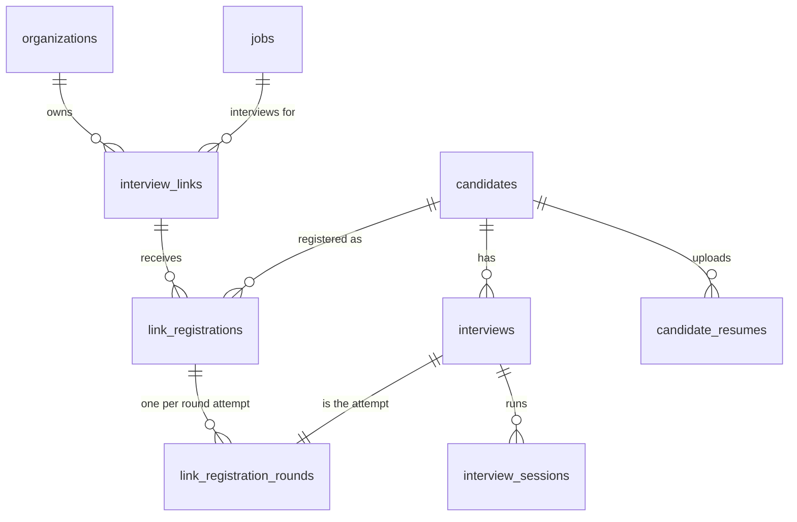
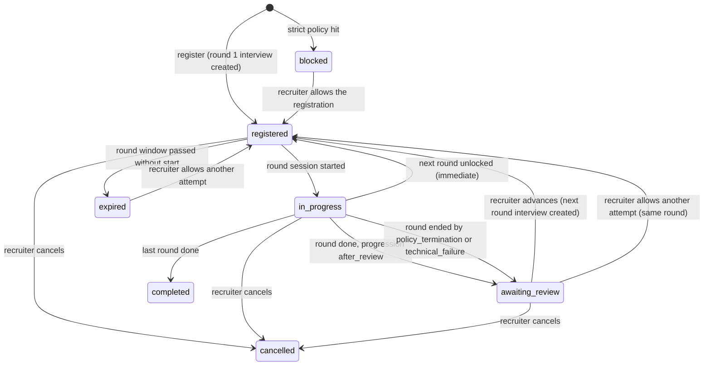

# Open interview links (one link, many candidates)

Written for: the backend and frontend engineers (and build agents) implementing open interview links in parallel,
and for reviewers checking privacy, fairness and security. Status: backend implemented 2026-10-08 (migration
`0004`, section 9.8 lists the implementation notes and contract clarifications); web implemented in parallel.

Related contracts: `docs/design/CONTRACTS.md` (conventions, RBAC, portal), `SECURITY.md`, `docs/design/UI_TEST_IDS.md`.
Code-level contracts win once they exist: `apps/api/app/schemas/api/open_links.py` (DTOs),
`apps/api/app/services/open_links/form_schema.py` (form schema), `apps/api/app/db/models/open_links.py` (tables).

## 0. Summary

Today a recruiter creates candidates one at a time (`POST /interviews` creates one interview plus a one-time invite
link `/i/<token>`). An **open link** is one shareable URL `/j/<token>` for a job and one or more of its rounds. Anyone
holding it (campus drive, job post, WhatsApp group of 50-100 people) opens it, fills a recruiter-defined registration
form, and lands in the existing candidate journey (consent, resume, system check, interview room). Behind the scenes
every registration reuses the existing building blocks:

| Need | Reused building block |
|---|---|
| Candidate record "under their name" | `candidates` (org-scoped, unique per e-mail), resumes, profiles |
| One attempt per round | `interviews` (one row per candidate x round attempt) + `InterviewSession` |
| Portal login | `start_candidate_session` (candidate cookies scoped to one interview) |
| Questions made for the candidate | unchanged: `session.prepare` plans questions from the candidate's resume profile and the round config |
| Reports, recordings, integrity | unchanged: everything hangs off the session |
| Policies (recording, monitoring, retention, report mode) | `build_policy_snapshot(org_settings, job)`, frozen per interview as today |

New pieces: three tables (`interview_links`, `link_registrations`, `link_registration_rounds`), a form builder with a
fairness guard, a public registration endpoint, a personal "continue later" link `/r/<token>`, round progression, and
the recruiter Links UI.

### Owner request coverage

| Owner asked | Where |
|---|---|
| One link per job, choose round(s), share with 50-100 people | sections 1, 3, 6 |
| Form with name, mobile, e-mail etc., editable by the interviewer | section 2 |
| Resume upload, analysis, then interview | section 3.4 (existing journey; `require_resume` per link) |
| Different questions per candidate, AI makes its own from the resume | section 3.5 (existing engine, no change) |
| Everything stored under the candidate's name: resume, reports, full video | section 3.6 |
| No second attempt; recognise repeat attempts (email, phone, device, IP) | section 4 |
| Multiple rounds; after round 1 the candidate moves to round 2 | section 5 |

## 1. Data model

### 1.1 Entity relationships



The round pipeline lives in `interview_links.round_ids`. A round attempt is a normal `interviews` row
(`round_id` fixed, `allow_round_selection=false`); `link_registration_rounds` ties it to the registration so the
recruiter sees one row per person with a status per round.

### 1.2 `interview_links`

| Column | Type | Notes |
|---|---|---|
| `id` | uuid PK | `UUIDPrimaryKeyMixin` |
| `created_at`, `updated_at` | timestamptz | `TimestampMixin` |
| `organization_id` | uuid FK `organizations.id` ON DELETE CASCADE, not null | index |
| `job_id` | uuid FK `jobs.id` ON DELETE CASCADE, not null | index; immutable after create |
| `name` | varchar(120) not null | recruiter label, also shown to candidates ("Campus drive, Pune, Oct 2026") |
| `description` | text null | optional intro shown on the landing page (Markdown, rendered with `skipHtml`) |
| `public_token` | varchar(64) not null, UNIQUE | 24 random bytes, base64url (32 chars, 192 bits). Stored in plain text on purpose: it is a public share URL that recruiters must be able to copy again, not a credential to any data. Rotation (`regenerate-token`) invalidates the old one. |
| `token_rotated_at` | timestamptz null | |
| `status` | varchar(16) not null default `active` | `active` \| `paused` \| `closed` (closed is final) |
| `round_ids` | `uuid[]` not null | ordered pipeline, 1-10 rounds of the job; one element = single-round link. Stored as an array (no FK) so deleting/deactivating a round never 500s; missing or inactive rounds are reported as `missing: true` and skipped. |
| `progression` | varchar(16) not null default `immediate` | `immediate` \| `after_review` (section 5) |
| `opens_at`, `closes_at` | timestamptz null | registration window; `closes_at > opens_at` |
| `max_registrations` | integer null | 1-10000; counts registrations except `blocked` |
| `round_window_hours` | integer not null default 72 | each round's interview must be started within this many hours after it unlocks (becomes `interviews.invite_expires_at`); 1-720 |
| `require_resume` | boolean not null default true | the session cannot start without a resume (server-enforced, section 3.4) |
| `access_code_hash` | varchar(255) null | argon2 of an optional shared code (shown once on set/rotate) |
| `per_ip_hourly_limit` | integer not null default 120 | registrations per client IP per hour for this link; 5-2000 (raise for campus drives behind one NAT) |
| `duplicate_policy` | jsonb not null | `{"scope": "job"\|"link", "device": "flag"\|"block", "network": "off"\|"flag"}`, default `{"scope":"job","device":"flag","network":"flag"}` |
| `form_schema` | jsonb not null | section 2.1; server sets `version` (increments on every change) |
| `acknowledged_warnings` | jsonb not null default `[]` | fairness warnings the recruiter acknowledged (`"<field_key>:<code>"`) |
| `created_by_id`, `updated_by_id` | uuid FK `users.id` ON DELETE SET NULL | |
| `closed_at` | timestamptz null | |

Indexes: `uq_interview_links_public_token`, `ix_interview_links_org_created (organization_id, created_at)`,
`ix_interview_links_job (job_id)`.

### 1.3 `link_registrations`

One row per person per link (plus rows for blocked attempts).

| Column | Type | Notes |
|---|---|---|
| `id`, `created_at`, `updated_at` | | |
| `organization_id` | uuid not null | index; denormalised for org scoping |
| `link_id` | uuid FK `interview_links.id` ON DELETE CASCADE, not null | |
| `job_id` | uuid not null | denormalised for job-scope duplicate checks |
| `candidate_id` | uuid FK `candidates.id` ON DELETE CASCADE, **null** for `blocked` rows | erasure of the candidate cascades |
| `status` | varchar(20) not null | `registered` \| `in_progress` \| `awaiting_review` \| `completed` \| `expired` \| `cancelled` \| `blocked` (section 5.1) |
| `status_reason` | varchar(40) null | e.g. `after_review`, `policy_termination`, `technical_failure`, `device_policy`, `recruiter_cancelled` |
| `full_name` | varchar(200) not null | as entered |
| `email` | varchar(320) not null | trimmed, lower-cased (also `candidates.email`) |
| `email_key` | varchar(320) not null | duplicate key: lower-case, `+tag` removed, dots removed for gmail.com/googlemail.com |
| `phone` | varchar(40) null | as entered (trimmed) |
| `phone_key` | varchar(20) null | digits only; the last 10 digits when 10 or more digits (so `+91 98xxx` == `098xxx`) |
| `answers` | jsonb not null | `{"form_version": n, "fields": [{"key","label","type","value"}]}` - a snapshot, so later form edits never break display |
| `privacy_ack_at` | timestamptz not null for non-blocked rows | candidate ticked "I have read how my data is used" |
| `disclosure_hash` | varchar(64) null | sha256 of the data-use summary shown at registration |
| `personal_token_hash` | varchar(64) UNIQUE null | sha256 of the 32-byte personal link token; plaintext only shown once |
| `personal_token_issued_at` | timestamptz null | |
| `personal_failed_count` | integer not null default 0 | identity-check failures on `/r/<token>` (lockout like invites) |
| `device_hash` | varchar(64) null | HMAC of the `ol_device` cookie value |
| `ip_hash` | varchar(64) null | HMAC of the client IP |
| `ip_ua_hash` | varchar(64) null | HMAC of IP + User-Agent |
| `resume_sha256` | varchar(64) null | copied from `candidate_resumes.sha256` once uploaded |
| `flags` | jsonb not null default `[]` | `[{"code","severity":"high"\|"low","message","related_registration_id","at"}]` |
| `flag_review` | varchar(16) not null default `none` | `none` \| `open` \| `cleared` \| `confirmed` |
| `flag_reviewed_by_id` | uuid FK users SET NULL | |
| `flag_reviewed_at` | timestamptz null | |
| `flag_review_note` | text null | |
| `current_round_index` | integer not null default 0 | index into `interview_links.round_ids` |
| `completed_at`, `cancelled_at` | timestamptz null | |
| `signals_purged_at` | timestamptz null | set when retention nulls `device_hash`/`ip_hash`/`ip_ua_hash` |

Constraints and indexes:

* `uq_link_registrations_link_email` UNIQUE (`link_id`, `email_key`) WHERE `status <> 'blocked'`
* `uq_link_registrations_link_phone` UNIQUE (`link_id`, `phone_key`) WHERE `phone_key IS NOT NULL AND status <> 'blocked'`
* `ix_link_registrations_job_email (organization_id, job_id, email_key)`, `ix_link_registrations_job_phone (organization_id, job_id, phone_key)`
* `ix_link_registrations_link_created (link_id, created_at)`, `ix_link_registrations_link_status (link_id, status)`
* `ix_link_registrations_link_device (link_id, device_hash)`, `ix_link_registrations_link_resume (link_id, resume_sha256)`,
  `ix_link_registrations_link_ipua (link_id, ip_ua_hash, created_at)`, `ix_link_registrations_candidate (candidate_id)`

### 1.4 `link_registration_rounds`

| Column | Type | Notes |
|---|---|---|
| `id`, `created_at`, `updated_at` | | |
| `registration_id` | uuid FK `link_registrations.id` ON DELETE CASCADE, not null | |
| `round_id` | uuid not null (no FK) | |
| `round_name` | varchar(200) not null | snapshot |
| `sequence` | integer not null | index in the link pipeline (0-based) |
| `attempt` | integer not null default 1 | >1 only through a recruiter "Allow another attempt" |
| `interview_id` | uuid FK `interviews.id` ON DELETE CASCADE, UNIQUE, not null | |
| `unlocked_by` | varchar(16) not null | `registration` \| `auto` \| `recruiter` \| `retake` |
| `unlocked_by_user_id` | uuid FK users SET NULL | |
| `note` | text null | advance/retake reason |

`uq_link_registration_rounds_attempt` UNIQUE (`registration_id`, `sequence`, `attempt`) - the database refuses a
second interview for the same round attempt even under races.

Per-round **state** is derived, never stored: no row = `locked`; else from `interviews.status` and the latest session:
`invited` (not started), `in_progress`, `completed`, `expired`, `cancelled`.

### 1.5 Migration

`apps/api/alembic/versions/0004_open_interview_links.py`, `revision = "0004"`, `down_revision = "0003"` (the single head
on 2026-10-08, verified with `uv run alembic heads`). Before writing it run `uv run alembic heads` again and use the
then-current single head; at the end re-check and, if another agent added a migration meanwhile, rebase onto it
(renumber the revision id/file name, set `down_revision` to that head). Purely additive: three `create_table` calls,
indexes (partial unique indexes via `postgresql_where`), and `downgrade()` dropping them in reverse order. No change to
existing tables. `uv run alembic check` must stay clean (models and migration must match).

Enums stay out of `app/domain/enums.py` (the web `types.test.ts` parses that file and fails on drift); they live in
`app/services/open_links/constants.py` as `StrEnum`s and are mirrored in `apps/web/src/features/links/types.ts`.

## 2. Registration form builder

### 2.1 Schema

```json
{
  "version": 3,
  "fields": [
    {"key": "full_name", "builtin": true, "type": "text", "label": "Full name", "help_text": null,
     "placeholder": null, "required": true, "enabled": true, "options": [], "min": null, "max": null,
     "max_length": 200},
    {"key": "email", "builtin": true, "type": "email", "label": "Email", "required": true, "enabled": true},
    {"key": "phone", "builtin": true, "type": "phone", "label": "Mobile number", "required": true, "enabled": true},
    {"key": "c_preferred_shift", "builtin": false, "type": "select", "label": "Preferred shift",
     "required": false, "enabled": true, "options": ["Day", "Night", "Either"]}
  ]
}
```

Array order is display order. `version` is server-owned. Limits: at most 30 fields, label 1-120 chars, help text
<= 300, placeholder <= 120, options 1-50 per field, each 1-120 chars, unique case-insensitively.
Keys: built-ins use their fixed key; custom keys match `^c_[a-z0-9_]{1,40}$` (the builder derives them from the label)
and are unique.

**Built-in fields** (`GET /open-links/form/catalog` returns this list; the server is authoritative):

| key | type | default | maps to |
|---|---|---|---|
| `full_name` | text (<=200) | required, cannot be disabled | `candidates.full_name` |
| `email` | email | required, cannot be disabled | `candidates.email` |
| `phone` | phone | enabled, required (owner asked for mobile number) | `candidates.phone` |
| `location` | text (<=120), label "City" | optional, disabled | `candidates.location` |
| `linkedin_url` | url | optional, disabled | answers only |
| `portfolio_url` | url, label "Portfolio or GitHub" | optional, disabled | answers only |
| `current_title` | text | optional, disabled | answers only |
| `current_company` | text | optional, disabled | answers only |
| `years_experience` | number 0-60, step 0.5 | optional, disabled | answers only |
| `notice_period` | select (Immediately, 15 days, 30 days, 60 days, 90 days, More than 90 days) | optional, disabled | answers only |
| `available_from` | date (availability) | optional, disabled | answers only |

Existing candidate rows are never overwritten by a registration: only empty `phone`/`location` are filled.

**Custom field types**: `text`, `textarea`, `number`, `email`, `phone`, `url`, `select`, `multiselect`, `checkbox`,
`date`. `date` exists only for availability: answers must be today (UTC, one day tolerance) or later and at most two
years ahead, which makes a date-of-birth field impossible by construction. There is no file field (the resume is
uploaded in the journey; photos are never collected).

### 2.2 Answer validation (server, `form_schema.validate_answers`)

Run on every registration against the link's current schema. Unknown keys -> 422. Disabled fields are ignored.
Strings are NFC-normalised, trimmed, control characters rejected.

| type | rule |
|---|---|
| text | <= `max_length` (default 200, max 500) |
| textarea | <= `max_length` (default 1000, max 2000) |
| number | finite, `min`/`max`, at most 2 decimals |
| email | `local@domain.tld`, <= 320, lower-cased |
| phone | only digits, spaces, `+ - ( ) .`; 7-15 digits |
| url | `http`/`https` only, host required, <= 500 |
| select | value in `options` |
| multiselect | unique subset of `options`, optional `max` = max selections |
| checkbox | boolean; `required` means it must be `true` (e.g. "I confirm my details are correct") |
| date | ISO `YYYY-MM-DD`, today .. today + 730 days |

Errors: 422 `validation_failed` with `details.fields = {"<key>": "<candidate-safe message>"}`.

### 2.3 Fairness guard (protected-trait fields)

`app/services/open_links/fairness.py::check_form(schema) -> (errors, warnings)`, run on create, PATCH and
`POST /open-links/form/validate`. It scans each enabled and disabled custom field's key, label, help text, placeholder
and options, lower-cased and with `_`/`-` turned into spaces, with:

1. `app.seed.fairness.fairness_hits(text)` (the catalog lint already used for the question bank; specific phrases such as
   "date of birth", "graduation year", "marital status", "citizenship"), and
2. form-specific short-label rules (form labels are terse, so the catalog lint alone misses "Age" or "Gender").

**Blocked** (422 `protected_field`, cannot be overridden):

| topic | example triggers (word-boundary regexes) |
|---|---|
| age / date of birth | `age`, `dob`, `date of birth`, `birth date`, `birthday`, `year of birth`, `graduation year`, `passing year`, `batch year` |
| gender / sex | `gender`, `sex`, `pronoun`, honorific options `mr`/`mrs`/`ms`/`miss` |
| marital / family status | `marital`, `married`, `spouse`, `husband`, `wife`, `children`, `kids`, `dependents`, `pregnan`, `father('s)? name`, `mother('s)? name`, `parent('s)? name`, `guardian` |
| religion / caste / race | `religion`, `faith`, `caste`, `sub caste`, `community`, `tribe`, `race`, `ethnic` |
| nationality / citizenship | `nationality`, `citizenship`, `citizen`, `passport`, `country of birth`, `place of birth`, `visa (status\|type)` |
| photo / appearance | `photo`, `photograph`, `picture`, `selfie`, `headshot`, `height`, `weight`, `complexion` |
| health / disability | `health`, `medical`, `disab`, `handicap`, `blood group`, `illness` |
| salary history | `current (salary\|ctc\|pay\|compensation)`, `last drawn`, `previous (salary\|ctc)`, `salary history` |

**Warnings** (422 `form_warnings_unacknowledged` until the recruiter acknowledges each `"<key>:<code>"` in
`acknowledged_warnings`; the acknowledgement is stored and audited):

| code | trigger | message shown |
|---|---|---|
| `expected_pay` | `expected (salary\|ctc\|pay)` | Ask only for expectations, never pay history. |
| `right_to_work` | `work authori[sz]ation`, `right to work`, `legally (authorized\|allowed)` | Ask only a yes/no about the job's location; never ask for nationality or visa type. |
| `address` | `address`, `pin ?code`, `postal`, `zip` | A city is enough; a full address is personal data you probably don't need. |
| `employment_gap` | `gap`, `career break` | Gaps can reveal health, caregiving or family status. |
| `languages` | `mother tongue`, `native language` | Can reveal national or ethnic origin; ask about job-required languages instead. |

Error body: `{"error": {"code": "protected_field", "message": "This form asks for information we never collect: ...",
"details": {"fields": [{"key", "label", "topic", "message"}]}}}`. The web builder runs a mirror of these rules for
instant feedback (`features/links/fairness.ts`), but the server decides.

**Form answers are never sent to the AI.** Interview planning and scoring use only the resume profile and the round
configuration (as today). Answers are shown to staff only, which keeps free text a candidate types into a custom field
out of every model prompt and every score.

## 3. Public flow

### 3.1 Sequence

```mermaid
sequenceDiagram
    autonumber
    participant C as Candidate browser
    participant W as Web /j/:token
    participant A as API /link-access
    participant DB as Postgres
    C->>W: open shared link
    W->>A: GET /link-access/{token}
    A->>DB: link by public_token (+ job, org, rounds, policy summary)
    A-->>W: LinkInfo (state, rounds, form, data-use summary)
    C->>W: fill form, tick privacy notice, submit
    W->>A: POST /link-access/{token}/register
    A->>A: origin check, rate limits, honeypot, access code
    A->>DB: lock link row, window/max checks, validate answers
    A->>DB: advisory locks on (org, email_key) and (org, phone_key)
    A->>DB: exact-identity lookup (scope link or job)
    alt completed or in progress elsewhere
        A-->>W: 409 already_completed / already_registered (or 200 resumed on the same device)
    else new person
        A->>DB: soft signals -> flags (or 403 when the link blocks that signal)
        A->>DB: get-or-create candidate; registration; personal token
        A->>DB: create_invitation(round 1) + link_registration_rounds
        A->>DB: start_candidate_session(interview)
        A-->>W: 201 {interview_id, next_step, personal_url, csrf_token} + cookies
        W->>C: "Save your personal link" then /candidate/{id}/welcome
    end
    Note over C,W: existing journey: welcome, instructions, consent, resume, system check, interview room
```

### 3.2 `GET /api/v1/link-access/{token}`

No auth, rate limited 60/min per IP (`link_access_info`). Malformed and unknown tokens both give 404
`link_not_found`. Returns no internal ids (no link, job, round or org ids) and no counts. The link's `state` is
computed: `scheduled` (now < opens_at), `open`, `paused`, `closed`, `expired` (now >= closes_at), `full`
(registrations >= max). For any state but `open` the `form` is `null`.

`data_use` is built from `build_policy_snapshot(org_settings, job)` (the same policy frozen into each interview) plus
`org_settings.data_processing_notice`, so the landing page discloses before any data is entered: audio/video/screen
recording, camera/screen monitoring, AI-assisted assessment with a human decision, and retention days. The full,
itemised consent still happens in the journey's consent step (`/portal/interviews/{id}/disclosure`), which the landing
page links to as "You will review and accept the details before the interview starts".

### 3.3 `POST /api/v1/link-access/{token}/register`

Server steps, one transaction (`get_db` commits before the response):

1. `require_allowed_origin(request)`: `Origin` (or `Referer` when absent) must be allowed by
   `app.realtime.origin.origin_allowed(PUBLIC_BASE_URL, CORS_ALLOWED_ORIGINS)`, else 403 `origin_not_allowed`.
   Body must be JSON (FastAPI enforces it), which a cross-site HTML form cannot send without a CORS preflight.
2. Rate limits (`app.core.ratelimit.enforce_rate_limit`): `link_register_ip` per IP across links (600/h,
   `OPEN_LINK_REGISTER_IP_LIMIT_PER_HOUR`), `link_register_link_ip` per (link, IP) = `per_ip_hourly_limit`/h,
   `link_register_link` per link 600/10 min.
3. `SELECT ... FOR UPDATE` on the link (serialises registrations of one link; 100 registrations at ~50 ms each is
   fine); state must be `open`, else 409 `link_unavailable` with `details.state`. Job closed/archived -> `closed`.
4. Honeypot: a non-empty `website` -> 400 `registration_rejected` (generic message, audited as
   `link.registration_rejected`, nothing created).
5. `privacy_ack` must be `true` -> else 422 `privacy_ack_required`.
6. Access code (when set): missing -> 422 `access_code_required`; wrong -> 401 `invalid_access_code`; 10 failures per
   (link, IP) in 10 min -> Redis lock `openlink:lock:{link_id}:{ip_hmac}` for `LOGIN_LOCKOUT_SECONDS`, 423
   `access_code_locked` + `Retry-After`.
7. `validate_answers` (section 2.2) -> normalised name, e-mail, phone, `email_key`, `phone_key`.
8. `pg_advisory_xact_lock(hashtext(org || ':' || email_key))` and the same for `phone_key` (prevents two parallel
   submissions of the same person from both passing the check).
9. Exact-identity check (section 4.1). May answer 409, or 200 `resumed`.
10. Soft signals (section 4.2) -> `flags`; a `block` policy hit stores a `blocked` row and answers 403
    `registration_blocked`.
11. Candidate: `SELECT candidates WHERE organization_id = :org AND email = :email`. Archived -> 409
    `registration_unavailable` (generic: "We couldn't register you. Please contact the hiring team."). Missing -> create
    with `source="open_link"`, `created_by_id = link.created_by_id`. Existing -> fill only empty phone/location.
12. Registration row (`status=registered`), personal token (32 bytes; only sha256 stored).
13. First round: `create_invitation(db, organization_id, invited_by_id=link.created_by_id, body=InterviewCreate(
    candidate_id, job_id, round_id=round_ids[first available], allow_round_selection=False,
    expires_in_hours=link.round_window_hours), skip_access_code=True)` (new keyword, section 9). Its
    `interview_exists` 409 becomes 409 `already_invited` ("You already have an invitation for this role. Please use
    the link in your invitation."). The invite token it generates is discarded (only its hash is stored, so it is
    unusable); the candidate enters through cookies now and the personal link later.
14. `link_registration_rounds` row (`sequence`, `attempt=1`, `unlocked_by="registration"`); interview
    `invite_opened_at = verified_at = now`.
15. `start_candidate_session(...)`, `set_auth_cookies(response, tokens)`; set the `ol_device` cookie when absent
    (section 4.2).
16. Audit `link.registration_created` (actor = candidate principal) with `{link_id, flags: [codes]}`; metric
    `interview_open_link_registrations_total{outcome="registered"}`.

The response sends the web app to `/candidate/{interview_id}/{next_step}` after the "save your personal link"
screen. `next_step` is `welcome` for new registrations.

### 3.4 Resume and system check

Unchanged journey. `require_resume=true` (default) is enforced server-side by one guarded hook in
`portal_create_session`: if the interview belongs to a link registration that requires a resume and the candidate has
no resume in a non-failed state, 409 `resume_required`. The web journey already requires the resume step
(`requires_resume`), so the hook only stops API misuse. When the resume is uploaded, a second guarded hook in
`portal_resume_upload` copies its sha256 to `link_registrations.resume_sha256` and evaluates the resume duplicate
signal. Both hooks call `app.services.open_links.hooks` inside `try/except` with a warning log: a failure in the
open-link layer never breaks the existing portal.

### 3.5 Questions per candidate

No engine change (the engine and `app/services/interview/**` are owned by another workflow). Each round attempt is a
normal interview, so `session.prepare` plans the interview from that candidate's resume profile, the job and the round
config, and the engine writes each next question from the candidate's answers. Two candidates on the same link get
different interviews because their profiles and answers differ. The question bank remains inspiration and rubric
source only.

### 3.6 "Stored under the candidate's name"

All artefacts already belong to the candidate: `candidates` row (name, email, phone), `candidate_resumes` + profile,
`interviews` (one per round attempt), sessions with transcript, scores, reports, integrity events and recordings (when
the job's recording policy has `record_video=true`; the link editor shows the job's effective policy and warns when
video recording is off, with a link to the job's policy settings). The registration adds the form answers and the
round pipeline. The candidate detail page gets a "Registrations" card (section 6.5).

### 3.7 Personal "continue later" link

* Issued once at registration (`personal_url = {PUBLIC_BASE_URL}/r/{token}`), shown on a "Save your personal link"
  screen with Copy and "I've saved it" buttons; never stored in plain text, never logged, never e-mailed (the platform
  has no mail service today). Recruiters can reissue it (rotates the token, shown once, audited) and send it themselves.
* `GET /api/v1/link-return/{token}` -> `{organization_name, job_title, link_name, state}`; no personal data.
* `POST /api/v1/link-return/{token}/verify {email}` -> identity check exactly like invite verification
  (`constant_time_equals` on the registration e-mail; 20/min per IP; 10/5 min per registration; lock for
  `LOGIN_LOCKOUT_SECONDS` after every 5 consecutive failures, permanent after 20 until a recruiter reissues). On
  success it runs `sync_registration` (section 5.3), picks the **current** interview (the newest round attempt that is
  not cancelled; if all are done, the last one), starts a candidate session for it and returns `next_step` and the
  progress view.

## 4. One attempt per person

### 4.1 Exact identity (never a second attempt)

Scope = `duplicate_policy.scope`: `job` (default: any link of the same job, plus interviews the candidate has for the
job outside links) or `link`. Match = same `email_key` OR same `phone_key` among non-blocked registrations in scope,
or (scope `job`) an org candidate with the same e-mail who has a non-cancelled interview for the job.

| Matched registration | Response | Notes |
|---|---|---|
| `completed` (all link rounds done) | 409 `already_completed` "You have already completed this interview." | |
| `awaiting_review` | 409 `already_registered`, `details.state="awaiting_review"` "You've finished round N. The hiring team will review it; open your personal link to check for the next round." | |
| `registered` / `in_progress`, and the request's `ol_device` cookie hashes to the registration's `device_hash` and the e-mail matches | 200 `outcome="resumed"`: new candidate session for the current interview, no new personal link | same browser, typical "closed the tab" case |
| `registered` / `in_progress`, other device | 409 `already_registered`, `details.resume_with="personal_link"` "You're already registered. Continue with the personal link you saved, or on the device you registered from." | never creates a second interview |
| `cancelled` / `expired` | 409 `already_registered`, `details.state` | a recruiter can allow another attempt |
| candidate has an open recruiter invitation for this job | 409 `already_invited` | |

A phone match with a different e-mail is still an exact match (owner rule). Every outcome is audited
(`link.registration_duplicate` with `{match: "email"|"phone", state}`) and counted in the metric. The 409 bodies carry
no personal data (no name, no masked e-mail), so the endpoint confirms only that "someone with these details" exists on
this link; that leak is bounded by the rate limits and needs the link token.

### 4.2 Soft signals (flags for human review by default)

| Signal | How it is computed | Default | Strict option |
|---|---|---|---|
| `same_device` (high) | `ol_device` cookie: 32 random bytes, HttpOnly, `SameSite=Lax`, `Secure` when `COOKIE_SECURE`, `Path=/api/v1/link-access`, Max-Age 180 days. DB stores `HMAC(signal_key, "device:" + value)`. Match = another non-blocked registration on the link with the same `device_hash` and a different identity. | flag | `device: "block"` -> blocked row + 403 `registration_blocked`. The editor warns: "Shared computers (campus labs, cyber cafes) will block real candidates." |
| `same_resume` (high) | `resume_sha256` equals another registration's in scope (set by the upload hook) | flag | no block option (the registration already exists when the resume arrives) |
| `same_network` (low) | `ip_ua_hash = HMAC(signal_key, "ipua:" + ip + "\n" + user_agent)` equals another registration's on the link within 15 minutes | flag (low) | `network: "off"` disables it |

Flags are appended to `flags`, set `flag_review="open"` for high severity, are audited (`link.registration_flagged`)
and never stop the candidate or change progression. Low-severity flags are shown but excluded from the "Needs review"
filter (behind one campus NAT every registration shares the network). Recruiters mark a flag `cleared` (not a
duplicate) or `confirmed` (likely the same person; they then decide, e.g. cancel, by hand).

`signal_key` = `OPEN_LINK_SIGNAL_SECRET` when set, else `HMAC_SHA256(MEDIA_URL_SECRET, "open-link-signals-v1")`.
Raw IPs and user agents are never stored in these tables, never shown and never exported (the existing `audit_logs`
keep their own IP/UA as today and are scrubbed by candidate erasure).

### 4.3 Repeat attempts inside the journey

Already enforced today and kept: a completed interview answers 409 `interview_completed` on consent/resume/session;
`create_or_resume` never makes a second session for a completed interview. A new attempt can only come from a
recruiter action (section 6.4 "Allow another attempt"), which creates a new interview row with `attempt + 1` and an
audit entry with the reason.

## 5. Multiple rounds

### 5.1 Registration states



`registered` means "has an interview to take now" (the current round is invited and not started).

### 5.2 Progression rules

* `immediate`: when round k's interview is `completed` and k is not the last round, the next round's interview is
  created at once for **everyone**, regardless of scores (owner rule: never advance or hold back on an AI score). The
  candidate sees "Continue to round k+1" on the complete page and the dashboard.
  Exception: if the round's session ended with `end_reason` in {`policy_termination`, `technical_failure`}, the
  registration goes to `awaiting_review` with that `status_reason`, so a person decides (advance, or allow another
  attempt of the same round). This routes the case to a human; it never rejects.
* `after_review`: after every completed round the registration waits in `awaiting_review`. Recruiters advance
  candidates singly or in bulk; candidates see the next round when they return through their personal link.
* Nothing ever moves a candidate backwards or out automatically. There is no auto-reject anywhere.
* Advancing never sends a message (no mail service). The advance dialog reminds the recruiter to tell candidates to
  open their personal link; a "copy candidate e-mails" action helps.

### 5.3 Completion hook (outside `app/services/interview/**`)

When a session closes, the engine (in `services/interview`, not edited here) sets `interviews.status = 'completed'`
(or `cancelled` when aborted) and, in the same transaction, enqueues `scoring.finalize` and `report.generate`. The
report worker later calls `mark_session_completed`. The open-link layer hooks in at three idempotent places, all
calling one function:

`app/services/open_links/progression.py::sync_registration(db, registration_id) -> SyncResult`
1. `SELECT ... FOR UPDATE` the registration.
2. Load its round rows + interviews + latest sessions (`end_reason`).
3. If the newest attempt of the current round is `completed`: last round -> `completed`; else `immediate` and
   `end_reason` not in the exception set -> create the next interview (`create_invitation`, `unlocked_by="auto"`),
   `current_round_index += 1`, `registered`; otherwise `awaiting_review` (+ `status_reason`).
4. Expired/cancelled interviews -> `expired`/`cancelled`; live/started -> `in_progress`.
5. The unique constraint on (`registration_id`, `sequence`, `attempt`) makes concurrent calls safe; the loser catches
   `IntegrityError` inside a savepoint and re-reads.

Call sites:

1. **Worker hook** (primary): `app/workers/reports.py::finalize_scores`, first statement (before the deferral check):
   `await enqueue("open_link.round_finished", {"session_id": str(sid)}, dedupe_key=f"open_link.round_finished:{sid}")`
   inside `try/except` (logged, never fails scoring). `scoring.finalize` is enqueued by the engine at session close, so
   this fires seconds after the interview ends and does not wait for reports. The handler
   (`app/workers/open_links.py`) maps session -> interview -> `link_registration_rounds` (no row = not a link interview,
   return) and runs `sync_registration`. Then it publishes `{"type": "link.progress"}` on `session:{id}:bus` (harmless if
   nobody listens).
2. **Lazy sync on read**: `GET /portal/link/progress`, `POST /link-return/{token}/verify`, and the staff registration
   list/detail run `sync_registration` for the rows they return when any row's state looks stale (current interview
   terminal but registration not updated). This makes the candidate's "Continue to round 2" appear instantly even if the
   worker is behind.
3. **Periodic sweep**: `open_link.sweep` every 300 s (`register_periodic_job`) syncs registrations whose current
   interview changed in the last day and runs retention (section 8.4).

### 5.4 Switching the candidate to the next round

Candidate sessions are bound to one interview (`iid` claim). `POST /portal/link/continue {interview_id}` checks the
interview is a round attempt of the caller's registration (same candidate) and is `invited`/`in_progress`, revokes the
caller's auth session (`revoked_reason="link_round_switch"`), starts a new candidate session for the target interview,
sets cookies and returns `{interview_id, next_step, csrf_token}`. The web app then navigates to
`/candidate/{interview_id}/{next_step}`. Consent is per interview (the disclosure may differ by round), the resume is
not asked again (`_latest_resume` is candidate-wide, so `steps_completed` already contains `resume`).

## 6. Recruiter UX

All staff pages use `PageContainer`/`PageHeader`, design-system components and semantic tokens only, work from 360 px,
and respect dark mode.

### 6.1 Navigation and routes

* Sidebar "Hiring" group: new item "Interview links" (`/app/links`, icon `Link2`, permission `jobs:read`, keywords
  "open link campus drive registration share").
* `/app/links` - all links of the org: table (name, job, rounds, state badge, registrations, awaiting review,
  flagged, closes at), filters (job, state), "Create link".
* `/app/links/new?job_id=` and `/app/links/:linkId/edit` - editor (permission `interviews:invite`).
* `/app/links/:linkId` - detail with tabs `registrations` (default), `share`, `settings` (read-only summary + Edit).
* Job detail page: new tab "Links" (`?tab=links`) listing the job's links with "Create link for this job".

### 6.2 Link editor (one page, sections)

1. **Basics**: name, job (fixed after create), description.
2. **Rounds**: radio "One round" (round select) / "Rounds in order" (checklist of the job's active rounds in job order,
   at least one). Shows each round's type and duration.
3. **Progression** (only with 2+ rounds): radio "Continue immediately" (default) / "After a person reviews". Helper text:
   "Progression never depends on AI scores."
4. **Schedule and limits**: opens at, closes at, max registrations, round window (hours), per-IP limit with a
   "Campus drive (many people on one network)" preset that sets 1000.
5. **Access**: require resume (default on), optional access code (generate; shown once in a dialog with copy).
6. **Duplicates**: scope (this job / this link), same device (flag / block, with the false-positive warning callout),
   same network (flag / off).
7. **Registration form**: builder (left) and live preview (right; stacked below on phones). Built-in fields as toggle
   rows (enabled, required), "Add field" (type menu), each custom row: label, type, help text, required, options
   editor (select/multiselect), min/max, move up/down buttons (keyboard accessible; no drag library), delete.
   Fairness errors render inline on the field (`Callout` tone danger) and block saving; warnings render with an
   "I understand" checkbox. The builder calls `POST /open-links/form/validate` (debounced 400 ms) in addition to the
   local mirror. The preview renders the exact `RegistrationForm` component the candidate sees, in preview mode.
8. **Job policy notice**: read-only summary of recording/monitoring/report mode for this job, a warning if video
   recording is off, link to the job editor.

Save: `POST /open-links` or `PATCH /open-links/{id}`; on create show the Share tab.

### 6.3 Share tab

Full URL in a read-only input + Copy, "Open in new tab", QR code (SVG rendered by `features/links/qr.ts`, a tiny
dependency-free encoder: byte mode, ECC level M, versions 1-10, mask by penalty score; "Download PNG" draws the SVG on a
canvas), pause/resume, close (confirm: "Nobody new can register; people already registered can finish"), regenerate
link (confirm: "The old link stops working immediately"), rotate/remove access code. If the QR encoder is not ready in
time, ship without the QR block (P2).

### 6.4 Registrations tab

Toolbar: search (name, e-mail, phone), status filter, round filter, "Needs review" toggle (high flags open or
`awaiting_review`), Export CSV. Table (`DataTable`; cards below 640 px):

| Column | Content |
|---|---|
| select | checkbox (bulk advance) |
| Candidate | name, e-mail, phone; link to `/app/candidates/:id` |
| Registered | relative time |
| Rounds | one chip per round: locked / invited / in progress / completed / expired / cancelled; completed chips link to `/app/sessions/:sessionId` |
| Status | registration status badge + reason |
| Flags | badge with count; tooltip lists reasons |
| Actions | menu: View, Advance to next round, Allow another attempt, Reissue personal link, Cancel, Allow registration (blocked rows) |

Row click opens a detail sheet: answers (label/value list), per-round attempts with links to session, report
(`/app/reports/:sessionId`) and recordings (`/app/sessions/:sessionId?tab=recordings`, owned by the recordings
track), flags with "Clear" / "Confirm duplicate" and a note, personal-link issued at, timeline.

Bulk "Advance" (enabled when selected rows are `awaiting_review`): confirmation dialog with count and the reminder to
notify candidates; result toast lists skipped rows with reasons. All actions are audited server-side.

### 6.5 Candidate detail

New `CandidateRegistrationsCard` (links the candidate registered through, answers, per-round status) placed on
`CandidateDetailPage` via one import and one element. It calls `GET /open-links/registrations?candidate_id=` and
renders nothing when empty.

## 7. Candidate UX

Mobile-first (the link will mostly be opened on phones), inside `CandidateShellLayout`, theme toggle available.

### 7.1 `/j/:token` (OpenLinkPage)

* Header: organization name, job title, link name; facts: rounds (name, about N minutes each), "Takes place online,
  in your browser", interviewer name.
* State panels (`EmptyState`): `scheduled` ("Registration opens on <date>"), `paused` ("Registration is paused. Try
  again later."), `closed` / `expired` ("Registration has closed"), `full` ("All places are taken"), 404 ("This link
  isn't valid. Check you copied the whole link.").
* Form (`RegistrationForm`): fields from the schema, native input types (`type=email`, `type=tel`, `inputmode`),
  labels above inputs, errors under fields, `aria-describedby` for help text; access code field when required; a
  visually hidden honeypot `website` input (`tabIndex=-1`, `autocomplete=off`, `aria-hidden`).
* "How your data is used" panel from `data_use`: bullet list (recording, monitoring, AI assistance with human decision,
  retention), the org notice, and "You will review and accept the full details before the interview starts."
  Required checkbox "I have read how my data will be used".
* Submit -> on 201 the **Save your personal link** screen: the URL with Copy, "Add to your notes" hint, warning that it
  is the only way back from another device, and "Continue" (enabled after copy or a "I've saved it" checkbox) ->
  `/candidate/{interview_id}/welcome`. On 200 `resumed` -> straight to `/candidate/{id}/{next_step}`.
* Error mapping: `already_completed` -> success-styled panel "You've already completed this interview. Thank you.";
  `already_registered` -> panel with "Use your personal link" explanation (and the `awaiting_review` variant);
  `already_invited` -> "Use the link in your invitation"; `registration_blocked` / `registration_unavailable` ->
  neutral "We couldn't register you. Please contact the hiring team."; 423/429 -> wait message with minutes;
  `validation_failed` -> field errors; `link_unavailable` -> the state panel.

### 7.2 `/r/:token` (PersonalLinkPage)

Org + job heading, e-mail input, "Continue" -> `POST /link-return/{token}/verify` -> navigate by `next_step`. Errors
mirror `InviteEntryPage` (`describeVerifyError` style). Cancelled -> neutral closed panel.

### 7.3 Next round

`NextRoundCard` (in `CompletePage` and `CandidateDashboardPage`) calls `GET /portal/link/progress` (404 -> render
nothing, so normal invites are unaffected). It shows the round list with states and, by `next_action`:
`start_next` -> "Continue to round N" button (`POST /portal/link/continue`, then navigate); `wait_for_review` -> "The
hiring team will review round N. Come back with your personal link."; `all_done` -> "You've completed all rounds.";
deadline shown when set. On `CompletePage` it polls every 5 s for up to 2 minutes while `next_action` is
`continue_current` and the interview just completed.

## 8. Security and privacy

### 8.1 Tokens and enumeration

* Link token: 24 bytes from `secrets.token_urlsafe` (192 bits); personal token: 32 bytes (256 bits), sha256 stored.
  Both validated against `^[A-Za-z0-9_-]{20,128}$` before any query; malformed and unknown answer the same 404.
* Rate limits on every public route (section 3.3, 3.7). No list or search endpoint is public.
* Log redaction: extend the edge regexp in `infra/caddy/Caddyfile` to
  `(/(?:i|j|r|candidate-access|link-access|link-return|signed)/)[^/?#]+` and add `/link-access/` and `/link-return/`
  patterns to `_REDACTIONS` in `app/realtime/router.py`. Never log tokens, e-mails, phones or answers at INFO
  (log ids and outcomes only).

### 8.2 Authorization and IDOR

| Route group | Auth | Permission |
|---|---|---|
| `GET /open-links*`, registrations list/detail, by-candidate | staff | `candidates:read` (all staff roles) |
| create/PATCH/status/regenerate/access-code, advance, retake, cancel, unblock, reissue personal link, export | staff | `interviews:invite` |
| flag review | staff | `candidates:write` |
| `/link-access/*`, `/link-return/*` | none (token) | - |
| `/portal/link/*` | candidate cookie | `portal:self` via `get_candidate_principal` |

Every staff query filters `organization_id = OrgScope` (SUPER_ADMIN may pass `?organization_id=`); registration routes
also check `registration.link_id == link_id` (404 otherwise). Portal link routes resolve the registration from
`principal.interview_id -> link_registration_rounds` and check `candidate_id == principal.candidate_id`; `continue`
only accepts an interview of that registration. Cross-org and cross-candidate access -> 404.

### 8.3 CSRF

Staff and candidate cookie-authenticated mutations keep the existing double-submit check (`get_principal` /
`get_candidate_principal` already enforce it). The public `link-access`/`link-return` POSTs have no cookie principal
(same as `candidate-access`), so they rely on: an `Origin`/`Referer` allowlist (403 `origin_not_allowed`), JSON-only
bodies, `SameSite=Lax` cookies, and the fact that they only create the caller's own session. The new prefixes are added
to `CSRF_EXEMPT_PREFIXES` in `app/core/deps.py` only if a test shows a stale staff cookie on the same origin trips the
check (the candidate-access precedent); otherwise no change.

### 8.4 PII minimisation, retention, erasure

* The form collects only fields the recruiter enabled; protected traits are blocked (section 2.3); answers are never
  sent to models.
* Signal hashes (`device_hash`, `ip_hash`, `ip_ua_hash`) are nulled by `open_link.sweep`
  `OPEN_LINK_SIGNAL_RETENTION_DAYS` (default 90) after registration, or 30 days after the link closes, whichever is
  first (`signals_purged_at` set). Flags already raised keep their codes and messages.
* `blocked` rows (no candidate) are deleted after `OPEN_LINK_BLOCKED_RETENTION_DAYS` (default 30).
* Registration answers live as long as the candidate: candidate erasure (`app/services/candidates/erasure.py`)
  cascades `link_registrations` and `link_registration_rounds` through the `candidate_id` FK; one additive statement
  also deletes `blocked` rows of the same org with that e-mail (`email = candidate.email`). The erasure summary counts
  them. Note: after erasure the person could register again (the right to erasure wins over duplicate detection).
* Archiving a candidate cancels open interviews (existing); `sync_registration` then marks the registration
  `cancelled`.
* CSV export: staff only, `Cache-Control: no-store`, every cell starting with `= + - @ \t \r` prefixed with `'`
  (spreadsheet formula injection), no signal hashes, audited with filters and row count.

### 8.5 Audit events

`link.create`, `link.update` (changed field names; form version), `link.status` (`from`, `to`),
`link.regenerate_token`, `link.access_code` (`enabled`), `link.form_warnings_acknowledged`,
`link.registration_created`, `link.registration_resumed`, `link.registration_duplicate`, `link.registration_blocked`,
`link.registration_rejected` (honeypot), `link.registration_flagged`, `link.personal_link_verified`,
`link.personal_link_failed`, `link.personal_link_reissued`, `link.round_unlocked` (`unlocked_by`), `link.advance`
(single and bulk: ids, count), `link.retake` (reason), `link.registration_cancel`, `link.registration_unblock`,
`link.flag_review` (decision), `link.registrations_export` (filters, row count). Details never hold tokens, e-mails,
phones or answers.

### 8.6 Abuse

A public link can be used to create junk candidates. Bounds: honeypot, per-IP and per-link limits, `max_registrations`,
optional access code, pause/close, schedule. Bulk cleanup = filter + bulk cancel (P1). A proof-of-work or CAPTCHA is out
of scope (CSP `self`, no third parties).

## 9. API contract

Prefix `/api/v1`. Errors use the standard envelope `{"error": {"code", "message", "request_id", "details"}}`. Lists
use `Page` (`items, total, limit, offset`). Timestamps ISO-8601 UTC; ids UUID strings.

### 9.1 Shared types

```ts
type LinkStatus = "active" | "paused" | "closed";
type LinkState = "open" | "scheduled" | "paused" | "closed" | "expired" | "full";
type Progression = "immediate" | "after_review";
type RegistrationStatus = "registered" | "in_progress" | "awaiting_review" | "completed" | "expired" | "cancelled" | "blocked";
type RoundState = "locked" | "invited" | "in_progress" | "completed" | "expired" | "cancelled";
type FieldType = "text" | "textarea" | "number" | "email" | "phone" | "url" | "select" | "multiselect" | "checkbox" | "date";

interface FormField {
  key: string; builtin: boolean; type: FieldType; label: string;
  help_text: string | null; placeholder: string | null;
  required: boolean; enabled: boolean;
  options: string[]; min: number | null; max: number | null; max_length: number | null;
}
interface FormSchema { version: number; fields: FormField[] }   // version ignored on input
interface DuplicatePolicy { scope: "job" | "link"; device: "flag" | "block"; network: "off" | "flag" }
interface LinkRound { id: string; name: string; round_type: string; sequence: number; duration_minutes: number; missing: boolean }
interface PolicySummary {
  video_recording: boolean; audio_recording: boolean; screen_recording: boolean;
  camera_monitoring: boolean; screen_monitoring: boolean; candidate_report_mode: string;
  retention_days: { resume: number; audio: number; video: number; transcript: number; report: number };
}
interface LinkCounts { registrations: number; in_progress: number; awaiting_review: number; completed: number; flagged: number; blocked: number }
interface Flag { code: "same_device" | "same_resume" | "same_network"; severity: "high" | "low"; message: string; related_registration_id: string | null; at: string }
```

### 9.2 Staff: links (`app/api/routers/open_links.py`, prefix `/open-links`)

Route order: static paths (`/form/...`, `/registrations`) are declared before `/{link_id}`.

| Method + path | Permission | Request | Response | Errors |
|---|---|---|---|---|
| `GET /open-links/form/catalog` | jobs:read | - | `{builtins: FormField[], types: FieldType[], limits: {max_fields: 30, max_options: 50}, default_schema: FormSchema}` | |
| `POST /open-links/form/validate` | interviews:invite | `{form_schema: FormSchema, acknowledged_warnings: string[]}` | 200 `{ok: boolean, errors: [{key, label, topic, message}], warnings: [{key, code, message, acknowledged}], normalized: FormSchema}` (always 200; it reports, it does not refuse) | 422 malformed schema |
| `GET /open-links` | candidates:read | `?job_id=&status=&q=&limit=&offset=` | `Page<OpenLinkSummary>` | |
| `POST /open-links` | interviews:invite | `OpenLinkCreate` | 201 `{link: OpenLink, access_code: string \| null}` (`Cache-Control: no-store`) | 404 `not_found` (job); 409 `job_not_open`; 422 `no_rounds`, `invalid_rounds` (`details.round_ids`), `protected_field`, `form_warnings_unacknowledged`, `validation_failed` |
| `GET /open-links/{link_id}` | candidates:read | - | `OpenLink` | 404 |
| `PATCH /open-links/{link_id}` | interviews:invite | `OpenLinkUpdate` | `OpenLink` | 409 `link_closed`, `round_in_use` (`details.round_ids`: removing/reordering rounds that already have interviews), 422 as create |
| `POST /open-links/{link_id}/status` | interviews:invite | `{status: LinkStatus}` | `OpenLink` | 409 `link_closed` (closed is final), `invalid_transition` |
| `POST /open-links/{link_id}/regenerate-token` | interviews:invite | - | `OpenLink` (new `url`) | 409 `link_closed` |
| `POST /open-links/{link_id}/access-code` | interviews:invite | `{enabled: boolean}` | `{link: OpenLink, access_code: string \| null}` (new code each call with `enabled=true`; no-store) | |
| `GET /open-links/{link_id}/registrations` | candidates:read | `?status=&round_index=&needs_review=&q=&limit=&offset=` (default `created_at` desc, limit <= 200) | `Page<Registration>` | 404 |
| `GET /open-links/{link_id}/registrations/{registration_id}` | candidates:read | - | `RegistrationDetail` | 404 |
| `POST /open-links/{link_id}/registrations/advance` | interviews:invite | `{registration_ids: string[1..200], note?: string<=500}` | `{advanced: [{registration_id, interview_id, round_id}], skipped: [{registration_id, code: "not_awaiting_review" \| "last_round" \| "candidate_archived" \| "already_invited" \| "round_missing" \| "not_found"}]}` | 404 link |
| `POST /open-links/{link_id}/registrations/{registration_id}/retake` | interviews:invite | `{round_index: number, reason: string 3..500}` | `RegistrationDetail` | 409 `retake_not_allowed` (round in progress or locked), `candidate_archived` |
| `POST /open-links/{link_id}/registrations/{registration_id}/cancel` | interviews:invite | `{reason?: string<=500}` | `RegistrationDetail` | 409 `invalid_status` |
| `POST /open-links/{link_id}/registrations/{registration_id}/unblock` | interviews:invite | `{reason: string 3..500}` | `{registration: RegistrationDetail, personal_url: string}` (no-store) | 409 `not_blocked`, `already_registered` |
| `POST /open-links/{link_id}/registrations/{registration_id}/personal-link` | interviews:invite | - | `{personal_url: string, issued_at: string}` (no-store) | 409 `invalid_status` (blocked) |
| `POST /open-links/{link_id}/registrations/{registration_id}/flag-review` | candidates:write | `{decision: "cleared" \| "confirmed", note?: string<=1000}` | `RegistrationDetail` | 409 `no_open_flags` |
| `GET /open-links/{link_id}/registrations/export` | interviews:invite | `?status=&needs_review=` | `text/csv; charset=utf-8`, `Content-Disposition: attachment; filename="<link-slug>-registrations-<YYYYMMDD>.csv"` | |
| `GET /open-links/registrations` | candidates:read | `?candidate_id=` (required) | `Page<Registration & {link: {id, name, job_title}}>` | |

```ts
interface OpenLinkCreate {
  job_id: string; name: string /*1..120*/; description?: string | null /*<=4000*/;
  round_ids: string[] /*1..10, active rounds of the job, unique; stored in job sequence order*/;
  progression?: Progression /*default immediate*/;
  opens_at?: string | null; closes_at?: string | null; max_registrations?: number | null /*1..10000*/;
  round_window_hours?: number /*1..720, default 72*/; require_resume?: boolean /*true*/;
  require_access_code?: boolean /*false*/; per_ip_hourly_limit?: number /*5..2000, default 120*/;
  duplicate_policy?: DuplicatePolicy; form_schema?: FormSchema /*default_schema*/;
  acknowledged_warnings?: string[];
}
type OpenLinkUpdate = Partial<Omit<OpenLinkCreate, "job_id" | "require_access_code">>;
interface OpenLinkSummary {
  id: string; name: string; job: { id: string; title: string; status: string };
  status: LinkStatus; state: LinkState; url: string; rounds: LinkRound[]; progression: Progression;
  opens_at: string | null; closes_at: string | null; max_registrations: number | null;
  counts: LinkCounts; created_at: string; updated_at: string;
}
interface OpenLink extends OpenLinkSummary {
  description: string | null; round_window_hours: number; require_resume: boolean; requires_access_code: boolean;
  per_ip_hourly_limit: number; duplicate_policy: DuplicatePolicy; form_schema: FormSchema;
  acknowledged_warnings: string[]; policy_summary: PolicySummary; warnings: string[] /*e.g. "round_missing", "video_recording_off"*/;
  created_by: { id: string; full_name: string } | null;
}
interface RegistrationRound {
  sequence: number; round_id: string; name: string; state: RoundState; attempt: number;
  interview_id: string | null; session_id: string | null; session_status: string | null;
  end_reason: string | null; started_at: string | null; completed_at: string | null; expires_at: string | null;
}
interface Registration {
  id: string; link_id: string; candidate: { id: string; full_name: string; email: string } | null;
  full_name: string; email: string; phone: string | null;
  status: RegistrationStatus; status_reason: string | null; current_round_index: number;
  rounds: RegistrationRound[] /*one per link round; latest attempt; locked rounds included*/;
  flags: Flag[]; flag_review: "none" | "open" | "cleared" | "confirmed";
  created_at: string; updated_at: string;
}
interface RegistrationDetail extends Registration {
  answers: { key: string; label: string; type: FieldType; value: unknown }[];
  attempts: RegistrationRound[] /*all attempts, newest first*/;
  privacy_ack_at: string | null; personal_link_issued_at: string | null;
  resume_id: string | null; flag_reviewed_at: string | null; flag_review_note: string | null;
}
```

CSV columns: `registered_at, full_name, email, phone, status, status_reason, flags`, then per link round
`round_<n>_name, round_<n>_state, round_<n>_completed_at, round_<n>_session_id`, then one column per form field label
(custom and optional built-ins). No scores in v1 (recruiters read them in the report, next to the human-decision note).

### 9.3 Public: link access (`app/api/routers/link_access.py`, prefix `/link-access`)

| Method + path | Limits | Request | Response | Errors |
|---|---|---|---|---|
| `GET /link-access/{token}` | 60/min/IP | - | `LinkInfo` | 404 `link_not_found` |
| `POST /link-access/{token}/register` | section 3.3 | `RegisterRequest` | 201 `{outcome: "registered", interview_id, next_step, csrf_token, personal_url}` or 200 `{outcome: "resumed", interview_id, next_step, csrf_token, personal_url: null}`; sets candidate cookies + `ol_device` | 403 `origin_not_allowed`, `registration_blocked`; 404 `link_not_found`; 409 `link_unavailable` (`details.state`), `already_completed`, `already_registered` (`details.state`, `details.resume_with`), `already_invited`, `registration_unavailable`; 400 `registration_rejected`; 401 `invalid_access_code`; 422 `privacy_ack_required`, `access_code_required`, `validation_failed` (`details.fields`); 423 `access_code_locked`; 429 `rate_limited` |

```ts
interface LinkInfo {
  organization_name: string; job_title: string; job_location: string | null;
  link_name: string; description: string | null; state: LinkState;
  opens_at: string | null; closes_at: string | null;
  rounds: { name: string; round_type: string; duration_minutes: number; sequence: number }[];
  progression: Progression; requires_access_code: boolean; require_resume: boolean;
  interviewer_name: string | null;
  form: { fields: Omit<FormField, "builtin" | "enabled">[] } | null;   // enabled fields only; null unless state=open
  data_use: PolicySummary & { notice_markdown: string; ai_assessment: true; human_decision: true };
  honeypot_field: "website";
}
interface RegisterRequest {
  answers: Record<string, string | number | boolean | string[] | null>;
  privacy_ack: boolean; access_code?: string | null; website?: string;
}
```

`next_step` uses the existing `CandidateStepKey` values (`welcome` ... `complete`).

### 9.4 Public: personal link (`app/api/routers/link_return.py`, prefix `/link-return`)

| Method + path | Limits | Request | Response | Errors |
|---|---|---|---|---|
| `GET /link-return/{token}` | 60/min/IP | - | `{organization_name, job_title, link_name, state: "active" \| "cancelled"}` | 404 `personal_link_not_found` |
| `POST /link-return/{token}/verify` | 20/min/IP, 10/5 min/registration, lockout | `{email: string}` | `{interview_id, next_step, csrf_token, progress: LinkProgress}` + candidate cookies | 401 `invalid_credentials`; 403 `origin_not_allowed`; 404; 410 `registration_cancelled`; 423 `invite_locked` (`details.retry_after_seconds` / `permanent`) |

### 9.5 Candidate portal (`app/api/routers/portal_links.py`, prefix `/portal/link`)

| Method + path | Request | Response | Errors |
|---|---|---|---|
| `GET /portal/link/progress` | - | `LinkProgress` (runs `sync_registration`) | 404 `not_link_registration` |
| `POST /portal/link/continue` | `{interview_id: string}` | `{interview_id, next_step, csrf_token}` + new cookies (old auth session revoked) | 404 `interview_not_found`; 409 `interview_not_available` (`details.status`) |

```ts
interface LinkProgress {
  organization_name: string; job_title: string; link_name: string; progression: Progression;
  rounds: { sequence: number; name: string; round_type: string; duration_minutes: number; state: RoundState; interview_id: string | null; is_current: boolean }[];
  next_action: "continue_current" | "start_next" | "wait_for_review" | "all_done" | "closed";
  next_interview_id: string | null; next_round_name: string | null; deadline: string | null;
}
```

### 9.6 Background jobs and test hooks

| Job | Payload | Owner |
|---|---|---|
| `open_link.round_finished` | `session_id` | open-links (enqueued from `scoring.finalize`) |
| `open_link.sweep` | (periodic, 300 s) | open-links: stale syncs, signal retention, blocked-row purge |

Test hook (only with `ENABLE_TEST_HOOKS=true`, never in production; module `test_hooks_open_links.py`, guarded by
`require_test_hooks_token` like the existing hooks):
`POST /api/v1/test/interviews/{interview_id}/complete {end_reason?: SessionEndReason}` - creates/ends a minimal
session and marks the interview completed exactly as the engine's close path does (no model calls), then runs
`sync_registration`. It lets integration and e2e tests exercise progression without a live interview (the GPU is busy;
never run full live interviews for this feature).

### 9.7 Settings and metrics

`app/core/config.py` (additive): `open_link_signal_secret: SecretStr | None = None`,
`open_link_signal_retention_days: int = 90`, `open_link_blocked_retention_days: int = 30`,
`open_link_register_ip_limit_per_hour: int = 600`, `open_link_default_round_window_hours: int = 72`.
`app/core/metrics.py` (additive): `interview_open_link_registrations_total{outcome}` with outcomes `registered`,
`resumed`, `already_completed`, `already_registered`, `already_invited`, `blocked`, `rejected`, `unavailable`.


### 9.8 Backend implementation notes (2026-10-08)

Clarifications and small deviations made while implementing; the code is authoritative.

* **Counts**: `LinkCounts.in_progress` counts `registered` + `in_progress` (people with a round to take or taking
  it); `registrations` excludes `blocked`; `flagged` = `flag_review == "open"`.
* **Form schema**: the 30-field limit counts the built-ins too (as the web builder does). `full_name` and `email` are
  forced enabled + required; missing built-ins are appended disabled; built-in `type`, `options`, `min`/`max` are
  pinned to the catalog (only label, help text, placeholder, required, enabled - and a lower `max_length` for
  text - can change). Schema errors are 422 `validation_failed` with `details.errors = [{index, key, message}]`.
* **Fairness guard**: built-in fields are scanned only when their wording was changed. `right_to_work` also covers
  "eligible/authorized to work"; warning phrases are blanked before the catalog lint runs, so "work authorization"
  or "mother tongue" warn instead of being blocked by the catalog's citizenship/national-origin rules.
* **Register**: honeypot, privacy ack and access code are checked before the link row lock (same outcomes). The 10th
  wrong access code within 10 minutes for one (link, IP) answers 423 at once. `already_registered` for
  `awaiting_review` also carries `details.round` (1-based). Rate-limit scopes: `link_access_info`,
  `link_register_ip`, `link_register_link_ip` (key = link id + IP HMAC), `link_register_link`,
  `link_return_info`, `link_return_verify`, `link_return_registration`. Redis keys:
  `openlink:lock:{link_id}:{ip_hmac}`, `openlink:codefail:{link_id}:{ip_hmac}`,
  `openlink:personal:lock:{registration_id}`.
* **Progression**: `sync_registration` also re-syncs `expired` registrations (a recruiter regenerating the invite
  brings them back to `registered`). If the automatic unlock of the next round is refused (job closed, candidate
  archived, an open recruiter invitation), the registration goes to `awaiting_review` with `status_reason` = that
  error code - a person decides. The last round always ends in `completed`, whatever the end reason.
* **Retake** is allowed only for the current round (`round_index == current_round_index`) when its latest attempt is
  `completed`, `expired` or `cancelled`; otherwise 409 `retake_not_allowed`.
* **Flag review** is accepted whenever the registration has any flag (re-review allowed); 409 `no_open_flags` only
  when it has none.
* **Unblock** may also answer 409 `candidate_archived` or `round_missing`; `unlocked_by="recruiter"`,
  `status_reason="recruiter_allowed"`.
* **PATCH** ignores `job_id` / `require_access_code` instead of refusing them.
* **RegistrationRound** for a locked round has `attempt: 0`. `OpenLink.warnings` may also contain `job_not_open`.
  `LinkProgress.next_interview_id` / `next_round_name` are set for `continue_current` too; an `expired`
  registration answers `next_action: "closed"`.
* **Test hook** `POST /test/interviews/{id}/complete`: marks the latest session (or a new minimal one) `completed`
  (`aborted` + interview `cancelled` for `end_reason="cancelled"`) and the interview `completed`, then syncs. It
  does not enqueue `scoring.finalize` / `report.generate` (no model calls); the response includes
  `registration_status` and `unlocked_interview_id`.
* **Portal continue** is audited as `link.round_continue`.
* **Erasure** summary (and `DELETE /candidates/{id}` response) gained `link_registrations` and
  `link_blocked_registrations_deleted`.
* **Internal module** not in the original list: `app/services/open_links/registrations.py` (staff list/detail
  serialisation); `unblock` lives in `registration.py`.

## 10. File ownership

### 10.1 Backend creates

* `apps/api/app/db/models/open_links.py` - `InterviewLink`, `LinkRegistration`, `LinkRegistrationRound`
* `apps/api/alembic/versions/0004_open_interview_links.py`
* `apps/api/app/schemas/api/open_links.py` - every DTO in section 9
* `apps/api/app/services/open_links/__init__.py`
* `apps/api/app/services/open_links/constants.py` - enums, limits, built-in field catalog
* `apps/api/app/services/open_links/form_schema.py` - schema validation/normalisation, answer validation
* `apps/api/app/services/open_links/fairness.py` - protected-field guard
* `apps/api/app/services/open_links/normalize.py` - `email_key`, `phone_key`
* `apps/api/app/services/open_links/signals.py` - HMAC keys, device cookie, flag evaluation
* `apps/api/app/services/open_links/links.py` - link CRUD, tokens, state, policy summary, serialisation
* `apps/api/app/services/open_links/registration.py` - register flow (section 3.3, 4)
* `apps/api/app/services/open_links/progression.py` - `sync_registration`, advance, retake, cancel, unblock, continue
* `apps/api/app/services/open_links/personal.py` - personal token issue/verify
* `apps/api/app/services/open_links/hooks.py` - `on_resume_uploaded`, `ensure_resume_for_session`, `on_session_finished`
* `apps/api/app/services/open_links/export.py` - CSV
* `apps/api/app/services/open_links/retention.py` - sweep
* `apps/api/app/api/routers/open_links.py`, `link_access.py`, `link_return.py`, `portal_links.py`, `test_hooks_open_links.py`
* `apps/api/app/workers/open_links.py` - `open_link.round_finished`, `open_link.sweep` (+ `register_periodic_job`)
* Tests: `apps/api/tests/unit/open_links/{test_form_schema,test_fairness,test_normalize,test_signals}.py`,
  `apps/api/tests/integration/open_links/{test_links_api,test_register,test_duplicates,test_progression,test_personal_link,test_portal_links,test_export,test_retention_erasure}.py`

### 10.2 Backend edits (small, additive; re-read right before each edit)

* `apps/api/app/db/models/__init__.py` - import/export the three models
* `apps/api/app/core/config.py` - five settings (section 9.7)
* `apps/api/app/core/metrics.py` - one counter
* `apps/api/app/services/jobs/invitations.py` - `create_invitation(..., skip_access_code: bool = False)` keyword
  (default keeps current behaviour)
* `apps/api/app/workers/reports.py` - one guarded `enqueue("open_link.round_finished", ...)` at the top of `finalize_scores`
* `apps/api/app/api/routers/portal.py` - two guarded hook calls (`portal_resume_upload` after accept;
  `portal_create_session` before `create_or_resume`)
* `apps/api/app/services/candidates/erasure.py` - delete `blocked` rows with the candidate's e-mail; add the count to the summary
* `apps/api/app/realtime/router.py` - two `_REDACTIONS` patterns
* `infra/caddy/Caddyfile` - redaction regexp (coordinator redeploys the edge)
* Docs: `docs/design/CONTRACTS.md` (section 4 endpoints, section 5 jobs, section 6 keys `openlink:lock:*`),
  `docs/design/UI_TEST_IDS.md`, `SECURITY.md` (open-link section)

### 10.3 Frontend creates (`apps/web/src/features/links/**`)

* `api.ts` (queries/mutations + normalisers, `queryKeys` entries local to the feature), `types.ts`, `formSchema.ts`
  (catalog defaults, local validation, key derivation), `fairness.ts` (mirror of section 2.3), `status.ts` (labels,
  badge tones), `qr.ts` (encoder) + `QrCode.tsx`
* Pages: `pages/LinksPage.tsx`, `pages/LinkEditorPage.tsx`, `pages/LinkDetailPage.tsx`, `pages/OpenLinkPage.tsx`,
  `pages/PersonalLinkPage.tsx`
* Components: `components/FormBuilder.tsx`, `FieldEditor.tsx`, `RegistrationForm.tsx`, `FormPreview.tsx`,
  `ShareLinkCard.tsx`, `RegistrationsTable.tsx`, `RegistrationDetailSheet.tsx`, `AdvanceDialog.tsx`,
  `RetakeDialog.tsx`, `JobLinksPanel.tsx`, `CandidateRegistrationsCard.tsx`, `NextRoundCard.tsx`,
  `PersonalLinkNotice.tsx`, `LinkStatePanel.tsx`, `DataUsePanel.tsx`
* Tests: `__tests__/{formSchema,fairness,qr,registrationForm,registrationsTable,openLinkPage,nextRoundCard}.test.ts(x)`
  (QR: Reed-Solomon check against the published 1-M "HELLO WORLD" codewords
  `32 91 11 120 209 114 220 77 67 64 236 17 236 17 236 17` -> EC `196 35 39 119 235 215 231 226 93 23`, plus format-bit
  BCH and finder-pattern structure checks)

### 10.4 Frontend edits (small, additive)

* `src/app/router.tsx` - `links` lazy pages; staff routes `links`, `links/new`, `links/:linkId`, `links/:linkId/edit`
  (editor behind `PermissionGate permission="interviews:invite"`); candidate routes `j/:token` and `r/:token` under
  `CandidateShellLayout`
* `src/components/layout/staffNav.ts` - "Interview links" item
* `src/features/recruiter/pages/JobDetailPage.tsx` - `links` tab rendering `JobLinksPanel`
* `src/features/recruiter/pages/CandidateDetailPage.tsx` - `CandidateRegistrationsCard`
* `src/features/candidate/pages/CompletePage.tsx`, `CandidateDashboardPage.tsx` - `NextRoundCard`
* No change to `src/lib/api.ts` (use `{ skipAuthRefresh: true }` on public calls) or `src/lib/types.ts`.

### 10.5 Test ids (add to `UI_TEST_IDS.md`)

Staff: `links-page`, `link-create-button`, `link-row` (`data-link-id`), `link-name-input`, `link-job-select`,
`link-round-mode-single|pipeline`, `link-round-option-<roundId>`, `link-progression-immediate|after_review`,
`link-opens-at`, `link-closes-at`, `link-max-registrations`, `link-round-window`, `link-require-resume`,
`link-access-code-toggle`, `link-access-code-value`, `link-duplicate-device-flag|block`, `link-save-button`,
`form-builder`, `form-field-row-<key>`, `form-field-enabled-<key>`, `form-field-required-<key>`,
`form-add-field-button`, `form-add-field-<type>`, `form-field-label-<key>`, `form-field-error-<key>`,
`form-field-warning-ack-<key>`, `form-preview`, `link-url`, `link-copy-button`, `link-qr`, `link-qr-download`,
`link-pause-button`, `link-resume-button`, `link-close-button`, `link-regenerate-button`, `registrations-table`,
`registration-row` (`data-registration-id`, `data-status`), `registration-select-<id>`, `registrations-search`,
`registrations-status-filter`, `registrations-needs-review`, `registrations-export`, `registrations-advance-button`,
`advance-confirm`, `registration-retake`, `registration-cancel`, `registration-reissue-link`,
`registration-personal-url`, `registration-flag-clear`, `registration-flag-confirm`, `registration-unblock`,
`job-links-tab`, `candidate-registrations-card`.

Candidate: `open-link-page` (`data-state`), `open-link-field-<key>`, `open-link-field-error-<key>`,
`open-link-access-code-input`, `open-link-privacy-ack`, `open-link-submit`, `open-link-error`,
`personal-link-url`, `personal-link-copy`, `personal-link-saved`, `personal-link-continue`,
`personal-link-email-input`, `personal-link-verify`, `personal-link-error`, `next-round-card` (`data-next-action`),
`next-round-continue`.

## 11. Delivery order and verification

1. Backend P0: models + migration, form schema + fairness, link CRUD, `GET`/`register`, progression with the test hook,
   portal progress/continue, personal link. P1: duplicates/flags, advance/retake/cancel/unblock, export, sweep,
   erasure edit, redactions.
2. Frontend P0 (against the contract with mocked responses first): public page + personal link screen, links list +
   editor + form builder + preview, registrations table, next-round card. P1: detail sheet actions, job tab,
   candidate card. P2: QR.
3. Verification without the GPU: own API process on a spare port (8400-8499) with `ENABLE_TEST_HOOKS=true`, a
   throwaway `interview_test_*` database migrated with Alembic and a separate Redis DB index, the mock AI registry;
   resume uploads as `.txt` (no OCR). Scripted scenarios: 100 registrations from one IP with the campus preset; the same
   e-mail/phone twice (409); same device + other e-mail (flag; block policy -> 403); two-round pipeline with
   `immediate` (test hook completes round 1 -> progress shows `start_next` -> continue -> round 2 interview) and
   `after_review` (bulk advance); expired round window; erasure removes registrations; CSV formula escaping.
   Playwright on a spare Vite port (5200-5299) at 360 px and desktop, light and dark. Kill every started process by PID.

## 12. Decisions taken

1. Default progression is `immediate` (the owner expects candidates to move on); `after_review` per link.
2. Immediate progression pauses for a person only when the round ended by `policy_termination` or `technical_failure`;
   never because of a score.
3. Duplicate scope defaults to the job (one attempt per job across links); `link` scope for repeated drives.
4. Exact identity = normalised e-mail OR phone; phone uses the last 10 digits.
5. Device, resume and network matches are flags; only the device signal can be switched to blocking, with a warning.
6. The link token is stored in plain text (shareable URL, must be re-copyable); personal tokens and access codes are
   hashed and shown once.
7. Registration answers never reach the AI; questions come from the resume profile through the unchanged engine.
8. Recording and monitoring follow the job/org policy (no per-link override); the editor warns if video is off.
9. Closing a link stops new registrations only; registered candidates keep their round windows.
10. A recruiter is the only way to a second attempt (retake/unblock), always with a reason in the audit log.
11. No new dependencies (QR encoder written in TypeScript; no CAPTCHA; no e-mail).
12. Enums for this feature live outside `app/domain/enums.py` to avoid the web enum-drift test.
